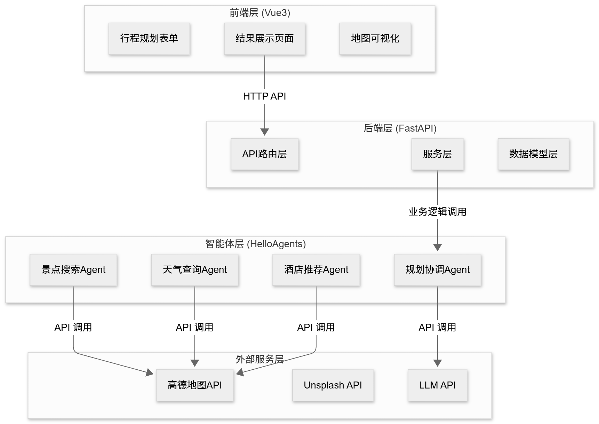
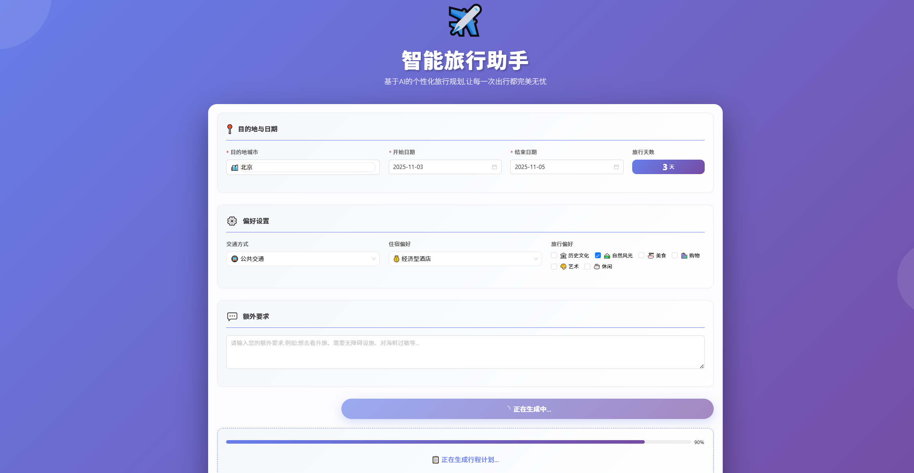
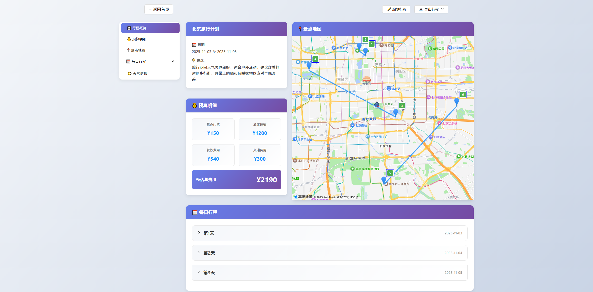
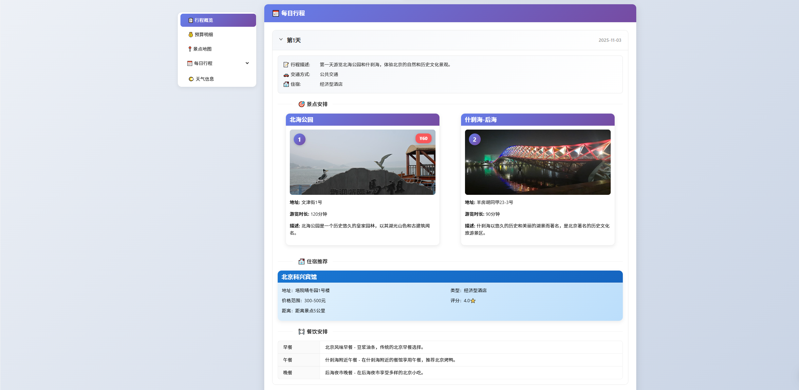
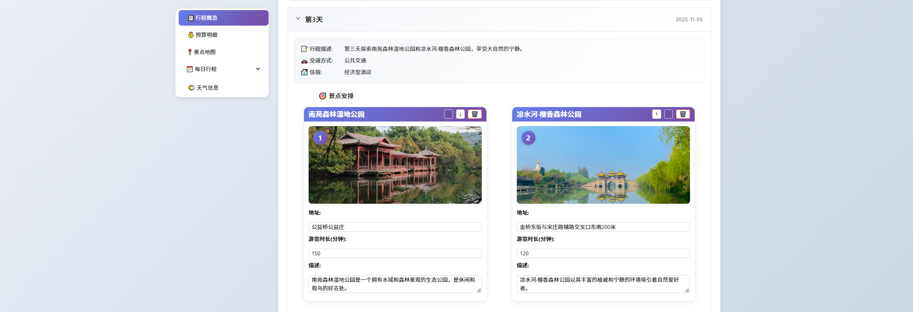
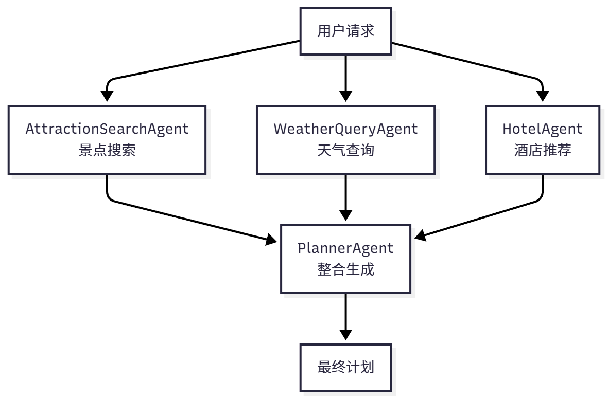
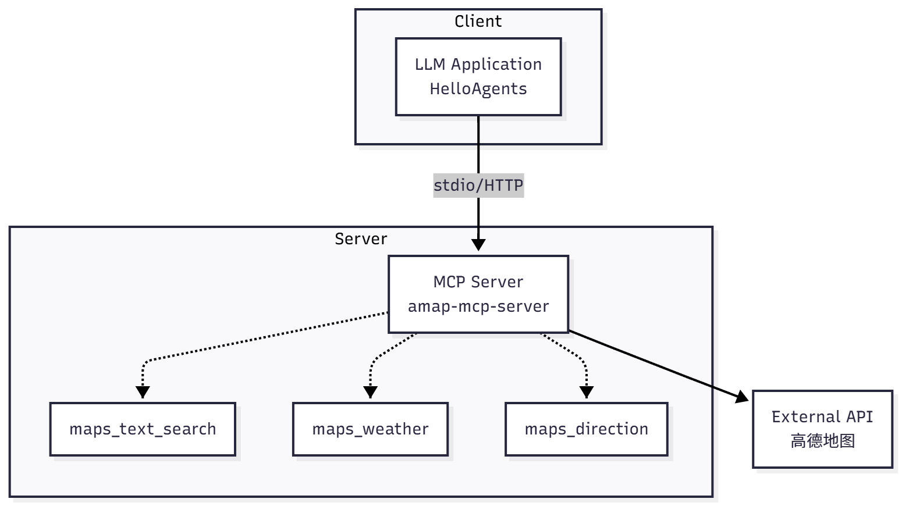
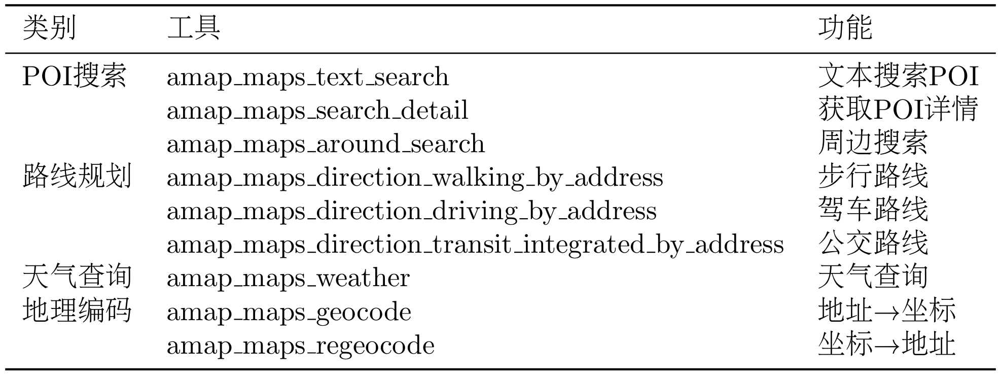
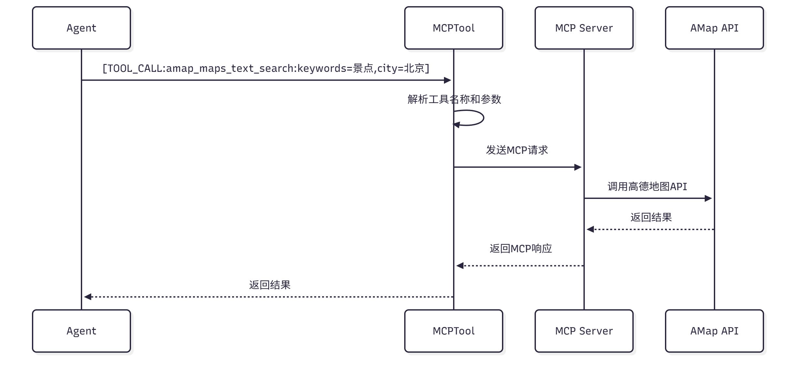
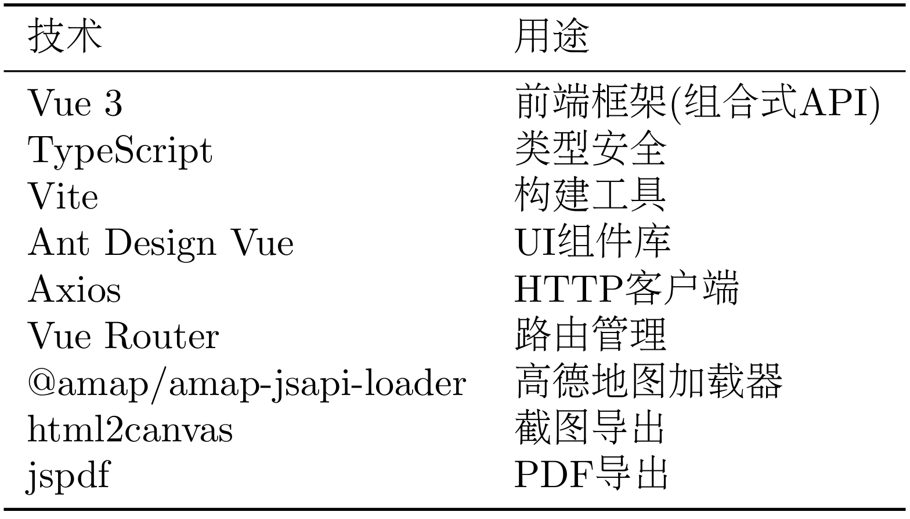

<a id="chapter-13-intelligent-travel-assistant"></a>
<a id="第十三章-智能旅行助手"></a>

In previous chapters, we built the HelloAgents framework from scratch, implementing core functionalities including various agent paradigms, tool systems, memory mechanisms, protocol communication, and performance evaluation. Starting from this chapter, we will enter a completely new phase: **integrating all learned knowledge to build complete practical applications.**

在前面的章节中，我们从零开始构建了 HelloAgents 框架，实现了多种智能体范式、工具系统、记忆机制、协议通信和性能评估等核心功能。从本章开始，我们将进入一个全新的阶段：<strong>将所学知识融会贯通，构建完整的实用应用。</strong>

Do you remember the first agent we built in Chapter 1? It was a simple intelligent travel assistant that demonstrated the basic principles of the `Thought-Action-Observation` loop. The intelligent travel assistant in this chapter will be a complete project, including the following core functions:

还记得在第一章中，我们构建的第一个智能体吗？那是一个简单的智能旅行助手，展示了`Thought-Action-Observation`循环的基本原理。本章的智能旅行助手将是一个完整的项目，包含以下核心功能：

**(1) Intelligent Itinerary Planning**: Users input destination, dates, preferences and other information, and the system automatically generates a complete itinerary plan including attractions, dining, and hotels.

<strong>（1）智能行程规划</strong>：用户输入目的地、日期、偏好等信息，系统自动生成包含景点、餐饮、酒店的完整行程计划。

**(2) Map Visualization**: Mark attraction locations on the map and draw tour routes, making the itinerary clear at a glance.

<strong>（2）地图可视化</strong>：在地图上标注景点位置、绘制游览路线，让行程一目了然。

**(3) Budget Calculation**: Automatically calculate ticket, hotel, dining, and transportation costs, displaying budget details.

<strong>（3）预算计算</strong>：自动计算门票、酒店、餐饮、交通费用，显示预算明细。

**(4) Itinerary Editing**: Support adding, deleting, and adjusting attractions, updating the map in real-time.

<strong>（4）行程编辑</strong>：支持添加、删除、调整景点，实时更新地图。

**(5) Export Function**: Support exporting as PDF or image, convenient for saving and sharing.

<strong>（5）导出功能</strong>：支持导出为 PDF 或图片，方便保存和分享。

<a id="131-project-overview-and-architecture-design"></a>
<a id="131-项目概述与架构设计"></a>

## 13.1 Project Overview and Architecture Design / 项目概述与架构设计

<a id="1311-why-we-need-an-intelligent-travel-assistant"></a>
<a id="1311-为什么需要智能旅行助手"></a>

### 13.1.1 Why We Need an Intelligent Travel Assistant / 为什么需要智能旅行助手

Planning a trip is both exciting and frustrating. You need to search for attraction information online, compare different guides, check weather forecasts, book hotels, calculate budgets, and plan routes. This process may take several hours or even days. And even after spending so much time, you're not sure whether the planned itinerary is reasonable, whether you've missed any important attractions, or whether the budget is accurate.

规划一次旅行是一件既令人兴奋又令人头疼的事情。你需要在网上搜索景点信息，对比不同的攻略，查看天气预报，预订酒店，计算预算，规划路线。这个过程可能需要花费几个小时甚至几天的时间。而且即使花了这么多时间，你也不确定规划的行程是否合理，是否遗漏了什么重要的景点，预算是否准确。

Traditional travel planning methods have several pain points. First is **scattered information**. Attraction information is on travel websites, weather information is on weather websites, hotel information is on booking websites - you need to switch between multiple websites and manually integrate this information. Second is **lack of personalization**. Most guides are generic and don't consider your personal preferences, budget constraints, travel time and other factors. Finally is **difficulty in adjustment**. When you want to modify the itinerary, you may need to replan the entire trip, because the order of attractions, time arrangements, and budget are all interconnected.

传统的旅行规划方式有几个痛点。首先是<strong>信息分散</strong>。景点信息在旅游网站上，天气信息在天气网站上，酒店信息在预订网站上，你需要在多个网站之间切换，手动整合这些信息。其次是<strong>缺少个性化</strong>。大部分攻略都是通用的，不考虑你的个人偏好、预算限制、出行时间等因素。最后是<strong>难以调整</strong>。当你想修改行程时，可能需要重新规划整个行程，因为景点的顺序、时间安排、预算都是相互关联的。

AI technology provides new possibilities for solving these problems. Imagine that you only need to tell the system "I want to visit Beijing for 3 days, like history and culture, medium budget", and the system can automatically generate a complete itinerary plan for you, including which attractions to visit each day, where to eat, which hotel to stay at, and how much budget is needed. Moreover, this plan is adjustable - you can delete attractions you don't like, adjust the tour order, and the system will automatically update the map and budget.

AI 技术为解决这些问题提供了新的可能。想象一下，你只需要告诉系统"我想去北京玩 3 天，喜欢历史文化，预算中等"，系统就能自动为你生成一个完整的行程计划，包括每天去哪些景点、在哪里吃饭、住哪个酒店、需要多少预算。而且这个计划是可以调整的，你可以删除不喜欢的景点，调整游览顺序，系统会自动更新地图和预算。

This is the intelligent travel assistant we want to build. It's not just a technical demonstration, but a truly useful application. Through this project, you will learn how to apply AI technology to practical problems, how to design multi-agent systems, and how to build complete Web applications.

这就是我们要构建的智能旅行助手。它不仅仅是一个技术演示，而是一个真正有用的应用。通过这个项目，你会学到如何将 AI 技术应用到实际问题中，如何设计多智能体系统，如何构建完整的 Web 应用。

<a id="1312-technical-architecture-overview"></a>
<a id="1312-技术架构概览"></a>

### 13.1.2 Technical Architecture Overview / 技术架构概览

The system adopts the classic **front-end and back-end separation architecture**, divided into four layers, as shown in Figure 13.1:

系统采用经典的<strong>前后端分离架构</strong>，分为四个层次，如图 13.1 所示：



Figure 13.1 Intelligent Travel Assistant Technical Architecture

图 13.1 智能旅行助手技术架构

**(1) Front-end Layer (Vue3+TypeScript)**: Responsible for user interaction and data display, including form input, result display, and map visualization.

<strong>（1）前端层 (Vue3+TypeScript)</strong>：负责用户交互和数据展示，包括表单输入、结果展示、地图可视化。

**(2) Back-end Layer (FastAPI)**: Responsible for API routing, data validation, and business logic.

<strong>（2）后端层 (FastAPI)</strong>：负责 API 路由、数据验证、业务逻辑。

**(3) Agent Layer (HelloAgents)**: Responsible for task decomposition, tool invocation, and result integration. Includes 4 specialized Agents.

<strong>（3）智能体层 (HelloAgents)</strong>：负责任务分解、工具调用、结果整合。包含 4 个专门的 Agent。

**(4) External Service Layer**: Provides data and capabilities, including Amap API, Unsplash API, and LLM API.

<strong>（4）外部服务层</strong>：提供数据和能力，包括高德地图 API、Unsplash API、LLM API。

The data flow process is as follows: User fills out form on front-end → Back-end validates data → Calls agent system → Agents sequentially call attraction search, weather query, hotel recommendation, itinerary planning Agents → Each Agent calls external APIs through MCP protocol → Integrate results and return to front-end → Front-end renders and displays.

数据流转过程如下：用户在前端填写表单 → 后端验证数据 → 调用智能体系统 → 智能体依次调用景点搜索、天气查询、酒店推荐、行程规划 Agent → 每个 Agent 通过 MCP 协议调用外部 API → 整合结果返回前端 → 前端渲染展示。

The project structure reference is as follows, provided for easy source code location:

项目的结构参考如下，提供便于定位源码：

```
helloagents-trip-planner/
├── backend/                    # Backend code
│   ├── app/
│   │   ├── agents/            # Agent implementation
│   │   ├── api/               # API routes
│   │   ├── models/            # Data models
│   │   ├── services/          # Service layer
│   │   └── config.py          # Configuration file
│   └── requirements.txt       # Python dependencies
│
└── frontend/                   # Frontend code
    ├── src/
    │   ├── views/             # Page components
    │   ├── services/          # API services
    │   ├── types/             # Type definitions
    │   └── router/            # Route configuration
    └── package.json           # npm dependencies
```

**中文对照**

```
helloagents-trip-planner/
├── backend/                    # 后端代码
│   ├── app/
│   │   ├── agents/            # 智能体实现
│   │   ├── api/               # API路由
│   │   ├── models/            # 数据模型
│   │   ├── services/          # 服务层
│   │   └── config.py          # 配置文件
│   └── requirements.txt       # Python依赖
│
└── frontend/                   # 前端代码
    ├── src/
    │   ├── views/             # 页面组件
    │   ├── services/          # API服务
    │   ├── types/             # 类型定义
    │   └── router/            # 路由配置
    └── package.json           # npm依赖
```

Detailed architecture design and data flow will be introduced in subsequent sections.

详细的架构设计和数据流转将在后续章节中介绍。

<a id="1313-quick-experience-run-the-project-in-5-minutes"></a>
<a id="1313-快速体验5-分钟运行项目"></a>

### 13.1.3 Quick Experience: Run the Project in 5 Minutes / 快速体验：5 分钟运行项目

Before diving into implementation details, let's first run the project to see the final effect. This way you will have an intuitive understanding of the entire system.

在深入学习实现细节之前，让我们先把项目跑起来，看看最终的效果。这样你会对整个系统有一个直观的认识。

**Environment Requirements:**

<strong>环境要求：</strong>

- Python 3.10 or higher

  Python 3.10 或更高版本

- Node.js 16.0 or higher

  Node.js 16.0 或更高版本

- npm 8.0 or higher

  npm 8.0 或更高版本

**Obtain API Keys:**

<strong>获取 API 密钥：</strong>

You need to prepare the following API keys:

你需要准备以下 API 密钥：

- LLM API (OpenAI, DeepSeek, etc.)

  LLM 的 API(OpenAI、DeepSeek 等)

- Amap Web Service Key: Visit https://console.amap.com/ to register and create an application

  高德地图 Web 服务 Key：访问 https://console.amap.com/ 注册并创建应用

- Unsplash Access Key: Visit https://unsplash.com/developers to register and create an application

  Unsplash Access Key：访问 https://unsplash.com/developers 注册并创建应用

Put all API keys in the `.env` file.

将所有 API 密钥放入`.env`文件。

Start the backend:

启动后端：

```bash
# 1. Enter backend directory
cd helloagents-trip-planner/backend

# 2. Install dependencies
pip install -r requirements.txt

# 3. Configure environment variables
cp .env.example .env
# Edit .env file, fill in your API keys

# 4. Start backend service
uvicorn app.api.main:app --reload
# or
python run.py
```

After successful startup, visit http://localhost:8000/docs to see the API documentation.

成功启动后，访问 http://localhost:8000/docs 可以看到 API 文档。

Open a new terminal window:

打开新的终端窗口：

```bash
# 1. Enter frontend directory
cd helloagents-trip-planner/frontend

# 2. Install dependencies
npm install

# 3. Start frontend service
npm run dev
```

After successful startup, visit http://localhost:5173 to use the application.

成功启动后，访问 http://localhost:5173 即可使用应用。

Experience core functions:

体验核心功能：

First, fill in the destination city, travel dates, preferences, budget, transportation and accommodation types in the homepage form. After clicking the "Start Planning" button, the system will display a loading progress bar and quickly generate a result page, as shown in Figure 13.2.

首先需在首页表单中填写目的地城市、旅行日期、偏好、预算、交通及住宿类型等信息。点击“开始规划”按钮后，系统会显示加载进度条，并很快生成结果页面，如图 13.2 所示。



Figure 13.2 Travel Assistant Planning Progress Page

图 13.2 旅行助手规划进行页面

After successful loading, the page will clearly display itinerary overview, budget details, attraction map, daily itinerary details and weather information, as shown in Figures 13.3 and 13.4.

随后加载成功，该页面会清晰展示行程概览、预算明细、景点地图、每日行程详情和天气信息，如图 13.3，13.4 所示。



Figure 13.3 Travel Assistant Planning Completion Page

图 13.3 旅行助手规划完成页面



Figure 13.4 Travel Assistant Planning Completion Page

图 13.4 旅行助手规划完成页面

If users need personalized adjustments, they can click the "Edit Itinerary" button to freely adjust the order of attractions or delete certain attractions, as shown in Figure 13.5. After planning is complete, through the "Export Itinerary" dropdown menu, the final plan can be easily saved as an image or PDF file for convenient reference at any time.

如果用户需要个性化调整，可以点击“编辑行程”按钮，自由调整景点顺序或删除某个景点，如图 13.5 所示。规划完成后，通过“导出行程”下拉菜单，即可将最终方案轻松保存为图片或 PDF 文件，方便随时查阅。



Figure 13.5 Travel Assistant Planning Completion Page

图 13.5 旅行助手规划完成页面

<a id="132-data-model-design"></a>
<a id="132-数据模型设计"></a>

## 13.2 Data Model Design / 数据模型设计

<a id="1321-data-flow-in-web-applications"></a>
<a id="1321-web-应用中的数据流转"></a>

### 13.2.1 Data Flow in Web Applications / Web 应用中的数据流转

When building an intelligent travel assistant, we need to solve a core problem: **How to represent and transfer travel plan data?**

在构建智能旅行助手时，我们需要解决一个核心问题：<strong>如何表示和传递旅行计划数据?</strong> 

We need to understand how data flows in a complete Web application. Imagine what happens when a user clicks the "Start Planning" button in the browser?

我们需要理解一个完整的 Web 应用中数据是如何流转的。想象一下，当用户在浏览器中点击"开始规划"按钮时，会发生什么？

The form data filled in by the user on the front-end (destination, dates, budget, etc.) needs to be sent to the back-end server through HTTP requests. After the back-end receives the data, it will call the agent system for processing. The agents will then call external services such as Amap API and Unsplash API to obtain data. The data formats returned by these external APIs are different - some use `lng`, some use `lon`, and some use `longitude`. Finally, the back-end needs to return the processed data to the front-end, which then renders it into the page the user sees.

用户在前端填写的表单数据(目的地、日期、预算等)需要通过 HTTP 请求发送到后端服务器。后端接收到数据后，会调用智能体系统进行处理。智能体又会调用高德地图 API、Unsplash API 等外部服务获取数据。这些外部 API 返回的数据格式各不相同，有的用`lng`，有的用`lon`，有的用`longitude`。最后，后端需要将处理好的数据返回给前端，前端再渲染成用户看到的页面。

In this process, data undergoes multiple transformations: Front-end form → HTTP request → Back-end Python object → External API response → Back-end Python object → HTTP response → Front-end TypeScript object → Page display. Without a unified data format, each transformation step could go wrong. This is why we need **data models**.

在这个过程中，数据经历了多次转换：前端表单 → HTTP 请求 → 后端 Python 对象 → 外部 API 响应 → 后端 Python 对象 → HTTP 响应 → 前端 TypeScript 对象 → 页面展示。如果没有统一的数据格式，每一步转换都可能出错。这就是为什么我们需要<strong>数据模型</strong>。

<a id="1322-from-dictionaries-to-pydantic-models"></a>
<a id="1322-从字典到-pydantic-模型"></a>

### 13.2.2 From Dictionaries to Pydantic Models / 从字典到 Pydantic 模型

Let's start with the simple prototype from Chapter 1. In that prototype, we used Python dictionaries to represent attraction data:

让我们从第一章的简单原型开始。在那个原型中，我们使用 Python 字典来表示景点数据：

```python
# Chapter 1 approach: using dictionaries
attraction = {
    "name": "Forbidden City",
    "location": {"lng": 116.397128, "lat": 39.916527},
    "price": 60
}

# Access data
lng = attraction["location"]["lng"]
```

This approach is convenient in the prototype stage, but will encounter many problems in actual projects. First is the problem of **inconsistent field names**. The location data returned by Amap API is a string like `"116.397128,39.916527"`, which needs to be manually split into longitude and latitude. Unsplash API might use `longitude` and `latitude`. If we use dictionaries everywhere in the code, we need to handle these differences in every place.

这种方式在原型阶段很方便，但在实际项目中会遇到很多问题。首先是<strong>字段名不统一</strong>的问题。高德地图 API 返回的位置数据是`"116.397128，39.916527"`这样的字符串，需要手动分割成经纬度。而 Unsplash API 可能使用`longitude`和`latitude`。如果我们在代码中到处都用字典，就需要在每个地方都处理这些差异。

Second is the problem of **type safety**. Suppose we accidentally set `price` as a string `"60"`, this won't immediately error in Python, but will cause problems when calculating the total budget. Worse, this kind of error can only be discovered at runtime, and the error message may be difficult to locate.

其次是<strong>类型安全</strong>的问题。假设我们不小心把`price`写成了字符串`"60"`，在 Python 中这不会立即报错，但在计算总预算时就会出问题。更糟糕的是，这种错误只能在运行时才能发现，而且错误信息可能很难定位。

Finally is the problem of **maintainability**. When we need to add a new field to attractions (such as `rating`), we need to modify multiple places in the code. If we miss somewhere, it will lead to data inconsistency.

最后是<strong>维护性</strong>的问题。当我们需要给景点添加新字段(比如`rating`评分)时，需要在代码的多个地方修改。如果遗漏了某个地方，就会导致数据不一致。

Pydantic provides a solution. It is a Python data validation library that allows us to define data structures using classes and automatically handle validation, conversion, and serialization. Let's look at a simple example:

Pydantic 提供了一个解决方案。它是 Python 的数据验证库，可以让我们用类来定义数据结构，并自动处理验证、转换和序列化。让我们看一个简单的例子：

```python
from pydantic import BaseModel, Field

class Location(BaseModel):
    longitude: float = Field(..., description="Longitude")
    latitude: float = Field(..., description="Latitude")

class Attraction(BaseModel):
    name: str
    location: Location
    ticket_price: int = 0

# Create object
attraction = Attraction(
    name="Forbidden City",
    location=Location(longitude=116.397128, latitude=39.916527),
    ticket_price=60
)

# Type-safe access
lng = attraction.location.longitude  # IDE will provide code completion
```

This approach has several benefits. First, if we pass in the wrong type (such as setting `ticket_price` as a string), Pydantic will immediately throw an exception telling us where the error is. Second, the IDE can provide code completion and type checking based on type definitions, greatly reducing spelling errors. Finally, when we need to modify the data structure, we only need to modify the class definition, and all places using this class will automatically update.

这样做有几个好处。首先，如果我们传入了错误的类型(比如把`ticket_price`设为字符串)，Pydantic 会立即抛出异常，告诉我们哪里出错了。其次，IDE 可以根据类型定义提供代码补全和类型检查，大大减少了拼写错误。最后，当我们需要修改数据结构时，只需要修改类定义，所有使用这个类的地方都会自动更新。

<a id="1323-core-concepts-of-pydantic"></a>
<a id="1323-pydantic-的核心概念"></a>

### 13.2.3 Core Concepts of Pydantic / Pydantic 的核心概念

Before diving into designing our data models, let's first understand several core concepts of Pydantic. The foundation of Pydantic is the `BaseModel` class, and all data models need to inherit from this class. Each field can specify a type, and Pydantic will automatically perform type checking and conversion.

在深入设计我们的数据模型之前，让我们先了解 Pydantic 的几个核心概念。Pydantic 的基础是`BaseModel`类，所有的数据模型都需要继承这个类。每个字段都可以指定类型，Pydantic 会自动进行类型检查和转换。

Field definition uses the `Field` function, which can specify default values, descriptions, validation rules, etc. `...` indicates that this field is required - if this field is not provided when creating an object, Pydantic will throw an exception. We can also use `Optional` to indicate optional fields, or directly provide default values.

字段定义使用`Field`函数，它可以指定默认值、描述、验证规则等。`...`表示这个字段是必填的，如果创建对象时没有提供这个字段，Pydantic 会抛出异常。我们也可以使用`Optional`来表示可选字段，或者直接提供默认值。

```python
from pydantic import BaseModel, Field
from typing import Optional, List

class Attraction(BaseModel):
    name: str = Field(..., description="Attraction name")  # Required
    rating: float = Field(default=0.0, ge=0, le=5)  # Default value, range validation
    visit_duration: int = Field(default=60, gt=0)  # Greater than 0
    description: Optional[str] = None  # Optional field
```

Pydantic also supports nested models and lists. We can use another model as a field type in one model, allowing us to build complex data structures. For example, an attraction contains location information, and an itinerary contains multiple attractions.

Pydantic 还支持嵌套模型和列表。我们可以在一个模型中使用另一个模型作为字段类型,这样就可以构建复杂的数据结构。比如，一个景点包含位置信息，一个行程包含多个景点。

```python
class DayPlan(BaseModel):
    date: str
    attractions: List[Attraction]  # Attraction list
    hotel: Optional[Hotel] = None  # Optional hotel information
```

One of the most powerful features is **custom validators**. Sometimes the data format returned by external APIs doesn't meet our requirements, and we can use the `field_validator` decorator to customize validation and conversion logic. For example, the temperature returned by Amap is a string like `"16°C"`, and we need to convert it to a number:

最强大的功能之一是<strong>自定义验证器</strong>。有时候外部 API 返回的数据格式不符合我们的要求，我们可以使用`field_validator`装饰器来自定义验证和转换逻辑。比如，高德地图返回的温度是`"16°C"`这样的字符串，我们需要把它转换成数字：

```python
from pydantic import field_validator

class WeatherInfo(BaseModel):
    temperature: int

    @field_validator('temperature', mode='before')
    def parse_temperature(cls, v):
        """Parse temperature string: "16°C" -> 16"""
        if isinstance(v, str):
            v = v.replace('°C', '').replace('℃', '').strip()
            return int(v)
        return v
```

This validator will automatically execute before creating the object, converting the string to an integer. This way we don't need to manually handle temperature format in every place in the code.

这个验证器会在创建对象之前自动执行，将字符串转换成整数。这样我们就不需要在代码的每个地方都手动处理温度格式了。

<a id="1324-bottom-up-model-design"></a>
<a id="1324-自底向上的模型设计"></a>

### 13.2.4 Bottom-Up Model Design / 自底向上的模型设计

Now let's start designing the data models for the intelligent travel assistant. A good design principle is **bottom-up**: first define the most basic models, then gradually combine them into complex structures. The advantage of this approach is that each model is simple, easy to understand and maintain.

现在让我们开始设计智能旅行助手的数据模型。一个好的设计原则是<strong>自底向上</strong>：先定义最基础的模型，然后逐步组合成复杂的结构。这样做的好处是每个模型都很简单，容易理解和维护。

The most basic model is **location information**. Whether it's attractions, hotels, or restaurants, all need location information. We define a `Location` class to represent longitude and latitude coordinates:

最基础的模型是<strong>位置信息</strong>。无论是景点、酒店还是餐厅，都需要位置信息。我们定义一个`Location`类来表示经纬度坐标：

```python
class Location(BaseModel):
    """Location information (longitude and latitude coordinates)"""
    longitude: float = Field(..., description="Longitude", ge=-180, le=180)
    latitude: float = Field(..., description="Latitude", ge=-90, le=90)
```

Here we use range validation (`ge` means greater than or equal to, `le` means less than or equal to) to ensure longitude and latitude values are within reasonable ranges.

这里我们使用了范围验证(`ge`表示大于等于，`le`表示小于等于)，确保经纬度的值在合理范围内。

Next is **attraction information**. An attraction contains name, address, location, visit duration, description, rating, image, and ticket price information. Note that we use `Location` as a field type, which is a nested model:

接下来是<strong>景点信息</strong>。一个景点包含名称、地址、位置、游览时间、描述、评分、图片和门票价格等信息。注意我们使用了`Location`作为字段类型，这就是嵌套模型：

```python
class Attraction(BaseModel):
    """Attraction information"""
    name: str = Field(..., description="Attraction name")
    address: str = Field(..., description="Address")
    location: Location = Field(..., description="Longitude and latitude coordinates")
    visit_duration: int = Field(..., description="Recommended visit duration (minutes)", gt=0)
    description: str = Field(..., description="Attraction description")
    category: Optional[str] = Field(default="Attraction", description="Attraction category")
    rating: Optional[float] = Field(default=None, ge=0, le=5, description="Rating")
    image_url: Optional[str] = Field(default=None, description="Image URL")
    ticket_price: int = Field(default=0, ge=0, description="Ticket price (yuan)")
```

Similarly, we define **meal information** and **hotel information**. These models have similar structures, all containing basic information such as name, address, location, and cost:

类似地，我们定义<strong>餐饮信息</strong>和<strong>酒店信息</strong>。这些模型的结构都很相似，都包含名称、地址、位置和费用等基本信息：

```python
class Meal(BaseModel):
    """Meal information"""
    type: str = Field(..., description="Meal type: breakfast/lunch/dinner/snack")
    name: str = Field(..., description="Meal name")
    address: Optional[str] = Field(default=None, description="Address")
    location: Optional[Location] = Field(default=None, description="Longitude and latitude coordinates")
    description: Optional[str] = Field(default=None, description="Description")
    estimated_cost: int = Field(default=0, description="Estimated cost (yuan)")

class Hotel(BaseModel):
    """Hotel information"""
    name: str = Field(..., description="Hotel name")
    address: str = Field(default="", description="Hotel address")
    location: Optional[Location] = Field(default=None, description="Hotel location")
    price_range: str = Field(default="", description="Price range")
    rating: str = Field(default="", description="Rating")
    distance: str = Field(default="", description="Distance to attractions")
    type: str = Field(default="", description="Hotel type")
    estimated_cost: int = Field(default=0, description="Estimated cost (yuan/night)")
```

**Budget information** is a special model that doesn't contain location information, but contains a summary of various expenses:

<strong>预算信息</strong>是一个特殊的模型，它不包含位置信息，而是包含各项费用的汇总：

```python
class Budget(BaseModel):
    """Budget information"""
    total_attractions: int = Field(default=0, description="Total attraction ticket cost")
    total_hotels: int = Field(default=0, description="Total hotel cost")
    total_meals: int = Field(default=0, description="Total meal cost")
    total_transportation: int = Field(default=0, description="Total transportation cost")
    total: int = Field(default=0, description="Total cost")
```

Now we can combine these basic models to build a **daily itinerary**. A daily itinerary contains date, description, transportation method, accommodation arrangement, hotel, attraction list, and meal list:

现在我们可以组合这些基础模型，构建<strong>单日行程</strong>。一个单日行程包含日期、描述、交通方式、住宿安排、酒店、景点列表和餐饮列表：

```python
class DayPlan(BaseModel):
    """Daily itinerary"""
    date: str = Field(..., description="Date")
    day_index: int = Field(..., description="Day number (starting from 0)")
    description: str = Field(..., description="Daily itinerary description")
    transportation: str = Field(..., description="Transportation method")
    accommodation: str = Field(..., description="Accommodation arrangement")
    hotel: Optional[Hotel] = Field(default=None, description="Hotel information")
    attractions: List[Attraction] = Field(default_factory=list, description="Attraction list")
    meals: List[Meal] = Field(default_factory=list, description="Meal arrangements")
```

Note that we use `List[Attraction]` to represent the attraction list, and `default_factory=list` means the default value is an empty list.

注意这里使用了`List[Attraction]`来表示景点列表，`default_factory=list`表示默认值是一个空列表。

**Weather information** requires special handling because the temperature format returned by Amap is non-standard. We use a custom validator to handle this:

<strong>天气信息</strong>需要特殊处理，因为高德地图返回的温度格式不规范。我们使用自定义验证器来处理：

```python
class WeatherInfo(BaseModel):
    """Weather information"""
    date: str = Field(..., description="Date")
    day_weather: str = Field(..., description="Daytime weather")
    night_weather: str = Field(..., description="Nighttime weather")
    day_temp: int = Field(..., description="Daytime temperature (Celsius)")
    night_temp: int = Field(..., description="Nighttime temperature (Celsius)")
    wind_direction: str = Field(..., description="Wind direction")
    wind_power: str = Field(..., description="Wind power")

    @field_validator('day_temp', 'night_temp', mode='before')
    def parse_temperature(cls, v):
        """Parse temperature string: "16°C" -> 16"""
        if isinstance(v, str):
            v = v.replace('°C', '').replace('℃', '').replace('°', '').strip()
            try:
                return int(v)
            except ValueError:
                return 0  # Error tolerance
        return v
```

Finally, we define the **complete travel plan**. This is the top-level model that contains all information:

最后，我们定义<strong>完整的旅行计划</strong>。这是最顶层的模型，包含了所有的信息：

```python
class TripPlan(BaseModel):
    """Travel plan"""
    city: str = Field(..., description="Destination city")
    start_date: str = Field(..., description="Start date")
    end_date: str = Field(..., description="End date")
    days: List[DayPlan] = Field(default_factory=list, description="Daily itinerary")
    weather_info: List[WeatherInfo] = Field(default_factory=list, description="Weather information")
    overall_suggestions: str = Field(..., description="Overall suggestions")
    budget: Optional[Budget] = Field(default=None, description="Budget information")
```

This way, we have completed the design of the entire data model. From the most basic `Location`, to `Attraction`, `Meal`, `Hotel`, then to `DayPlan`, and finally to `TripPlan`, forming a clear hierarchical structure.

这样，我们就完成了整个数据模型的设计。从最基础的`Location`，到`Attraction`、`Meal`、`Hotel`，再到`DayPlan`，最后到`TripPlan`，形成了一个清晰的层次结构。

<a id="1325-application-of-data-models-in-web-applications"></a>
<a id="1325-数据模型在-web-应用中的应用"></a>

### 13.2.5 Application of Data Models in Web Applications / 数据模型在 Web 应用中的应用

Now let's see how these data models are used in actual Web applications. In FastAPI, Pydantic models can be directly used as type definitions for requests and responses. FastAPI will automatically perform data validation, serialization, and documentation generation.

现在让我们看看这些数据模型如何在实际的 Web 应用中使用。在 FastAPI 中，Pydantic 模型可以直接用作请求和响应的类型定义。FastAPI 会自动进行数据验证、序列化和文档生成。

```python
from fastapi import FastAPI
from app.models.schemas import TripPlanRequest, TripPlan

app = FastAPI()

@app.post("/api/trip/plan", response_model=TripPlan)
async def create_trip_plan(request: TripPlanRequest) -> TripPlan:
    """
    Create travel plan

    FastAPI automatically:
    1. Validates request data (TripPlanRequest)
    2. Validates response data (TripPlan)
    3. Generates OpenAPI documentation
    """
    trip_plan = await generate_trip_plan(request)
    return trip_plan
```

When a user sends a POST request to `/api/trip/plan`, FastAPI will automatically convert the JSON data into a `TripPlanRequest` object. If the data format is incorrect (such as missing required fields or type mismatch), FastAPI will automatically return a 400 error and tell the user where the error is.

当用户发送 POST 请求到`/api/trip/plan`时，FastAPI 会自动将 JSON 数据转换成`TripPlanRequest`对象。如果数据格式不正确(比如缺少必填字段，或者类型不匹配)，FastAPI 会自动返回 400 错误，并告诉用户哪里出错了。

On the front-end, we also need to define corresponding TypeScript types. Although TypeScript and Python are different languages, the data structures are the same:

在前端，我们也需要定义对应的 TypeScript 类型。虽然 TypeScript 和 Python 是不同的语言，但数据结构是一样的：

```typescript
interface Location {
  longitude: number;
  latitude: number;
}

interface Attraction {
  name: string;
  address: string;
  location: Location;
  visit_duration: number;
  ticket_price: number;
}

interface TripPlan {
  city: string;
  start_date: string;
  end_date: string;
  days: DayPlan[];
}
```

This way, the front-end and back-end use a unified data format. When the back-end returns a `TripPlan` object, the front-end can use it directly without any conversion. TypeScript's type checking can also help us avoid many errors.

这样，前后端就使用了统一的数据格式。当后端返回`TripPlan`对象时，前端可以直接使用，不需要任何转换。TypeScript 的类型检查也能帮助我们避免很多错误。

<a id="133-multi-agent-collaboration-design"></a>
<a id="133-多智能体协作设计"></a>

## 13.3 Multi-Agent Collaboration Design / 多智能体协作设计

<a id="1331-why-we-need-multi-agent"></a>
<a id="1331-为何需要多智能体"></a>

### 13.3.1 Why We Need Multi-Agent / 为何需要多智能体

In Chapter 7, we learned how to build agents using SimpleAgent. The design philosophy of SimpleAgent is simple and direct: each time the `run()` method is called, the Agent analyzes the user's question, decides whether to call tools, and then returns the result. This design is very effective when handling simple tasks, but when facing tasks like travel planning, some problems arise.

在第七章中，我们学习了如何使用 SimpleAgent 来构建智能体。SimpleAgent 的设计理念是简单直接：每次调用`run()`方法时，Agent 会分析用户的问题，决定是否需要调用工具，然后返回结果。这种设计在处理简单任务时非常有效，但当面对旅行规划这样的任务时，就会遇到一些问题。

If we use a single Agent to complete travel planning, what does this Agent need to do? First, it needs to search for attraction information, which requires calling Amap's POI search tool. Then, it needs to query weather information, which requires calling the weather query tool. Next, it needs to search for hotel information, which again requires calling the POI search tool. Finally, it needs to integrate all this information to generate a complete travel plan.

如果用单个 Agent 来完成旅行规划。这个 Agent 需要做什么呢？首先，它要搜索景点信息，这需要调用高德地图的 POI 搜索工具。然后，它要查询天气信息，这需要调用天气查询工具。接着，它要搜索酒店信息，这又需要调用 POI 搜索工具。最后，它要把所有这些信息整合起来，生成一个完整的旅行计划。

This sounds simple, but in actual operation, the first problem is encountered: **tool calling limitations**. SimpleAgent can only execute one tool per `run()` call. This means we need to call the `run()` method multiple times, with each call handling one task. But this brings a new problem: how to pass information between multiple calls? How to pass the attraction information obtained from the first call to the second call? We need to manually manage these intermediate results, and the code becomes very complex.

这听起来很简单，但实际操作时会遇到第一个问题：<strong>工具调用的限制</strong>。SimpleAgent 每次`run()`调用只能执行一个工具。这意味着我们需要多次调用`run()`方法，每次调用处理一个任务。但这样做会带来一个新问题：如何在多次调用之间传递信息？第一次调用得到的景点信息，如何传递给第二次调用？我们需要手动管理这些中间结果，代码会变得很复杂。

Of course, we can use ReactAgent to solve this problem. ReactAgent can execute multiple tools in one call, and it will automatically perform multiple rounds of thinking and action. But this brings new problems: **time cost**. Each round of thinking by ReactAgent requires calling the LLM. If three tools need to be called, at least three rounds of thinking are needed, which means at least three LLM calls. Moreover, these calls are serial - the next one can only start after the previous one is complete, so the total time will be very long.

当然，我们可以使用 ReactAgent 来解决这个问题。ReactAgent 可以在一次调用中执行多个工具，它会自动进行多轮思考和行动。但这又带来了新的问题：<strong>时间成本</strong>。ReactAgent 的每一轮思考都需要调用 LLM，如果需要调用三个工具，就需要至少三轮思考，这意味着至少三次 LLM 调用。而且这些调用是串行的，必须等前一个完成才能开始下一个，总时间会很长。

The second problem is **prompt complexity**. If we want one Agent to complete all tasks, we need to describe the execution logic of each task in detail in the prompt. For example:

第二个问题是<strong>提示词的复杂度</strong>。如果我们要让一个 Agent 完成所有任务，就需要在提示词中详细描述每个任务的执行逻辑。比如：

```python
COMPLEX_PROMPT = """You are a travel planning assistant. You need to:
1. Use maps_text_search to search for attractions, keywords determined by user preferences
2. Use maps_weather to query weather, get weather forecast for the next few days
3. Use maps_text_search to search for hotels, type determined by user needs
4. Integrate all information to generate travel plan, including daily attractions, dining, accommodation arrangements
Note: Must execute in order, each tool can only be called once, output must be in JSON format...
"""
```

This kind of prompt has several problems. First is **difficult to maintain**. If we want to modify the attraction search logic (such as adding rating filtering), we need to modify the entire prompt, which can easily affect other parts. Second is **error-prone**. The LLM needs to understand the requirements of multiple tasks simultaneously, and can easily confuse the formats and parameters of different tasks. Finally is **difficult to debug**. When the generated plan doesn't meet expectations, it's hard to know which part went wrong - is the attraction search inaccurate, did the weather query fail, or is there a problem with the integration logic?

这样的提示词有几个问题。首先是<strong>难以维护</strong>。如果我们想修改景点搜索的逻辑(比如增加评分筛选)，就需要修改整个提示词，很容易影响到其他部分。其次是<strong>容易出错</strong>。LLM 需要同时理解多个任务的要求，很容易搞混不同任务的格式和参数。最后是<strong>难以调试</strong>。当生成的计划不符合预期时，我们很难知道是哪个环节出了问题，是景点搜索不准确，还是天气查询失败，还是整合逻辑有问题？

Facing these problems, a natural idea is: can we decompose complex tasks into multiple simple tasks and let different Agents each do their own job? This is the core idea of multi-Agent collaboration.

面对这些问题，一个自然的想法是：能不能把复杂的任务分解成多个简单的任务，让不同的 Agent 各司其职？这就是多 Agent 协作的核心思想。

Imagine a travel agency in the real world. When you go to a travel agency to consult about a travel plan, you won't be served by just one person. Usually there will be a dedicated attraction consultant responsible for recommending attractions; a hotel consultant responsible for booking hotels; and an itinerary planner responsible for integrating all information into a complete itinerary. Each person focuses on their area of expertise, and finally the itinerary planner summarizes all the information. This division of labor and collaboration is much more efficient than having one person do everything.

想象一下现实世界中的旅行社。当你去旅行社咨询旅行计划时，不会只有一个人为你服务。通常会有专门的景点顾问，负责推荐景点；有酒店顾问，负责预订酒店；还有行程规划师，负责把所有信息整合成完整的行程。每个人都专注于自己擅长的领域，最后由行程规划师把所有信息汇总。这种分工协作的方式，比让一个人做所有事情要高效得多。

<a id="1332-agent-role-design"></a>
<a id="1332-agent-角色设计"></a>

### 13.3.2 Agent Role Design / Agent 角色设计

Based on the task decomposition principle, we designed four specialized Agents, as shown in Figure 13.6:

基于任务分解原则，我们设计了四个专门的 Agent，如图 13.6 所示:



Figure 13.6 Multi-Agent Collaboration Flow

图 13.6 多智能体协作流程

- **AttractionSearchAgent (Attraction Search Expert)** focuses on searching for attraction information. It only needs to understand user preferences (such as "history and culture", "natural scenery"), then call Amap's POI search tool and return a list of related attractions. Its prompt is very simple, only needing to explain how to choose keywords based on preferences and how to call tools.

  <strong>AttractionSearchAgent(景点搜索专家)</strong>专注于搜索景点信息。它只需要理解用户的偏好(比如"历史文化"、"自然风光")，然后调用高德地图的 POI 搜索工具，返回相关的景点列表。它的提示词很简单，只需要说明如何根据偏好选择关键词，如何调用工具。

- **WeatherQueryAgent (Weather Query Expert)** focuses on querying weather information. It only needs to know the city name, then call the weather query tool and return the weather forecast for the next few days. Its task is very clear and almost error-free.

  <strong>WeatherQueryAgent(天气查询专家)</strong>专注于查询天气信息。它只需要知道城市名称，然后调用天气查询工具，返回未来几天的天气预报。它的任务非常明确，几乎不会出错。

- **HotelAgent (Hotel Recommendation Expert)** focuses on searching for hotel information. It needs to understand user accommodation needs (such as "budget", "luxury"), then call the POI search tool and return a list of hotels that meet the requirements.

  <strong>HotelAgent(酒店推荐专家)</strong>专注于搜索酒店信息。它需要理解用户的住宿需求(比如"经济型"、"豪华型")，然后调用 POI 搜索工具，返回符合要求的酒店列表。

- **PlannerAgent (Itinerary Planning Expert)** is responsible for integrating all information. It receives the output from the first three Agents, plus the user's original requirements (dates, budget, etc.), and then generates a complete travel plan. It doesn't need to call any external tools, only needs to focus on information integration and itinerary arrangement.

  <strong>PlannerAgent(行程规划专家)</strong>负责整合所有信息。它接收前三个 Agent 的输出，加上用户的原始需求(日期、预算等)，然后生成完整的旅行计划。它不需要调用任何外部工具，只需要专注于信息的整合和行程的安排。

Now let's design the role and prompt for each Agent in detail. When designing prompts, we need to consider several key questions: What input does this Agent need? What output should it produce? What tools does it need to call? What problems might it encounter?

现在让我们详细设计每个 Agent 的角色和提示词。设计提示词时，我们需要考虑几个关键问题：这个 Agent 需要什么输入？它应该产生什么输出？它需要调用什么工具？它可能遇到什么问题？

**AttractionSearchAgent**'s task is to search for attractions based on user preferences. Its input is the city name and user preferences (such as "history and culture", "natural scenery"). It needs to call the `amap_maps_text_search` tool with parameters being keywords and city. Its output is a list of attractions, including name, address, rating, and other information.

<strong>AttractionSearchAgent</strong>的任务是根据用户偏好搜索景点。它的输入是城市名称和用户偏好(比如"历史文化"、"自然风光")。它需要调用`amap_maps_text_search`工具，参数是关键词和城市。它的输出是景点列表，包含名称、地址、评分等信息。

```python
ATTRACTION_AGENT_PROMPT = """You are an attraction search expert.

**Tool Call Format:**
`[TOOL_CALL:amap_maps_text_search:keywords=attraction,city=city_name]`

**Examples:**
- `[TOOL_CALL:amap_maps_text_search:keywords=attraction,city=Beijing]`
- `[TOOL_CALL:amap_maps_text_search:keywords=museum,city=Shanghai]`

**Important:**
- Must use tools to search, don't fabricate information
- Search for attractions in {city} based on user preferences ({preferences})
"""
```

This prompt is concise but contains all necessary information. It clearly explains the tool call format, provides specific examples, and emphasizes two important principles: must use tools (can't fabricate) and search based on user preferences.

这个提示词很简洁，但包含了所有必要的信息。它明确说明了工具调用的格式，提供了具体的示例，还强调了两个重要原则：必须使用工具(不能编造)，要根据用户偏好搜索。

**WeatherQueryAgent**'s task is simpler, only needing to query weather. Its input is the city name, and output is weather information.

<strong>WeatherQueryAgent</strong>的任务更简单，只需要查询天气。它的输入是城市名称，输出是天气信息。

```python
WEATHER_AGENT_PROMPT = """You are a weather query expert.

**Tool Call Format:**
`[TOOL_CALL:amap_maps_weather:city=city_name]`

Please query weather information for {city}.
"""
```

**HotelAgent**'s task is to search for hotels. Its input is the city name and accommodation type, and output is a hotel list.

<strong>HotelAgent</strong>的任务是搜索酒店。它的输入是城市名称和住宿类型，输出是酒店列表。

```python
HOTEL_AGENT_PROMPT = """You are a hotel recommendation expert.

**Tool Call Format:**
`[TOOL_CALL:amap_maps_text_search:keywords=hotel,city=city_name]`

Please search for {accommodation} hotels in {city}.
"""
```

**PlannerAgent** is the most complex because it needs to integrate all information. Its input is user requirements and the output from the first three Agents, and output is a complete travel plan (JSON format).

<strong>PlannerAgent</strong>是最复杂的，因为它需要整合所有信息。它的输入是用户需求和前三个 Agent 的输出，输出是完整的旅行计划(JSON 格式)。

```python
PLANNER_AGENT_PROMPT = """You are an itinerary planning expert.

**Output Format:**
Strictly return in the following JSON format:
{
  "city": "city name",
  "start_date": "YYYY-MM-DD",
  "end_date": "YYYY-MM-DD",
  "days": [...],
  "weather_info": [...],
  "overall_suggestions": "overall suggestions",
  "budget": {...}
}

**Planning Requirements:**
1. weather_info must include weather for each day
2. Temperature as pure numbers (without °C)
3. Arrange 2-3 attractions per day
4. Consider attraction distance and visit time
5. Include breakfast, lunch, and dinner
6. Provide practical suggestions
7. Include budget information
"""
```

<a id="1333-agent-collaboration-flow"></a>
<a id="1333-agent-协作流程"></a>

### 13.3.3 Agent Collaboration Flow / Agent 协作流程

Now let's see how these four Agents collaborate to complete the travel planning task. The entire flow can be divided into five steps:

现在让我们看看这四个 Agent 如何协作完成旅行规划任务。整个流程可以分为五个步骤：

```python
class TripPlannerAgent:
    def __init__(self):
        self.attraction_agent = SimpleAgent(name="Attraction Search", prompt=ATTRACTION_PROMPT)
        self.weather_agent = SimpleAgent(name="Weather Query", prompt=WEATHER_PROMPT)
        self.hotel_agent = SimpleAgent(name="Hotel Recommendation", prompt=HOTEL_PROMPT)
        self.planner_agent = SimpleAgent(name="Itinerary Planning", prompt=PLANNER_PROMPT)

    def plan_trip(self, request: TripPlanRequest) -> TripPlan:
        # Step 1: Attraction search
        attraction_response = self.attraction_agent.run(
            f"Please search for {request.preferences} attractions in {request.city}"
        )

        # Step 2: Weather query
        weather_response = self.weather_agent.run(
            f"Please query weather for {request.city}"
        )

        # Step 3: Hotel recommendation
        hotel_response = self.hotel_agent.run(
            f"Please search for {request.accommodation} hotels in {request.city}"
        )

        # Step 4: Integrate and generate plan
        planner_query = self._build_planner_query(
            request, attraction_response, weather_response, hotel_response
        )
        planner_response = self.planner_agent.run(planner_query)

        # Step 5: Parse JSON
        trip_plan = self._parse_trip_plan(planner_response)
        return trip_plan
```

This flow executes four steps sequentially, with the output of each step serving as input for the next step. Note that we use the `TripPlanRequest` and `TripPlan` Pydantic models defined in Section 13.2.

这个流程顺序执行四个步骤，每个步骤的输出作为下一个步骤的输入。注意我们使用了`TripPlanRequest`和`TripPlan`这两个 Pydantic 模型，这是在 13.2 节中定义的。

<a id="1334-query-construction"></a>
<a id="1334-查询构建"></a>

### 13.3.4 Query Construction / 查询构建

PlannerAgent needs to integrate all information. This query needs to include all necessary information and be organized clearly and orderly so that the LLM can accurately understand it.

PlannerAgent 需要整合所有信息，这个查询需要包含所有必要的信息，而且要组织得清晰有序，让 LLM 能够准确理解。

```python
def _build_planner_query(
    self,
    request: TripPlanRequest,
    attraction_response: str,
    weather_response: str,
    hotel_response: str
) -> str:
    """Build query for planning Agent"""
    return f"""
Please generate a {request.days}-day travel plan for {request.city} based on the following information:

**User Requirements:**
- Destination: {request.city}
- Dates: {request.start_date} to {request.end_date}
- Days: {request.days} days
- Preferences: {request.preferences}
- Budget: {request.budget}
- Transportation: {request.transportation}
- Accommodation: {request.accommodation}

**Attraction Information:**
{attraction_response}

**Weather Information:**
{weather_response}

**Hotel Information:**
{hotel_response}

Please generate a detailed travel plan, including daily attraction arrangements, dining recommendations, accommodation information, and budget details.
"""
```

Through this multi-Agent collaboration design, we decompose a complex travel planning task into four simple subtasks. Each Agent focuses on its area of expertise, and also lays a good foundation for future feature expansion (such as adding restaurant recommendation Agent, transportation planning Agent).

通过这种多 Agent 协作的设计，我们把一个复杂的旅行规划任务分解成了四个简单的子任务。每个 Agent 都专注于自己擅长的领域，也为未来的功能扩展(比如添加餐厅推荐 Agent、交通规划 Agent)打下了良好的基础。

<a id="134-mcp-tool-integration-details"></a>
<a id="134-mcp-工具集成详解"></a>

## 13.4 MCP Tool Integration Details / MCP 工具集成详解

<a id="1341-why-not-call-apis-directly"></a>
<a id="1341-为什么不直接调用-api"></a>

### 13.4.1 Why Not Call APIs Directly / 为什么不直接调用 API

In Section 13.3, we designed four Agents to collaborate on the travel planning task. Among them, AttractionSearchAgent, WeatherQueryAgent, and HotelAgent all need to call Amap's API to obtain data. A natural question is: why not call Amap's HTTP API directly in the Agent?

在 13.3 节中，我们设计了四个 Agent 来协作完成旅行规划任务。其中 AttractionSearchAgent、WeatherQueryAgent 和 HotelAgent 都需要调用高德地图的 API 来获取数据。一个自然的问题是：为什么不直接在 Agent 中调用高德地图的 HTTP API？

Let's first see what calling the API directly would look like. Amap provides a POI search API, and we need to construct HTTP requests, pass parameters, and parse responses:

让我们先看看直接调用 API 会是什么样子。高德地图提供了 POI 搜索 API，我们需要构造 HTTP 请求，传递参数，解析响应：

```python
import requests

def search_poi(keywords: str, city: str, api_key: str):
    """Directly call Amap POI search API"""
    url = "https://restapi.amap.com/v3/place/text"
    params = {
        "keywords": keywords,
        "city": city,
        "key": api_key,
        "output": "json"
    }
    response = requests.get(url, params=params)
    data = response.json()
    return data
```

This approach looks simple, but will encounter several problems in actual use. First is **Agent cannot call autonomously**. In our HelloAgents framework, Agents call tools by recognizing tool call markers in prompts (such as `[TOOL_CALL:tool_name:arg1=value1]`). If we call the API directly in code, the Agent loses its autonomous decision-making ability and becomes a simple function call.

这种方式看起来很简单，但在实际使用中会遇到几个问题。首先是<strong>Agent 无法自主调用</strong>。在我们的 HelloAgents 框架中，Agent 通过识别提示词中的工具调用标记(比如`[TOOL_CALL:tool_name:arg1=value1]`)来调用工具。如果我们直接在代码中调用 API，Agent 就失去了自主决策的能力，变成了一个简单的函数调用。

Second is **complex parameter passing**. Amap's API has many parameters. For example, POI search has more than a dozen parameters such as `keywords`, `city`, `types`, `offset`, `page`, etc. If we want the Agent to use these parameters flexibly, we need to explain the meaning and format of each parameter in detail in the prompt, which will make the prompt very complex.

其次是<strong>参数传递复杂</strong>。高德地图的 API 有很多参数，比如 POI 搜索有`keywords`、`city`、`types`、`offset`、`page`等十几个参数。如果我们要让 Agent 能够灵活使用这些参数，就需要在提示词中详细说明每个参数的含义和格式，这会让提示词变得非常复杂。

Third is **difficult response parsing**. The data returned by Amap API is in JSON format with a relatively complex structure. We need to write code to parse this data and extract the fields we need. If the API's response format changes, we need to modify the parsing code.

第三是<strong>响应解析困难</strong>。高德地图 API 返回的是 JSON 格式的数据，结构比较复杂。我们需要编写代码来解析这些数据，提取我们需要的字段。如果 API 的响应格式发生变化，我们就需要修改解析代码。

Finally is **chaotic tool management**. Amap provides more than a dozen different APIs (POI search, weather query, route planning, etc.). If we write a function for each API and then manually register it to the Agent's tool list, the code will become very lengthy. And when we want to add a new API, we need to modify multiple places.

最后是<strong>工具管理混乱</strong>。高德地图提供了十几个不同的 API(POI 搜索、天气查询、路线规划等)，如果我们为每个 API 都编写一个函数，然后手动注册到 Agent 的工具列表中，代码会变得很冗长。而且当我们想添加新的 API 时，需要修改多个地方。

<a id="1342-amap-mcp-integration"></a>
<a id="1342-高德地图-mcp-集成"></a>

### 13.4.2 Amap MCP Integration / 高德地图 MCP 集成

MCP (Model Context Protocol) is a standardized protocol proposed by Anthropic for connecting LLMs and external tools. This section will introduce how to integrate the Amap MCP server in the project. Our project uses `amap-mcp-server`, which is an MCP server implemented in Node.js:

MCP(Model Context Protocol)是 Anthropic 提出的标准化协议，用于连接 LLM 和外部工具。本节将介绍如何在项目中集成高德地图 MCP 服务器。我们的项目用的是`amap-mcp-server`，这是一个用 Node.js 实现的 MCP 服务器：



Figure 13.7 amap-mcp-server Tools

图 13.7 amap-mcp-server 工具

The Amap MCP server provides various tools, mainly divided into the following categories, as shown in Table 13.1:

高德地图 MCP 服务器提供了多种工具，主要分为以下类别，如表 13.1 所示:



Table 13.1 Amap MCP Tool Categories

表 13.1 高德地图 MCP 工具分类

Through the MCP protocol, we can easily integrate in HelloAgents:

通过 MCP 协议，我们可以很方便地在 HelloAgents 中集成:

```python
from hello_agents.tools import MCPTool
from app.config import get_settings

settings = get_settings()

# Create MCP tool
mcp_tool = MCPTool(
    name="amap_mcp",
    command="npx",
    args=["-y", "@sugarforever/amap-mcp-server"],
    env={"AMAP_API_KEY": settings.amap_api_key},
    auto_expand=True
)
```

What does this code do? First, `command` and `args` specify how to start the MCP server. `npx -y @sugarforever/amap-mcp-server` will download and run the `amap-mcp-server` package from the npm repository. The `env` parameter passes environment variables, here we pass the Amap API key.

这段代码做了什么呢？首先，`command`和`args`指定了如何启动 MCP 服务器。`npx -y @sugarforever/amap-mcp-server`会从 npm 仓库下载并运行`amap-mcp-server`这个包。`env`参数传递了环境变量，这里我们传递了高德地图的 API 密钥。

**Note:** Some examples in this document use `npx` to launch MCP (Model Context Protocol) services. However,in the code repository corresponding to this section of content, we actually use `uvx`. It’s important to note that `npx` and `uvx` share nearly identical design principles—the only difference lies in their ecosystems: `npx` targets JavaScript/Node.js (packages from npm), while `uvx` targets Python (packages from PyPI).There is no superiority or inferiority between the two methods. Please choose according to your needs when using them.

**注意：**本文档中部分示例使用 `npx` 启动 MCP（Model Context Protocol）服务。而在本节代码仓中，我们实际采用的是 `uvx` 方式。需要说明的是，`npx` 和 `uvx` 在设计理念上高度一致，区别仅在于所处的生态系统，`npx` 面向 JavaScript/Node.js（包来自 npm），而`uvx` 面向 Python（包来自 PyPI）。两种方式并无优劣之分，请大家在使用时按需进行选择。

When we create the `MCPTool` object, it will start the MCP server process in the background and communicate with the server through standard input/output (stdin/stdout). This is a feature of the MCP protocol: using inter-process communication instead of HTTP, which is more efficient and easier to manage.

当我们创建`MCPTool`对象时，它会在后台启动 MCP 服务器进程，并通过标准输入输出(stdin/stdout)与服务器通信。这是 MCP 协议的一个特点：使用进程间通信而不是 HTTP，这样更高效，也更容易管理。

The most critical parameter is `auto_expand=True`. When set to True, `MCPTool` will automatically query what tools the MCP server provides, and then create an independent Tool object for each tool. This is why we only created one `MCPTool`, but the Agent got 16 tools. Let's see this process:

最关键的是`auto_expand=True`这个参数。当设置为 True 时，`MCPTool`会自动查询 MCP 服务器提供了哪些工具，然后为每个工具创建一个独立的 Tool 对象。这就是为什么我们只创建了一个`MCPTool`，但 Agent 却获得了 16 个工具。让我们看看这个过程：

```python
# Create one MCPTool
mcp_tool = MCPTool(..., auto_expand=True)
agent.add_tool(mcp_tool)

# Agent actually gets 16 tools!
print(list(agent.tools.keys()))
# ['amap_maps_text_search', 'amap_maps_weather', ...]
```

As shown in Figure 13.8, suppose the user wants to search for attractions in Beijing. AttractionSearchAgent receives the query "Please search for historical and cultural attractions in Beijing". The Agent analyzes this query and decides to call the `amap_maps_text_search` tool with parameters `keywords=attraction, city=Beijing`.

如图 13.8 所示，假设用户想搜索北京的景点，AttractionSearchAgent 接收到查询"请搜索北京的历史文化景点"。Agent 分析这个查询，决定调用`amap_maps_text_search`工具，参数是`keywords=景点，city=北京`。



Figure 13.8 MCP Tool Call Flow

图 13.8 MCP 工具调用流程

The Agent generates a tool call marker: `[TOOL_CALL:amap_maps_text_search:keywords=attraction,city=Beijing]`. The HelloAgents framework parses this marker, extracts the tool name and parameters, and then calls the corresponding Tool object.

Agent 生成工具调用标记：`[TOOL_CALL:amap_maps_text_search:keywords=景点，city=北京]`。HelloAgents 框架解析这个标记，提取工具名称和参数，然后调用对应的 Tool 对象。

The Tool object is automatically created by `MCPTool`, and it will send the call request to the MCP server. Specifically, it will construct a JSON-RPC format message and send it to the server process through stdin:

Tool 对象是`MCPTool`自动创建的，它会把调用请求发送给 MCP 服务器。具体来说，它会构造一个 JSON-RPC 格式的消息，通过 stdin 发送给服务器进程：

```json
{
  "jsonrpc": "2.0",
  "method": "tools/call",
  "params": {
    "name": "amap_maps_text_search",
    "arguments": {
      "keywords": "attraction",
      "city": "Beijing"
    }
  }
}
```

The MCP server receives this message, parses the parameters, and then calls Amap's HTTP API. It will construct an HTTP request, add the API key, send the request, and receive the response.

MCP 服务器接收到这个消息，解析参数，然后调用高德地图的 HTTP API。它会构造 HTTP 请求，添加 API 密钥，发送请求，接收响应。

Amap API returns JSON format data containing attraction list, address, coordinates, and other information. The MCP server parses this data, extracts key fields, and then constructs a response message, returning it to `MCPTool` through stdout:

高德地图 API 返回 JSON 格式的数据，包含景点列表、地址、坐标等信息。MCP 服务器解析这些数据，提取关键字段，然后构造响应消息，通过 stdout 返回给`MCPTool`：

```json
{
  "jsonrpc": "2.0",
  "result": {
    "content": [
      {
        "type": "text",
        "text": "Found the following attractions:\n1. Forbidden City Museum - Address: No. 4 Jingshan Front Street, Dongcheng District\n2. Temple of Heaven Park - Address: Tiantan Road, Dongcheng District\n..."
      }
    ]
  }
}
```

`MCPTool` receives the response, extracts the text content, and returns it to the Agent. The Agent uses this result as the output of the tool call and continues to generate the final reply.

`MCPTool`接收到响应，提取文本内容，返回给 Agent。Agent 把这个结果作为工具调用的输出，继续生成最终的回复。

This process looks complex, but for the Agent, it only needs to know that there is a tool called `amap_maps_text_search` that can search for attractions. All the underlying details are encapsulated by the MCP protocol and `MCPTool`.

这个流程看起来很复杂，但对于 Agent 来说，它只需要知道有一个叫`amap_maps_text_search`的工具，可以搜索景点。所有的底层细节都被 MCP 协议和`MCPTool`封装起来了。

<a id="1343-sharing-mcp-instances"></a>
<a id="1343-共享-mcp-实例"></a>

### 13.4.3 Sharing MCP Instances / 共享 MCP 实例

In our multi-Agent system, three Agents all need to use Amap tools. So should each Agent create its own `MCPTool` instance, or share the same instance?

在我们的多 Agent 系统中，有三个 Agent 都需要使用高德地图的工具。那么每个 Agent 应该创建自己的`MCPTool`实例，还是共享同一个实例？

If each Agent creates a `MCPTool` instance, this means three server processes will run simultaneously. Each process will independently call the Amap API, which may exceed the API's rate limit. Moreover, multiple processes will occupy more memory and CPU resources.

如果每个 Agent 都创建一个`MCPTool`实例，这意味着会有三个服务器进程同时运行。每个进程都会独立地调用高德地图 API，这可能会超过 API 的速率限制。而且多个进程会占用更多的内存和 CPU 资源。

A better approach is to let all Agents share the same `MCPTool` instance. This way, only one MCP server process needs to be started, and all API calls go through this process. This not only saves resources but also allows better control of API call frequency.

更好的做法是让所有 Agent 共享同一个`MCPTool`实例。这样只需要启动一个 MCP 服务器进程，所有的 API 调用都通过这个进程进行。这不仅节省资源，还可以更好地控制 API 调用频率。

In the code, we create a `MCPTool` instance in the constructor of `TripPlannerAgent`, and then add it to each sub-Agent's tool list:

在代码中，我们在`TripPlannerAgent`的构造函数中创建一个`MCPTool`实例，然后把它添加到每个子 Agent 的工具列表中：

```python
class TripPlannerAgent:
    def __init__(self):
        settings = get_settings()
        self.llm = HelloAgentsLLM()

        # Create shared MCP tool instance (create only once)
        self.mcp_tool = MCPTool(
            name="amap_mcp",
            command="npx",
            args=["-y", "@sugarforever/amap-mcp-server"],
            env={"AMAP_API_KEY": settings.amap_api_key},
            auto_expand=True
        )

        # Create multiple Agents, sharing the same MCP tool
        self.attraction_agent = SimpleAgent(
            name="AttractionSearchAgent",
            llm=self.llm,
            system_prompt=ATTRACTION_AGENT_PROMPT
        )
        self.attraction_agent.add_tool(self.mcp_tool)  # Share

        self.weather_agent = SimpleAgent(
            name="WeatherQueryAgent",
            llm=self.llm,
            system_prompt=WEATHER_AGENT_PROMPT
        )
        self.weather_agent.add_tool(self.mcp_tool)  # Share

        self.hotel_agent = SimpleAgent(
            name="HotelAgent",
            llm=self.llm,
            system_prompt=HOTEL_AGENT_PROMPT
        )
        self.hotel_agent.add_tool(self.mcp_tool)  # Share
```

This way, all three Agents can use Amap's 16 tools, but only one MCP server process is running underneath. When we call the `plan_trip` method of `TripPlannerAgent`, the three Agents will call tools in sequence, and all requests are sent to the Amap API through the same MCP server.

这样，三个 Agent 都可以使用高德地图的 16 个工具，但底层只有一个 MCP 服务器进程在运行。当我们调用`TripPlannerAgent`的`plan_trip`方法时，三个 Agent 会依次调用工具，所有的请求都通过同一个 MCP 服务器发送到高德地图 API。

<a id="1344-unsplash-image-api-integration"></a>
<a id="1344-unsplash-图片-api-集成"></a>

### 13.4.4 Unsplash Image API Integration / Unsplash 图片 API 集成

In addition to Amap, we also need to obtain images for attractions to make the travel plan more vivid and intuitive. We use the Unsplash API to search for attraction images. Note that Unsplash is a foreign service and is one of the few image APIs that can be used for free, so search results may not be accurate enough. In actual projects, you can consider using Bing, Baidu, or Amap's POI image API, but these services usually require payment.

除了高德地图，我们还需要为景点获取图片，让旅行计划更加生动直观。我们使用 Unsplash API 来搜索景点图片。需要注意的是，Unsplash 是国外的服务，而且是为数不多可以免费使用的图片 API，所以搜索结果可能不够准确。在实际项目中，可以考虑使用必应、百度或高德的 POI 图片 API，但这些服务通常需要付费。

The integration of Unsplash API is relatively simple. We create an `UnsplashService` class to encapsulate API calls:

Unsplash API 的集成比较简单，我们创建一个`UnsplashService`类来封装 API 调用：

```python
# backend/app/services/unsplash_service.py
import requests
from typing import Optional, List, Dict
import logging

logger = logging.getLogger(__name__)

class UnsplashService:
    """Unsplash image service"""

    def __init__(self, access_key: str):
        self.access_key = access_key
        self.base_url = "https://api.unsplash.com"

    def search_photos(self, query: str, per_page: int = 10) -> List[Dict]:
        """Search for images"""
        try:
            url = f"{self.base_url}/search/photos"
            params = {
                "query": query,
                "per_page": per_page,
                "client_id": self.access_key
            }

            response = requests.get(url, params=params, timeout=10)
            response.raise_for_status()

            data = response.json()
            results = data.get("results", [])

            # Extract image URLs
            photos = []
            for result in results:
                photos.append({
                    "url": result["urls"]["regular"],
                    "description": result.get("description", ""),
                    "photographer": result["user"]["name"]
                })

            return photos

        except Exception as e:
            logger.error(f"Image search failed: {e}")
            return []

    def get_photo_url(self, query: str) -> Optional[str]:
        """Get single image URL"""
        photos = self.search_photos(query, per_page=1)
        return photos[0].get("url") if photos else None
```

This service class provides two methods: `search_photos` searches for multiple images, and `get_photo_url` gets the URL of a single image. We use this service in the API route to get images for each attraction:

这个服务类提供了两个方法：`search_photos`搜索多张图片，`get_photo_url`获取单张图片的 URL。我们在 API 路由中使用这个服务，为每个景点获取图片：

```python
# backend/app/api/routes/trip.py
from app.services.unsplash_service import UnsplashService

unsplash_service = UnsplashService(settings.unsplash_access_key)

@router.post("/plan", response_model=TripPlan)
async def create_trip_plan(request: TripPlanRequest) -> TripPlan:
    # Generate travel plan
    trip_plan = trip_planner_agent.plan_trip(request)

    # Get images for each attraction
    for day in trip_plan.days:
        for attraction in day.attractions:
            if not attraction.image_url:
                image_url = unsplash_service.get_photo_url(
                    f"{attraction.name} {trip_plan.city}"
                )
                attraction.image_url = image_url

    return trip_plan
```

Note that we didn't encapsulate Unsplash as a Tool or MCP tool, but called it directly in the API route. This is because image search doesn't require the Agent's intelligent decision-making, it's just a simple data enhancement step. If you want the Agent to autonomously decide whether images are needed or choose different image sources, you can consider encapsulating it as a Tool.

注意我们没有把 Unsplash 封装成 Tool 或 MCP 工具，而是直接在 API 路由中调用。这是因为图片搜索不需要 Agent 的智能决策，只是一个简单的数据增强步骤。如果你想让 Agent 能够自主决定是否需要图片，或者选择不同的图片来源，可以考虑把它封装成 Tool。

<a id="135-front-end-development-details"></a>
<a id="135-前端开发详解"></a>

## 13.5 Front-End Development Details / 前端开发详解

<a id="1351-front-end-and-back-end-separation-web-architecture"></a>
<a id="1351-前后端分离的-web-架构"></a>

### 13.5.1 Front-End and Back-End Separation Web Architecture / 前后端分离的 Web 架构

Before starting front-end development, we need to understand the architecture pattern of modern Web applications. In early Web development, front-end and back-end were mixed together. For example, technologies like PHP and JSP had HTML templates and business logic code written in the same file. This approach is convenient in small projects, but encounters many problems in large projects: front-end and back-end developers need frequent coordination, code is difficult to reuse, and testing is difficult.

在开始前端开发之前，我们需要理解现代 Web 应用的架构模式。在早期的 Web 开发中，前端和后端是混在一起的，比如 PHP、JSP 这样的技术，HTML 模板和业务逻辑代码写在同一个文件里。这种方式在小项目中很方便，但在大型项目中会遇到很多问题：前端和后端开发者需要频繁协调，代码难以复用，测试困难。

Modern Web applications generally adopt a **front-end and back-end separation** architecture. The back-end is only responsible for providing API interfaces and returning data in JSON format. The front-end is an independent application that calls back-end APIs through HTTP requests, obtains data, and then renders pages. This architecture has several obvious advantages: front-end and back-end can be developed, deployed, and tested independently; the front-end can be a Web application, mobile application, or desktop application, all using the same set of back-end APIs; the front-end can use modern frameworks and toolchains to provide a better user experience.

现代 Web 应用普遍采用<strong>前后端分离</strong>的架构。后端只负责提供 API 接口，返回 JSON 格式的数据。前端是一个独立的应用，通过 HTTP 请求调用后端 API，获取数据后渲染页面。这种架构有几个明显的优势：前端和后端可以独立开发、独立部署、独立测试；前端可以是 Web 应用、移动应用或桌面应用，都使用同一套后端 API；前端可以使用现代的框架和工具链，提供更好的用户体验。

In our intelligent travel assistant project, the back-end is implemented with Python and FastAPI, providing a core API interface `POST /api/trip/plan` that receives travel requirements and returns travel plans. The front-end is implemented with Vue 3 and TypeScript, and is a single-page application (SPA). Users fill in forms in the browser, click the "Start Planning" button, the front-end sends an HTTP request to the back-end, waits for a response, and then renders the result page. Throughout this process, the page doesn't refresh, and the user experience is very smooth.

在我们的智能旅行助手项目中，后端是用 Python 和 FastAPI 实现的，提供了一个核心 API 接口`POST /api/trip/plan`，接收旅行需求，返回旅行计划。前端是用 Vue 3 和 TypeScript 实现的，是一个单页应用(SPA)，用户在浏览器中填写表单，点击"开始规划"按钮，前端发送 HTTP 请求到后端，等待响应，然后渲染结果页面。整个过程中，页面不会刷新，用户体验很流畅。

The choice of front-end technology stack needs to consider several factors: development efficiency, performance, ecosystem, and learning curve. As shown in Table 13.2, the project chose the following technology stack:

前端技术栈的选择需要考虑几个因素：开发效率、性能、生态系统、学习曲线。如表 13.2 所示，该项目选择了以下技术栈：



Table 13.2 Front-End Technology Stack

表 13.2 前端技术栈

The project's directory structure is as follows:

项目的目录结构是这样的：

```bash
frontend/
├── src/
│   ├── views/              # Page components
│   │   ├── Home.vue        # Home page (form)
│   │   └── Result.vue      # Result page
│   ├── services/           # API services
│   │   └── api.ts
│   ├── types/              # Type definitions
│   │   └── index.ts
│   ├── router/             # Router configuration
│   │   └── index.ts
│   ├── App.vue
│   └── main.ts
├── package.json
├── vite.config.ts
└── tsconfig.json
```

**中文对照**

```bash
frontend/
├── src/
│   ├── views/              # 页面组件
│   │   ├── Home.vue        # 首页(表单)
│   │   └── Result.vue      # 结果页
│   ├── services/           # API服务
│   │   └── api.ts
│   ├── types/              # 类型定义
│   │   └── index.ts
│   ├── router/             # 路由配置
│   │   └── index.ts
│   ├── App.vue
│   └── main.ts
├── package.json
├── vite.config.ts
└── tsconfig.json
```

The `views` directory stores page components, the `services` directory stores API call logic, the `types` directory stores TypeScript type definitions, and the `router` directory stores router configuration.

其中`views`目录存放页面组件，`services`目录存放 API 调用逻辑，`types`目录存放 TypeScript 类型定义，`router`目录存放路由配置。

<a id="1352-type-definitions"></a>
<a id="1352-类型定义"></a>

### 13.5.2 Type Definitions / 类型定义

In Section 13.2, we used Pydantic to define data models on the back-end, such as `Location`, `Attraction`, `DayPlan`, `TripPlan`, etc. On the front-end, we need to define corresponding TypeScript types.

在 13.2 节中，我们在后端使用 Pydantic 定义了数据模型，比如`Location`、`Attraction`、`DayPlan`、`TripPlan`等。在前端，我们需要定义对应的 TypeScript 类型。

Let's see how to define these types. First is the most basic `Location` type, representing longitude and latitude coordinates:

让我们看看如何定义这些类型。首先是最基础的`Location`类型，表示经纬度坐标：

```typescript
// frontend/src/types/index.ts
export interface Location {
  longitude: number
  latitude: number
}
```

This type definition corresponds exactly to the back-end Pydantic model. Note that TypeScript uses the `interface` keyword to define types, field types are separated by colons, and no default values are needed.

这个类型定义和后端的 Pydantic 模型完全对应。注意 TypeScript 使用`interface`关键字定义类型，字段类型用冒号分隔，不需要默认值。

Next is the `Attraction` type, representing attraction information:

接下来是`Attraction`类型，表示景点信息：

```typescript
export interface Attraction {
  name: string
  address: string
  location: Location
  visit_duration: number
  description: string
  category?: string
  rating?: number
  image_url?: string
  ticket_price?: number
}
```

Note that we use the `Location` type as a field type here, which is a nested type. The question mark `?` indicates an optional field, corresponding to `Optional` in the back-end Pydantic model.

注意这里使用了`Location`类型作为字段类型，这就是嵌套类型。问号`?`表示可选字段，对应后端 Pydantic 模型中的`Optional`。

Similarly, we define types like `Meal`, `Hotel`, `Budget`, `WeatherInfo`, etc. Finally, the top-level `TripPlan` type:

类似地，我们定义`Meal`、`Hotel`、`Budget`、`WeatherInfo`等类型。最后是顶层的`TripPlan`类型：

```typescript
export interface TripPlan {
  city: string
  start_date: string
  end_date: string
  days: DayPlan[]
  weather_info: WeatherInfo[]
  overall_suggestions: string
  budget?: Budget
}
```

There's also the request type `TripPlanRequest`, corresponding to the back-end request model:

还有请求类型`TripPlanRequest`，对应后端的请求模型：

```typescript
export interface TripPlanRequest {
  city: string
  start_date: string
  end_date: string
  days: number
  preferences: string
  budget: string
  transportation: string
  accommodation: string
}
```

What are these type definitions for? First, when we call the API, TypeScript will check whether the data we pass conforms to the `TripPlanRequest` type. If we accidentally write `days` as a string, TypeScript will immediately report an error. Second, when we receive the API response, TypeScript will check whether the response data conforms to the `TripPlan` type. If the back-end's data structure changes, the front-end will immediately discover it. Finally, the IDE can provide code completion based on type definitions. When we type `tripPlan.`, the IDE will automatically list all available fields.

这些类型定义有什么用呢？首先，当我们调用 API 时，TypeScript 会检查我们传递的数据是否符合`TripPlanRequest`类型。如果我们不小心把`days`写成了字符串，TypeScript 会立即报错。其次，当我们接收 API 响应时，TypeScript 会检查响应数据是否符合`TripPlan`类型。如果后端返回的数据结构发生变化，前端会立即发现。最后，IDE 可以根据类型定义提供代码补全，我们输入`tripPlan.`时，IDE 会自动列出所有可用的字段。

<a id="1353-api-service-encapsulation"></a>
<a id="1353-api-服务封装"></a>

### 13.5.3 API Service Encapsulation / API 服务封装

With type definitions, we can encapsulate API calls. We create an `api.ts` file and use Axios to send HTTP requests:

有了类型定义，我们就可以封装 API 调用了。我们创建一个`api.ts`文件，使用 Axios 来发送 HTTP 请求：

```typescript
import axios from 'axios'
import type { TripPlanRequest, TripPlan } from '../types'

const api = axios.create({
  baseURL: 'http://localhost:8000/api',
  timeout: 120000, // 2-minute timeout
  headers: {
    'Content-Type': 'application/json'
  }
})
```

Here we create an Axios instance and configure the base URL, timeout, and request headers. Why is the timeout set to 2 minutes? Because generating a travel plan requires calling multiple Agents, each Agent needs to call the LLM and external APIs, and the entire process may take 10-30 seconds. If the timeout is too short, the request will be interrupted.

这里我们创建了一个 Axios 实例，配置了基础 URL、超时时间和请求头。为什么超时时间设置为 2 分钟？因为生成旅行计划需要调用多个 Agent，每个 Agent 都要调用 LLM 和外部 API，整个过程可能需要 10-30 秒。如果超时时间太短，请求会被中断。

Next we add interceptors. Interceptors can execute some common logic before sending requests and after receiving responses, such as logging, error handling, authentication, etc.:

接下来我们添加拦截器。拦截器可以在请求发送前和响应接收后执行一些通用逻辑，比如日志记录、错误处理、认证等：

```typescript
// Request interceptor
api.interceptors.request.use(
  config => {
    console.log('Sending request:', config)
    return config
  },
  error => Promise.reject(error)
)

// Response interceptor
api.interceptors.response.use(
  response => {
    console.log('Received response:', response)
    return response
  },
  error => {
    console.error('Request failed:', error)
    return Promise.reject(error)
  }
)
```

Finally, we define the API function, which is the only entry point for the front-end to call the back-end:

最后我们定义 API 函数，这是前端调用后端的唯一入口：

```typescript
// Generate travel plan
export const generateTripPlan = async (request: TripPlanRequest): Promise<TripPlan> => {
  const response = await api.post<TripPlan>('/trip/plan', request)
  return response.data
}
```

Note the type signature of this function: the parameter is of type `TripPlanRequest`, and the return value is of type `Promise<TripPlan>`. This means TypeScript will check whether the parameters passed by the caller meet the requirements, and will also check whether the use of the return value is correct.

注意这个函数的类型签名：参数是`TripPlanRequest`类型，返回值是`Promise<TripPlan>`类型。这意味着 TypeScript 会检查调用者传递的参数是否符合要求，也会检查返回值的使用是否正确。

<a id="1354-home-form-design"></a>
<a id="1354-home-表单设计"></a>

### 13.5.4 Home Form Design / Home 表单设计

The Home page is the user's entry point, containing a form for users to fill in travel requirements. We use Vue 3's Composition API to organize the code:

Home 页面是用户的入口，包含一个表单，让用户填写旅行需求。我们使用 Vue 3 的 Composition API 来组织代码：

```vue
<script setup lang="ts">
import { ref } from 'vue'
import { useRouter } from 'vue-router'
import { message } from 'ant-design-vue'
import { generateTripPlan } from '@/services/api'
import type { TripPlanRequest } from '@/types'

const router = useRouter()
const loading = ref(false)
const loadingProgress = ref(0)
const loadingStatus = ref('')

const formData = ref<TripPlanRequest>({
  city: '',
  start_date: '',
  end_date: '',
  days: 3,
  preferences: 'History and Culture',
  budget: 'Medium',
  transportation: 'Public Transportation',
  accommodation: 'Budget Hotel'
})
</script>
```

Here we use `ref` to create reactive variables. `formData` is the form data, of type `TripPlanRequest`. `loading` indicates whether it's loading, `loadingProgress` indicates the loading progress, and `loadingStatus` indicates the loading status text.

这里我们使用`ref`来创建响应式变量。`formData`是表单数据，类型是`TripPlanRequest`。`loading`表示是否正在加载，`loadingProgress`表示加载进度，`loadingStatus`表示加载状态文本。

The form submission logic is as follows:

表单提交的逻辑是这样的：

```typescript
const handleSubmit = async () => {
  loading.value = true
  loadingProgress.value = 0

  // Simulate progress updates
  const progressInterval = setInterval(() => {
    if (loadingProgress.value < 90) {
      loadingProgress.value += 10
      if (loadingProgress.value <= 30) loadingStatus.value = '🔍 Searching for attractions...'
      else if (loadingProgress.value <= 50) loadingStatus.value = '🌤️ Querying weather...'
      else if (loadingProgress.value <= 70) loadingStatus.value = '🏨 Recommending hotels...'
      else loadingStatus.value = '📋 Generating itinerary...'
    }
  }, 500)

  try {
    const response = await generateTripPlan(formData.value)
    clearInterval(progressInterval)
    loadingProgress.value = 100
    router.push({ name: 'result', state: { tripPlan: response } })
  } catch (error) {
    clearInterval(progressInterval)
    message.error('Failed to generate plan, please try again')
  } finally {
    loading.value = false
  }
}
```

This code does several things. First, it sets `loading` to true to display the loading state. Then, it starts a timer that updates the progress bar and status text every 500 milliseconds. This is a simulated progress because we can't accurately know the back-end's processing progress. But this lets users know the system is working, rather than being stuck.

这段代码做了几件事。首先，设置`loading`为 true，显示加载状态。然后，启动一个定时器，每 500 毫秒更新一次进度条和状态文本。这是一个模拟的进度，因为我们无法准确知道后端的处理进度。但这样可以让用户知道系统正在工作，而不是卡住了。

Next, it calls the `generateTripPlan` function to send the API request. This is an asynchronous operation, and we use `await` to wait for the response. If the request succeeds, clear the timer, set progress to 100%, then navigate to the result page and pass the travel plan data. If the request fails, display an error message. Finally, whether successful or failed, set `loading` to false to hide the loading state.

接着，调用`generateTripPlan`函数发送 API 请求。这是一个异步操作，我们使用`await`等待响应。如果请求成功，清除定时器，设置进度为 100%，然后跳转到结果页面，并把旅行计划数据传递过去。如果请求失败，显示错误消息。最后，无论成功还是失败，都设置`loading`为 false，隐藏加载状态。

The template part uses Ant Design Vue components:

模板部分使用 Ant Design Vue 的组件：

```vue
<template>
  <div class="home-container">
    <div class="page-header">
      <h1 class="page-title">✈️ Intelligent Travel Assistant</h1>
      <p class="page-subtitle">AI-Powered Personalized Travel Planning</p>
    </div>

    <a-card class="form-card">
      <a-form :model="formData" @finish="handleSubmit">
        <a-form-item label="Destination City" name="city" :rules="[{ required: true }]">
          <a-input v-model:value="formData.city" placeholder="e.g., Beijing" />
        </a-form-item>

        <!-- More form items... -->

        <a-form-item>
          <a-button type="primary" html-type="submit" size="large" :loading="loading">
            Start Planning
          </a-button>
        </a-form-item>

        <!-- Loading progress bar -->
        <a-form-item v-if="loading">
          <a-progress :percent="loadingProgress" status="active" />
          <p>{{ loadingStatus }}</p>
        </a-form-item>
      </a-form>
    </a-card>
  </div>
</template>
```

Note the `v-model:value` directive, which implements two-way data binding. When users type in the input box, `formData.city` automatically updates. When the value of `formData.city` changes, the input box content also automatically updates.

注意`v-model:value`指令，它实现了双向数据绑定。当用户在输入框中输入内容时，`formData.city`会自动更新。当`formData.city`的值改变时，输入框的内容也会自动更新。

<a id="1355-result-page-display"></a>
<a id="1355-result-页面展示"></a>

### 13.5.5 Result Page Display / Result 页面展示

The Result page is the core of the entire application, displaying the generated travel plan. This page includes several parts: itinerary overview, budget details, map visualization, daily itinerary details, and weather information.

Result 页面是整个应用的核心，展示生成的旅行计划。这个页面包含几个部分：行程概览、预算明细、地图可视化、每日行程详情、天气信息。

First is map visualization. We use the Amap JS API to mark attraction locations on the map:

首先是地图可视化。我们使用高德地图 JS API 在地图上标注景点位置：

```typescript
import AMapLoader from '@amap/amap-jsapi-loader'

const initMap = async () => {
  const AMap = await AMapLoader.load({
    key: 'your_amap_web_key',
    version: '2.0'
  })

  map = new AMap.Map('amap-container', {
    zoom: 12,
    center: [116.397128, 39.916527]
  })

  // Add attraction markers
  tripPlan.value.days.forEach((day) => {
    day.attractions.forEach((attraction, index) => {
      const marker = new AMap.Marker({
        position: [attraction.location.longitude, attraction.location.latitude],
        title: attraction.name,
        label: { content: `${index + 1}`, direction: 'top' }
      })
      map.add(marker)
    })
  })
}
```

This code first loads the Amap SDK, then creates a map instance, and finally iterates through all attractions to create a marker for each. The marker's position is the attraction's longitude and latitude coordinates, which are obtained from the back-end's `Attraction` object.

这段代码首先加载高德地图 SDK，然后创建地图实例，最后遍历所有景点，为每个景点创建一个标记(Marker)。标记的位置是景点的经纬度坐标，这些坐标是从后端的`Attraction`对象中获取的。

The export function uses the `html2canvas` and `jsPDF` libraries. `html2canvas` can convert DOM elements to Canvas, and then we can export the Canvas as an image or PDF:

导出功能使用`html2canvas`和`jsPDF`库。`html2canvas`可以把 DOM 元素转换成 Canvas，然后我们可以把 Canvas 导出为图片或 PDF：

```typescript
import html2canvas from 'html2canvas'
import jsPDF from 'jspdf'

// Export as image
const exportAsImage = async () => {
  const element = document.getElementById('trip-plan-content')
  const canvas = await html2canvas(element, { scale: 2 })
  const link = document.createElement('a')
  link.download = `${tripPlan.value.city} Travel Plan.png`
  link.href = canvas.toDataURL()
  link.click()
}

// Export as PDF
const exportAsPDF = async () => {
  const element = document.getElementById('trip-plan-content')
  const canvas = await html2canvas(element, { scale: 2 })
  const imgData = canvas.toDataURL('image/png')
  const pdf = new jsPDF('p', 'mm', 'a4')
  const imgWidth = 210
  const imgHeight = (canvas.height * imgWidth) / canvas.width
  pdf.addImage(imgData, 'PNG', 0, 0, imgWidth, imgHeight)
  pdf.save(`${tripPlan.value.city} Travel Plan.pdf`)
}
```

Through these front-end technologies, we implemented a complete Web application. Users can fill in forms in the browser, submit requests, wait for AI to generate travel plans, then view detailed itinerary arrangements, see attraction locations on the map, and export as images or PDFs. The entire process is smooth and natural - this is the charm of modern Web applications.

通过这些前端技术，我们实现了一个完整的 Web 应用。用户可以在浏览器中填写表单，提交请求，等待 AI 生成旅行计划，然后查看详细的行程安排，在地图上看到景点位置，还可以导出为图片或 PDF。整个过程流畅自然，这就是现代 Web 应用的魅力。

<a id="136-feature-implementation-details"></a>
<a id="136-功能实现详解"></a>

## 13.6 Feature Implementation Details / 功能实现详解

This section introduces the core feature implementations of the intelligent travel assistant, including budget calculation, loading progress bar, itinerary editing, export functionality, and side navigation.

本节介绍智能旅行助手的核心功能实现，包括预算计算、加载进度条、行程编辑、导出功能和侧边导航。

<a id="1361-budget-calculation-feature"></a>
<a id="1361-预算计算功能"></a>

### 13.6.1 Budget Calculation Feature / 预算计算功能

When planning a trip, budget is a very important consideration. Users need to know approximately how much this trip will cost and where the money will be spent. Our intelligent travel assistant provides automatic budget calculation functionality, dividing expenses into four major categories: attraction tickets, hotel accommodation, dining, and transportation.

在规划旅行时，预算是一个非常重要的考虑因素。用户需要知道这次旅行大概要花多少钱，钱都花在哪里。我们的智能旅行助手提供了自动预算计算功能，将费用分为四大类：景点门票、酒店住宿、餐饮和交通。

Where is the budget calculation logic implemented? We chose to implement it in the back-end's PlannerAgent. Why not calculate on the front-end? Because budget estimation needs to be based on attraction ticket prices, hotel price ranges, dining standards, and other information, all of which are already obtained by PlannerAgent when generating the itinerary. If calculated on the front-end, we would need to duplicate this logic, and it might not be accurate.

预算计算的逻辑在哪里实现呢？我们选择在后端的 PlannerAgent 中实现。为什么不在前端计算？因为预算的估算需要基于景点的门票价格、酒店的价格范围、餐饮的标准等信息，这些信息都是 PlannerAgent 在生成行程时已经获取的。如果在前端计算，就需要重复这些逻辑，而且可能不准确。

In PlannerAgent's prompt, we explicitly require the LLM to generate budget information:

在 PlannerAgent 的提示词中，我们明确要求 LLM 生成预算信息：

```python
PLANNER_AGENT_PROMPT = """
You are an itinerary planning expert.

**Output Format:**
Strictly return in the following JSON format:
{
  ...
  "budget": {
    "total_attractions": 180,
    "total_hotels": 1200,
    "total_meals": 480,
    "total_transportation": 200,
    "total": 2060
  }
}

**Planning Requirements:**
...
7. Include budget information, estimate based on attraction tickets, hotel prices, dining standards, and transportation methods
"""
```

The LLM will estimate the cost of each item based on the attractions, hotels, and dining arrangements in the itinerary. For example, if the itinerary includes the Forbidden City (ticket 60 yuan), Temple of Heaven (ticket 15 yuan), and Summer Palace (ticket 30 yuan), then the total attraction ticket cost is 105 yuan. If it's a 3-day 2-night trip with budget hotels (300 yuan per night), then the total hotel cost is 600 yuan.

LLM 会根据行程中的景点、酒店、餐饮安排，估算每一项的费用。比如，如果行程中包含故宫(门票 60 元)、天坛(门票 15 元)、颐和园(门票 30 元)，那么景点门票总费用就是 105 元。如果是 3 天 2 晚的行程，酒店是经济型(每晚 300 元)，那么酒店总费用就是 600 元。

On the front-end, we use Ant Design Vue's Statistic component to display budget information. This component is specifically designed for displaying statistical data and supports number animations, prefixes/suffixes, custom styles, etc.:

在前端，我们使用 Ant Design Vue 的 Statistic 组件来展示预算信息。这个组件专门用于展示统计数据,支持数字动画、前缀后缀、自定义样式等：

```vue
<a-card v-if="tripPlan.budget" title="💰 Budget Details">
  <a-row :gutter="16">
    <a-col :span="6">
      <a-statistic title="Attraction Tickets" :value="tripPlan.budget.total_attractions" suffix="yuan" />
    </a-col>
    <a-col :span="6">
      <a-statistic title="Hotel Accommodation" :value="tripPlan.budget.total_hotels" suffix="yuan" />
    </a-col>
    <a-col :span="6">
      <a-statistic title="Dining Expenses" :value="tripPlan.budget.total_meals" suffix="yuan" />
    </a-col>
    <a-col :span="6">
      <a-statistic title="Transportation" :value="tripPlan.budget.total_transportation" suffix="yuan" />
    </a-col>
  </a-row>
  <a-divider />
  <a-row>
    <a-col :span="24" style="text-align: center;">
      <a-statistic
        title="Estimated Total Cost"
        :value="tripPlan.budget.total"
        suffix="yuan"
        :value-style="{ color: '#cf1322', fontSize: '32px', fontWeight: 'bold' }"
      />
    </a-col>
  </a-row>
</a-card>
```

This code uses grid layout (`a-row` and `a-col`) to display the four expense items side by side. Each expense item uses an `a-statistic` component to display the title and value. Finally, a divider (`a-divider`) separates them, and below displays the total cost in large red font for emphasis.

这段代码使用了栅格布局(`a-row`和`a-col`)，将四项费用并排显示。每项费用使用一个`a-statistic`组件，显示标题和数值。最后用一个分隔线(`a-divider`)隔开，下面显示总费用，使用红色大字体突出显示。

Note the conditional rendering `v-if="tripPlan.budget"`. Because budget information is optional (defined as `Optional[Budget]` in the Pydantic model), if the LLM doesn't generate budget information, this card won't be displayed. This reflects the front-end's error tolerance for data.

注意`v-if="tripPlan.budget"`这个条件渲染。因为预算信息是可选的(在 Pydantic 模型中定义为`Optional[Budget]`)，如果 LLM 没有生成预算信息，这个卡片就不会显示。这体现了前端对数据的容错处理。

<a id="1362-loading-progress-bar"></a>
<a id="1362-加载进度条"></a>

### 13.6.2 Loading Progress Bar / 加载进度条

Generating a travel plan is a time-consuming operation. The back-end needs to sequentially call AttractionSearchAgent, WeatherQueryAgent, HotelAgent, and PlannerAgent, and each Agent needs to call the LLM and external APIs. The entire process may take 10-30 seconds. If the user clicks the "Start Planning" button and the page has no feedback, the user will think the system is stuck and may refresh the page or click repeatedly.

生成旅行计划是一个耗时的操作。后端需要依次调用 AttractionSearchAgent、WeatherQueryAgent、HotelAgent 和 PlannerAgent，每个 Agent 都要调用 LLM 和外部 API。整个过程可能需要 10-30 秒。如果用户点击"开始规划"按钮后，页面没有任何反馈，用户会以为系统卡住了，可能会刷新页面或重复点击。

To improve user experience, we added a loading progress bar and status prompts. Currently, it's just simulated progress, but it lets users know the system is working.

为了提升用户体验，我们添加了加载进度条和状态提示。现在只是模拟进度，可以让用户知道系统正在工作。

```typescript
const loading = ref(false)
const loadingProgress = ref(0)
const loadingStatus = ref('')

const handleSubmit = async () => {
  loading.value = true
  loadingProgress.value = 0

  // Simulate progress updates
  const progressInterval = setInterval(() => {
    if (loadingProgress.value < 90) {
      loadingProgress.value += 10
      if (loadingProgress.value <= 30) loadingStatus.value = '🔍 Searching for attractions...'
      else if (loadingProgress.value <= 50) loadingStatus.value = '🌤️ Querying weather...'
      else if (loadingProgress.value <= 70) loadingStatus.value = '🏨 Recommending hotels...'
      else loadingStatus.value = '📋 Generating itinerary...'
    }
  }, 500)

  try {
    const response = await generateTripPlan(formData.value)
    clearInterval(progressInterval)
    loadingProgress.value = 100
    loadingStatus.value = '✅ Complete!'
    router.push({ name: 'result', state: { tripPlan: response } })
  } catch (error) {
    clearInterval(progressInterval)
    message.error('Failed to generate plan')
  } finally {
    loading.value = false
  }
}
```

<a id="1363-itinerary-editing-feature"></a>
<a id="1363-行程编辑功能"></a>

### 13.6.3 Itinerary Editing Feature / 行程编辑功能

Although AI-generated travel plans are intelligent, they may not fully meet users' personal needs. For example, users may not like a certain attraction and want to delete it, or want to adjust the order of attractions. We provide an itinerary editing feature that allows users to customize their itinerary.

AI 生成的旅行计划虽然很智能，但可能不完全符合用户的个人需求。比如，用户可能不喜欢某个景点，想删除它；或者想调整景点的游览顺序。我们提供了行程编辑功能，让用户可以自定义行程。

The core of the editing feature is **state management**. We need to maintain two states: the current itinerary plan and the original itinerary plan. When users enter edit mode, we save a copy of the original plan. If users cancel editing, we restore the original plan. If users save changes, we update the current plan:

编辑功能的核心是<strong>状态管理</strong>。我们需要维护两个状态：当前的行程计划和原始的行程计划。当用户进入编辑模式时，我们保存原始计划的副本。如果用户取消编辑，就恢复原始计划。如果用户保存修改，就更新当前计划：

```typescript
const editMode = ref(false)
const originalPlan = ref<TripPlan | null>(null)

// Enter edit mode
const toggleEditMode = () => {
  editMode.value = true
  originalPlan.value = JSON.parse(JSON.stringify(tripPlan.value))
}
```

Note that we use `JSON.parse(JSON.stringify(...))` to deep copy the object. Why not assign directly? Because objects in JavaScript are reference types - if we assign directly, `originalPlan` and `tripPlan` will point to the same object, and modifying one will affect the other. Deep copying creates a completely independent copy.

注意这里使用了`JSON.parse(JSON.stringify(...))`来深拷贝对象。为什么不直接赋值？因为 JavaScript 中对象是引用类型，如果直接赋值，`originalPlan`和`tripPlan`会指向同一个对象，修改一个会影响另一个。深拷贝可以创建一个完全独立的副本。

The logic for moving attractions is to swap the positions of two elements in the array:

移动景点的逻辑是交换数组中两个元素的位置：

```typescript
// Move attraction
const moveAttraction = (dayIndex: number, attractionIndex: number, direction: 'up' | 'down') => {
  const attractions = tripPlan.value.days[dayIndex].attractions
  const newIndex = direction === 'up' ? attractionIndex - 1 : attractionIndex + 1

  if (newIndex >= 0 && newIndex < attractions.length) {
    [attractions[attractionIndex], attractions[newIndex]] =
    [attractions[newIndex], attractions[attractionIndex]]
  }
}
```

This uses ES6's destructuring assignment syntax to swap two elements. `[a, b] = [b, a]` is an elegant way to swap without needing a temporary variable.

这里使用了 ES6 的解构赋值语法来交换两个元素。`[a,b] = [b,a]`是一个很优雅的交换方式，不需要临时变量。

Deleting attractions uses the array's `splice` method:

删除景点使用数组的`splice`方法：

```typescript
// Delete attraction
const deleteAttraction = (dayIndex: number, attractionIndex: number) => {
  tripPlan.value.days[dayIndex].attractions.splice(attractionIndex, 1)
}
```

When saving changes, we need to reinitialize the map because attraction positions may have changed:

保存修改时，我们需要重新初始化地图，因为景点的位置可能发生了变化：

```typescript
// Save changes
const saveChanges = () => {
  editMode.value = false
  message.success('Changes saved')
  initMap()  // Reinitialize map
}

// Cancel editing
const cancelEdit = () => {
  if (originalPlan.value) {
    tripPlan.value = originalPlan.value
  }
  editMode.value = false
}
```

In the template, we display different UI based on the value of `editMode`. In edit mode, up, down, and delete buttons are displayed next to each attraction:

在模板中，我们根据`editMode`的值显示不同的 UI。编辑模式下，每个景点旁边会显示上移、下移、删除按钮：

```vue
<div v-if="editMode" class="edit-buttons">
  <a-button size="small" @click="moveAttraction(dayIndex, index, 'up')">Up</a-button>
  <a-button size="small" @click="moveAttraction(dayIndex, index, 'down')">Down</a-button>
  <a-button size="small" danger @click="deleteAttraction(dayIndex, index)">Delete</a-button>
</div>
```

<a id="1364-export-functionality"></a>
<a id="1364-导出功能"></a>

### 13.6.4 Export Functionality / 导出功能

After users generate a satisfactory travel plan, they may want to save it or share it with friends. We provide two export methods: export as image and export as PDF.

用户生成了满意的旅行计划后，可能想保存下来或分享给朋友。我们提供了两种导出方式：导出为图片和导出为 PDF。

The core of the export functionality is the `html2canvas` library. This library can convert DOM elements to Canvas, and then we can export the Canvas as an image. But there's a technical challenge here: the map is rendered using Canvas, and `html2canvas` has compatibility issues when handling nested Canvas.

导出功能的核心是`html2canvas`库。这个库可以把 DOM 元素转换成 Canvas，然后我们可以把 Canvas 导出为图片。但这里有一个技术难点：地图是用 Canvas 渲染的，而`html2canvas`在处理嵌套 Canvas 时存在兼容性问题。

We tried multiple solutions, including converting the map Canvas to an image before exporting, but due to Amap's Canvas rendering mechanism and cross-origin restrictions, this solution didn't completely solve the problem. In actual projects, you may need to consider the following alternative solutions:

我们尝试了多种解决方案，包括将地图 Canvas 转换成图片后再导出，但由于高德地图的 Canvas 渲染机制和跨域限制，这个方案并没有完全解决问题。在实际项目中，可能需要考虑以下替代方案：

1. **Use Amap's static map API**: Call the `maps_staticmap` tool to generate static map images to replace dynamic maps

   <strong>使用高德地图的静态地图 API</strong>：调用`maps_staticmap`工具生成静态地图图片，替代动态地图

2. **Export separately**: Export the map and itinerary content separately, then merge them on the back-end

   <strong>分开导出</strong>：地图和行程内容分开导出，最后在后端合并

3. **Use screenshot service**: Use headless browsers like Puppeteer to take screenshots on the server side

   <strong>使用截图服务</strong>：使用 Puppeteer 等无头浏览器在服务端截图

4. **Simplify export content**: Hide the map when exporting, only export text content

   <strong>简化导出内容</strong>：导出时隐藏地图，只导出文字内容

In the current implementation, we adopted a simplified approach, temporarily hiding the map part when exporting and only exporting the text content and attraction information of the itinerary. Although this isn't the ideal solution, it ensures the export functionality is usable.

目前的实现中，我们采用了简化方案，在导出时暂时隐藏地图部分，只导出行程的文字内容和景点信息。虽然这不是最理想的方案，但可以保证导出功能的可用性。

The logic for exporting as an image is simple:

导出为图片的逻辑很简单：

```typescript
import html2canvas from 'html2canvas'

const exportAsImage = async () => {
  const element = document.getElementById('trip-plan-content')
  if (!element) return

  const canvas = await html2canvas(element, {
    backgroundColor: '#ffffff',
    scale: 2,
    useCORS: true
  })

  const link = document.createElement('a')
  link.download = `${tripPlan.value.city} Travel Plan.png`
  link.href = canvas.toDataURL('image/png')
  link.click()
  message.success('Export successful!')
}
```

`scale: 2` means using 2x resolution, making the exported image clearer. `useCORS: true` allows cross-origin image loading, which is important for attraction images (from Unsplash).

`scale: 2`表示使用 2 倍分辨率，这样导出的图片更清晰。`useCORS: true`允许跨域加载图片，这对于景点图片(来自 Unsplash)很重要。

Exporting as PDF requires additional steps: first convert to Canvas, then convert to image, and finally add to PDF:

导出为 PDF 需要额外的步骤：先转换成 Canvas，再转换成图片，最后添加到 PDF 中：

```typescript
import jsPDF from 'jspdf'

const exportAsPDF = async () => {
  // First capture map image
  await captureMapImage()

  const element = document.getElementById('trip-plan-content')
  if (!element) return

  const canvas = await html2canvas(element, {
    backgroundColor: '#ffffff',
    scale: 2,
    useCORS: true,
    allowTaint: true
  })

  // Restore map
  restoreMap()

  const pdf = new jsPDF('p', 'mm', 'a4')
  const imgData = canvas.toDataURL('image/png')
  const imgWidth = 210  // A4 width
  const imgHeight = (canvas.height * imgWidth) / canvas.width

  pdf.addImage(imgData, 'PNG', 0, 0, imgWidth, imgHeight)
  pdf.save(`${tripPlan.value.city} Travel Plan.pdf`)
  message.success('Export successful!')
}
```

Here we need to calculate the image height to maintain the aspect ratio. The width of A4 paper is 210mm, and we calculate the corresponding height based on the Canvas aspect ratio.

这里需要计算图片的高度，保持宽高比。A4 纸的宽度是 210mm，我们根据 Canvas 的宽高比计算出对应的高度。

<a id="1365-side-navigation-and-anchor-jumping"></a>
<a id="1365-侧边导航与锚点跳转"></a>

### 13.6.5 Side Navigation and Anchor Jumping / 侧边导航与锚点跳转

The Result page has a lot of content, including itinerary overview, budget details, map, daily itinerary, weather information, etc. If users want to quickly jump to a certain section, they need to scroll a long distance. We provide side navigation and anchor jumping functionality, allowing users to quickly locate.

Result 页面的内容很多，包括行程概览、预算明细、地图、每日行程、天气信息等。如果用户想快速跳转到某个部分，需要滚动很长的距离。我们提供了侧边导航和锚点跳转功能，让用户可以快速定位。

Side navigation uses Ant Design Vue's Menu component:

侧边导航使用 Ant Design Vue 的 Menu 组件：

```vue
<a-menu
  v-model:selectedKeys="[activeSection]"
  mode="inline"
  @click="scrollToSection"
>
  <a-menu-item key="overview">📋 Itinerary Overview</a-menu-item>
  <a-menu-item key="budget">💰 Budget Details</a-menu-item>
  <a-menu-item key="map">🗺️ Map</a-menu-item>
  <a-menu-item key="days">📅 Daily Itinerary</a-menu-item>
  <a-menu-item key="weather">🌤️ Weather</a-menu-item>
</a-menu>
```

When clicking a menu item, call the `scrollToSection` function:

点击菜单项时，调用`scrollToSection`函数：

```typescript
const activeSection = ref('overview')

// Scroll to specified section
const scrollToSection = ({ key }: { key: string }) => {
  activeSection.value = key
  const element = document.getElementById(key)
  if (element) {
    element.scrollIntoView({ behavior: 'smooth', block: 'start' })
  }
}
```

`scrollIntoView` is a native browser API that can scroll an element into the visible area. `behavior: 'smooth'` means smooth scrolling rather than instant jumping. `block: 'start'` means the top of the element aligns with the top of the visible area.

`scrollIntoView`是浏览器原生的 API，可以让元素滚动到可视区域。`behavior: 'smooth'`表示平滑滚动，而不是瞬间跳转。`block: 'start'`表示元素的顶部对齐到可视区域的顶部。

In various parts of the page, we need to add corresponding ids:

在页面的各个部分，我们需要添加对应的 id：

```vue
<div id="overview">
  <!-- Itinerary overview content -->
</div>

<div id="budget">
  <!-- Budget details content -->
</div>

<div id="map">
  <!-- Map content -->
</div>
```

This way, when users click a menu item in the side navigation, the page will smoothly scroll to the corresponding section.

这样，当用户点击侧边导航的某个菜单项时，页面会平滑滚动到对应的部分。

Through the implementation of these features, our intelligent travel assistant not only generates travel plans but also provides rich interactive features: budget calculation lets users understand costs, loading progress bar makes waiting less anxious, itinerary editing makes plans more personalized, export functionality allows plans to be shared and saved, and side navigation makes long pages easy to browse. The combination of these features forms a complete, user-friendly, and practical Web application.

通过这些功能的实现，我们的智能旅行助手不仅能够生成旅行计划，还提供了丰富的交互功能：预算计算让用户了解费用，加载进度条让等待不再焦虑，行程编辑让计划更符合个人需求，导出功能让计划可以分享和保存，侧边导航让长页面易于浏览。这些功能的组合，构成了一个完整、易用、实用的 Web 应用。

<a id="137-conclusion"></a>
<a id="137-结语"></a>

## 13.7 Conclusion / 结语

Congratulations on completing Chapter 13!

恭喜你完成了第十三章的学习！

Through this chapter, you not only learned how to build a complete intelligent travel assistant application, but more importantly, you mastered:

通过本章，你不仅学会了如何构建一个完整的智能旅行助手应用，更重要的是掌握了：

1. **System Design Thinking**: How to decompose complex problems into multiple simple tasks

   <strong>系统设计思维</strong>： 如何将复杂问题分解为多个简单任务

2. **Engineering Practice Ability**: How to transform theoretical knowledge into runnable code

   <strong>工程实践能力</strong>： 如何将理论知识转化为可运行的代码

3. **Full-Stack Development Ability**: How to integrate front-end and back-end technology stacks

   <strong>全栈开发能力</strong>： 如何整合前后端技术栈

4. **AI Application Development**: How to use LLMs to build practical applications

   <strong>AI 应用开发</strong>： 如何利用 LLM 构建实用的应用

This project is a starting point, not an endpoint. Based on this project, you can:

这个项目是一个起点，而不是终点。你可以基于这个项目：

- Add more features

  添加更多功能

- Optimize user experience

  优化用户体验

- Extend to other domains (such as intelligent shopping assistant, intelligent learning assistant, etc.)

  扩展到其他领域(如智能购物助手、智能学习助手等)

- Deploy to production environment to serve real users

  部署到生产环境，服务真实用户

The best way to learn is through practice. Don't just read the code - modify, extend, and optimize it yourself. Each practice will deepen your understanding of multi-Agent systems.

最好的学习方式是实践。不要只是阅读代码，而是要动手修改、扩展、优化。每一次实践都会让你对多 Agent 系统有更深的理解。

Wishing you success on your journey in AI application development!

祝你在 AI 应用开发的道路上越走越远！

---

[下一章：自动化深度研究智能体 / Next: Automated Deep Research Agent →](../chapter-14-automated-deep-research-agent/)
