<a id="chapter-14-automated-deep-research-agent"></a>
<a id="第十四章-自动化深度研究智能体"></a>

In Chapter 13's travel assistant project, we experienced how to apply HelloAgents to a multi-agent product. In this chapter, we continue forward, focusing on **knowledge-intensive applications**: **building an agent assistant that can automatically execute deep research tasks.**

在第十三章的旅行助手项目中，我们体验了如何将 HelloAgents 应用于一个多智能体产品。本章我们继续向前，聚焦「知识密集型应用」：<strong>构建一个能够自动化执行深度研究任务的智能体助手。</strong>

Compared to travel planning, the difficulty of deep research lies in the continuous divergence of information, rapid updates of facts, and users' high requirements for citation sources. To deliver trustworthy research reports, we need to equip agents with three core capabilities:

相比旅行规划，深度研究的难点在于信息的不断发散、事实的快速更新以及用户对引用来源的高要求。为了交付可信的研究报告，我们需要让智能体具备三个核心能力：

**(1) Problem Analysis**: Decompose users' open topics into retrievable query statements.

<strong>（1）问题剖析</strong>：将用户的开放主题拆解为可检索的查询语句。

**(2) Multi-Round Information Collection**: Continuously mine materials by combining different search APIs and deduplicate and integrate them.

<strong>（2）多轮信息采集</strong>：结合不同搜索 API 持续挖掘资料，并去重整合。

**(3) Reflection and Summarization**: Identify knowledge gaps based on stage results, decide whether to continue retrieval, and generate structured summaries.

<strong>（3）反思与总结</strong>：依据阶段结果识别知识空白，决定是否继续检索，并生成结构化总结。

<a id="141-project-overview-and-architecture-design"></a>
<a id="141-项目概述与架构设计"></a>

## 14.1 Project Overview and Architecture Design / 项目概述与架构设计

<a id="1411-why-we-need-a-deep-research-assistant"></a>
<a id="1411-为什么需要深度研究助手"></a>

### 14.1.1 Why We Need a Deep Research Assistant / 为什么需要深度研究助手

In the era of information explosion, we need to quickly understand new technologies, concepts, or events every day. Traditional research methods have several pain points. First is **information overload**. Search engines return thousands of results, and you need to click on links one by one and read a lot of content to find useful information. Second is **lack of structure**. Even if you find relevant information, this information is often fragmented and lacks systematic organization. Finally is **repetitive labor**. Every time you research a new topic, you need to repeat the process of "search → read → summarize → organize".

在信息爆炸的时代，我们每天都需要快速了解新的技术、概念或事件。传统的研究方式有几个痛点。首先是<strong>信息过载</strong>。搜索引擎返回成千上万的结果，你需要逐个点开链接，阅读大量内容，才能找到有用的信息。其次是<strong>缺少结构</strong>。即使找到了相关信息，这些信息往往是碎片化的，缺少系统性的组织。最后是<strong>重复劳动</strong>。每次研究新主题时，都需要重复"搜索→阅读→总结→整理"的过程。

This is the problem that the deep research assistant needs to solve. It's not just a search tool, but a research assistant that can autonomously plan, execute, and summarize.

这就是深度研究助手需要解决的问题。它不仅仅是一个搜索工具，而是一个能够自主规划、执行和总结的研究助手。

**Core Value of Deep Research Assistant:**

<strong>深度研究助手的核心价值：</strong>

1. **Save Time**: Compress 1-2 hours of research work into 5-10 minutes

   <strong>节省时间</strong>：将 1-2 小时的研究工作压缩到 5-10 分钟

2. **Improve Quality**: Systematic research process to avoid missing important information

   <strong>提高质量</strong>：系统化的研究流程，避免遗漏重要信息

3. **Traceable**: Record all search results and sources for easy verification and citation

   <strong>可追溯</strong>：记录所有搜索结果和来源，方便验证和引用

4. **Extensible**: Easily add new search engines, data sources, and analysis tools

   <strong>可扩展</strong>：可以轻松添加新的搜索引擎、数据源和分析工具

<a id="1412-technical-architecture-overview"></a>
<a id="1412-技术架构概览"></a>

### 14.1.2 Technical Architecture Overview / 技术架构概览

This system still adopts the classic **front-end and back-end separation architecture**, as shown in Figure 14.1.

此次系统仍然采用经典的<strong>前后端分离架构</strong>，如图 14.1 所示。

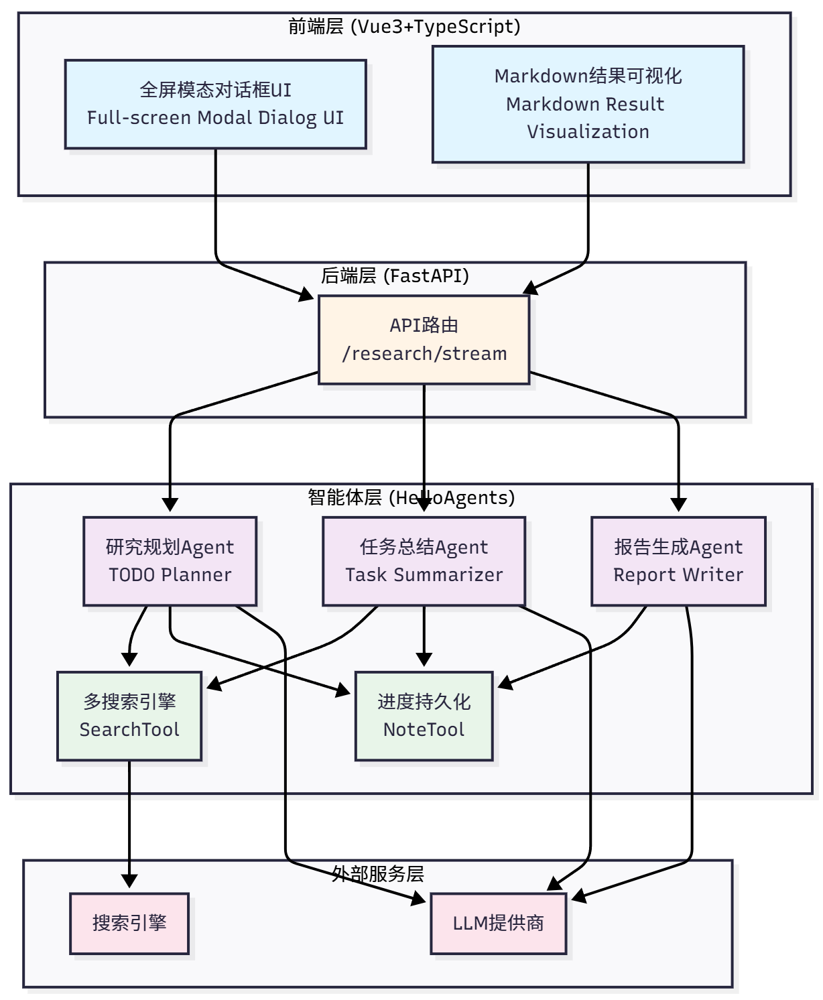

Figure 14.1 Deep Research Assistant Technical Architecture

图 14.1 深度研究助手技术架构

The system is designed with a four-layer architecture:

系统分为四层架构设计：

**Front-End Layer (Vue3+TypeScript)**: Full-screen modal dialog UI, Markdown result visualization

<strong>前端层 (Vue3+TypeScript)</strong>：全屏模态对话框 UI、Markdown 结果可视化

**Back-End Layer (FastAPI)**: API routing (`/research/stream`)

<strong>后端层 (FastAPI)</strong>：API 路由（`/research/stream`）

**Agent Layer (HelloAgents)**: Three specialized Agents (TODO Planner, Task Summarizer, Report Writer) + Two core tools (SearchTool, NoteTool)

<strong>智能体层 (HelloAgents)</strong>：三个专门 Agent（TODO Planner、Task Summarizer、Report Writer）+ 两个核心工具（SearchTool、NoteTool）

**External Service Layer**: Search engines + LLM providers

<strong>外部服务层</strong>：搜索引擎+ LLM 提供商

Let's see how a complete research request flows through the system, as shown in Figure 14.2:

让我们看看一个完整的研究请求是如何在系统中流转的，如图 14.2 所示：

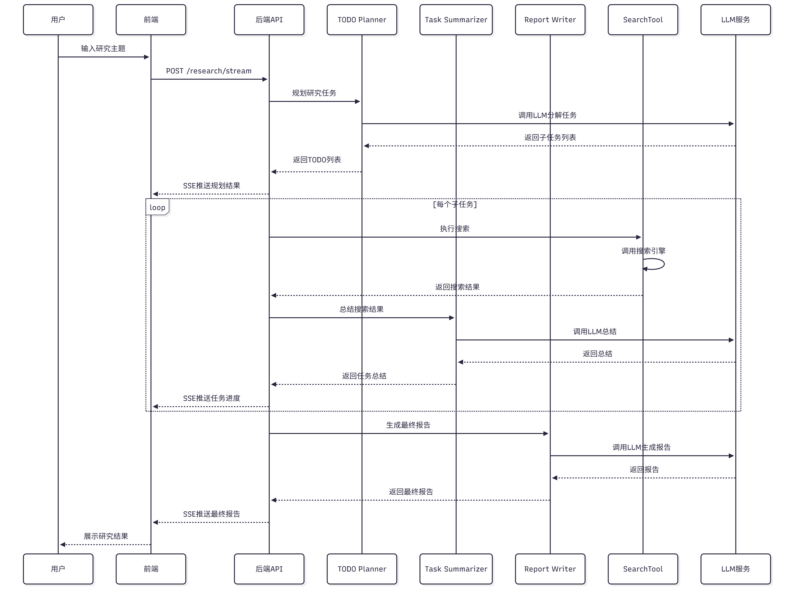

Figure 14.2 Deep Research Assistant Data Flow Process

图 14.2 深度研究助手数据流转过程

1. **User Input**: User enters research topic on the front-end

   <strong>用户输入</strong>：用户在前端输入研究主题

2. **Front-End Sends**: Front-end connects to `/research/stream` via SSE

   <strong>前端发送</strong>：前端通过 SSE 连接到`/research/stream`

3. **Back-End Receives**: FastAPI receives request, creates research state

   <strong>后端接收</strong>：FastAPI 接收请求，创建研究状态

4. **Planning Phase**: Calls research planning Agent, decomposes into 3 subtasks

   <strong>规划阶段</strong>：调用研究规划 Agent，分解为 3 个子任务

5. **Execution Phase**: Executes each subtask one by one

   <strong>执行阶段</strong>：逐个执行每个子任务

   - Use SearchTool to search

     使用 SearchTool 搜索

   - Call task summarization Agent to summarize

     调用任务总结 Agent 总结

   - Use NoteTool to record results

     使用 NoteTool 记录结果

6. **Report Phase**: Call report generation Agent, integrate all summaries

   <strong>报告阶段</strong>：调用报告生成 Agent，整合所有总结

7. **Stream Return**: Push progress and results to front-end via SSE

   <strong>流式返回</strong>：通过 SSE 推送进度和结果到前端

8. **Front-End Display**: Front-end updates task status, progress bar, logs, and report in real-time

   <strong>前端展示</strong>：前端实时更新任务状态、进度条、日志、报告

The project directory structure is as follows:

项目的目录结构如下：

```
helloagents-deepresearch/
├── backend/                    # Back-end code
│   ├── src/
│   │   ├── agent.py           # Core coordinator
│   │   ├── main.py            # FastAPI entry
│   │   ├── models.py          # Data models
│   │   ├── prompts.py         # Prompt templates
│   │   ├── config.py          # Configuration management
│   │   └── services/          # Service layer
│   │       ├── planner.py     # Planning service
│   │       ├── summarizer.py  # Summarization service
│   │       ├── reporter.py    # Report service
│   │       └── search.py      # Search service
│   ├── .env                   # Environment variables
│   ├── pyproject.toml         # Dependency management
│   └── workspace/             # Research notes
│
└── frontend/                   # Front-end code
    ├── src/
    │   ├── App.vue            # Main component
    │   ├── components/        # UI components
    │   │   └── ResearchModal.vue
    │   └── composables/       # Composable functions
    │       └── useResearch.ts
    ├── package.json           # npm dependencies
    └── vite.config.ts         # Build configuration
```

**中文对照**

```
helloagents-deepresearch/
├── backend/                    # 后端代码
│   ├── src/
│   │   ├── agent.py           # 核心协调器
│   │   ├── main.py            # FastAPI入口
│   │   ├── models.py          # 数据模型
│   │   ├── prompts.py         # Prompt模板
│   │   ├── config.py          # 配置管理
│   │   └── services/          # 服务层
│   │       ├── planner.py     # 规划服务
│   │       ├── summarizer.py  # 总结服务
│   │       ├── reporter.py    # 报告服务
│   │       └── search.py      # 搜索服务
│   ├── .env                   # 环境变量
│   ├── pyproject.toml         # 依赖管理
│   └── workspace/             # 研究笔记
│
└── frontend/                   # 前端代码
    ├── src/
    │   ├── App.vue            # 主组件
    │   ├── components/        # UI组件
    │   │   └── ResearchModal.vue
    │   └── composables/       # 组合式函数
    │       └── useResearch.ts
    ├── package.json           # npm依赖
    └── vite.config.ts         # 构建配置
```

<a id="1413-quick-experience-run-the-project-in-5-minutes"></a>
<a id="1413-快速体验5-分钟运行项目"></a>

### 14.1.3 Quick Experience: Run the Project in 5 Minutes / 快速体验：5 分钟运行项目

Before diving into implementation details, let's first run the project to see the final result. This way you'll have an intuitive understanding of the entire system.

在深入学习实现细节之前，让我们先把项目跑起来，看看最终的效果。这样你会对整个系统有一个直观的认识。

You can check versions with the following commands:

你可以通过以下命令检查版本：

```bash
python --version  # Should show Python 3.10.x or higher
node --version    # Should show v16.x.x or higher
npm --version     # Should show 8.x.x or higher
```

**(1) Start the Back-End**

（1）启动后端

```bash
# 1. Enter back-end directory
cd helloagents-deepresearch/backend

# 2. Install dependencies
# Method 1: Using uv (recommended, faster Python package manager)
uv sync

# Method 2: Using pip
pip install -e .

# 3. Configure environment variables
cp .env.example .env

# 4. Edit .env file, fill in your API keys
# Open .env file with your favorite editor
# At minimum, configure:
# - LLM_PROVIDER (e.g., openai, deepseek, qwen)
# - LLM_API_KEY (your LLM API key)
# - SEARCH_API (e.g., duckduckgo, tavily)

# 5. Start back-end
python src/main.py
```

If everything is normal, you'll see output similar to:

如果一切正常，你会看到类似的输出：

```
INFO:     Started server process [12345]
INFO:     Waiting for application startup.
INFO:     Application startup complete.
INFO:     Uvicorn running on http://0.0.0.0:8000 (Press CTRL+C to quit)
```

**(2) Start the Front-End**

（2）启动前端

Open a new terminal window:

打开一个新的终端窗口：

```bash
# 1. Enter front-end directory
cd helloagents-deepresearch/frontend

# 2. Install dependencies
npm install

# 3. Start front-end
npm run dev
```

If everything is normal, you'll see output similar to:

如果一切正常，你会看到类似的输出：

```
  VITE v5.0.0  ready in 500 ms

  ➜  Local:   http://localhost:5174/
  ➜  Network: use --host to expose
  ➜  press h + enter to show help
```

**(3) Start Research**

（3）开始研究

Open your browser and visit `http://localhost:5174`. You'll see a centered input card, as shown in Figure 14.3. Enter a research topic, for example `What kind of organization is Datawhale?`, select a search engine (if multiple are configured), and click the "Start Research" button.

打开浏览器访问 `http://localhost:5174`，你会看到一个居中的输入卡片，如图 14.3 所示。输入研究主题，例如`Datawhale是一个什么样的组织？`，选择搜索引擎（如果配置了多个），点击"开始研究"按钮。

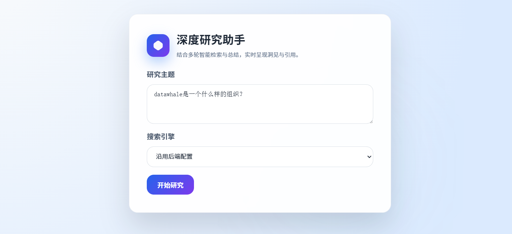

Figure 14.3 Deep Research Assistant Search Page

图 14.3 深度研究助手搜索页面

As shown in Figure 14.4, the system will automatically expand to full screen, with research information displayed on the left and research progress and results displayed in real-time on the right. The entire research process takes about 1-3 minutes, depending on the complexity of the topic and the response speed of the search engine.

如图 14.4 所示，系统会自动展开为全屏，左侧显示研究信息，右侧实时显示研究进度和结果。整个研究过程大约需要 1-3 分钟，取决于主题的复杂度和搜索引擎的响应速度。

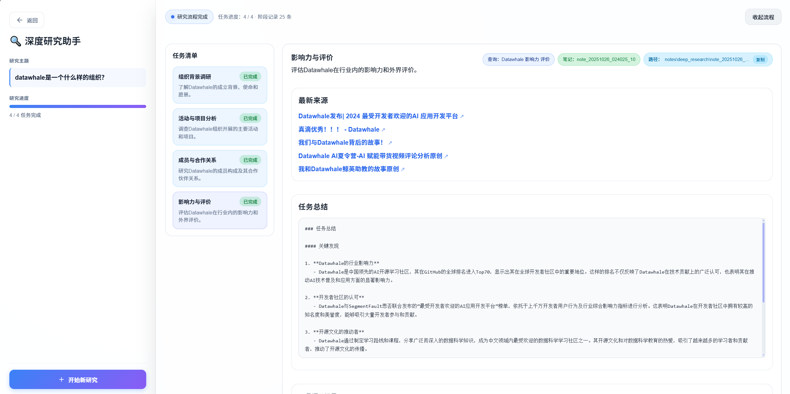

Figure 14.4 Deep Research Assistant Expanded Research

图 14.4 深度研究助手展开研究

After research is complete, you'll see:

研究完成后，你会看到：

- **Task List**: Shows all subtasks and their status

  <strong>任务列表</strong>：显示所有子任务及其状态

- **Progress Log**: Shows all operations during the research process

  <strong>进度日志</strong>：显示研究过程中的所有操作

- **Final Report**: Structured Markdown report containing summaries of all subtasks and source citations

  <strong>最终报告</strong>：结构化的 Markdown 报告，包含所有子任务的总结和来源引用

Now you've successfully run the deep research assistant and have an intuitive understanding of the system.

现在你已经成功运行了深度研究助手，对系统有了直观的认识。

<a id="142-todo-driven-research-paradigm"></a>
<a id="142-todo-驱动的研究范式"></a>

## 14.2 TODO-Driven Research Paradigm / TODO 驱动的研究范式

<a id="1421-what-is-todo-driven-research"></a>
<a id="1421-什么是-todo-驱动的研究"></a>

### 14.2.1 What is TODO-Driven Research / 什么是 TODO 驱动的研究

Traditional search engines can only answer single questions, while deep research needs to answer a series of related questions. The TODO-driven research paradigm decomposes complex research topics into multiple subtasks (TODOs), executes them one by one, and integrates the results.

传统的搜索引擎只能回答单个问题，而深度研究需要回答一系列相关的问题。TODO 驱动的研究范式将复杂的研究主题分解为多个子任务（TODO），逐个执行并整合结果。

The core idea of this paradigm is: **Transform the complex task of "research" into a "planning → execution → integration" process**.

这种范式的核心思想是：<strong>将"研究"这个复杂任务转化为"规划→执行→整合"的流程</strong>。

Let's understand this transformation through an example. Suppose you want to research "What kind of organization is Datawhale?". The traditional search method is:

让我们通过一个例子来理解这个转变。假设你想研究"Datawhale 是一个什么样的组织？"，传统的搜索方式是：

```
User input: What kind of organization is Datawhale?
Search engine: Returns 10-20 links
User: Click on links one by one, read content, take notes
Result: Fragmented information, lacking systematization
```

**中文对照**

```
用户输入：Datawhale是一个什么样的组织？
搜索引擎：返回10-20个链接
用户：逐个点开链接，阅读内容，记录笔记
结果：碎片化的信息，缺少系统性
```

The problem with this approach is that each link only covers one aspect of the topic, lacks systematic structure, and requires manual organization and summarization.

这种方式的问题在于每个链接只涵盖主题的一个方面、缺少系统性结构，需要手动整理和总结。

**TODO-Driven Approach: Systematic Research**

<strong>TODO 驱动方式：系统化研究</strong>

```
User input: What kind of organization is Datawhale?

System planning:
  ├─ TODO 1: Basic information about Datawhale (organizational positioning)
  ├─ TODO 2: Main projects of Datawhale (core content)
  ├─ TODO 3: Community culture of Datawhale (values)
  └─ TODO 4: Influence of Datawhale (social contribution)

System execution:
  For each TODO:
    1. Search for relevant materials
    2. Summarize key information
    3. Record source citations

System integration:
  Generate structured report:
    ├─ Part 1: Organizational positioning (from TODO 1)
    ├─ Part 2: Core content (from TODO 2)
    ├─ Part 3: Values (from TODO 3)
    ├─ Part 4: Social contribution (from TODO 4)
    └─ References: All source citations
```

**中文对照**

```
用户输入：Datawhale是一个什么样的组织？

系统规划：
  ├─ TODO 1：Datawhale的基本信息（组织定位）
  ├─ TODO 2：Datawhale的主要项目（核心内容）
  ├─ TODO 3：Datawhale的社区文化（价值观）
  └─ TODO 4：Datawhale的影响力（社会贡献）

系统执行：
  对每个TODO：
    1. 搜索相关资料
    2. 总结关键信息
    3. 记录来源引用

系统整合：
  生成结构化报告：
    ├─ 第一部分：组织定位（来自TODO 1）
    ├─ 第二部分：核心内容（来自TODO 2）
    ├─ 第三部分：价值观（来自TODO 3）
    ├─ 第四部分：社会贡献（来自TODO 4）
    └─ 参考文献：所有来源引用
```

The advantages of this approach are that it decomposes complex topics into clear sub-questions, records search results and summaries for each subtask for easy traceability, and the systematic research process avoids missing important information. It's also easy to add new subtasks or adjust execution order.

这种方式的优势在于将复杂主题分解为清晰的子问题，每个子任务的搜索结果和总结都被记录下来，方便追溯。同时，系统化的研究流程避免了遗漏重要信息，可以轻松添加新的子任务或调整执行顺序。

A complete TODO-driven research system contains three core elements:

一个完整的 TODO 驱动研究系统包含三个核心要素：

**(1) Intelligent Planner (TODO Planner)**: Responsible for decomposing research topics into subtasks. A good planner needs to understand the key aspects and research objectives of the topic, decompose the topic into 3-5 subtasks (too few won't cover everything, too many will be redundant), and design appropriate search queries for each subtask.

<strong>（1）智能规划器（TODO Planner）</strong>：负责将研究主题分解为子任务。一个好的规划器需要理解主题的关键方面和研究目标，将主题分解为 3-5 个子任务（太少覆盖不全，太多会冗余），并为每个子任务设计合适的搜索查询。

**(2) Task Executor**: Responsible for executing each subtask. The executor needs to use search engines to obtain relevant materials, extract key information and remove redundant content, while saving all source citations for easy verification.

<strong>（2）任务执行器（Task Executor）</strong>：负责执行每个子任务。执行器需要使用搜索引擎获取相关资料，提取关键信息并去除冗余内容，同时保存所有来源引用以方便验证。

**(3) Report Writer**: Responsible for integrating the results of all subtasks. The generator needs to organize content in logical order, merge duplicate information, and add source citations for each viewpoint.

<strong>（3）报告生成器（Report Writer）</strong>：负责整合所有子任务的结果。生成器需要按照逻辑顺序组织内容，合并重复的信息，并为每个观点添加来源引用。

In our case, the TODO-driven research process is shown in Figure 14.5:

在我们的案例里，TODO 驱动的研究流程如图 14.5 所示：

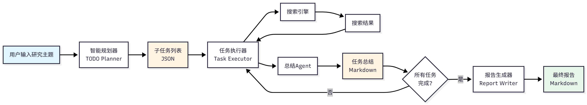

Figure 14.5 TODO-Driven Research Process

图 14.5 TODO 驱动的研究流程

The entire process is linear, but each stage has clear inputs and outputs. This design makes the system easy to understand and debug.

整个流程是线性的，但每个阶段都有明确的输入和输出。这种设计使得系统易于理解和调试。

<a id="1422-three-stage-research-process"></a>
<a id="1422-三阶段研究流程"></a>

### 14.2.2 Three-Stage Research Process / 三阶段研究流程

The TODO-driven research process is divided into three stages: Planning, Execution, and Reporting. Each stage has a dedicated Agent responsible for it.

TODO 驱动的研究流程分为三个阶段:规划（Planning）、执行（Execution）、报告（Reporting）。每个阶段都有专门的 Agent 负责。

**(1) Stage 1: Planning**

<strong>（1）阶段 1：规划</strong>

The goal of the planning stage is to decompose the research topic into 3-5 subtasks. The system receives the research topic and current date as input, and outputs a JSON-format list of subtasks. Each subtask contains three fields: title (task title), intent (research intent), and query (search query).

规划阶段的目标是将研究主题分解为 3-5 个子任务。系统接收研究主题和当前日期作为输入，输出 JSON 格式的子任务列表。每个子任务包含三个字段：title（任务标题）、intent（研究意图）和 query（搜索查询）。

The research planning Agent adopts different decomposition strategies based on topic characteristics, usually starting with basic concepts, then understanding technical status, practical applications, and development trends, and conducting comparative analysis when necessary. For example, for "What kind of organization is Datawhale?", the planning Agent might generate the following subtasks:

研究规划 Agent 会根据主题特点采用不同的分解策略，通常从基础概念入手，然后了解技术现状、实际应用和发展趋势，必要时还会进行对比分析。例如，对于"Datawhale 是一个什么样的组织？"，规划 Agent 可能生成以下子任务：

```json
[
  {
    "title": "Basic information about Datawhale",
    "intent": "Understand Datawhale's organizational positioning, founding time, development history",
    "query": "Datawhale organization introduction history 2024"
  },
  {
    "title": "Main projects of Datawhale",
    "intent": "Understand Datawhale's core open source projects and tutorials",
    "query": "Datawhale projects tutorials open source 2024"
  },
  ...
]
```

A good plan should be comprehensive, logically clear, have precise queries, and an appropriate number of items.

一个好的规划应该覆盖全面、逻辑清晰、查询精准、条目数量适中。

**(2) Stage 2: Execution**

<strong>（2）阶段 2：执行</strong>

The execution stage executes each subtask one by one, searching and summarizing relevant materials. The system receives the subtask list and search engine configuration as input, and outputs a summary (Markdown format) and source citation list for each subtask. The execution process is as follows:

执行阶段逐个执行每个子任务，搜索并总结相关资料。系统接收子任务列表和搜索引擎配置作为输入，输出每个子任务的总结（Markdown 格式）和来源引用列表。执行流程如下：

For each subtask, the executor will:

对于每个子任务，执行器会：

1. **Search for materials**: Use the configured search engine to execute the search

   <strong>搜索资料</strong>：使用配置的搜索引擎执行搜索

   ```python
   search_results = search_tool.run({
       "input": task.query,
       "backend": "tavily",
       "mode": "structured",
       "max_results": 5
   })
   ```

2. **Get search results**: Extract title, URL, snippet

   <strong>获取搜索结果</strong>：提取标题、URL、摘要

   ```json
   {
     "results": [
       {
         "title": "What is a Multimodal Model?",
         "url": "https://example.com/multimodal-model",
         "snippet": "A multimodal model is an AI model that can process multiple types of data..."
       },
       ...
     ]
   }
   ```

3. **Call summarization Agent**: Summarize search results

   <strong>调用总结 Agent</strong>：总结搜索结果

   ```python
   summary = summarizer_agent.run(
       task=task,
       search_results=search_results
   )
   ```

4. **Record summary and sources**: Save to NoteTool

   <strong>记录总结和来源</strong>：保存到 NoteTool

   ```python
   note_tool.run({
       "action": "create",
       "title": task.title,
       "content": f"## {task.title}\n\n{summary}\n\n## Sources\n{sources}",
       "tags": ["research", "summary"]
   })
   ```

The task summarization Agent will extract core viewpoints from each search result, merge similar information, retain important numbers, dates, names and other key data, and add source citations for each viewpoint. For example, for the search results of "Basic information about Datawhale", the summarization Agent might generate:

任务总结 Agent 会从每个搜索结果中提取核心观点，合并相似信息，保留重要的数字、日期、名称等关键数据，并为每个观点添加来源引用。例如，对于"Datawhale 的基本信息"的搜索结果，总结 Agent 可能生成：

```markdown
## Basic Information about Datawhale

Datawhale is an open source organization focused on data science and AI, founded in 2018[1]. The organization's core mission is "for the learner, grow together with learners", committed to building a pure learning community[2].

**Core Positioning:**

1. **Open Source Education Platform**: Provides high-quality AI and data science learning resources[1]
2. **Learner Community**: Gathers tens of thousands of AI learners and practitioners[3]
3. **Knowledge Sharing**: Advocates open source spirit, all content is completely free and open[2]

**Development History:**

- **2018**: Datawhale was founded, released first open source tutorial[1]
- **2020**: Became one of the leading AI learning communities in China[3]
- **2024**: Released 50+ open source projects, impacting 100,000+ learners[4]

## Sources

[1] https://github.com/datawhalechina
[2] https://datawhale.club/about
[3] https://www.zhihu.com/org/datawhale
[4] https://datawhale.cn
```

**中文对照**

```markdown
## Datawhale的基本信息

Datawhale是一个专注于数据科学与AI领域的开源组织，成立于2018年[1]。组织的核心使命是"for the learner，和学习者一起成长"，致力于构建一个纯粹的学习社区[2]。

**核心定位：**

1. **开源教育平台**：提供高质量的AI和数据科学学习资源[1]
2. **学习者社区**：汇聚了数万名AI学习者和实践者[3]
3. **知识共享**：倡导开源精神，所有内容完全免费开放[2]

**发展历程：**

- **2018年**：Datawhale成立，发布首个开源教程[1]
- **2020年**：成为国内领先的AI学习社区之一[3]
- **2024年**：累计发布50+开源项目，影响10万+学习者[4]

## 来源

[1] https://github.com/datawhalechina
[2] https://datawhale.club/about
[3] https://www.zhihu.com/org/datawhale
[4] https://datawhale.cn
```

During execution, the system will push progress information to the front-end in real-time:

在执行过程中，系统会实时推送进度信息到前端：

```json
{
  "type": "status",
  "message": "Searching: Basic information about Datawhale"
}
```

```json
{
  "type": "status",
  "message": "Summarizing search results..."
}
```

```json
{
  "type": "task",
  "task": {
    "id": 1,
    "title": "Basic information about Datawhale",
    "status": "completed"
  }
}
```

**(3) Stage 3: Reporting**

<strong>（3）阶段 3：报告</strong>

The goal of the reporting stage is to integrate the summaries of all subtasks and generate the final report. The system receives the summaries of all subtasks and the research topic as input, and outputs the final report in Markdown format. The report contains five parts: title, overview, detailed analysis of each subtask, summary, and references. For example, for "What kind of organization is Datawhale?", the final report might be:

报告阶段的目标是整合所有子任务的总结，生成最终报告。系统接收所有子任务的总结和研究主题作为输入，输出 Markdown 格式的最终报告。报告包含标题、概述、各个子任务的详细分析、总结和参考文献五个部分。例如，对于"Datawhale 是一个什么样的组织？"，最终报告可能是：

```markdown
# What Kind of Organization is Datawhale?

## Overview

This report systematically researched the open source organization Datawhale, covering four aspects: basic information, main projects, community culture, and influence.

## 1. Basic Information about Datawhale

Datawhale is an open source organization focused on data science and AI, founded in 2018...

(Insert summary of subtask 1 here)

## 2. Main Projects of Datawhale

Datawhale has released multiple high-quality open source tutorials, including Hello-Agents, Joyful-Pandas, etc...

(Insert summary of subtask 2 here)
...
## Summary

Through this research, we learned about Datawhale's organizational positioning, core projects, community culture, and social contributions. Datawhale is a pure learning community that has made important contributions to AI education.

## References

[1] https://github.com/datawhalechina
[2] https://datawhale.club/about
...
```

**中文对照**

```markdown
# Datawhale是一个什么样的组织？

## 概述

本报告系统地研究了Datawhale这个开源组织，涵盖基本信息、主要项目、社区文化和影响力四个方面。

## 1. Datawhale的基本信息

Datawhale是一个专注于数据科学与AI领域的开源组织，成立于2018年...

（此处插入子任务1的总结）

## 2. Datawhale的主要项目

Datawhale发布了多个高质量的开源教程，包括Hello-Agents、Joyful-Pandas等...

（此处插入子任务2的总结）
......
## 总结

通过本次研究，我们了解了Datawhale的组织定位、核心项目、社区文化和社会贡献。Datawhale是一个纯粹的学习社区，为AI教育做出了重要贡献。

## 参考文献

[1] https://github.com/datawhalechina
[2] https://datawhale.club/about
...
```

The report generation Agent will organize content in the logical order of subtasks, add a brief overview at the beginning, merge duplicate information, unify Markdown format, and organize all source citations into the references section.

报告生成 Agent 会按照子任务的逻辑顺序组织内容，在开头添加简要概述，合并重复的信息，统一 Markdown 格式，并将所有来源引用整理到参考文献部分。

<a id="143-agent-system-design"></a>
<a id="143-智能体系统设计"></a>

## 14.3 Agent System Design / 智能体系统设计

<a id="1431-agent-responsibility-division"></a>
<a id="1431-agent-职责划分"></a>

### 14.3.1 Agent Responsibility Division / Agent 职责划分

In the deep research assistant, we designed three specialized Agents, each responsible for a specific task. This makes each Agent simple, easy to understand and maintain.

在深度研究助手中，我们设计了三个专门的 Agent，每个 Agent 负责一个特定的任务。这使得每个 Agent 都很简单，易于理解和维护。

In Chapter 7, we learned how to use `SimpleAgent` to build agents. The design philosophy of `SimpleAgent` is simple and direct: each time the `run()` method is called, the Agent analyzes the user's question, decides whether to call tools, and then returns the result. This design is very effective when handling simple tasks, but when facing complex tasks like deep research, we need to continue using a multi-agent collaboration approach.

在第七章中，我们学习了如何使用`SimpleAgent`来构建智能体。`SimpleAgent`的设计理念是简单直接：每次调用`run()`方法时，Agent 会分析用户的问题，决定是否需要调用工具，然后返回结果。这种设计在处理简单任务时非常有效，但当面对深度研究这样的复杂任务时，就需要我们继续采用多智能体协作的方案进行。

As shown in Table 14.1, the three Agents are respectively responsible for planning, summarization, and report generation.

如表 14.1 所示，三个 Agent 分别负责规划、总结和报告生成。

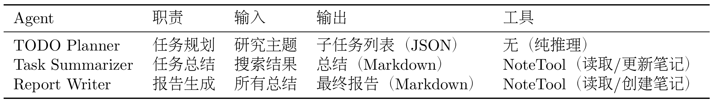

Table 14.1 Responsibility Division of Three Agents

表 14.1 三个 Agent 的职责划分

Let's introduce the design of each Agent in detail.

让我们详细介绍每个 Agent 的设计。

**Agent 1: Research Planning Expert (TODO Planner)**

<strong>Agent 1：研究规划专家（TODO Planner）</strong>

**Responsibility**: Decompose research topics into 3-5 subtasks

<strong>职责</strong>：将研究主题分解为 3-5 个子任务

**Design Philosophy**: The core task of the research planning expert is to understand the user's research topic, analyze the key aspects of the topic, and then generate a series of subtasks. This process is similar to the "brainstorming" stage of human researchers before starting research.

<strong>设计理念</strong>：研究规划专家的核心任务是理解用户的研究主题，分析主题的关键方面，然后生成一系列子任务。这个过程类似于人类研究者在开始研究前的"头脑风暴"阶段。

**Prompt Design**:

<strong>Prompt 设计</strong>：

```python
todo_planner_instructions = """
You are a research planning expert. Your task is to decompose the user's research topic into 3-5 subtasks.

Current date: {current_date}

Research topic: {research_topic}

Please analyze this research topic and decompose it into 3-5 subtasks. Each subtask should:
1. Cover an important aspect of the topic
2. Have a clear research objective
3. Be able to find relevant materials through search engines

Please return the subtask list in JSON format, each subtask containing:
- title: Task title (concise and clear)
- intent: Task intent (why research this)
- query: Search query (query string for search engines, can use English for better search results)

Example output:
[
  {{
    "title": "What is a multimodal model",
    "intent": "Understand the basic concepts of multimodal models to lay the foundation for subsequent research",
    "query": "multimodal model definition concept 2024"
  }},
  ...
]

Please ensure:
1. Number of subtasks is between 3-5
2. Subtasks have logical relationships (e.g., from basics to applications, from current status to trends)
3. Search queries can accurately find relevant materials
4. Only return JSON, do not include other text
"""
```

**Key Design Points**: The prompt includes the current date to get the latest information, explicitly requires JSON format output for easy parsing, helps the Agent understand expected output through examples, and emphasizes constraints such as number of subtasks and logical relationships.

<strong>关键设计点</strong>：提示词包含当前日期以获取最新信息，明确要求 JSON 格式输出便于解析，通过示例帮助 Agent 理解期望输出，并强调子任务数量、逻辑关系等约束。

**Implementation Code**:

<strong>实现代码</strong>：

The ToolAwareSimpleAgent here is an extension of SimpleAgent. You can learn about it in Section 14.3.2, no need to delve into it here.

这里的 ToolAwareSimpleAgent 是根据 SimpleAgent 拓展实现，可以在 14.3.2 了解，这里不用深究。

```python
class PlanningService:
    def __init__(self, llm: HelloAgentsLLM):
        self._agent = ToolAwareSimpleAgent(
            name="TODO Planner",
            system_prompt="You are a research planning expert",
            llm=llm,
            tool_call_listener=self._on_tool_call
        )

    def plan_todo_list(self, state: SummaryState) -> List[TodoItem]:
        prompt = todo_planner_instructions.format(
            current_date=get_current_date(),
            research_topic=state.research_topic,
        )

        response = self._agent.run(prompt)
        tasks_payload = self._extract_tasks(response)

        todo_items = []
        for idx, item in enumerate(tasks_payload, start=1):
            task = TodoItem(
                id=idx,
                title=item["title"],
                intent=item["intent"],
                query=item["query"],
            )
            todo_items.append(task)

        return todo_items

    def _extract_tasks(self, response: str) -> List[dict]:
        """Extract JSON from Agent response"""
        # Use regex to extract JSON part
        json_match = re.search(r'\[.*\]', response, re.DOTALL)
        if json_match:
            json_str = json_match.group(0)
            return json.loads(json_str)
        else:
            raise ValueError("Unable to extract JSON from response")
```

**Agent 2: Task Summarization Expert (Task Summarizer)**

<strong>Agent 2：任务总结专家（Task Summarizer）</strong>

**Responsibility**: Summarize search results, extract key information

<strong>职责</strong>：总结搜索结果，提取关键信息

**Design Philosophy**: The core task of the task summarization expert is to read search results, extract key information, and present it in a structured way. This process is similar to human researchers taking notes after reading literature.

<strong>设计理念</strong>：任务总结专家的核心任务是阅读搜索结果，提取关键信息，并以结构化的方式呈现。这个过程类似于人类研究者在阅读文献后做笔记的过程。

**Prompt Design**:

<strong>Prompt 设计</strong>：

```python
task_summarizer_instructions = """
You are a task summarization expert. Your task is to summarize search results and extract key information.

Task title: {task_title}
Task intent: {task_intent}
Search query: {task_query}

Search results:
{search_results}

Please carefully read the above search results, extract key information, and return a summary in Markdown format.

The summary should include:
1. **Core Viewpoints**: Core viewpoints and conclusions from search results
2. **Key Data**: Important numbers, dates, names, etc.
3. **Source Citations**: Add source citations for each viewpoint (using [1], [2], etc.)

Please ensure:
1. Summary is concise and clear, avoiding redundancy
2. Retain important details and data
3. Add source citations for each viewpoint
4. Use Markdown format (headings, lists, bold, etc.)

Example output:
## Core Viewpoints

Multimodal models are AI models that can process multiple types of data[1]. Unlike traditional unimodal models, multimodal models can simultaneously understand text, images, audio, etc.[2].

**Key Features:**
- Cross-modal understanding[1]
- Unified representation[3]
- End-to-end training[2]

## Sources

[1] https://example.com/source1
[2] https://example.com/source2
[3] https://example.com/source3
"""
```

**Key Design Points**: The prompt includes task title, intent, query and other context to help the Agent understand the task, explicitly requires output to include core viewpoints, key data, and source citations, emphasizes adding source citations for each viewpoint, and helps the Agent understand the expected output format through examples.

<strong>关键设计点</strong>：提示词包含任务标题、意图、查询等上下文帮助 Agent 理解任务，明确要求输出包含核心观点、关键数据、来源引用，强调为每个观点添加来源引用，并通过示例帮助 Agent 理解期望的输出格式。

**Implementation Code**:

<strong>实现代码</strong>：

```python
class SummarizationService:
    def __init__(self, llm: HelloAgentsLLM):
        self._agent = ToolAwareSimpleAgent(
            name="Task Summarizer",
            system_prompt="You are a task summarization expert",
            llm=llm,
            tool_call_listener=self._on_tool_call
        )

    def summarize_task(
        self,
        task: TodoItem,
        search_results: List[dict]
    ) -> str:
        # Format search results
        formatted_sources = self._format_sources(search_results)

        prompt = task_summarizer_instructions.format(
            task_title=task.title,
            task_intent=task.intent,
            task_query=task.query,
            search_results=formatted_sources,
        )

        summary = self._agent.run(prompt)
        return summary

    def _format_sources(self, search_results: List[dict]) -> str:
        """Format search results"""
        formatted = []
        for idx, result in enumerate(search_results, start=1):
            formatted.append(
                f"[{idx}] {result['title']}\n"
                f"URL: {result['url']}\n"
                f"Snippet: {result['snippet']}\n"
            )
        return "\n".join(formatted)
```

**Agent 3: Report Writing Expert (Report Writer)**

<strong>Agent 3：报告撰写专家（Report Writer）</strong>

**Responsibility**: Integrate summaries of all subtasks and generate final report

<strong>职责</strong>：整合所有子任务的总结，生成最终报告

**Design Philosophy**: The core task of the report writing expert is to integrate the summaries of all subtasks into a structured report. This process is similar to human researchers writing research reports after completing all investigations.

<strong>设计理念</strong>：报告撰写专家的核心任务是将所有子任务的总结整合成一份结构化的报告。这个过程类似于人类研究者在完成所有调研后撰写研究报告的过程。

**Prompt Design**:

<strong>Prompt 设计</strong>：

```python
report_writer_instructions = """
You are a report writing expert. Your task is to integrate the summaries of all subtasks and generate a structured research report.

Research topic: {research_topic}

Subtask summaries:
{task_summaries}

Please integrate all the above subtask summaries and generate a structured research report.

The report should include:
1. **Title**: Research topic
2. **Overview**: Briefly introduce the research topic and report structure (2-3 paragraphs)
3. **Detailed Analysis of Each Subtask**: Organize in logical order (using level-2 headings)
4. **Summary**: Summarize the main findings of the research (1-2 paragraphs)
5. **References**: All source citations (grouped by subtask)

Please ensure:
1. Report structure is clear and logically coherent
2. Eliminate duplicate information
3. Retain all source citations
4. Use Markdown format

Example output:
# Latest Advances in Multimodal Large Models

## Overview

This report systematically researched the latest advances in multimodal large models...

## 1. What is a Multimodal Model

(Insert summary of subtask 1 here)

## 2. What are the Latest Multimodal Models

(Insert summary of subtask 2 here)

...

## Summary

Through this research, we learned about...

## References

### Task 1: What is a Multimodal Model
[1] https://example.com/source1
...
"""
```

**Key Design Points**: The prompt explicitly requires the report to include title, overview, detailed analysis, summary, references and other structures, emphasizes organizing content in logical order, requires merging duplicate information to eliminate redundancy, and retains all source citations.

<strong>关键设计点</strong>：提示词明确要求报告包含标题、概述、详细分析、总结、参考文献等结构，强调按逻辑顺序组织内容，要求合并重复信息消除冗余，并保留所有来源引用。

**Implementation Code**:

<strong>实现代码</strong>：

```python
class ReportingService:
    def __init__(self, llm: HelloAgentsLLM):
        self._agent = ToolAwareSimpleAgent(
            name="Report Writer",
            system_prompt="You are a report writing expert",
            llm=llm,
            tool_call_listener=self._on_tool_call
        )

    def generate_report(
        self,
        research_topic: str,
        task_summaries: List[Tuple[TodoItem, str]]
    ) -> str:
        # Format subtask summaries
        formatted_summaries = self._format_summaries(task_summaries)

        prompt = report_writer_instructions.format(
            research_topic=research_topic,
            task_summaries=formatted_summaries,
        )

        report = self._agent.run(prompt)
        return report

    def _format_summaries(
        self,
        task_summaries: List[Tuple[TodoItem, str]]
    ) -> str:
        """Format subtask summaries"""
        formatted = []
        for idx, (task, summary) in enumerate(task_summaries, start=1):
            formatted.append(
                f"## Task {idx}: {task.title}\n"
                f"Intent: {task.intent}\n\n"
                f"{summary}\n"
            )
        return "\n".join(formatted)
```

<a id="1432-toolawaresimpleagent-design"></a>
<a id="1432-toolawaresimpleagent-的设计"></a>

### 14.3.2 ToolAwareSimpleAgent Design / ToolAwareSimpleAgent 的设计

In Chapter 7, we implemented `SimpleAgent`, which is the basic Agent of the HelloAgents framework. But in the deep research assistant, we need an Agent that can **record tool calls**. This is where `ToolAwareSimpleAgent` comes from.

在第七章中，我们实现了`SimpleAgent`，它是 HelloAgents 框架的基础 Agent。但在深度研究助手中，我们需要一个能够<strong>记录工具调用</strong>的 Agent。这就是`ToolAwareSimpleAgent`的由来。

In the deep research assistant, we need to record the tool call status of each Agent for:

在深度研究助手中，我们需要记录每个 Agent 的工具调用情况，用于：

1. **Debugging**: View which tools the Agent called and what parameters were passed

   <strong>调试</strong>：查看 Agent 调用了哪些工具，传入了什么参数

2. **Logging**: Record all operations during the research process

   <strong>日志</strong>：记录研究过程中的所有操作

3. **Analysis**: Analyze the Agent's behavior patterns

   <strong>分析</strong>：分析 Agent 的行为模式

4. **Progress Display**: Show in real-time what the Agent is doing

   <strong>进度展示</strong>：实时显示 Agent 正在做什么

`SimpleAgent` itself does not support tool call listening, so we need to extend it.

`SimpleAgent`本身不支持工具调用监听，因此我们需要扩展它。

`ToolAwareSimpleAgent` adds a `tool_call_listener` parameter on top of `SimpleAgent`. This is a callback function that is called every time a tool is called.

`ToolAwareSimpleAgent`在`SimpleAgent`的基础上增加了一个`tool_call_listener`参数，这是一个回调函数，每次工具调用时都会被调用。

**Usage Example:**

<strong>使用示例：</strong>

```python
from hello_agents import ToolAwareSimpleAgent

def tool_listener(call_info):
    print(f"Agent: {call_info['agent_name']}")
    print(f"Tool: {call_info['tool_name']}")
    print(f"Parameters: {call_info['parsed_parameters']}")
    print(f"Result: {call_info['result']}")

agent = ToolAwareSimpleAgent(
    name="Research Assistant",
    system_prompt="You are a research assistant",
    llm=llm,
    tool_call_listener=tool_listener
)
```

`ToolAwareSimpleAgent` inherits from `SimpleAgent` and overrides the `_execute_tool_call` method:

`ToolAwareSimpleAgent`继承自`SimpleAgent`，重写了`_execute_tool_call`方法：

```python
class ToolAwareSimpleAgent(SimpleAgent):
    def __init__(
        self,
        name: str,
        system_prompt: str,
        llm: HelloAgentsLLM,
        tool_registry: Optional[ToolRegistry] = None,
        tool_call_listener: Optional[Callable] = None,
    ):
        super().__init__(
            name=name,
            system_prompt=system_prompt,
            llm=llm,
            tool_registry=tool_registry,
        )
        self._tool_call_listener = tool_call_listener

    def _execute_tool_call(self, tool_name: str, parameters: str) -> str:
        """Execute tool call and notify listener"""
        # Parse parameters
        parsed_parameters = self._parse_parameters(parameters)

        # Call tool
        result = super()._execute_tool_call(tool_name, parameters)

        # Notify listener
        if self._tool_call_listener:
            self._tool_call_listener({
                "agent_name": self.name,
                "tool_name": tool_name,
                "parsed_parameters": parsed_parameters,
                "result": result,
            })

        return result
```

In the deep research assistant, we use `ToolAwareSimpleAgent` to record all Agent tool calls:

在深度研究助手中，我们使用`ToolAwareSimpleAgent`来记录所有 Agent 的工具调用：

```python
class DeepResearchAgent:
    def __init__(self, config: Configuration):
        self.config = config
        self.llm = HelloAgentsLLM(...)

        # Create tool call listener
        def tool_listener(call_info):
            self._emit_event({
                "type": "tool_call",
                "agent": call_info["agent_name"],
                "tool": call_info["tool_name"],
                "parameters": call_info["parsed_parameters"],
            })

        # Create three Agents, all using the same listener
        self.planner = PlanningService(self.llm, tool_listener)
        self.summarizer = SummarizationService(self.llm, tool_listener)
        self.reporter = ReportingService(self.llm, tool_listener)
```

This way, all Agent tool calls are recorded and pushed to the front-end via SSE, displayed to the user in real-time.

这样，所有 Agent 的工具调用都会被记录，并通过 SSE 推送到前端，实时显示给用户。

<a id="1433-agent-collaboration-mode"></a>
<a id="1433-agent-协作模式"></a>

### 14.3.3 Agent Collaboration Mode / Agent 协作模式

The three Agents have a **sequential collaboration** relationship, as shown in Figure 14.6.

三个 Agent 之间是<strong>顺序协作</strong>的关系，如图 14.6 所示。

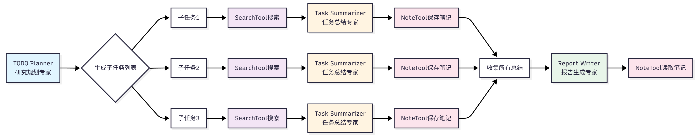

Figure 14.6 Agent Collaboration Process

图 14.6 Agent 协作流程

The characteristics of the sequential collaboration mode are:

顺序协作模式的特点是：

1. **Linear Process**: Agents execute in a fixed order

   <strong>线性流程</strong>：Agent 按照固定的顺序执行

2. **Clear Input and Output**: Each Agent's input comes from the previous Agent's output

   <strong>明确的输入输出</strong>：每个 Agent 的输入来自上一个 Agent 的输出

3. **No Concurrency**: Only one Agent is working at the same time

   <strong>无并发</strong>：同一时间只有一个 Agent 在工作

`DeepResearchAgent` is the core coordinator of the entire system, responsible for scheduling the three Agents:

`DeepResearchAgent`是整个系统的核心协调器，负责调度三个 Agent：

```python
class DeepResearchAgent:
    def run(self, research_topic: str) -> str:
        # 1. Planning stage
        self._emit_event({"type": "status", "message": "Planning research tasks..."})
        todo_list = self.planner.plan_todo_list(research_topic)
        self._emit_event({"type": "tasks", "tasks": todo_list})

        # 2. Execution stage
        task_summaries = []
        for task in todo_list:
            self._emit_event({
                "type": "status",
                "message": f"Researching: {task.title}"
            })

            # Search
            search_results = self.search_service.search(task.query)

            # Summarize
            summary = self.summarizer.summarize_task(task, search_results)
            task_summaries.append((task, summary))

            self._emit_event({
                "type": "task_completed",
                "task_id": task.id
            })

        # 3. Reporting stage
        self._emit_event({"type": "status", "message": "Generating report..."})
        report = self.reporter.generate_report(research_topic, task_summaries)
        self._emit_event({"type": "report", "content": report})

        return report
```

<a id="144-tool-system-integration"></a>
<a id="144-工具系统集成"></a>

## 14.4 Tool System Integration / 工具系统集成

<a id="1441-searchtool-extension"></a>
<a id="1441-searchtool-扩展"></a>

### 14.4.1 SearchTool Extension / SearchTool 扩展

In Chapter 7, we implemented the basic version of `SearchTool`, integrating Tavily and SerpApi search engines, demonstrating the design idea of multi-source search. In this chapter's deep research assistant, we further extended the capabilities of `SearchTool`, adding DuckDuckGo, Perplexity, SearXNG and other search engines, and implementing Advanced mode (combining multiple search engines). Search is the most core function of the deep research assistant, and these extensions enable the system to adapt to different usage scenarios and needs.

在第七章中，我们实现了`SearchTool`的基础版本，集成了 Tavily 和 SerpApi 两个搜索引擎，展示了多源搜索的设计思想。在本章的深度研究助手中，我们进一步扩展了`SearchTool`的能力，新增了 DuckDuckGo、Perplexity、SearXNG 等搜索引擎，并实现了 Advanced 模式（组合多个搜索引擎）。搜索是深度研究助手最核心的功能，这些扩展使得系统能够适应不同的使用场景和需求。

As shown in Table 14.2, the search engines added this time have different characteristics and applicable scenarios.

如表 14.2 所示，这次增加的搜索引擎有不同的特点和适用场景。

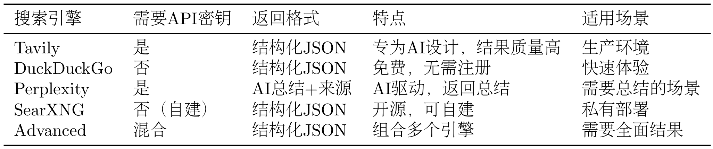

Table 14.2 Multi-Search Engine Comparison

表 14.2 多搜索引擎对比

We will no longer discuss how to extend separately. You can refer to the source code and the extension cases in Chapter 7 for implementation. `SearchTool` provides a unified search interface. No matter which search engine is used, the calling method is the same.

我们不再单独讨论如何扩展，可以参考源码以及第七章的拓展案例实现。`SearchTool`提供了统一的搜索接口，无论使用哪个搜索引擎，调用方式都是一样的。

In the deep research assistant, we select the search engine through the configuration file:

在深度研究助手中，我们通过配置文件选择搜索引擎：

```python
# config.py
class SearchAPI(str, Enum):
    TAVILY = "tavily"
    DUCKDUCKGO = "duckduckgo"
    PERPLEXITY = "perplexity"
    SEARXNG = "searxng"
    ADVANCED = "advanced"

class Configuration(BaseModel):
    search_api: SearchAPI = SearchAPI.DUCKDUCKGO
    # ...
```

```python
# .env
SEARCH_API=tavily
```

This way, users can select the search engine by modifying the `.env` file without modifying the code.

这样，用户可以通过修改`.env`文件来选择搜索引擎，无需修改代码。

The result returned by `SearchTool` is a dictionary containing:

`SearchTool`返回的结果是一个字典，包含：

- `results`: List of search results, each result contains title, URL, snippet

  `results`：搜索结果列表，每个结果包含标题、URL、摘要

- `backend`: Search engine used

  `backend`：使用的搜索引擎

- `answer`: AI-generated answer (Perplexity only)

  `answer`：AI 生成的答案（仅 Perplexity）

- `notices`: Notification information (such as API limits, errors, etc.)

  `notices`：通知信息（如 API 限制、错误等）

Here are some special case handling.

以下是一些特殊情况的处理。

Search results may contain duplicate URLs, we need to deduplicate:

搜索结果可能包含重复的 URL，我们需要去重：

```python
def deduplicate_sources(sources: List[dict]) -> List[dict]:
    """Remove duplicate URLs"""
    seen_urls = set()
    unique_sources = []

    for source in sources:
        if source["url"] not in seen_urls:
            seen_urls.add(source["url"])
            unique_sources.append(source)

    return unique_sources
```

Search results may contain a large amount of text, we need to limit the number of tokens for each source:

搜索结果可能包含大量文本，我们需要限制每个来源的 Token 数量：

```python
def limit_source_tokens(source: dict, max_tokens: int = 2000) -> dict:
    """Limit the number of tokens for a source"""
    snippet = source["snippet"]

    # Simple token estimation: 1 token is approximately 4 characters
    max_chars = max_tokens * 4

    if len(snippet) > max_chars:
        snippet = snippet[:max_chars] + "..."

    return {
        **source,
        "snippet": snippet
    }
```

<a id="1442-notetool-usage"></a>
<a id="1442-notetool-使用"></a>

### 14.4.2 NoteTool Usage / NoteTool 使用

In the deep research assistant, we use `NoteTool` to persist research progress. `NoteTool` is a built-in tool integrated in Chapter 9, used to create, read, update, and delete notes.

在深度研究助手中，我们使用`NoteTool`来持久化研究进度。`NoteTool`是第九章集成的内置工具，用于创建、读取、更新和删除笔记。

During the research process, we need to record the search results, summaries, and final research report for each subtask. This information needs to be persisted to disk so that research can continue from the last progress when interrupted, and it is also convenient to view all operations during the research process and analyze the quality and efficiency of the research.

在研究过程中，我们需要记录每个子任务的搜索结果、总结以及最终的研究报告。这些信息需要持久化到磁盘，以便在研究过程中断时能够从上次的进度继续，同时也方便查看研究过程中的所有操作，分析研究的质量和效率。

`NoteTool` stores notes in the specified workspace directory, with each note being a Markdown file. The note filename is the task ID, and the content includes task title, task intent, search query, search results, and summary.

`NoteTool`将笔记存储在指定的工作空间目录中，每个笔记是一个 Markdown 文件。笔记的文件名是任务 ID，内容包含任务标题、任务意图、搜索查询、搜索结果和总结。

The final generated file style will be in the following tree structure:

最后生成的文件风格会是下面的树状图风格：

```
workspace/
├── notes/
│   ├── 1.md  # Notes for task 1
│   ├── 2.md  # Notes for task 2
│   ├── 3.md  # Notes for task 3
│   └── ...
└── reports/
    └── final_report.md  # Final report
```

**中文对照**

```
workspace/
├── notes/
│   ├── 1.md  # 任务1的笔记
│   ├── 2.md  # 任务2的笔记
│   ├── 3.md  # 任务3的笔记
│   └── ...
└── reports/
    └── final_report.md  # 最终报告
```

In the deep research assistant, we use `NoteTool` to record the research progress of each subtask:

在深度研究助手中，我们使用`NoteTool`来记录每个子任务的研究进度：

```python
class NotesService:
    def __init__(self, workspace: str):
        self.note_tool = NoteTool(workspace=workspace)

    def save_task_summary(
        self,
        task: TodoItem,
        search_results: List[dict],
        summary: str
    ):
        """Save task summary"""
        # Format note content
        content = self._format_note_content(
            task=task,
            search_results=search_results,
            summary=summary
        )

        # Create note
        self.note_tool.run({
            "action": "create",
            "title": f"Task {task.id}: {task.title}",
            "content": content,
            "tags": ["research", "summary"]
        })

    def _format_note_content(
        self,
        task: TodoItem,
        search_results: List[dict],
        summary: str
    ) -> str:
        """Format note content"""
        content = f"# Task {task.id}: {task.title}\n\n"
        content += f"## Task Information\n\n"
        content += f"- **Intent**: {task.intent}\n"
        content += f"- **Query**: {task.query}\n\n"

        content += f"## Search Results\n\n"
        for idx, result in enumerate(search_results, start=1):
            content += f"[{idx}] {result['title']}\n"
            content += f"URL: {result['url']}\n"
            content += f"Snippet: {result['snippet']}\n\n"

        content += f"## Summary\n\n{summary}\n"

        return content
```

<a id="1443-toolregistry-tool-management"></a>
<a id="1443-toolregistry-工具管理"></a>

### 14.4.3 ToolRegistry Tool Management / ToolRegistry 工具管理

`ToolRegistry` is the tool registry of the HelloAgents framework, also supported in our Chapter 7, used to manage the registration and invocation of all tools. In the deep research assistant, we use `ToolRegistry` to manage `SearchTool` and `NoteTool`.

`ToolRegistry`是 HelloAgents 框架的工具注册表，同样也是在我们的第七章所支持，用于管理所有工具的注册和调用。在深度研究助手中，我们使用`ToolRegistry`来管理`SearchTool`和`NoteTool`。

Before creating an Agent, we need to register tools first:

在创建 Agent 之前，我们需要先注册工具：

```python
from hello_agents import ToolAwareSimpleAgent
from hello_agents.tools import ToolRegistry
from hello_agents.tools import SearchTool
from hello_agents.tools import NoteTool

# Create tools
search_tool = SearchTool(backend="hybrid")
note_tool = NoteTool(workspace="./workspace/notes")

# Create registry
registry = ToolRegistry()

# Register tools
registry.register_tool(search_tool)
registry.register_tool(note_tool)

# Create Agent
agent = ToolAwareSimpleAgent(
    name="Research Assistant",
    system_prompt="You are a research assistant",
    llm=llm,
    tool_registry=registry
)
```

When an Agent needs to call a tool, it generates a tool call instruction, as shown in Figure 14.7.

当 Agent 需要调用工具时，它会生成工具调用指令，如图 14.7 所示。

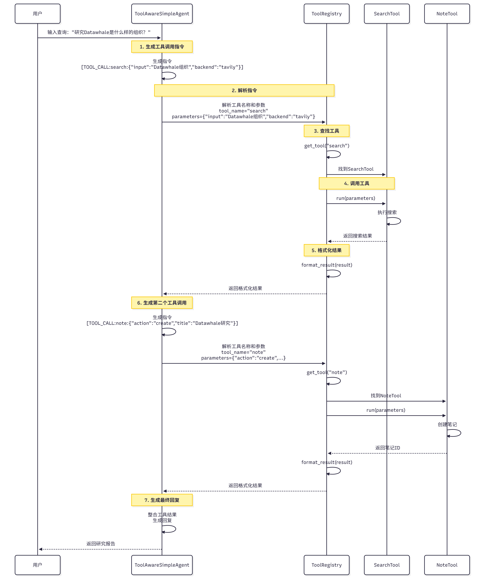

Figure 14.7 Tool Call Process

图 14.7 工具调用流程

**Tool Call Process**:

**工具调用流程<strong>：

1. **Agent generates instruction**: Agent generates tool call instruction, such as `[TOOL_CALL:search_tool:{"input": "Datawhale organization", "backend": "tavily"}]`

   </strong>Agent 生成指令<strong>：Agent 生成工具调用指令，如`[TOOL_CALL:search_tool:{"input": "Datawhale组织", "backend": "tavily"}]`

2. **Parse instruction**: `ToolRegistry` parses the instruction, extracts tool name and parameters

   </strong>解析指令<strong>：`ToolRegistry`解析指令，提取工具名称和参数

3. **Find tool**: `ToolRegistry` finds the corresponding tool based on the tool name

   </strong>查找工具<strong>：`ToolRegistry`根据工具名称查找对应的工具

4. **Call tool**: Call the tool's `run` method, passing in parameters

   </strong>调用工具<strong>：调用工具的`run`方法，传入参数

5. **Return result**: Tool returns execution result

   </strong>返回结果<strong>：工具返回执行结果

6. **Format result**: Format the result as a string and return it to the Agent

   </strong>格式化结果<strong>：将结果格式化为字符串，返回给 Agent

<a id="145-service-layer-implementation"></a>
<a id="145-服务层实现"></a>

## 14.5 Service Layer Implementation / 服务层实现

This section will introduce the implementation of core services in detail, including PlanningService, SummarizationService, ReportingService, and SearchService. These services are the bridge connecting Agents and tools, responsible for specific business logic.

本节将详细介绍核心服务的实现，包括 PlanningService、SummarizationService、ReportingService 和 SearchService。这些服务是连接 Agent 和工具的桥梁，负责具体的业务逻辑。

<a id="1451-task-planning-service"></a>
<a id="1451-任务规划服务"></a>

### 14.5.1 Task Planning Service / 任务规划服务

`PlanningService` is responsible for calling the research planning Agent to decompose the research topic into subtasks. This is the first and most critical step of the entire research process.

`PlanningService`负责调用研究规划 Agent，将研究主题分解为子任务。这是整个研究流程的第一步，也是最关键的一步。

**(1) Implementation Approach**

</strong>（1）方案实现<strong>

Its core responsibilities are:

它的核心职责是：

1. **Build planning Prompt**: Build Prompt based on research topic and current date

   </strong>构建规划 Prompt<strong>：根据研究主题和当前日期构建 Prompt

2. **Call planning Agent**: Call TODO Planner Agent to generate subtask list

   </strong>调用规划 Agent<strong>：调用 TODO Planner Agent 生成子任务列表

3. **Parse JSON response**: Extract JSON-format subtask list from Agent's response

   </strong>解析 JSON 响应<strong>：从 Agent 的响应中提取 JSON 格式的子任务列表

4. **Validate subtask format**: Ensure each subtask contains required fields (title, intent, query)

   </strong>验证子任务格式**：确保每个子任务包含必需的字段（title、intent、query）

```python
import re
import json
from typing import List, Callable, Optional
from datetime import datetime

from hello_agents import HelloAgentsLLM
from hello_agents import ToolAwareSimpleAgent
from models import TodoItem, SummaryState
from prompts import todo_planner_instructions

class PlanningService:
    """Task planning service"""

    def __init__(
        self,
        llm: HelloAgentsLLM,
        tool_call_listener: Optional[Callable] = None
    ):
        self._llm = llm
        self._tool_call_listener = tool_call_listener

        # Create planning Agent
        self._agent = ToolAwareSimpleAgent(
            name="TODO Planner",
            system_prompt="You are a research planning expert, skilled at decomposing complex research topics into clear subtasks.",
            llm=llm,
            tool_call_listener=tool_call_listener
        )

    def plan_todo_list(self, state: SummaryState) -> List[TodoItem]:
        """Plan TODO list

        Args:
            state: Research state, containing research topic

        Returns:
            Subtask list
        """
        # Build Prompt
        prompt = todo_planner_instructions.format(
            current_date=self._get_current_date(),
            research_topic=state.research_topic,
        )

        # Call Agent
        response = self._agent.run(prompt)

        # Parse JSON
        tasks_payload = self._extract_tasks(response)

        # Validate and create TodoItem
        todo_items = []
        for idx, item in enumerate(tasks_payload, start=1):
            # Validate required fields
            if not all(key in item for key in ["title", "intent", "query"]):
                raise ValueError(f"Task {idx} is missing required fields")

            task = TodoItem(
                id=idx,
                title=item["title"],
                intent=item["intent"],
                query=item["query"],
            )
            todo_items.append(task)

        return todo_items

    def _get_current_date(self) -> str:
        """Get current date"""
        return datetime.now().strftime("%Y-%m-%d")

    def _extract_tasks(self, response: str) -> List[dict]:
        """Extract JSON from Agent response

        The Agent's response may contain extra text, such as:
        "Okay, I will plan the following tasks for you:\n[{...}, {...}]\nThese tasks cover..."

        We need to extract the JSON part.
        """
        # Method 1: Use regex to extract JSON array
        json_match = re.search(r'\[.*\]', response, re.DOTALL)
        if json_match:
            json_str = json_match.group(0)
            try:
                return json.loads(json_str)
            except json.JSONDecodeError as e:
                raise ValueError(f"JSON parsing failed: {e}")

        # Method 2: If no JSON array is found, try to parse the entire response directly
        try:
            return json.loads(response)
        except json.JSONDecodeError:
            raise ValueError("Unable to extract JSON from response")
```

**(2) JSON Parsing and Validation**

<strong>（2）JSON 解析与验证</strong>

The JSON returned by the Agent may contain extra text or format errors, so we need robust parsing logic:

Agent 返回的 JSON 可能包含额外的文本或格式错误，我们需要 robust 的解析逻辑：

**Common Issues**:

<strong>常见问题</strong>：

1. **Contains extra text**: Agent may add explanatory text before and after JSON

   <strong>包含额外文本</strong>：Agent 可能在 JSON 前后添加说明文字

2. **Format errors**: JSON may be missing quotes, commas, etc.

   <strong>格式错误</strong>：JSON 可能缺少引号、逗号等

3. **Missing fields**: Some subtasks may be missing required fields

   <strong>字段缺失</strong>：某些子任务可能缺少必需字段

**Solutions**:

<strong>解决方案</strong>：

1. **Use regex**: Extract JSON part

   <strong>使用正则表达式</strong>：提取 JSON 部分

2. **Multiple parsing strategies**: First try to extract JSON array, then try to parse directly

   <strong>多种解析策略</strong>：先尝试提取 JSON 数组，再尝试直接解析

3. **Field validation**: Ensure each subtask contains required fields

   <strong>字段验证</strong>：确保每个子任务包含必需字段

**Example**:

<strong>示例</strong>：

```python
# Agent response example 1: Contains extra text
response1 = """
Okay, I will plan the following tasks for you:

[
  {
    "title": "What is a multimodal model",
    "intent": "Understand basic concepts",
    "query": "multimodal model definition"
  },
  {
    "title": "Latest multimodal models",
    "intent": "Understand technical status",
    "query": "latest multimodal models 2024"
  }
]

These tasks cover the basic information and core projects of the Datawhale organization.
"""

# Extract JSON
tasks1 = service._extract_tasks(response1)
# Result: [{"title": "Basic information about Datawhale", ...}, ...]

# Agent response example 2: Pure JSON
response2 = """
[
  {"title": "Basic information about Datawhale", "intent": "Understand organizational positioning", "query": "Datawhale organization introduction"},
  {"title": "Main projects of Datawhale", "intent": "Understand core content", "query": "Datawhale projects tutorials 2024"}
]
"""

# Extract JSON
tasks2 = service._extract_tasks(response2)
# Result: [{"title": "What is a multimodal model", ...}, ...]
```

**(3) Planning Quality Assessment**

<strong>（3）规划质量评估</strong>

A good plan should meet the following criteria:

一个好的规划应该满足以下标准：

1. **Comprehensive coverage**: Cover all important aspects of the topic

   <strong>覆盖全面</strong>：涵盖主题的所有重要方面

2. **Clear logic**: Clear logical relationships between subtasks

   <strong>逻辑清晰</strong>：子任务之间有明确的逻辑关系

3. **Precise queries**: Search queries can accurately find relevant materials

   <strong>查询精准</strong>：搜索查询能够准确找到相关资料

4. **Appropriate quantity**: 3-5 subtasks

   <strong>数量适中</strong>：3-5 个子任务

We can add an evaluation method:

我们可以添加一个评估方法：

```python
def evaluate_plan(self, todo_items: List[TodoItem]) -> dict:
    """Evaluate planning quality

    Returns:
        Evaluation results, including score and suggestions
    """
    score = 100
    suggestions = []

    # Check quantity
    if len(todo_items) < 3:
        score -= 20
        suggestions.append("Too few subtasks, may miss important information")
    elif len(todo_items) > 5:
        score -= 10
        suggestions.append("Too many subtasks, may have redundancy")

    # Check query quality
    for task in todo_items:
        if len(task.query.split()) < 2:
            score -= 10
            suggestions.append(f"Query for task '{task.title}' is too simple")

    # Check logical relationships
    # (More complex logic checks can be added here)

    return {
        "score": score,
        "suggestions": suggestions
    }
```

<a id="1452-summarization-service"></a>
<a id="1452-总结服务"></a>

### 14.5.2 Summarization Service / 总结服务

`SummarizationService` is responsible for calling the task summarization Agent to summarize search results. This is the core link of the research process and determines the quality of the research.

`SummarizationService`负责调用任务总结 Agent，总结搜索结果。这是研究流程的核心环节，决定了研究的质量。

Its responsibilities are:

它的职责是：

1. **Format search results**: Format search results into readable text

   <strong>格式化搜索结果</strong>：将搜索结果格式化为易读的文本

2. **Build summarization Prompt**: Build Prompt based on task information and search results

   <strong>构建总结 Prompt</strong>：根据任务信息和搜索结果构建 Prompt

3. **Call summarization Agent**: Call Task Summarizer Agent to generate summary

   <strong>调用总结 Agent</strong>：调用 Task Summarizer Agent 生成总结

4. **Extract source citations**: Extract source citations from summary

   <strong>提取来源引用</strong>：从总结中提取来源引用

Core code:

核心代码：

```python
from typing import List, Callable, Optional, Tuple

from hello_agents import HelloAgentsLLM
from hello_agents import ToolAwareSimpleAgent
from models import TodoItem
from prompts import task_summarizer_instructions

class SummarizationService:
    """Summarization service"""

    def __init__(
        self,
        llm: HelloAgentsLLM,
        tool_call_listener: Optional[Callable] = None
    ):
        self._llm = llm
        self._tool_call_listener = tool_call_listener

        # Create summarization Agent
        self._agent = ToolAwareSimpleAgent(
            name="Task Summarizer",
            system_prompt="You are a task summarization expert, skilled at extracting key information from search results.",
            llm=llm,
            tool_call_listener=tool_call_listener
        )

    def summarize_task(
        self,
        task: TodoItem,
        search_results: List[dict]
    ) -> Tuple[str, List[str]]:
        """Summarize task

        Args:
            task: Task information
            search_results: Search results list

        Returns:
            (Summary text, source URL list)
        """
        # Format search results
        formatted_sources = self._format_sources(search_results)

        # Build Prompt
        prompt = task_summarizer_instructions.format(
            task_title=task.title,
            task_intent=task.intent,
            task_query=task.query,
            search_results=formatted_sources,
        )

        # Call Agent
        summary = self._agent.run(prompt)

        # Extract source URLs
        source_urls = [result["url"] for result in search_results]

        return summary, source_urls

    def _format_sources(self, search_results: List[dict]) -> str:
        """Format search results

        Format search results into readable text, including:
        - Serial number
        - Title
        - URL
        - Snippet
        """
        formatted = []
        for idx, result in enumerate(search_results, start=1):
            formatted.append(
                f"[{idx}] {result['title']}\n"
                f"URL: {result['url']}\n"
                f"Snippet: {result['snippet']}\n"
            )
        return "\n".join(formatted)
```

<a id="report-structure-design"></a>
<a id="报告结构设计"></a>

### Report Structure Design / 报告结构设计

The final report should include the following parts:

最终报告应包含以下部分：

<a id="references"></a>
<a id="参考文献"></a>

## References / 参考文献

<a id="task-1-what-is-a-multimodal-model"></a>
<a id="任务-1什么是多模态模型"></a>

### Task 1: What is a Multimodal Model / 任务 1：什么是多模态模型

- https://example.com/multimodal-model-definition
...

<a id="task-2-what-are-the-latest-multimodal-models"></a>
<a id="任务-2最新的多模态模型有哪些"></a>

### Task 2: What are the Latest Multimodal Models / 任务 2：最新的多模态模型有哪些

- https://example.com/gpt4v
...
...

<a id="1453-report-generation-service"></a>
<a id="1453-报告生成服务"></a>

### 14.5.3 Report Generation Service / 报告生成服务

`ReportingService` is responsible for calling the report generation Agent to integrate the summaries of all subtasks. This is the last step of the research process, generating the final research report.

`ReportingService`负责调用报告生成 Agent，整合所有子任务的总结。这是研究流程的最后一步，生成最终的研究报告。

Its responsibilities are:

它的职责是：

1. **Format subtask summaries**: Format all subtask summaries into a unified format

   <strong>格式化子任务总结</strong>：将所有子任务的总结格式化为统一的格式

2. **Build report Prompt**: Build Prompt based on research topic and subtask summaries

   <strong>构建报告 Prompt</strong>：根据研究主题和子任务总结构建 Prompt

3. **Call report Agent**: Call Report Writer Agent to generate final report

   <strong>调用报告 Agent</strong>：调用 Report Writer Agent 生成最终报告

4. **Organize citations**: Organize all source citations into the references section

   <strong>整理引用</strong>：将所有来源引用整理到参考文献部分

**Core Code Implementation**:

<strong>核心代码实现</strong>：

```python
from typing import List, Callable, Optional, Tuple

from hello_agents import HelloAgentsLLM
from hello_agents import ToolAwareSimpleAgent
from models import TodoItem
from prompts import report_writer_instructions

class ReportingService:
    """Report generation service"""

    def __init__(
        self,
        llm: HelloAgentsLLM,
        tool_call_listener: Optional[Callable] = None
    ):
        self._llm = llm
        self._tool_call_listener = tool_call_listener

        # Create report Agent
        self._agent = ToolAwareSimpleAgent(
            name="Report Writer",
            system_prompt="You are a report writing expert, skilled at integrating information and generating structured reports.",
            llm=llm,
            tool_call_listener=tool_call_listener
        )

    def generate_report(
        self,
        research_topic: str,
        task_summaries: List[Tuple[TodoItem, str, List[str]]]
    ) -> str:
        """Generate final report

        Args:
            research_topic: Research topic
            task_summaries: Subtask summary list, each element is (task, summary, source URL list)

        Returns:
            Final report (Markdown format)
        """
        # Format subtask summaries
        formatted_summaries = self._format_summaries(task_summaries)

        # Build Prompt
        prompt = report_writer_instructions.format(
            research_topic=research_topic,
            task_summaries=formatted_summaries,
        )

        # Call Agent
        report = self._agent.run(prompt)

        return report

    def _format_summaries(
        self,
        task_summaries: List[Tuple[TodoItem, str, List[str]]]
    ) -> str:
        """Format subtask summaries

        Format all subtask summaries into a unified format, including:
        - Task serial number
        - Task title
        - Task intent
        - Summary content
        - Source URLs
        """
        formatted = []
        for idx, (task, summary, source_urls) in enumerate(task_summaries, start=1):
            formatted.append(
                f"## Task {idx}: {task.title}\n\n"
                f"**Intent**: {task.intent}\n\n"
                f"{summary}\n\n"
                f"**Sources**:\n"
            )
            for url in source_urls:
                formatted.append(f"- {url}\n")
            formatted.append("\n")

        return "".join(formatted)
```

<a id="1454-search-scheduling-service"></a>
<a id="1454-搜索调度服务"></a>

### 14.5.4 Search Scheduling Service / 搜索调度服务

`SearchService` is responsible for scheduling search engines, executing searches, and returning results. This is the bridge connecting Agents and SearchTool. Here we did not adopt the usual form of having SimpleAgent directly call tools, but instead return the execution results of SearchTool to the Agent through an intermediate layer, which makes the Agent more focused on processing the obtained information.

`SearchService`负责调度搜索引擎，执行搜索并返回结果。这是连接 Agent 和 SearchTool 的桥梁。在这里我们没有采用往常一样的使得 simpleAgent 直接调用工具的形式，而是将 SearchTool 的执行结果通过中间层来返回给 Agent，这样会使得 Agent 更加专注处理得到的信息。

Its responsibilities are:

它的职责是：

1. **Schedule search engine**: Select search engine based on configuration

   <strong>调度搜索引擎</strong>：根据配置选择搜索引擎

2. **Execute search**: Call SearchTool to execute search

   <strong>执行搜索</strong>：调用 SearchTool 执行搜索

3. **Process results**: Deduplicate, limit tokens, format

   <strong>处理结果</strong>：去重、限制 Token、格式化

4. **Error handling**: Handle search failure situations

   <strong>错误处理</strong>：处理搜索失败的情况

Core code:

核心代码：

```python
from typing import List, Optional
import logging

from hello_agents.tools import SearchTool
from config import Configuration

logger = logging.getLogger(__name__)

class SearchService:
    """Search scheduling service"""

    def __init__(self, config: Configuration):
        self.config = config

        # Create SearchTool
        self.search_tool = SearchTool(backend="hybrid")

    def search(
        self,
        query: str,
        max_results: int = 5
    ) -> List[dict]:
        """Execute search

        Args:
            query: Search query
            max_results: Maximum number of results

        Returns:
            Search results list
        """
        try:
            # Call SearchTool
            raw_response = self.search_tool.run({
                "input": query,
                "backend": self.config.search_api.value,
                "mode": "structured",
                "max_results": max_results
            })

            # Extract results
            results = raw_response.get("results", [])

            # Process results
            results = self._deduplicate_sources(results)
            results = self._limit_source_tokens(results)

            logger.info(f"Search successful: {query}, returned {len(results)} results")

            return results

        except Exception as e:
            logger.error(f"Search failed: {query}, error: {e}")
            return []

    def _deduplicate_sources(self, sources: List[dict]) -> List[dict]:
        """Remove duplicate URLs"""
        seen_urls = set()
        unique_sources = []

        for source in sources:
            url = source.get("url", "")
            if url and url not in seen_urls:
                seen_urls.add(url)
                unique_sources.append(source)

        return unique_sources

    def _limit_source_tokens(
        self,
        sources: List[dict],
        max_tokens_per_source: int = 2000
    ) -> List[dict]:
        """Limit the number of tokens per source"""
        limited_sources = []

        for source in sources:
            snippet = source.get("snippet", "")

            # Simple token estimation: 1 token is approximately 4 characters
            max_chars = max_tokens_per_source * 4

            if len(snippet) > max_chars:
                snippet = snippet[:max_chars] + "..."

            limited_sources.append({
                **source,
                "snippet": snippet
            })

        return limited_sources
```

Select search engine based on configuration, as shown in Figure 14.8:

根据配置选择搜索引擎，如图 14.8 所示：

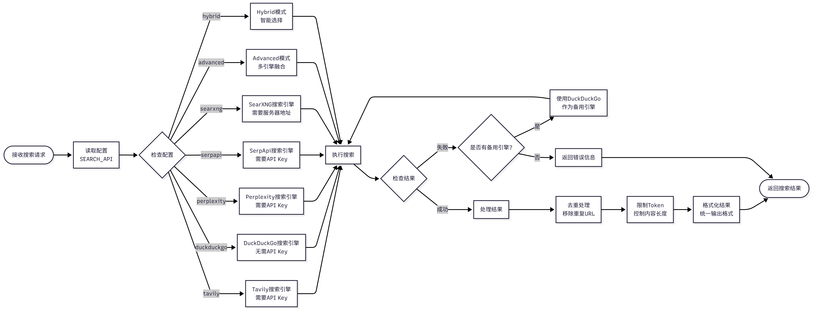

Figure 14.8 Search Engine Scheduling Process

图 14.8 搜索引擎调度流程

**Scheduling Logic**:

**调度逻辑<strong>：

1. **Read configuration**: Read `SEARCH_API` configuration from `.env` file

   </strong>读取配置<strong>：从`.env`文件读取`SEARCH_API`配置

2. **Select engine**: Select search engine based on configuration (tavily, duckduckgo, perplexity, etc.)

   </strong>选择引擎<strong>：根据配置选择搜索引擎（tavily、duckduckgo、perplexity 等）

3. **Execute search**: Call SearchTool to execute search

   </strong>执行搜索<strong>：调用 SearchTool 执行搜索

4. **Process results**: Deduplicate, limit tokens, format

   </strong>处理结果<strong>：去重、限制 Token、格式化

5. **Return results**: Return processed search results

   </strong>返回结果<strong>：返回处理后的搜索结果

To improve efficiency and reduce costs, we can add search result caching:

为了提高效率和降低成本，我们可以添加搜索结果缓存：

```python
import hashlib
import json
from pathlib import Path

class SearchService:
    def __init__(self, config: Configuration):
        self.config = config
        self.search_tool = SearchTool(backend="hybrid")

        # Cache directory
        self.cache_dir = Path("./cache/search")
        self.cache_dir.mkdir(parents=True, exist_ok=True)

    def search(
        self,
        query: str,
        max_results: int = 5,
        use_cache: bool = True
    ) -> List[dict]:
        """Execute search (with cache)"""
        # Generate cache key
        cache_key = self._generate_cache_key(query, max_results)
        cache_file = self.cache_dir / f"{cache_key}.json"

        # Try to read from cache
        if use_cache and cache_file.exists():
            logger.info(f"Reading search results from cache: {query}")
            with open(cache_file, "r", encoding="utf-8") as f:
                return json.load(f)

        # Execute search
        results = self._execute_search(query, max_results)

        # Save to cache
        if use_cache and results:
            with open(cache_file, "w", encoding="utf-8") as f:
                json.dump(results, f, ensure_ascii=False, indent=2)

        return results

    def _generate_cache_key(self, query: str, max_results: int) -> str:
        """Generate cache key"""
        # Generate MD5 hash using query and max results
        content = f"{query}_{max_results}_{self.config.search_api.value}"
        return hashlib.md5(content.encode()).hexdigest()
```

Through four core services (PlanningService, SummarizationService, ReportingService, SearchService), we built a complete research process. These services each perform their duties and collaborate through clear interfaces, achieving an automated process from research topic to final report.

通过四个核心服务（PlanningService、SummarizationService、ReportingService、SearchService），我们构建了一个完整的研究流程。这些服务各司其职，通过清晰的接口协作，实现了从研究主题到最终报告的自动化流程。

<a id="146-front-end-interaction-design"></a>
<a id="146-前端交互设计"></a>

## 14.6 Front-End Interaction Design / 前端交互设计

In the previous sections, we implemented the complete back-end system. This section will introduce the front-end interaction design in detail, including full-screen modal dialog UI, real-time progress display, and research result visualization.

在前面的章节中，我们实现了完整的后端系统。本节将详细介绍前端交互设计，包括全屏模态对话框 UI、实时进度展示和研究结果可视化。

<a id="1461-full-screen-modal-dialog-ui-design"></a>
<a id="1461-全屏模态对话框-ui-设计"></a>

### 14.6.1 Full-Screen Modal Dialog UI Design / 全屏模态对话框 UI 设计

The deep research assistant adopts a full-screen modal dialog UI design, which has the following advantages:

深度研究助手采用全屏模态对话框的 UI 设计，这种设计有以下优势：

1. **Immersive experience**: Full-screen display, avoiding distractions, focusing on research

   </strong>沉浸式体验<strong>：全屏显示，避免干扰，专注于研究

2. **Clear hierarchy**: Main page and research page are separated, with clear hierarchy

   </strong>清晰的层次<strong>：主页面和研究页面分离，层次清晰

3. **Easy to close**: Click the close button or press ESC key to return to the main page

   </strong>易于关闭<strong>：点击关闭按钮或按 ESC 键即可返回主页面

4. **Responsive design**: Adapts to different screen sizes

   </strong>响应式设计<strong>：适配不同屏幕尺寸

As shown in Figure 14.9, the full-screen modal dialog contains the following parts:

如图 14.9 所示，全屏模态对话框包含以下部分：

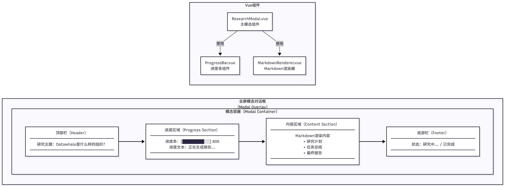

Figure 14.9 Full-Screen Modal Dialog UI

图 14.9 全屏模态对话框 UI

**UI Components**:

</strong>UI 组件<strong>：

1. **Top bar**: Contains research topic and close button

   </strong>顶部栏<strong>：包含研究主题和关闭按钮

2. **Progress area**: Shows current research progress (planning, execution, reporting)

   </strong>进度区域<strong>：显示当前研究进度（规划、执行、报告）

3. **Content area**: Shows research results (Markdown format)

   </strong>内容区域<strong>：显示研究结果（Markdown 格式）

4. **Bottom bar**: Shows status information (such as "Researching...", "Completed")

   </strong>底部栏**：显示状态信息（如"研究中..."、"已完成"）

The corresponding Vue implementation is as follows (ResearchModal.vue):

对应的 Vue 实现如下所示(ResearchModal.vue):

```vue
<template>
  <div v-if="isOpen" class="modal-overlay" @click.self="close">
    <div class="modal-container">
      <!-- Top bar -->
      <div class="modal-header">
        <h2>{{ researchTopic }}</h2>
        <button @click="close" class="close-button">
          <svg><!-- Close icon --></svg>
        </button>
      </div>

      <!-- Progress area -->
      <div class="progress-section">
        <div class="progress-bar">
          <div
            class="progress-fill"
            :style="{ width: progressPercentage + '%' }"
          ></div>
        </div>
        <div class="progress-text">{{ progressText }}</div>
      </div>

      <!-- Content area -->
      <div class="content-section">
        <div v-if="isLoading" class="loading-spinner">
          <div class="spinner"></div>
          <p>Researching, please wait...</p>
        </div>

        <div v-else class="markdown-content" v-html="renderedMarkdown"></div>
      </div>

      <!-- Bottom bar -->
      <div class="modal-footer">
        <span class="status-text">{{ statusText }}</span>
      </div>
    </div>
  </div>
</template>

<script setup lang="ts">
import { ref, computed, watch } from 'vue'
import { marked } from 'marked'

interface Props {
  isOpen: boolean
  researchTopic: string
}

const props = defineProps<Props>()
const emit = defineEmits<{
  close: []
}>()

// State
const isLoading = ref(true)
const progressPercentage = ref(0)
const progressText = ref('Preparing...')
const statusText = ref('Researching...')
const markdownContent = ref('')

// Render Markdown
const renderedMarkdown = computed(() => {
  return marked(markdownContent.value)
})

// Close modal
const close = () => {
  emit('close')
}

// Listen for ESC key
const handleKeydown = (e: KeyboardEvent) => {
  if (e.key === 'Escape') {
    close()
  }
}

// Add keyboard listener on mount
watch(() => props.isOpen, (isOpen) => {
  if (isOpen) {
    document.addEventListener('keydown', handleKeydown)
  } else {
    document.removeEventListener('keydown', handleKeydown)
  }
})
</script>

<style scoped>
.modal-overlay {
  position: fixed;
  top: 0;
  left: 0;
  width: 100vw;
  height: 100vh;
  background-color: rgba(0, 0, 0, 0.5);
  display: flex;
  justify-content: center;
  align-items: center;
  z-index: 1000;
}
...
</style>
```

To adapt to different screen sizes, we add media queries:

为了适配不同屏幕尺寸，我们添加媒体查询：

```css
/* Tablet devices */
@media (max-width: 768px) {
  .modal-container {
    width: 95vw;
    height: 95vh;
  }

  .modal-header,
  .progress-section,
  .content-section,
  .modal-footer {
    padding: 15px 20px;
  }
}

/* Mobile devices */
@media (max-width: 480px) {
  .modal-container {
    width: 100vw;
    height: 100vh;
    border-radius: 0;
  }

  .modal-header h2 {
    font-size: 18px;
  }
}
```

<a id="1462-real-time-progress-display"></a>
<a id="1462-实时进度展示"></a>

### 14.6.2 Real-Time Progress Display / 实时进度展示

The deep research assistant uses SSE to implement real-time progress display. SSE is a server push technology that allows the server to actively send data to the client, which is also explained in the protocol chapter.

深度研究助手使用 SSE 实现实时进度展示。SSE 是一种服务器推送技术，允许服务器主动向客户端发送数据，在协议章节也有所讲解。

As shown in Figure 14.10, the SSE process includes the following steps:

如图 14.10 所示，SSE 流程包括以下步骤：

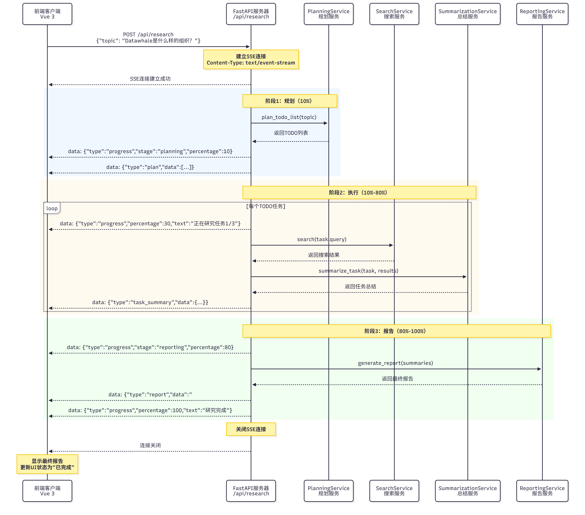

Figure 14.10 SSE Process

图 14.10 SSE 流程

**Process Description**:

<strong>流程说明</strong>：

1. **Client initiates request**: Send POST request to `/api/research`, containing research topic

   <strong>客户端发起请求</strong>：发送 POST 请求到`/api/research`，包含研究主题

2. **Server establishes SSE connection**: Return `text/event-stream` response

   <strong>服务器建立 SSE 连接</strong>：返回`text/event-stream`响应

3. **Server pushes progress**: Periodically push research progress (planning, execution, reporting)

   <strong>服务器推送进度</strong>：定期推送研究进度（规划、执行、报告）

4. **Client receives progress**: Listen for SSE events, update UI

   <strong>客户端接收进度</strong>：监听 SSE 事件，更新 UI

5. **Research complete**: Server pushes final report, closes connection

   <strong>研究完成</strong>：服务器推送最终报告，关闭连接

If you want to use SSE in front-end and back-end projects, you also need to make the following configurations.

如果想把 SSE 用于前后端的项目中还需要做如下配置。

**Back-End FastAPI SSE Endpoint**:

<strong>后端 FastAPI SSE 端点</strong>：

```python
from fastapi import FastAPI
from fastapi.responses import StreamingResponse
from typing import AsyncGenerator
import asyncio
import json

app = FastAPI()

async def research_stream(topic: str) -> AsyncGenerator[str, None]:
    """Research streaming generator

    Generate SSE format data:
    data: {"type": "progress", "data": {...}}

    """
    try:
        # 1. Planning stage
        yield f"data: {json.dumps({'type': 'progress', 'stage': 'planning', 'percentage': 10, 'text': 'Planning research tasks...'})}\n\n"

        # Call PlanningService
        todo_items = await planning_service.plan_todo_list(topic)

        yield f"data: {json.dumps({'type': 'plan', 'data': [item.dict() for item in todo_items]})}\n\n"

        # 2. Execution stage
        task_summaries = []
        for idx, task in enumerate(todo_items, start=1):
            # Update progress
            percentage = 10 + (idx / len(todo_items)) * 70
            yield f"data: {json.dumps({'type': 'progress', 'stage': 'executing', 'percentage': percentage, 'text': f'Researching task {idx}/{len(todo_items)}: {task.title}'})}\n\n"

            # Search
            search_results = await search_service.search(task.query)

            # Summarize
            summary, source_urls = await summarization_service.summarize_task(task, search_results)

            task_summaries.append((task, summary, source_urls))

            # Push task summary
            yield f"data: {json.dumps({'type': 'task_summary', 'task_id': task.id, 'summary': summary})}\n\n"

        # 3. Reporting stage
        yield f"data: {json.dumps({'type': 'progress', 'stage': 'reporting', 'percentage': 90, 'text': 'Generating final report...'})}\n\n"

        # Generate report
        report = await reporting_service.generate_report(topic, task_summaries)

        # Push final report
        yield f"data: {json.dumps({'type': 'report', 'data': report})}\n\n"

        # Complete
        yield f"data: {json.dumps({'type': 'progress', 'stage': 'completed', 'percentage': 100, 'text': 'Research complete!'})}\n\n"

    except Exception as e:
        # Error handling
        yield f"data: {json.dumps({'type': 'error', 'message': str(e)})}\n\n"

@app.post("/api/research")
async def research(request: ResearchRequest):
    """Research endpoint (SSE)"""
    return StreamingResponse(
        research_stream(request.topic),
        media_type="text/event-stream",
        headers={
            "Cache-Control": "no-cache",
            "Connection": "keep-alive",
        }
    )
```

**Front-End Using EventSource to Receive SSE**:

<strong>前端使用 EventSource 接收 SSE</strong>：

```typescript
// composables/useResearch.ts
import { ref } from 'vue'

export function useResearch() {
  const isLoading = ref(false)
  const progressPercentage = ref(0)
  const progressText = ref('')
  const markdownContent = ref('')
  const error = ref<string | null>(null)

  const startResearch = (topic: string) => {
    isLoading.value = true
    error.value = null

    // Create EventSource
    const eventSource = new EventSource(`/api/research?topic=${encodeURIComponent(topic)}`)

    // Listen for messages
    eventSource.onmessage = (event) => {
      const data = JSON.parse(event.data)

      switch (data.type) {
        case 'progress':
          progressPercentage.value = data.percentage
          progressText.value = data.text
          break

        case 'plan':
          // Display planning results
          console.log('Planning results:', data.data)
          break

        case 'task_summary':
          // Append task summary to Markdown
          markdownContent.value += `\n\n## Task ${data.task_id}\n\n${data.summary}`
          break

        case 'report':
          // Display final report
          markdownContent.value = data.data
          break

        case 'error':
          error.value = data.message
          eventSource.close()
          isLoading.value = false
          break

        case 'completed':
          eventSource.close()
          isLoading.value = false
          break
      }
    }

    // Error handling
    eventSource.onerror = (err) => {
      console.error('SSE error:', err)
      error.value = 'Connection failed, please retry'
      eventSource.close()
      isLoading.value = false
    }
  }

  return {
    isLoading,
    progressPercentage,
    progressText,
    markdownContent,
    error,
    startResearch,
  }
}
```

**Using in Component**:

<strong>在组件中使用</strong>：

```vue
<script setup lang="ts">
import { useResearch } from '@/composables/useResearch'

const {
  isLoading,
  progressPercentage,
  progressText,
  markdownContent,
  error,
  startResearch
} = useResearch()

const handleStartResearch = (topic: string) => {
  startResearch(topic)
}
</script>
```

<a id="1463-research-result-visualization"></a>
<a id="1463-研究结果可视化"></a>

### 14.6.3 Research Result Visualization / 研究结果可视化

Research results are displayed in Markdown format, including titles, paragraphs, lists, quotes, and other elements. We use the `marked` library to convert Markdown to HTML and add custom styles.

研究结果以 Markdown 格式展示，包含标题、段落、列表、引用等元素。我们使用`marked`库将 Markdown 转换为 HTML，并添加自定义样式。

**Rendering Markdown**:

<strong>渲染 Markdown</strong>：

```typescript
import { marked } from 'marked'

// Configure marked
marked.setOptions({
  breaks: true,  // Support line breaks
  gfm: true,     // Support GitHub Flavored Markdown
})

// Render
const renderedHtml = marked(markdownContent.value)
```

Research reports contain a large number of source citations, which we need to handle specially:

研究报告中包含大量来源引用，我们需要特殊处理：

```markdown
## References

### Task 1: Basic Information about Datawhale
- [Datawhale GitHub](https://github.com/datawhalechina)
- [Datawhale Official Website](https://datawhale.club)

### Task 2: Main Projects of Datawhale
- [Hello-Agents Tutorial](https://github.com/datawhalechina/Hello-Agents)
...
```

**中文对照**

```markdown
## 参考文献

### 任务1：Datawhale的基本信息
- [Datawhale GitHub](https://github.com/datawhalechina)
- [Datawhale 官网](https://datawhale.club)

### 任务2：Datawhale的主要项目
- [Hello-Agents 教程](https://github.com/datawhalechina/Hello-Agents)
......
```

Through full-screen modal dialog UI, SSE real-time progress display, and Markdown result visualization, we built a user-friendly front-end interface. Users can clearly see the research progress and view research results in a beautiful format.

通过全屏模态对话框 UI、SSE 实时进度展示和 Markdown 结果可视化，我们构建了一个用户友好的前端界面。用户可以清晰地看到研究进度，并以美观的格式查看研究结果。

<a id="147-chapter-summary"></a>
<a id="147-本章小结"></a>

## 14.7 Chapter Summary / 本章小结

In this chapter, we built a complete automated deep research agent system from scratch. Let's review the core points:

在本章中，我们从零开始构建了一个完整的自动化深度研究智能体系统。让我们回顾一下核心要点：

**(1) TODO-Driven Research Paradigm**

<strong>（1）TODO 驱动的研究范式</strong>

We proposed a new research paradigm - TODO-driven research. This paradigm decomposes complex research topics into executable subtasks and completes research through three stages:

我们提出了一种新的研究范式——TODO 驱动的研究。这种范式将复杂的研究主题分解为可执行的子任务，通过三个阶段完成研究：

- **Planning stage**: Decompose research topic into 3-5 subtasks, each subtask contains title, intent, and search query

  <strong>规划阶段</strong>：将研究主题分解为 3-5 个子任务，每个子任务包含标题、意图和搜索查询

- **Execution stage**: Execute search and summarization for each subtask, generating structured knowledge

  <strong>执行阶段</strong>：对每个子任务执行搜索和总结，生成结构化的知识

- **Reporting stage**: Integrate summaries of all subtasks, generate final research report

  <strong>报告阶段</strong>：整合所有子任务的总结，生成最终的研究报告

The advantages of this paradigm are:

这种范式的优势在于：

1. **Strong controllability**: Each subtask has clear objectives and scope

   <strong>可控性强</strong>：每个子任务都有明确的目标和范围

2. **Reliable quality**: Dedicated Agents ensure quality at each stage

   <strong>质量可靠</strong>：通过专门的 Agent 保证每个环节的质量

3. **Easy to debug**: Can debug each subtask individually

   <strong>易于调试</strong>：可以单独调试每个子任务

4. **Good scalability**: Can easily add new subtasks or modify existing subtasks

   <strong>可扩展性好</strong>：可以轻松添加新的子任务或修改现有子任务

**(2) Three-Agent Collaboration System**

<strong>（2）三 Agent 协作系统</strong>

We designed three specialized Agents, each performing their duties:

我们设计了三个专门的 Agent，各司其职：

- **TODO Planner (Research Planning Expert)**: Responsible for decomposing research topics into subtasks

  <strong>TODO Planner（研究规划专家）</strong>：负责将研究主题分解为子任务

- **Task Summarizer (Task Summarization Expert)**: Responsible for summarizing search results for each subtask

  <strong>Task Summarizer（任务总结专家）</strong>：负责总结每个子任务的搜索结果

- **Report Writer (Report Writing Expert)**: Responsible for integrating summaries of all subtasks and generating final report

  <strong>Report Writer（报告撰写专家）</strong>：负责整合所有子任务的总结，生成最终报告

The advantages of this design are:

这种设计的优势在于：

1. **Clear responsibilities**: Each Agent focuses on a specific task

   <strong>职责清晰</strong>：每个 Agent 专注于一个特定的任务

2. **Prompt optimization**: Can customize specialized Prompts for each Agent

   <strong>Prompt 优化</strong>：可以为每个 Agent 定制专门的 Prompt

3. **Easy to maintain**: Modifying one Agent does not affect other Agents

   <strong>易于维护</strong>：修改一个 Agent 不会影响其他 Agent

4. **Quality assurance**: Each Agent is an "expert" in their field

   <strong>质量保证</strong>：每个 Agent 都是该领域的"专家"

**(3) ToolAwareSimpleAgent Design**

<strong>（3）ToolAwareSimpleAgent 的设计</strong>

We extended the `SimpleAgent` of the HelloAgents framework and implemented `ToolAwareSimpleAgent`. This Agent has tool call listening capability and can:

我们扩展了 HelloAgents 框架的`SimpleAgent`，实现了`ToolAwareSimpleAgent`。这个 Agent 具有工具调用监听能力，可以：

- **Listen to tool calls**: Listen to each tool call through callback functions

  <strong>监听工具调用</strong>：通过回调函数监听每次工具调用

- **Real-time feedback**: Push tool call information to the front-end in real-time

  <strong>实时反馈</strong>：将工具调用信息实时推送给前端

- **Debugging support**: Record all tool calls for easy debugging

  <strong>调试支持</strong>：记录所有工具调用，便于调试

This Agent has been integrated into the HelloAgents framework and can be reused in other projects.

这个 Agent 已经集成到 HelloAgents 框架中，可以在其他项目中复用。

**(4) Tool System Integration**

<strong>（4）工具系统集成</strong>

We fully utilized the tool system of the HelloAgents framework:

我们充分利用了 HelloAgents 框架的工具系统：

- **SearchTool**: Extended to support more search engines (Tavily, DuckDuckGo, Perplexity, etc.)

  <strong>SearchTool</strong>：扩展支持更多种搜索引擎（Tavily、DuckDuckGo、Perplexity 等）

- **NoteTool**: Persist research progress, support recovery and auditing

  <strong>NoteTool</strong>：持久化研究进度，支持恢复和审计

- **ToolRegistry**: Unified management of all tools, support custom extensions

  <strong>ToolRegistry</strong>：统一管理所有工具，支持自定义扩展

Through configuration-based design, users can easily switch search engines without modifying code.

通过配置化的设计，用户可以轻松切换搜索引擎，无需修改代码。

**(5) Core Service Implementation**

<strong>（5）核心服务实现</strong>

We implemented four core services connecting Agents and tools:

我们实现了四个核心服务，连接 Agent 和工具：

- **PlanningService**: Call planning Agent, parse JSON, validate format

  <strong>PlanningService</strong>：调用规划 Agent，解析 JSON，验证格式

- **SummarizationService**: Call summarization Agent, process search results, extract sources

  <strong>SummarizationService</strong>：调用总结 Agent，处理搜索结果，提取来源

- **ReportingService**: Call report Agent, integrate summaries, generate report

  <strong>ReportingService</strong>：调用报告 Agent，整合总结，生成报告

- **SearchService**: Schedule search engines, process results, error degradation, result caching

  <strong>SearchService</strong>：调度搜索引擎，处理结果，错误降级，结果缓存

These services each perform their duties and collaborate through clear interfaces, achieving an automated process from research topic to final report.

这些服务各司其职，通过清晰的接口协作，实现了从研究主题到最终报告的自动化流程。

**(6) Front-End Interaction Design**

<strong>（6）前端交互设计</strong>

We designed a user-friendly front-end interface:

我们设计了用户友好的前端界面：

- **Full-screen modal dialog**: Immersive experience, clear hierarchy

  <strong>全屏模态对话框</strong>：沉浸式体验，清晰的层次

- **SSE real-time progress**: Real-time display of research progress, good user experience

  <strong>SSE 实时进度</strong>：实时展示研究进度，用户体验良好

- **Markdown visualization**: Beautiful format, clear structure

  <strong>Markdown 可视化</strong>：美观的格式，清晰的结构

Through the Vue 3 + TypeScript + SSE technology stack, we implemented a modern web application.

通过 Vue 3 + TypeScript + SSE 的技术栈，我们实现了一个现代化的 Web 应用。

This knowledge is not only applicable to deep research assistants, but can also be applied to other AI applications. We hope readers can explore more possibilities based on this chapter and build more powerful AI systems.

这些知识不仅适用于深度研究助手，也可以应用到其他 AI 应用中。希望读者能够在本章的基础上，探索更多的可能性，构建出更强大的 AI 系统。

In the next chapter, we will build a multi-agent system combined with a game engine - Cyber Town, exploring complex interaction and collaboration patterns between Agents. Stay tuned!

在下一章中，我们将构建一个与游戏引擎结合的多 Agent 系统——赛博小镇，探索 Agent 之间的复杂交互和协作模式。敬请期待！

---

[上一章：智能旅行助手 / Previous: Intelligent Travel Assistant ←](../chapter-13-intelligent-travel-assistant/)
