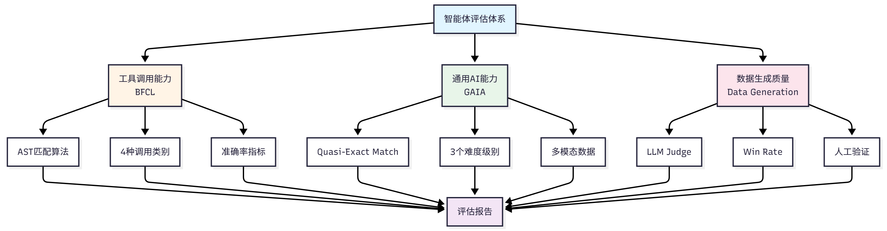
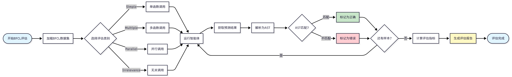
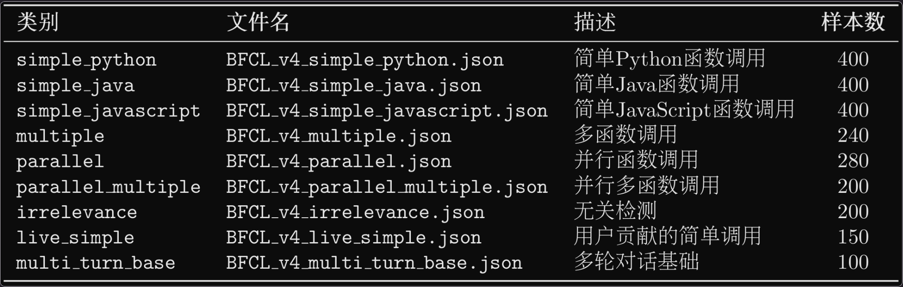
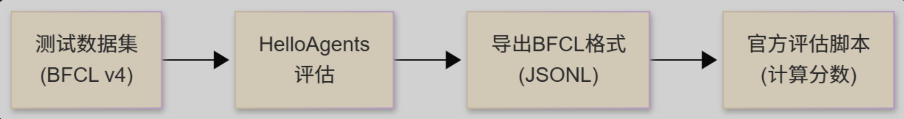
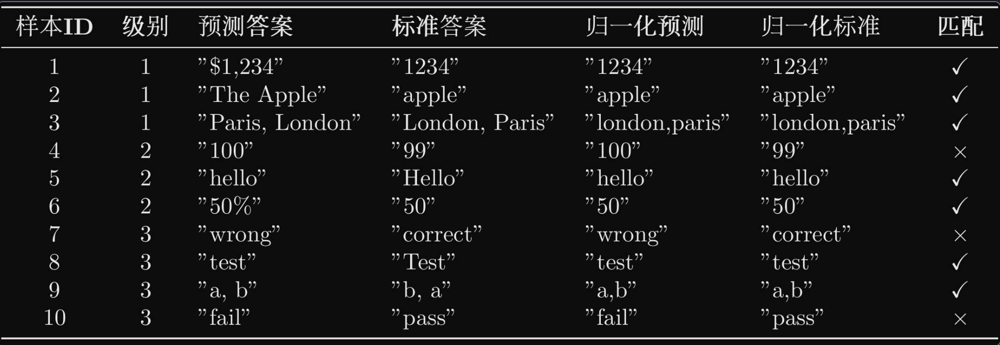
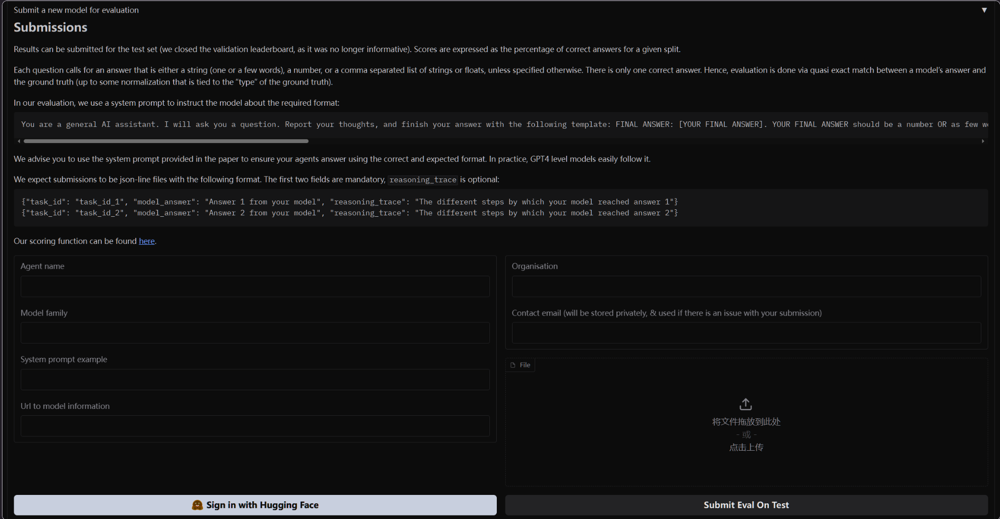
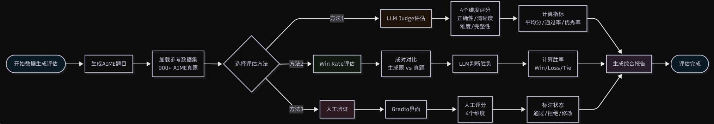
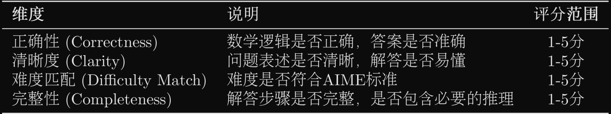
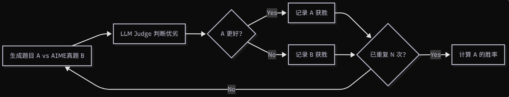
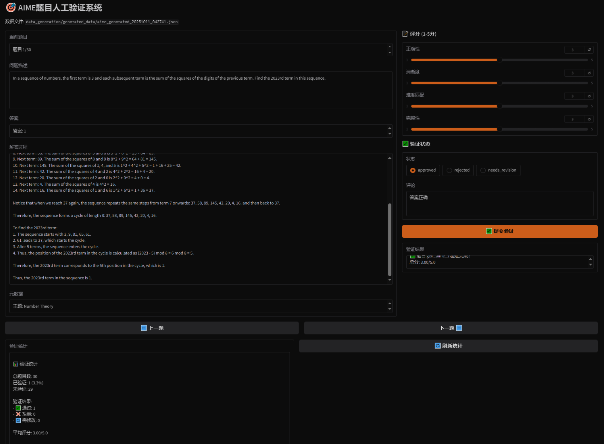

[toc]


<a id="chapter-12-agent-performance-evaluation"></a>
<a id="第十二章-智能体性能评估"></a>

# Chapter 12: Agent Performance Evaluation / 第十二章 智能体性能评估

In previous chapters, we built the core functionality of the HelloAgents framework, implementing various agent paradigms, tool systems, memory mechanisms, and reinforcement learning training. When building agent systems, we also need to solve a core problem: **How to objectively evaluate agent performance?** Specifically, we need to answer the following questions:

在前面的章节中，我们构建了 HelloAgents 框架的核心功能，实现了多种智能体范式、工具系统、记忆机制和强化学习训练等。在构建智能体系统时，我们还需要解决一个核心问题：<strong>如何客观地评估智能体的性能？</strong> 具体来说，我们需要回答以下问题：

1. Does the agent possess the expected capabilities?

    智能体是否具备预期的能力？

2. How does it perform on different tasks?

    在不同任务上的表现如何？

3. What level is it at compared to other agents?

    与其他智能体相比处于什么水平？

This chapter will add a **Performance Evaluation System** to HelloAgents. We will deeply understand the theoretical foundation of agent evaluation and implement evaluation tools.

本章将为 HelloAgents 增加<strong>性能评估系统（Evaluation System）</strong>。我们将深入理解智能体评估的理论基础，并实现评估的工具。

<a id="121-agent-evaluation-fundamentals"></a>
<a id="121-智能体评估基础"></a>

## 12.1 Agent Evaluation Fundamentals / 智能体评估基础

<a id="1211-why-agent-evaluation-is-needed"></a>
<a id="1211-为何需要智能体评估"></a>

### 12.1.1 Why Agent Evaluation is Needed / 为何需要智能体评估

We now have SimpleAgent, which already possesses powerful reasoning and tool invocation capabilities. Let's look at a typical usage scenario:

我们现在的 SimpleAgent，它已经具备了强大的推理和工具调用能力。让我们看一个典型的使用场景：

```python
from hello_agents import SimpleAgent, HelloAgentsLLM
from hello_agents.tools import SearchTool

# Create LLM and agent
llm = HelloAgentsLLM()

# Create a system prompt emphasizing tool use
system_prompt = """You are an AI assistant that can use search tools to obtain the latest information.

When you need to search for information, please use the following format:
[TOOL_CALL:search:search keywords]

For example:
- [TOOL_CALL:search:latest AI news]
- [TOOL_CALL:search:Python programming tutorial]

Please use the search tool to obtain the latest information before answering questions."""

agent = SimpleAgent(name="AI Assistant", llm=llm, system_prompt=system_prompt)

# Add search tool
agent.add_tool(SearchTool())

# Example: Use search tool to answer questions
response = agent.run("What are the latest AI technology development trends?")
print(f"\nAnswer: {response}")
```

This agent can work normally, but we face a core problem: How to objectively evaluate its performance? When we optimize prompts or change LLM models, how do we know if there's real improvement? Before deploying to production environment, how do we ensure agent reliability? These questions all need to be solved through systematic evaluation.

这个智能体能正常工作，但我们面临一个核心问题：如何客观地评估它的性能？当我们优化提示词或更换 LLM 模型后，如何知道是否真的有改进？在部署到生产环境前，如何保证智能体的可靠性？这些问题都需要通过系统化的评估来解决。

The core value of agent evaluation lies in providing standardized methods to measure agent capabilities. Through evaluation, we can quantify agent performance with specific numerical metrics, objectively compare the merits of different design solutions, promptly discover agent weaknesses in specific scenarios, and prove agent reliability to users.

智能体评估的核心价值在于提供标准化的方法来衡量智能体的能力。通过评估，我们可以用具体的数字指标量化智能体的表现，客观比较不同设计方案的优劣，及时发现智能体在特定场景下的弱点，并向用户证明智能体的可靠性。

Unlike traditional software testing, agent evaluation faces unique challenges. First is output uncertainty - the same question may have multiple correct answers, making it difficult to judge with simple right or wrong. Second is diversity of evaluation criteria - different tasks require different evaluation methods; tool invocation needs to check function signatures, while Q&A tasks need to evaluate semantic similarity. Finally is high evaluation cost - each evaluation requires numerous API calls, potentially costing hundreds of yuan or more.

与传统软件测试不同，智能体评估面临着独特的挑战。首先是输出的不确定性，同一问题可能有多个正确答案，很难用简单的对错来判断。其次是评估标准的多样性，不同任务需要不同的评估方法，工具调用需要检查函数签名，问答任务需要评估语义相似度。最后是评估成本的高昂，每次评估都需要大量的 API 调用，成本可能达到数百元甚至更多。

To address these challenges, academia and industry have proposed multiple standardized **Benchmarks**. These benchmarks provide unified datasets, evaluation metrics, and scoring methods, enabling us to evaluate and compare different agent systems under the same standards.

为了应对这些挑战，学术界和工业界提出了多个标准化的<strong>评估基准（Benchmark）</strong>。这些基准提供了统一的数据集、评估指标和评分方法，使我们能够在相同的标准下评估和对比不同的智能体系统。

<a id="1212-overview-of-mainstream-evaluation-benchmarks"></a>
<a id="1212-主流评估基准概览"></a>

### 12.1.2 Overview of Mainstream Evaluation Benchmarks / 主流评估基准概览

The agent evaluation field has seen the emergence of multiple influential benchmark tests. Below are some mainstream evaluation benchmarks and metrics:

智能体评估领域已经涌现出多个具有影响力的基准测试。下面介绍一些主流的评估基准和指标：

**(1) Tool Invocation Capability Evaluation**

<strong>（1）工具调用能力评估</strong>

Tool invocation is one of the core capabilities of agents. Agents need to understand user intent, select appropriate tools, and correctly construct function calls. Related evaluation benchmarks include:

工具调用是智能体的核心能力之一。智能体需要理解用户意图，选择合适的工具，并正确构造函数调用。相关的评估基准包括：

- **BFCL (Berkeley Function Calling Leaderboard)**<sup>[1]</sup>: Launched by UC Berkeley, includes 1120+ test samples, covering four categories: simple, multiple, parallel, irrelevance, uses AST matching algorithm for evaluation, moderate dataset size, active community.

    <strong>BFCL (Berkeley Function Calling Leaderboard)</strong><sup>[1]</sup>：UC Berkeley 推出，包含 1120+测试样本，涵盖 simple、multiple、parallel、irrelevance 四个类别，使用 AST 匹配算法评估，数据集规模适中，社区活跃。

- **ToolBench**<sup>[2]</sup>: Launched by Tsinghua University, includes 16000+ real API call scenarios, covering complex tool usage scenarios in the real world.

    <strong>ToolBench</strong><sup>[2]</sup>：清华大学推出，包含 16000+真实 API 调用场景，覆盖真实世界的复杂工具使用场景。

- **API-Bank**<sup>[3]</sup>: Launched by Microsoft Research, includes 53 commonly used API tools, focuses on evaluating agent understanding and invocation of API documentation.

    <strong>API-Bank</strong><sup>[3]</sup>：Microsoft Research 推出，包含 53 个常用 API 工具，专注于评估智能体对 API 文档的理解和调用能力。

**(2) General Capability Evaluation**

<strong>（2）通用能力评估</strong>

Evaluates agent comprehensive performance in real-world tasks, including multi-step reasoning, knowledge application, multimodal understanding, etc.:

评估智能体在真实世界任务中的综合表现，包括多步推理、知识运用、多模态理解等能力：

- **GAIA (General AI Assistants)**<sup>[4]</sup>: Jointly launched by Meta AI and Hugging Face, includes 466 real-world problems, divided into Level 1/2/3 difficulty levels, evaluates multi-step reasoning, tool use, file processing, web browsing capabilities, uses Quasi Exact Match algorithm, tasks are realistic and comprehensive.

    <strong>GAIA (General AI Assistants)</strong><sup>[4]</sup>：Meta AI 和 Hugging Face 联合推出，包含 466 个真实世界问题，分为 Level 1/2/3 三个难度级别，评估多步推理、工具使用、文件处理、网页浏览等能力，使用准精确匹配（Quasi Exact Match）算法，任务真实且综合性强。

- **AgentBench**<sup>[5]</sup>: Launched by Tsinghua University, includes 8 tasks in different domains, comprehensively evaluates agent general capabilities.

    <strong>AgentBench</strong><sup>[5]</sup>：清华大学推出，包含 8 个不同领域的任务，全面评估智能体的通用能力。

- **WebArena**<sup>[6]</sup>: Launched by CMU, evaluates agent task completion and web interaction capabilities in real web environments.

    <strong>WebArena</strong><sup>[6]</sup>：CMU 推出，评估智能体在真实网页环境中的任务完成能力和网页交互能力。

**(3) Multi-Agent Collaboration Evaluation**

<strong>（3）多智能体协作评估</strong>

Evaluates the ability of multiple agents to work collaboratively:

评估多个智能体协同工作的能力：

- **ChatEval**<sup>[7]</sup>: Evaluates quality of multi-agent dialogue systems.

    <strong>ChatEval</strong><sup>[7]</sup>：评估多智能体对话系统的质量。

- **SOTOPIA**<sup>[8]</sup>: Evaluates agent interaction capabilities in social scenarios.

    <strong>SOTOPIA</strong><sup>[8]</sup>：评估智能体在社交场景中的互动能力。

- **Custom Collaboration Scenarios**: Evaluation tasks designed according to specific application scenarios.

    <strong>自定义协作场景</strong>：根据具体应用场景设计的评估任务。

**(4) Common Evaluation Metrics**

<strong>（4）常用评估指标</strong>

Different benchmarks use different evaluation metrics, common ones include:

不同基准使用不同的评估指标，常见的包括：

- **Accuracy Metrics**: Accuracy, Exact Match, F1 Score, used to measure answer correctness.

    <strong>准确性指标</strong>：Accuracy（准确率）、Exact Match（精确匹配）、F1 Score（F1 分数），用于衡量答案的正确性。

- **Efficiency Metrics**: Response Time, Token Usage, used to measure execution efficiency.

    <strong>效率指标</strong>：Response Time（响应时间）、Token Usage（Token 使用量），用于衡量执行效率。

- **Robustness Metrics**: Error Rate, Failure Recovery, used to measure fault tolerance.

    <strong>鲁棒性指标</strong>：Error Rate（错误率）、Failure Recovery（故障恢复），用于衡量容错能力。

- **Collaboration Metrics**: Communication Efficiency, Task Completion, used to measure collaboration effectiveness.

    <strong>协作指标</strong>：Communication Efficiency（通信效率）、Task Completion（任务完成度），用于衡量协作效果。

<a id="1213-helloagents-evaluation-system-design"></a>
<a id="1213-helloagents-评估体系设计"></a>

### 12.1.3 HelloAgents Evaluation System Design / HelloAgents 评估体系设计

Considering learning curve and practicality, this chapter will focus on the following evaluation scenarios:

考虑到学习曲线和实用性，本章将重点介绍以下评估场景：

1. **BFCL**: Evaluate tool invocation capability

    <strong>BFCL</strong>：评估工具调用能力

    - Selection rationale: Moderate dataset size, clear evaluation metrics, active community

        选择理由：数据集规模适中，评估指标清晰，社区活跃

    - Applicable scenarios: Evaluate agent function call accuracy

        适用场景：评估智能体的函数调用准确性

2. **GAIA**: Evaluate general AI assistant capability

    <strong>GAIA</strong>：评估通用 AI 助手能力

    - Selection rationale: Realistic tasks, difficulty grading, strong comprehensiveness

        选择理由：任务真实，难度分级，综合性强

    - Applicable scenarios: Evaluate agent comprehensive problem-solving capability

        适用场景：评估智能体的综合问题解决能力

3. **Data Generation Quality Evaluation**: Evaluate LLM-generated data quality

    <strong>数据生成质量评估</strong>：评估 LLM 生成数据质量

    - Selection rationale: Through this case, experience complete demonstration of using Agent to create data and evaluate data

        选择理由：通过这个案例可以完整体验如何使用 Agent 创造数据，评估数据的完整演示。

    - Applicable scenarios: Evaluate quality of generated training data and test data

        适用场景：评估生成的训练数据、测试数据的质量

    - Evaluation methods: LLM Judge, Win Rate, manual verification

        评估方法：LLM Judge、Win Rate、人工验证

Through these three evaluation scenarios, we will build a complete evaluation system. Figure 12.1 shows our evaluation system construction approach.

通过这三个评估场景，我们将构建一个完整的评估体系，如图 12.1 展示了我们的评估系统构建思路。


Figure 12.1 HelloAgents Evaluation System Architecture

图 12.1 HelloAgents 评估体系架构图

<a id="1214-chapter-learning-objectives-and-quick-experience"></a>
<a id="1214-本章学习目标与快速体验"></a>

### 12.1.4 Chapter Learning Objectives and Quick Experience / 本章学习目标与快速体验

Let's first look at the learning content of Chapter 12:

让我们先看看第十二章的学习内容：

```
hello_agents/
├── evaluation/                         # Evaluation module
│   └── benchmarks/                     # Evaluation benchmark implementation
│       ├── bfcl/                       # BFCL evaluation implementation
│       │   ├── dataset.py              # BFCL dataset loader
│       │   ├── evaluator.py            # BFCL evaluator (AST matching)
│       │   ├── metrics.py              # BFCL-specific metrics
│       │   └── ast_matcher.py          # AST matching algorithm
│       ├── gaia/                       # GAIA evaluation implementation
│       │   ├── dataset.py              # GAIA dataset loader
│       │   ├── evaluator.py            # GAIA evaluator (quasi exact match)
│       │   ├── metrics.py              # GAIA-specific metrics
│       │   └── quasi_exact_match.py    # Quasi exact match algorithm
│       └── data_generation/            # Data generation evaluation implementation
│           ├── dataset.py              # AIME dataset loader
│           ├── llm_judge.py            # LLM Judge evaluator
│           └── win_rate.py             # Win Rate evaluator
└── tools/builtin/                      # Built-in tools module
    ├── bfcl_evaluation_tool.py         # BFCL evaluation tool
    ├── gaia_evaluation_tool.py         # GAIA evaluation tool
    ├── llm_judge_tool.py               # LLM Judge tool
    └── win_rate_tool.py                # Win Rate tool
```

**中文对照**

```
hello_agents/
├── evaluation/                         # 评估模块
│   └── benchmarks/                     # 评估基准实现
│       ├── bfcl/                       # BFCL评估实现
│       │   ├── dataset.py              # BFCL数据集加载器
│       │   ├── evaluator.py            # BFCL评估器（AST匹配）
│       │   ├── metrics.py              # BFCL专用指标
│       │   └── ast_matcher.py          # AST匹配算法
│       ├── gaia/                       # GAIA评估实现
│       │   ├── dataset.py              # GAIA数据集加载器
│       │   ├── evaluator.py            # GAIA评估器（准精确匹配）
│       │   ├── metrics.py              # GAIA专用指标
│       │   └── quasi_exact_match.py    # 准精确匹配算法
│       └── data_generation/            # 数据生成评估实现
│           ├── dataset.py              # AIME数据集加载器
│           ├── llm_judge.py            # LLM Judge评估器
│           └── win_rate.py             # Win Rate评估器
└── tools/builtin/                      # 内置工具模块
    ├── bfcl_evaluation_tool.py         # BFCL评估工具
    ├── gaia_evaluation_tool.py         # GAIA评估工具
    ├── llm_judge_tool.py               # LLM Judge工具
    └── win_rate_tool.py                # Win Rate工具
```

For this chapter's content, the learning objective is to master the ability to apply evaluation tools. Let's first prepare the development environment:

对于这一章的内容，学习目标是掌握应用评估工具的能力。让我们先准备好开发环境：

```bash
# Install HelloAgents framework (Chapter 12 version)
pip install "hello-agents[evaluation]==0.2.7"

# Set environment variables
export HF_TOKEN="your_huggingface_token"     # For GAIA dataset (setup steps will follow)

# Since the official `bfcl-eval` package requires numpy<=2.0.0, which conflicts with HelloAgents main dependencies, separate installation is needed
pip install "numpy==1.26.4" bfcl-eval
```

In the following sections, we will deeply learn the detailed usage and introduction of each evaluation method.

在接下来的章节中，我们将深入学习每种评估方法的详细用法和介绍。

<a id="122-bfcl-tool-invocation-capability-evaluation"></a>
<a id="122-bfcl工具调用能力评估"></a>

## 12.2 BFCL: Tool Invocation Capability Evaluation / BFCL：工具调用能力评估

<a id="1221-bfcl-benchmark-introduction"></a>
<a id="1221-bfcl-基准介绍"></a>

### 12.2.1 BFCL Benchmark Introduction / BFCL 基准介绍

BFCL (Berkeley Function Calling Leaderboard) is a function calling capability evaluation benchmark launched by UC Berkeley<sup>[1]</sup>. In agent systems, tool calling is one of the core capabilities. Agents need to complete the following tasks:

BFCL (Berkeley Function Calling Leaderboard) 是由加州大学伯克利分校推出的函数调用能力评估基准<sup>[1]</sup>。在智能体系统中，工具调用（Tool Calling）是核心能力之一。智能体需要完成以下任务：

1. **Understand Task Requirements**: Extract key information from user's natural language description

    <strong>理解任务需求</strong>：从用户的自然语言描述中提取关键信息

2. **Select Appropriate Tools**: Choose the most suitable tool from available tool set

    <strong>选择合适工具</strong>：从可用工具集中选择最适合的工具

3. **Construct Function Calls**: Correctly fill in function name and parameters

    <strong>构造函数调用</strong>：正确填写函数名和参数

4. **Handle Complex Scenarios**: Support advanced scenarios like multi-function calls, parallel calls

    <strong>处理复杂场景</strong>：支持多函数调用、并行调用等高级场景

The BFCL benchmark contains four evaluation categories with increasing difficulty. Starting from the most basic single function call (Simple), gradually increasing to scenarios requiring multiple function calls (Multiple), then to complex scenarios requiring parallel calls of multiple functions (Parallel), and finally to scenarios requiring judgment of whether function calls are needed (Irrelevance). These four categories cover various tool calling scenarios that agents may encounter in practical applications, as shown in Table 12.1:

BFCL 基准包含四个评估类别，难度递增。从最基础的单函数调用（Simple）开始，逐步增加到需要调用多个函数的场景（Multiple），再到需要并行调用多个函数的复杂场景（Parallel），最后是需要判断是否需要调用函数的场景（Irrelevance）。这四个类别覆盖了智能体在实际应用中可能遇到的各种工具调用场景，如表 12.1 所示：



Table 12.1 Four Evaluation Categories in BFCL Benchmark

表 12.1 BFCL 基准中的四个评估类别

The BFCL evaluation process follows standard benchmark testing procedures: first load dataset and select evaluation category, then run agent to obtain prediction results, next parse prediction results into Abstract Syntax Tree (AST), and finally judge whether predictions are correct through AST matching algorithm. The entire process traverses all test samples, ultimately calculating evaluation metrics like accuracy and generating evaluation reports. The complete evaluation process is shown in Figure 12.2:

BFCL 的评估流程遵循标准的基准测试流程：首先加载数据集并选择评估类别，然后运行智能体获取预测结果，接着将预测结果解析为抽象语法树（AST），最后通过 AST 匹配算法判断预测是否正确。整个流程会遍历所有测试样本，最终计算出准确率等评估指标并生成评估报告。完整的评估流程如图 12.2 所示：



Figure 12.2 BFCL Evaluation Process Diagram

图 12.2 BFCL 评估流程图

**(1) BFCL Dataset Structure**

<strong>（1）BFCL 数据集结构</strong>

The BFCL dataset uses JSON format, with each test sample containing the following fields:

BFCL 数据集采用 JSON 格式，每个测试样本包含以下字段：

```json
{
  "id": "simple_001",
  "question": "What's the weather like in Beijing today?",
  "function": [
    {
      "name": "get_weather",
      "description": "Get the current weather for a location",
      "parameters": {
        "type": "object",
        "properties": {
          "location": {
            "type": "string",
            "description": "The city name"
          }
        },
        "required": ["location"]
      }
    }
  ],
  "ground_truth": [
    {
      "name": "get_weather",
      "arguments": {
        "location": "Beijing"
      }
    }
  ]
}
```

**Key Field Descriptions:**

<strong>关键字段说明：</strong>

- `question`: User's natural language request

    `question`: 用户的自然语言请求

- `function`: List of available functions (including function signatures and descriptions)

    `function`: 可用的函数列表（包含函数签名和描述）

- `ground_truth`: Standard answer (expected function call)

    `ground_truth`: 标准答案（期望的函数调用）

**(2) AST Matching Explanation**

<strong>（2）AST 匹配说明</strong>

BFCL uses **AST Matching (Abstract Syntax Tree Matching)** as the core evaluation algorithm, so let's understand the evaluation strategy below.

BFCL 使用<strong>AST 匹配（Abstract Syntax Tree Matching）</strong>作为核心评估算法，因此下文可以了解一下评估的策略。

BFCL uses Abstract Syntax Tree (AST) for intelligent matching, rather than simple string matching. The core idea of AST matching is: **Parse function calls into syntax trees, then compare tree structure and node values**.

BFCL 使用抽象语法树（AST）进行智能匹配，而不是简单的字符串匹配。AST 匹配的核心思想是：<strong>将函数调用解析为语法树，然后比较树的结构和节点值</strong>。

Given predicted function call $P$ and standard answer $G$, the AST matching function is defined as:

给定预测的函数调用 $P$ 和标准答案 $G$，AST 匹配函数定义为：

$$
\text{AST\_Match}(P, G) = \begin{cases}
1 & \text{if } \text{AST}(P) \equiv \text{AST}(G) \\
0 & \text{otherwise}
\end{cases}
$$

Where $\text{AST}(x)$ represents parsing function call into abstract syntax tree, $\equiv$ represents syntax tree equivalence.

其中 $\text{AST}(x)$ 表示将函数调用解析为抽象语法树，$\equiv$ 表示语法树等价。

Two syntax trees are equivalent if they satisfy three core conditions: function names must be completely identical (exact match), parameter key-value pair sets are equal (ignoring order), and each parameter value is semantically equivalent (e.g., `2+3` is equivalent to `5`). In the specific matching process, function name matching requires exact string matching, for example `get_weather` and `get_temperature` are considered different functions. Parameter matching uses AST for intelligent comparison, allowing different parameter orders (`f(a=1, b=2)` is equivalent to `f(b=2, a=1)`), allowing equivalent expressions (`f(x=2+3)` is equivalent to `f(x=5)`), and also allowing different string representations (`f(s="hello")` is equivalent to `f(s='hello')`). For multi-function call scenarios, the matching algorithm requires calling the same number of functions, each function call must match, but call order can differ (using set matching).

两个语法树等价需要满足三个核心条件：函数名必须完全一致（精确匹配），参数键值对集合相等（忽略顺序），以及每个参数的值在语义上等价（例如 `2+3` 等价于 `5`）。在具体的匹配过程中，函数名匹配要求字符串精确匹配，例如 `get_weather` 和 `get_temperature` 被视为不同的函数。参数匹配则使用 AST 进行智能比较，允许参数顺序不同（`f(a=1, b=2)` 等价于 `f(b=2, a=1)`），允许等价表达式（`f(x=2+3)` 等价于 `f(x=5)`），也允许不同的字符串表示（`f(s="hello")` 等价于 `f(s='hello')`）。对于多函数调用的场景，匹配算法要求调用相同数量的函数，每个函数调用都必须匹配，但调用顺序可以不同（使用集合匹配）。

**AST Matching Examples:**

<strong>AST 匹配示例：</strong>

```python
# Example 1: Different parameter order (match successful)
Prediction: get_weather(city="Beijing", unit="celsius")
Standard: get_weather(unit="celsius", city="Beijing")
Result: ✅ Match successful

# Example 2: Equivalent expression (match successful)
Prediction: calculate(x=2+3)
Standard: calculate(x=5)
Result: ✅ Match successful

# Example 3: Wrong function name (match failed)
Prediction: get_temperature(city="Beijing")
Standard: get_weather(city="Beijing")
Result: ❌ Match failed

# Example 4: Wrong parameter value (match failed)
Prediction: get_weather(city="Shanghai")
Standard: get_weather(city="Beijing")
Result: ❌ Match failed
```

**(3) BFCL Evaluation Metrics**

<strong>（3）BFCL 评估指标</strong>

BFCL uses the following metrics to evaluate agent performance:

BFCL 使用以下指标评估智能体性能：

**1. Accuracy**

<strong>1. 准确率 (Accuracy)</strong>

Accuracy is the most core metric, defined as the proportion of samples with successful AST matching:

准确率是最核心的指标，定义为 AST 匹配成功的样本比例：

$$
\text{Accuracy} = \frac{1}{N} \sum_{i=1}^{N} \text{AST\_Match}(P_i, G_i)
$$

Where:

其中：

- $N$ is the total number of samples

    $N$ 是总样本数

- $P_i$ is the prediction result of the $i$-th sample

    $P_i$ 是第 $i$ 个样本的预测结果

- $G_i$ is the standard answer of the $i$-th sample

    $G_i$ 是第 $i$ 个样本的标准答案

- $\text{AST\_Match}(P_i, G_i) \in \{0, 1\}$ is the AST matching function

    $\text{AST\_Match}(P_i, G_i) \in \{0, 1\}$ 是 AST 匹配函数

**2. AST Match Rate**

<strong>2. AST 匹配率 (AST Match Rate)</strong>

Same as accuracy, emphasizing use of AST matching algorithm:

与准确率相同，强调使用 AST 匹配算法：

$$
\text{AST Match Rate} = \text{Accuracy}
$$

**3. Category-wise Accuracy**

<strong>3. 分类准确率 (Category-wise Accuracy)</strong>

For each category $c \in \{\text{simple}, \text{multiple}, \text{parallel}, \ldots\}$, calculate the accuracy for that category:

对于每个类别 $c \in \{\text{simple}, \text{multiple}, \text{parallel}, \ldots\}$，计算该类别的准确率：

$$
\text{Accuracy}_c = \frac{1}{|D_c|} \sum_{i \in D_c} \text{AST\_Match}(P_i, G_i)
$$

Where $D_c$ is the sample set of category $c$, $|D_c|$ is the number of samples in that category.

其中 $D_c$ 是类别 $c$ 的样本集合，$|D_c|$ 是该类别的样本数。

**4. Weighted Accuracy**

<strong>4. 加权准确率 (Weighted Accuracy)</strong>

Considering difficulty weights of different categories:

考虑不同类别的难度权重：

$$
\text{Weighted Accuracy} = \sum_{c} w_c \cdot \text{Accuracy}_c
$$

Where $w_c$ is the weight of category $c$, satisfying $\sum_c w_c = 1$.

其中 $w_c$ 是类别 $c$ 的权重，满足 $\sum_c w_c = 1$。

**5. Error Rate**

<strong>5. 错误率 (Error Rate)</strong>

Proportion of samples that failed to correctly call functions:

未能正确调用函数的样本比例：

$$
\text{Error Rate} = 1 - \text{Accuracy} = \frac{1}{N} \sum_{i=1}^{N} (1 - \text{AST\_Match}(P_i, G_i))
$$

**Metric Interpretation:**

<strong>指标解释：</strong>

- **Accuracy = 1.0**: All samples are completely correct

    <strong>Accuracy = 1.0</strong>：所有样本都完全正确

- **Accuracy = 0.8**: 80% of samples correct, 20% of samples incorrect

    <strong>Accuracy = 0.8</strong>：80%的样本正确，20%的样本错误

- **Accuracy = 0.0**: All samples are incorrect

    <strong>Accuracy = 0.0</strong>：所有样本都错误

**Category Accuracy Example:**

<strong>分类准确率示例：</strong>

```python
# Assume evaluation results
simple_accuracy = 0.95      # Simple category: 95% correct
multiple_accuracy = 0.82    # Multiple category: 82% correct
parallel_accuracy = 0.68    # Parallel category: 68% correct

# Weighted accuracy (assuming equal weights)
weighted_accuracy = (0.95 + 0.82 + 0.68) / 3 = 0.817
```

**(4) BFCL Official Evaluation Tool**

<strong>（4）BFCL 官方评估工具</strong>

BFCL provides official CLI tool for evaluation:

BFCL 提供官方 CLI 工具进行评估：

```bash
# Install BFCL evaluation tool
pip install bfcl

# Run official evaluation
bfcl evaluate \
    --model-result-path ./results.json \
    --test-category simple_python
```

Advantages of using the official evaluation tool: it uses the official AST matching algorithm, evaluation results are completely consistent with the leaderboard, supports all BFCL v4 categories, and can automatically generate detailed evaluation reports.

使用官方评估工具的优势在于：它使用官方的 AST 匹配算法，评估结果与排行榜完全一致，支持所有 BFCL v4 类别，并且能够自动生成详细的评估报告。

<a id="1222-obtaining-bfcl-dataset"></a>
<a id="1222-获取-bfcl-数据集"></a>

### 12.2.2 Obtaining BFCL Dataset / 获取 BFCL 数据集

The BFCL dataset can be obtained through the following methods:

BFCL 数据集可以通过以下方式获取：

**Method 1: Clone from Official GitHub Repository (Recommended)**

<strong>方法 1：从官方 GitHub 仓库克隆（推荐）</strong>

This is the most reliable method, obtaining complete dataset and ground truth:

这是最可靠的方式，可以获取完整的数据集和 ground truth：

```bash
# Clone BFCL repository
git clone https://github.com/ShishirPatil/gorilla.git temp_gorilla
cd temp_gorilla/berkeley-function-call-leaderboard

# View BFCL v4 dataset
ls bfcl_eval/data/
# Output: BFCL_v4_simple_python.json  BFCL_v4_multiple.json  BFCL_v4_parallel.json  ...

# View ground truth
ls bfcl_eval/data/possible_answer/
# Output: BFCL_v4_simple_python.json  BFCL_v4_multiple.json  ...
```

Reasons for recommending this method: it contains complete ground truth (standard answers), data format is completely consistent with official evaluation tool, can directly use official evaluation scripts, and supports BFCL v4 latest version.

推荐这种方式的原因是：它包含完整的 ground truth（标准答案），数据格式与官方评估工具完全一致，可以直接使用官方评估脚本，并且支持 BFCL v4 最新版本。

**Method 2: Load Official Data Using HelloAgents**

<strong>方法 2：使用 HelloAgents 加载官方数据</strong>

After cloning repository, load data using HelloAgents:

克隆仓库后，使用 HelloAgents 加载数据：

```python
from hello_agents.evaluation import BFCLDataset

# Load BFCL official data
dataset = BFCLDataset(
    bfcl_data_dir="./temp_gorilla/berkeley-function-call-leaderboard/bfcl_eval/data",
    category="simple_python"  # BFCL v4 category
)

# Load data (including test data and ground truth)
data = dataset.load()

print(f"✅ Loaded {len(data)} test samples")
print(f"✅ Loaded {len(dataset.ground_truth)} ground truth")
# Output:
# ✅ Loaded 400 test samples
# ✅ Loaded 400 ground truth
```

The working principle of this loader is: first load test data from `bfcl_eval/data/`, then load ground truth from `bfcl_eval/data/possible_answer/`, next automatically merge test data and ground truth, and finally preserve original BFCL data format. BFCL v4 dataset categories can be viewed in Table 12.2.

这个加载器的工作原理是：首先从`bfcl_eval/data/`加载测试数据，然后从`bfcl_eval/data/possible_answer/`加载 ground truth，接着自动合并测试数据和 ground truth，最后保留原始 BFCL 数据格式。其中 BFCL v4 数据集类别可以在表 12.2 查看。



Table 12.2 Four Evaluation Categories in BFCL Benchmark

表 12.2 BFCL 基准中的四个评估类别

You can also view available categories through code:

当然也可以通过代码查看可用类别：

```python
# Get all supported categories
categories = dataset.get_available_categories()
print(f"Supported categories: {categories}")
# Output: ['simple_python', 'simple_java', 'simple_javascript', 'multiple', ...]
```

<a id="1223-implementing-bfcl-evaluation-in-helloagents"></a>
<a id="1223-在-helloagents-中实现-bfcl-评估"></a>

### 12.2.3 Implementing BFCL Evaluation in HelloAgents / 在 HelloAgents 中实现 BFCL 评估

Now let's see how to implement BFCL evaluation in the HelloAgents framework. We provide three usage methods:

现在让我们看看如何在 HelloAgents 框架中实现 BFCL 评估。我们提供了三种使用方式：

**Method 1: Using BFCLEvaluationTool (Recommended)**

<strong>方式 1：使用 BFCLEvaluationTool（推荐）</strong>

This is the simplest method, completing evaluation, report generation, and official evaluation with one line of code:

这是最简单的方式，一行代码完成评估、报告生成和官方评估：

```python
from hello_agents import SimpleAgent, HelloAgentsLLM
from hello_agents.tools import BFCLEvaluationTool

# 1. Create agent to be evaluated
llm = HelloAgentsLLM()
agent = SimpleAgent(name="TestAgent", llm=llm)

# 2. Create BFCL evaluation tool
bfcl_tool = BFCLEvaluationTool()

# 3. Run evaluation (automatically complete all steps)
results = bfcl_tool.run(
    agent=agent,
    category="simple_python",  # Evaluation category
    max_samples=5              # Number of evaluation samples (0 means all)
)

# 4. View results
print(f"Accuracy: {results['overall_accuracy']:.2%}")
print(f"Correct: {results['correct_samples']}/{results['total_samples']}")
```

**Run Output:**

<strong>运行输出：</strong>

```
============================================================
BFCL One-Click Evaluation
============================================================

Configuration:
   Evaluation category: simple_python
   Sample count: 5
   Agent: TestAgent

============================================================
Step 1: Run HelloAgents Evaluation
============================================================
✅ BFCL dataset loaded
   Data directory: ./temp_gorilla/berkeley-function-call-leaderboard/bfcl_eval/data
   Category: simple_python
   Sample count: 400
   Ground truth count: 400

🔧 Starting BFCL evaluation...
   Progress: 1/5
   Progress: 5/5

✅ BFCL evaluation complete
   Overall accuracy: 100.00%
   simple_python: 100.00% (5/5)

📊 Evaluation results:
   Accuracy: 100.00%
   Correct: 5/5

============================================================
Step 2: Export BFCL Format Results
============================================================
✅ BFCL format results exported
   Output file: ./evaluation_results/bfcl_official/BFCL_v4_simple_python_result.json

============================================================
Step 3: Run BFCL Official Evaluation
============================================================
✅ Result file copied to: ./result/Qwen_Qwen3-8B/BFCL_v4_simple_python_result.json

🔄 Running command: bfcl evaluate --model Qwen/Qwen3-8B --test-category simple_python --partial-eval

============================================================
BFCL Official Evaluation Results
============================================================
📊 Evaluation results summary:
Model,Overall Acc,simple_python
Qwen/Qwen3-8B,100.00,100.00

🎯 Final results:
   Accuracy: 100.00%
   Correct: 5/5

============================================================
Step 4: Generate Evaluation Report
============================================================
📄 Report generated: ./evaluation_reports/bfcl_report_20251011_005938.md

Accuracy: 100.00%
Correct: 5/5
```

**中文对照**

```
============================================================
BFCL一键评估
============================================================

配置:
   评估类别: simple_python
   样本数量: 5
   智能体: TestAgent

============================================================
步骤1: 运行HelloAgents评估
============================================================
✅ BFCL数据集加载完成
   数据目录: ./temp_gorilla/berkeley-function-call-leaderboard/bfcl_eval/data
   类别: simple_python
   样本数: 400
   Ground truth数: 400

🔧 开始 BFCL 评估...
   进度: 1/5
   进度: 5/5

✅ BFCL 评估完成
   总体准确率: 100.00%
   simple_python: 100.00% (5/5)

📊 评估结果:
   准确率: 100.00%
   正确数: 5/5

============================================================
步骤2: 导出BFCL格式结果
============================================================
✅ BFCL格式结果已导出
   输出文件: ./evaluation_results/bfcl_official/BFCL_v4_simple_python_result.json

============================================================
步骤3: 运行BFCL官方评估
============================================================
✅ 结果文件已复制到: ./result/Qwen_Qwen3-8B/BFCL_v4_simple_python_result.json

🔄 运行命令: bfcl evaluate --model Qwen/Qwen3-8B --test-category simple_python --partial-eval

============================================================
BFCL官方评估结果
============================================================
📊 评估结果汇总:
Model,Overall Acc,simple_python
Qwen/Qwen3-8B,100.00,100.00

🎯 最终结果:
   准确率: 100.00%
   正确数: 5/5

============================================================
步骤4: 生成评估报告
============================================================
📄 报告已生成: ./evaluation_reports/bfcl_report_20251011_005938.md

准确率: 100.00%
正确数: 5/5
```

**Auto-generated Markdown Report:**

<strong>自动生成的 Markdown 报告：</strong>

After evaluation completes, a detailed Markdown report is automatically generated, including:

评估完成后，会自动生成一份详细的 Markdown 报告，包含：

```markdown
# BFCL Evaluation Report
**Generated**: 2025-10-11 00:59:38

## 📊 Evaluation Overview

- **Agent**: TestAgent
- **Evaluation Category**: simple_python
- **Overall Accuracy**: 100.00%
- **Correct Samples**: 5/5

## 📈 Detailed Metrics

### Category Accuracy

- **simple_python**: 100.00% (5/5)

## 📝 Sample Details

| Sample ID | Question | Prediction | Ground Truth | Correct |
|-----------|----------|------------|--------------|---------|
| simple_python_0 | Find the area of a triangle... | [{'name': 'calculate_triangle_area'...}] | [{'function_name': {'base': [10]...}}] | ✅ |
| simple_python_1 | Calculate the factorial of 5... | [{'name': 'calculate_factorial'...}] | [{'function_name': {'number': [5]}}] | ✅ |
...

## 📊 Accuracy Visualization
Accuracy: ██████████████████████████████████████████████████ 100.00%

## 💡 Recommendations
- ✅ Excellent performance! Agent shows outstanding tool calling capabilities.
```

**中文对照**

```markdown
# BFCL评估报告
**生成时间**: 2025-10-11 00:59:38

## 📊 评估概览

- **智能体**: TestAgent
- **评估类别**: simple_python
- **总体准确率**: 100.00%
- **正确样本数**: 5/5

## 📈 详细指标

### 分类准确率

- **simple_python**: 100.00% (5/5)

## 📝 样本详情

| 样本ID | 问题 | 预测结果 | 正确答案 | 是否正确 |
|--------|------|----------|----------|----------|
| simple_python_0 | Find the area of a triangle... | [{'name': 'calculate_triangle_area'...}] | [{'function_name': {'base': [10]...}}] | ✅ |
| simple_python_1 | Calculate the factorial of 5... | [{'name': 'calculate_factorial'...}] | [{'function_name': {'number': [5]}}] | ✅ |
...

## 📊 准确率可视化
准确率: ██████████████████████████████████████████████████ 100.00%

## 💡 建议
- ✅ 表现优秀！智能体在工具调用方面表现出色。
```

**Method 2: Using One-Click Evaluation Script**

<strong>方式 2：使用一键评估脚本</strong>

Suitable for quick command-line evaluation. In this chapter's accompanying code examples, we provide `04_run_bfcl_evaluation.py`, supporting direct command-line evaluation:

适合命令行快速评估，在这一章配套的代码案例里，我们提供了`04_run_bfcl_evaluation.py`，支持直接命令行调用测评：

```bash
# Run evaluation script
python chapter12/04_run_bfcl_evaluation.py --category simple_python --samples 10

# Specify model name (for BFCL official evaluation)
python examples/04_run_bfcl_evaluation.py \
    --category simple_python \
    --samples 10 \
    --model-name "Qwen/Qwen3-8B"
```

The script supports three parameters: `--category` specifies evaluation category (default simple_python), `--samples` specifies number of evaluation samples (default 5, 0 means all), `--model-name` specifies model name for BFCL official evaluation (default Qwen/Qwen3-8B).

脚本支持三个参数：`--category`指定评估类别（默认 simple_python），`--samples`指定评估样本数（默认 5，0 表示全部），`--model-name`指定模型名称用于 BFCL 官方评估（默认 Qwen/Qwen3-8B）。

**Method 3: Directly Using Dataset and Evaluator**

<strong>方式 3：直接使用 Dataset 和 Evaluator</strong>

Suitable for scenarios requiring custom evaluation process:

适合需要自定义评估流程的场景：

```python
from hello_agents import SimpleAgent, HelloAgentsLLM
from hello_agents.evaluation import BFCLDataset, BFCLEvaluator

# 1. Create agent
llm = HelloAgentsLLM()
agent = SimpleAgent(name="TestAgent", llm=llm)

# 2. Load dataset
dataset = BFCLDataset(
    bfcl_data_dir="./temp_gorilla/berkeley-function-call-leaderboard/bfcl_eval/data",
    category="simple_python"
)
data = dataset.load()

# 3. Create evaluator
evaluator = BFCLEvaluator(
    dataset=dataset,
    category="simple_python",
    evaluation_mode="ast"  # Use AST matching mode
)

# 4. Run evaluation
results = evaluator.evaluate(agent, max_samples=10)

# 5. View results
print(f"Accuracy: {results['overall_accuracy']:.2%}")
print(f"Correct: {results['correct_samples']}/{results['total_samples']}")

# 6. Export BFCL format results (optional)
evaluator.export_to_bfcl_format(
    results,
    output_path="./evaluation_results/my_results.json"
)
```

Through these three methods, we can choose appropriate evaluation methods based on different needs. If you just want to quickly understand agent performance, using BFCLEvaluationTool's one-click evaluation is most convenient; if you need batch evaluation or integration into CI/CD pipeline, using command-line scripts is more suitable; if you need deep customization of evaluation process or integration into your own system, directly using Dataset and Evaluator provides maximum flexibility.

通过以上三种方式，我们可以根据不同的需求选择合适的评估方法。如果只是想快速了解智能体的表现，使用 BFCLEvaluationTool 的一键评估最为便捷；如果需要批量评估或集成到 CI/CD 流程，使用命令行脚本更加合适；如果需要深度定制评估流程或集成到自己的系统中，直接使用 Dataset 和 Evaluator 提供了最大的灵活性。

<a id="1224-bfcl-official-evaluation-tool-integration"></a>
<a id="1224-bfcl-官方评估工具集成"></a>

### 12.2.4 BFCL Official Evaluation Tool Integration / BFCL 官方评估工具集成

Previously we learned how to use HelloAgents' built-in evaluation functionality. In fact, `BFCLEvaluationTool` has **automatically integrated BFCL official evaluation tool**, allowing you to obtain authoritative, comparable evaluation results.

前面我们学习了如何使用 HelloAgents 内置的评估功能。实际上，`BFCLEvaluationTool`已经<strong>自动集成了 BFCL 官方评估工具</strong>，让你能够获得权威的、可对比的评估结果。

The entire evaluation process includes four steps: first load test data from BFCL v4 dataset, then use HelloAgents to run evaluation and obtain agent prediction results, next export results to BFCL official format (JSONL), and finally use official evaluation script to calculate final scores. This process ensures evaluation results are completely consistent with BFCL leaderboard, as shown in Figure 12.3:

整个评估流程包括四个步骤：首先从 BFCL v4 数据集加载测试数据，然后使用 HelloAgents 运行评估获取智能体的预测结果，接着将结果导出为 BFCL 官方格式（JSONL），最后使用官方评估脚本计算最终分数。这个流程确保了评估结果与 BFCL 排行榜完全一致，如图 12.3 所示：



Figure 12.3 HelloAgents Loading BFCL Evaluation Process

图 12.3 Helloagents 载入 BFCL 评估过程

When using `BFCLEvaluationTool`, official evaluation **runs automatically** (enabled by default):

使用`BFCLEvaluationTool`时，官方评估会<strong>自动运行</strong>（默认启用）：

```python
from hello_agents import SimpleAgent, HelloAgentsLLM
from hello_agents.tools import BFCLEvaluationTool

# Create agent
llm = HelloAgentsLLM()
agent = SimpleAgent(name="TestAgent", llm=llm)

# Create evaluation tool
bfcl_tool = BFCLEvaluationTool()

# Run evaluation (automatically runs official evaluation)
results = bfcl_tool.run(
    agent=agent,
    category="simple_python",
    max_samples=5,
    # run_official_eval=True  # Default is True, can be omitted
    model_name="Qwen/Qwen3-8B"  # Optional, specify model name
)
```

The tool automatically executes the complete evaluation process: first run HelloAgents evaluation to obtain prediction results, then export results to BFCL format and save to `evaluation_results/bfcl_official/` directory, next copy result file to `result/{model_name}/` directory to meet official evaluation tool requirements, then run BFCL official evaluation command to calculate scores, and finally display official evaluation results and generate Markdown format evaluation report.

工具会自动执行完整的评估流程：首先运行 HelloAgents 评估获取预测结果，然后将结果导出为 BFCL 格式并保存到`evaluation_results/bfcl_official/`目录，接着复制结果文件到`result/{model_name}/`目录以符合官方评估工具的要求，随后运行 BFCL 官方评估命令计算分数，最后显示官方评估结果并生成 Markdown 格式的评估报告。

**Official Evaluation Output Example:**

<strong>官方评估输出示例：</strong>

```
============================================================
Step 3: Run BFCL Official Evaluation
============================================================

✅ Result file copied to:
   ./result/Qwen_Qwen3-8B/BFCL_v4_simple_python_result.json

🔄 Running command: bfcl evaluate --model Qwen/Qwen3-8B --test-category simple_python --partial-eval

============================================================
BFCL Official Evaluation Results
============================================================

📊 Evaluation results summary:
Model,Overall Acc,simple_python
Qwen/Qwen3-8B,100.00,100.00

🎯 Final results:
   Accuracy: 100.00%
   Correct: 5/5
```

**中文对照**

```
============================================================
步骤3: 运行BFCL官方评估
============================================================

✅ 结果文件已复制到:
   ./result/Qwen_Qwen3-8B/BFCL_v4_simple_python_result.json

🔄 运行命令: bfcl evaluate --model Qwen/Qwen3-8B --test-category simple_python --partial-eval

============================================================
BFCL官方评估结果
============================================================

📊 评估结果汇总:
Model,Overall Acc,simple_python
Qwen/Qwen3-8B,100.00,100.00

🎯 最终结果:
   准确率: 100.00%
   正确数: 5/5
```

If you want to manually control the evaluation process, you can disable automatic official evaluation:

如果你想手动控制评估流程，可以禁用自动官方评估：

```python
# Disable official evaluation
results = bfcl_tool.run(
    agent=agent,
    category="simple_python",
    max_samples=5,
    run_official_eval=False  # Disable official evaluation
)

# Then manually run official evaluation
import subprocess
subprocess.run([
    "bfcl", "evaluate",
    "--model", "Qwen/Qwen3-8B",
    "--test-category", "simple_python",
    "--partial-eval"
])
```

You can also manually generate reports:

你也可以手动生成报告：

```python
# Run evaluation
results = bfcl_tool.run(agent, category="simple_python", max_samples=5)

# Manually generate report
report = bfcl_tool.generate_report(
    results,
    output_file="./my_reports/custom_report.md"
)

# Print report content
print(report)
```

<a id="1225-core-component-implementation-details"></a>
<a id="1225-核心组件实现细节"></a>

### 12.2.5 Core Component Implementation Details / 核心组件实现细节

In previous sections, we learned how to use BFCL evaluation tools. Now let's dive into how HelloAgents evaluation system's core components are implemented. Understanding these implementation details not only helps you better use the evaluation system, but also allows you to customize and extend according to your own needs.

在前面的小节中，我们学习了如何使用 BFCL 评估工具。现在让我们深入了解 HelloAgents 评估系统的核心组件是如何实现的。理解这些实现细节不仅能帮助你更好地使用评估系统，还能让你根据自己的需求进行定制和扩展。

**(1) BFCLDataset: Dataset Loader**

<strong>（1）BFCLDataset：数据集加载器</strong>

BFCLDataset is responsible for loading and managing BFCL dataset:

BFCLDataset 负责加载和管理 BFCL 数据集：

````python
class BFCLDataset:
    """BFCL dataset loader"""

    def __init__(self, category: str = "simple", local_data_path: Optional[str] = None):
        self.category = category
        self.local_data_path = local_data_path
        self.data = []

    def load(self) -> List[Dict[str, Any]]:
        """Load dataset"""
        # Load from local first
        if self.local_data_path:
            return self._load_from_local()
        # Otherwise load from Hugging Face
        return self._load_from_huggingface()
````

Because BFCL's dataset is in the official repository, the recommended approach here is to directly clone a local copy for evaluation. Only when not found will it load from Hugging Face.

因为 BFCL 的数据集就在官方的仓库内，所以这里建议的方式是直接在本地 clone 一份进行测评。当找不到时才到 huggingface 进行加载。

**(2) BFCLEvaluator: Evaluation Executor**

<strong>（2）BFCLEvaluator：评估执行器</strong>

BFCLEvaluator is responsible for executing the evaluation process. Its core is the `evaluate()` method, which coordinates the entire evaluation process:

BFCLEvaluator 负责执行评估流程。它的核心是`evaluate()`方法，该方法协调整个评估过程：

````python
class BFCLEvaluator:
    """BFCL evaluator"""

    def evaluate(self, agent: Any, max_samples: Optional[int] = None) -> Dict[str, Any]:
        """Execute evaluation"""
        results = []

        for item in self.dataset[:max_samples]:
            # 1. Construct prompt
            prompt = self._build_prompt(item)

            # 2. Call agent
            response = agent.run(prompt)

            # 3. Extract function calls
            predicted_calls = self._extract_function_calls(response)

            # 4. Compare with ground truth
            is_correct = self._compare_calls(predicted_calls, item["ground_truth"])

            results.append({
                "id": item["id"],
                "prediction": predicted_calls,
                "ground_truth": item["ground_truth"],
                "is_correct": is_correct
            })

        return {"results": results, "total_samples": len(results)}
````

This evaluator's design contains three core points: first is prompt construction, needing to convert questions and function definitions in dataset into prompts understandable by agent; second is function call extraction, needing to extract function calls from agent's response and support multiple formats (JSON, code blocks, etc.); finally is AST matching, using abstract syntax tree for function call comparison, which is more accurate than simple string matching.

这个评估器的设计包含三个核心要点：首先是提示词构造，需要将数据集中的问题和函数定义转换为智能体可理解的提示词；其次是函数调用提取，需要从智能体的响应中提取函数调用，并支持多种格式（JSON、代码块等）；最后是 AST 匹配，使用抽象语法树进行函数调用对比，这比简单的字符串匹配更准确。

Let's look at the implementation of function call extraction:

让我们看看函数调用提取的实现：

```python
def _extract_function_calls(self, response: str) -> List[Dict[str, Any]]:
    """Extract function calls from response

    Supports multiple formats:
    1. JSON format: {"name": "func", "arguments": {...}}
    2. Code block format: ```python\nfunc(arg1=val1)\n```
    3. Plain text format: func(arg1=val1)
    """
    calls = []

    # Try JSON parsing
    try:
        json_match = re.search(r'\{.*\}', response, re.DOTALL)
        if json_match:
            data = json.loads(json_match.group())
            if isinstance(data, dict) and "name" in data:
                calls.append(data)
            elif isinstance(data, list):
                calls.extend(data)
    except json.JSONDecodeError:
        pass

    # Try code block extraction
    code_blocks = re.findall(r'```(?:python)?\n(.*?)\n```', response, re.DOTALL)
    for code in code_blocks:
        # Parse Python function calls
        parsed_calls = self._parse_python_calls(code)
        calls.extend(parsed_calls)

    return calls
```

**(3) BFCLMetrics: Metrics Calculator**

<strong>（3）BFCLMetrics：指标计算器</strong>

BFCLMetrics is responsible for calculating various evaluation metrics:

BFCLMetrics 负责计算各种评估指标：

````python
class BFCLMetrics:
    """BFCL metrics calculator"""

    def compute_metrics(self, results: List[Dict[str, Any]]) -> Dict[str, Any]:
        """Compute all metrics"""
        return {
            "accuracy": self._compute_accuracy(results),
            "ast_match_rate": self._compute_ast_match_rate(results),
            "parameter_accuracy": self._compute_parameter_accuracy(results),
            "f1_score": self._compute_f1_score(results),
            "category_statistics": self._compute_category_stats(results)
        }
````

**AST Matching Implementation**:

<strong>AST 匹配的实现</strong>：

AST matching is the core technology of BFCL evaluation. It is more intelligent than simple string matching and can identify semantically equivalent function calls:

AST 匹配是 BFCL 评估的核心技术。它比简单的字符串匹配更智能，能够识别语义等价的函数调用：

```python
def _ast_match(self, pred_call: Dict, true_call: Dict) -> bool:
    """Match function calls using AST

    Advantages of AST matching:
    1. Ignore parameter order: func(a=1, b=2) equivalent to func(b=2, a=1)
    2. Recognize equivalent expressions: 2+3 equivalent to 5
    3. Ignore whitespace and format differences
    """
    # 1. Function name must match exactly
    if pred_call.get("name") != true_call.get("name"):
        return False

    # 2. Convert parameters to AST nodes
    pred_args = self._args_to_ast(pred_call.get("arguments", {}))
    true_args = self._args_to_ast(true_call.get("arguments", {}))

    # 3. Compare AST nodes
    return ast.dump(pred_args) == ast.dump(true_args)

def _args_to_ast(self, args: Dict[str, Any]) -> ast.AST:
    """Convert parameter dictionary to AST node"""
    # Construct a virtual function call
    code = f"func({', '.join(f'{k}={repr(v)}' for k, v in args.items())})"
    tree = ast.parse(code)
    return tree.body[0].value  # Return Call node
```

**(4) Tool Encapsulation: BFCLEvaluationTool**

<strong>（4）工具化封装：BFCLEvaluationTool</strong>

Finally, we encapsulate these components into a Tool so it can be directly called by agents:

最后，我们将这些组件封装成一个 Tool，让它可以被智能体直接调用：

````python
class BFCLEvaluationTool(Tool):
    """BFCL evaluation tool"""

    def __init__(self, local_data_path: Optional[str] = None):
        super().__init__(
            name="bfcl_evaluation",
            description="Evaluate agent's tool calling capability"
        )
        self.dataset = None
        self.evaluator = None
        self.metrics_calculator = BFCLMetrics()

    def run(self, parameters: Dict[str, Any]) -> str:
        """Execute evaluation"""
        # 1. Load dataset
        self.dataset = BFCLDataset(...)

        # 2. Create evaluator
        self.evaluator = BFCLEvaluator(...)

        # 3. Run evaluation
        results = self.evaluator.evaluate(...)

        # 4. Calculate metrics
        metrics = self.metrics_calculator.compute_metrics(...)

        # 5. Return JSON results
        return json.dumps(results, ensure_ascii=False)
````

This tool's design follows three core principles: first inherit Tool base class to follow HelloAgents' tool specification, ensuring seamless integration with framework; second perform strict parameter validation, checking required parameters and providing friendly error prompts, improving user experience; finally format results, returning JSON string for easy parsing and display. Through this modular design, we implemented an evaluation system that is both easy to use and flexible. Users can directly use high-level Tool interface to quickly complete evaluation, or dive into low-level components for customization to meet special needs.

这个工具的设计遵循三个核心原则：首先继承 Tool 基类以遵循 HelloAgents 的工具规范，确保与框架的无缝集成；其次进行严格的参数验证，检查必需参数并提供友好的错误提示，提升用户体验；最后对结果进行格式化，返回 JSON 字符串以便于解析和展示。通过这种模块化的设计，我们实现了一个既易用又灵活的评估系统，用户可以直接使用高层的 Tool 接口快速完成评估，也可以深入到底层组件进行定制以满足特殊需求。

<a id="1226-extension-and-optimization-recommendations"></a>
<a id="1226-扩展与优化建议"></a>

### 12.2.6 Extension and Optimization Recommendations / 扩展与优化建议

Through previous learning, we have mastered how to use HelloAgents for BFCL evaluation. It should be noted that our current implementation is a simple reproduction based on SimpleAgent, mainly completing basic BFCL evaluation functionality. In practical applications, BFCL benchmark contains multiple difficulty levels and scenarios. To achieve higher scores on the leaderboard, further optimization and extension are needed.

通过前面的学习，我们已经掌握了如何使用 HelloAgents 进行 BFCL 评估。需要注意的是，我们目前的实现是基于 SimpleAgent 的简单复现，主要完成了 BFCL 评估的基础功能。在实际应用中，BFCL 基准包含多个难度级别和场景，要在排行榜上获得更高的分数，还需要进一步的优化和扩展。

**(1) Limitations of Current Implementation**

<strong>（1）当前实现的局限性</strong>

Our current SimpleAgent implementation mainly focuses on building the evaluation process, with room for improvement in tool calling capabilities. SimpleAgent uses custom tool calling format `[TOOL_CALL:tool_name:parameters]`, which requires LLM to actively learn and use. In complex scenarios, performance may not match agents using native function calling. Additionally, we currently only test basic categories like simple_python. For more complex scenarios like multiple, parallel, irrelevance, targeted optimization is still needed.

我们当前的 SimpleAgent 实现主要聚焦于评估流程的搭建，在工具调用能力上还有提升空间。SimpleAgent 使用自定义的工具调用格式`[TOOL_CALL:tool_name:parameters]`，这种格式需要 LLM 主动学习和使用，在复杂场景下的表现可能不如使用原生函数调用（Function Calling）的智能体。此外，我们目前只测试了 simple_python 等基础类别，对于 multiple、parallel、irrelevance 等更复杂的场景，还需要针对性的优化。

**(2) Directions for Improving BFCL Scores**

<strong>（2）提升 BFCL 分数的方向</strong>

To further improve BFCL evaluation scores, you can start from the following directions. First is optimizing agent's tool calling capability - consider using LLMs that support native function calling (like GPT-4, Claude, etc.), or improve prompts to help LLM better understand tool calling format. Second is expanding tool library - BFCL tests involve various types of functions, you can pre-implement common tool types based on test dataset characteristics to improve agent's tool coverage. Third is designing different strategies for different difficulty levels - for example, in multiple scenarios agents need to plan multi-step tool calling sequences, in parallel scenarios they need to identify tool calls that can be executed in parallel, in irrelevance scenarios they need to judge whether tool calling is truly needed.

要进一步提升 BFCL 评估分数，可以从以下几个方向入手。首先是优化智能体的工具调用能力，可以考虑使用支持原生函数调用的 LLM（如 GPT-4、Claude 等），或者改进提示词让 LLM 更好地理解工具调用格式。其次是扩展工具库，BFCL 测试中涉及各种类型的函数，可以根据测试数据集的特点，预先实现常用的工具类型，提高智能体的工具覆盖率。第三是针对不同难度级别设计不同的策略，例如在 multiple 场景下需要智能体能够规划多步骤的工具调用序列，在 parallel 场景下需要识别可以并行执行的工具调用，在 irrelevance 场景下需要判断是否真的需要调用工具。

**(3) Practice Recommendations**

<strong>（3）实践建议</strong>

For developers wanting to achieve better results on BFCL, the following practice strategies are recommended. First, start from simple category, ensure basic single function calls work stably - this is the foundation for subsequent optimization. Then, gradually test more complex categories like multiple, parallel, analyze failure cases, find agent's weak points. During optimization, you can refer to high-scoring models on BFCL leaderboard, learn their design ideas and optimization techniques. Meanwhile, it's recommended to use official evaluation tools for validation, ensuring optimized results are consistent with leaderboard standards.

对于想要在 BFCL 上取得更好成绩的开发者，建议采用以下实践策略。首先，从 simple 类别开始，确保基础的单函数调用能够稳定工作，这是后续优化的基础。然后，逐步测试 multiple、parallel 等更复杂的类别，分析失败案例，找出智能体的薄弱环节。在优化过程中，可以参考 BFCL 排行榜上的高分模型，学习它们的设计思路和优化技巧。同时，建议使用官方评估工具进行验证，确保优化后的结果与排行榜标准一致。

Here are some suggestions for further processing during evaluation:

这里总结一些评估时可以进一步处理的建议：

**1. Progressive Evaluation**

<strong>1. 渐进式评估</strong>

Start from small samples, gradually increase sample count:

从小样本开始，逐步增加样本数：

```python
# Step 1: Quick test (5 samples)
results_quick = bfcl_tool.run(agent, category="simple_python", max_samples=5)

# Step 2: Medium-scale test (50 samples)
if results_quick['overall_accuracy'] > 0.8:
    results_medium = bfcl_tool.run(agent, category="simple_python", max_samples=50)

# Step 3: Full evaluation (all samples)
if results_medium['overall_accuracy'] > 0.8:
    results_full = bfcl_tool.run(agent, category="simple_python", max_samples=0)
```

**2. Multi-Category Evaluation**

<strong>2. 多类别评估</strong>

Evaluate tasks of different difficulties:

评估不同难度的任务：

```python
categories = ["simple_python", "multiple", "parallel", "irrelevance"]

for category in categories:
    print(f"\nEvaluating category: {category}")
    results = bfcl_tool.run(agent, category=category, max_samples=10)
    print(f"Accuracy: {results['overall_accuracy']:.2%}")
```

**3. Comparative Evaluation**

<strong>3. 对比评估</strong>

Compare agents with different configurations:

对比不同配置的智能体：

```python
# Configuration 1: Default prompt
agent1 = SimpleAgent(name="Agent-Default", llm=llm)
results1 = bfcl_tool.run(agent1, category="simple_python", max_samples=10)

# Configuration 2: Optimized prompt
agent2 = SimpleAgent(name="Agent-Optimized", llm=llm)
# ... Set optimized system prompt ...
results2 = bfcl_tool.run(agent2, category="simple_python", max_samples=10)

# Compare results
print(f"Default configuration accuracy: {results1['overall_accuracy']:.2%}")
print(f"Optimized configuration accuracy: {results2['overall_accuracy']:.2%}")
```

If your evaluation results are good, consider submitting to BFCL official leaderboard!

如果你的评估结果很好，可以考虑提交到 BFCL 官方排行榜！

**Step 1: Prepare Submission Materials**

<strong>步骤 1：准备提交材料</strong>

1. Model description document

    模型描述文档

2. Evaluation result files (all categories)

    评估结果文件（所有类别）

3. Model access method (API or open-source link)

    模型访问方式（API 或开源链接）

**Step 2: Submit to GitHub**

<strong>步骤 2：提交到 GitHub</strong>

Visit BFCL official repository and submit Pull Request according to instructions:

访问 BFCL 官方仓库，按照说明提交 Pull Request：

- Repository: https://github.com/ShishirPatil/gorilla

    仓库地址：https://github.com/ShishirPatil/gorilla

- Submission guide: Refer to `CONTRIBUTING.md`

    提交指南：参考`CONTRIBUTING.md`

**Step 3: Wait for Review**

<strong>步骤 3：等待审核</strong>

BFCL team will review your submission and verify result accuracy. After approval, your model will appear on the official leaderboard!

BFCL 团队会审核你的提交，验证结果的准确性。审核通过后，你的模型将出现在官方排行榜上！

<a id="123-gaia-general-ai-assistant-capability-evaluation"></a>
<a id="123-gaia通用-ai-助手能力评估"></a>

## 12.3 GAIA: General AI Assistant Capability Evaluation / GAIA：通用 AI 助手能力评估

<a id="1231-gaia-benchmark-introduction"></a>
<a id="1231-gaia-基准介绍"></a>

### 12.3.1 GAIA Benchmark Introduction / GAIA 基准介绍

GAIA (General AI Assistants) is an evaluation benchmark jointly launched by Meta AI and Hugging Face, focusing on evaluating AI assistants' **general capabilities**<sup>[2]</sup>. Unlike BFCL's focus on tool calling, GAIA evaluates agents' comprehensive performance in real-world tasks.

GAIA (General AI Assistants) 是由 Meta AI 和 Hugging Face 联合推出的评估基准，专注于评估 AI 助手的<strong>通用能力</strong><sup>[2]</sup>。与 BFCL 专注于工具调用不同，GAIA 评估的是智能体在真实世界任务中的综合表现。

GAIA's design philosophy is: **Real-world problems often require comprehensive application of multiple capabilities**. An excellent AI assistant not only needs to call tools, but also needs to:

GAIA 的设计理念是：<strong>真实世界的问题往往需要多种能力的综合运用</strong>。一个优秀的 AI 助手不仅需要调用工具，还需要：

- **Multi-step Reasoning**: Decompose complex problems into multiple sub-problems

    <strong>多步推理</strong>：将复杂问题分解为多个子问题

- **Knowledge Application**: Utilize built-in knowledge and external knowledge bases

    <strong>知识运用</strong>：利用内置知识和外部知识库

- **Multimodal Understanding**: Process multiple inputs like text, images, files

    <strong>多模态理解</strong>：处理文本、图片、文件等多种输入

- **Web Browsing**: Obtain latest information from the internet

    <strong>网页浏览</strong>：从互联网获取最新信息

- **File Operations**: Read and process files in various formats

    <strong>文件操作</strong>：读取和处理各种格式的文件

**(1) GAIA Dataset Structure**

<strong>（1）GAIA 数据集结构</strong>

After understanding GAIA's evaluation philosophy, let's dive into the specific structure of GAIA dataset. GAIA contains 466 carefully designed real-world problems. These problems are divided into three difficulty levels based on complexity and required reasoning steps, from simple zero-step reasoning tasks to difficult tasks requiring multi-step complex reasoning, comprehensively covering various scenarios agents may encounter in practical applications, as shown in Table 12.3:

了解 GAIA 的评估理念后，让我们深入了解 GAIA 数据集的具体结构。GAIA 包含 466 个精心设计的真实世界问题，这些问题按照复杂度和所需推理步骤分为三个难度级别，从简单的零步推理任务到需要多步复杂推理的困难任务，全面覆盖了智能体在实际应用中可能遇到的各种场景，如表 12.3 所示：


Table 12.3 GAIA Dataset Difficulty Level Distribution

表 12.3 GAIA 数据集难度级别分布

For GAIA dataset sample examples, refer to the code snippet below:

关于 GAIA 数据集的样本示例可以参考下面的代码片段：

```json
{
  "task_id": "gaia_001",
  "Question": "What is the total population of the top 3 most populous cities in California?",
  "Level": 2,
  "Final answer": "12847521",
  "file_name": "",
  "file_path": "",
  "Annotator Metadata": {
    "Steps": [
      "Search for most populous cities in California",
      "Get population data for top 3 cities",
      "Sum the populations"
    ],
    "Number of steps": 3,
    "How long did this take?": "5 minutes",
    "Tools": ["web_search", "calculator"]
  }
}
```

**Key Field Descriptions:**

<strong>关键字段说明：</strong>

- `Question`: Question description

    `Question`: 问题描述

- `Level`: Difficulty level (1-3)

    `Level`: 难度级别（1-3）

- `Final answer`: Standard answer (may be number, text, or file)

    `Final answer`: 标准答案（可能是数字、文本或文件）

- `file_name/file_path`: Attachment file (if any)

    `file_name/file_path`: 附件文件（如果有）

- `Annotator Metadata`: Metadata provided by annotator (reasoning steps, required tools, etc.)

    `Annotator Metadata`: 标注者提供的元数据（推理步骤、所需工具等）

**(2) Quasi Exact Match Introduction**

<strong>（2）准精确匹配介绍</strong>

GAIA uses **Quasi Exact Match** evaluation algorithm, which is GAIA's officially defined evaluation standard. The core idea of this algorithm is: **First normalize answers, then perform exact matching**.

GAIA 使用<strong>准精确匹配（Quasi Exact Match）</strong>评估算法，这是 GAIA 官方定义的评估标准。该算法的核心思想是：<strong>先对答案进行归一化处理，然后进行精确匹配</strong>。

Given predicted answer $A_{\text{pred}}$ and standard answer $A_{\text{true}}$, the quasi exact match function is defined as:

给定预测答案 $A_{\text{pred}}$ 和标准答案 $A_{\text{true}}$，准精确匹配函数定义为：

$$
\text{Quasi\_Exact\_Match}(A_{\text{pred}}, A_{\text{true}}) = \begin{cases}
1 & \text{if } \mathcal{N}(A_{\text{pred}}) = \mathcal{N}(A_{\text{true}}) \\
0 & \text{otherwise}
\end{cases}
$$

Where $\mathcal{N}(\cdot)$ is the normalization function, applying different rules based on answer type.

其中 $\mathcal{N}(\cdot)$ 是归一化函数，根据答案类型应用不同的规则。

The normalization function applies different rules based on answer type. For numeric types, remove comma separators (`1,000` → `1000`) and unit symbols (`$100` → `100`, `50%` → `50`), for example `"$1,234.56"` normalizes to `"1234.56"`. For string types, convert to lowercase (`"Apple"` → `"apple"`), remove articles (`"the apple"` → `"apple"`), remove extra spaces (`"hello  world"` → `"hello world"`) and remove trailing punctuation (`"hello."` → `"hello"`), for example `"The United States"` normalizes to `"united states"`. For list types, split elements by comma, apply string normalization to each element, sort alphabetically then rejoin, for example `"Paris, London, Berlin"` normalizes to `"berlin,london,paris"`.

归一化函数根据答案类型应用不同的规则。对于数字类型，需要移除逗号分隔符（`1,000` → `1000`）和单位符号（`$100` → `100`，`50%` → `50`），例如`"$1,234.56"`归一化为`"1234.56"`。对于字符串类型，需要转换为小写（`"Apple"` → `"apple"`）、移除冠词（`"the apple"` → `"apple"`）、移除多余空格（`"hello  world"` → `"hello world"`）和移除末尾标点（`"hello."` → `"hello"`），例如`"The United States"`归一化为`"united states"`。对于列表类型，需要按逗号分隔元素，对每个元素应用字符串归一化，按字母顺序排序后重新连接，例如`"Paris, London, Berlin"`归一化为`"berlin,london,paris"`。

**Normalization Examples:**

<strong>归一化示例：</strong>

```python
# Numeric answer
Original answer: "$1,234.56"
Normalized: "1234.56"

# String answer
Original answer: "The United States of America"
Normalized: "united states of america"

# List answer
Original answer: "Paris, London, Berlin"
Normalized: "berlin, london, paris"
```

**(3) GAIA Evaluation Metrics**

<strong>（3）GAIA 评估指标</strong>

GAIA uses the following metrics to evaluate agent performance:

GAIA 使用以下指标评估智能体性能：

**1. Exact Match Rate**

<strong>1. 精确匹配率 (Exact Match Rate)</strong>

Exact match rate is GAIA's core metric, defined as the proportion of samples with successful quasi exact matching:

精确匹配率是 GAIA 的核心指标，定义为准精确匹配成功的样本比例：

$$
\text{Exact Match Rate} = \frac{1}{N} \sum_{i=1}^{N} \text{Quasi\_Exact\_Match}(A_{\text{pred},i}, A_{\text{true},i})
$$

Where:

其中：

- $N$ is the total number of samples

    $N$ 是总样本数

- $A_{\text{pred},i}$ is the predicted answer of the $i$-th sample

    $A_{\text{pred},i}$ 是第 $i$ 个样本的预测答案

- $A_{\text{true},i}$ is the standard answer of the $i$-th sample

    $A_{\text{true},i}$ 是第 $i$ 个样本的标准答案

- $\text{Quasi\_Exact\_Match}(\cdot, \cdot) \in \{0, 1\}$ is the quasi exact match function

    $\text{Quasi\_Exact\_Match}(\cdot, \cdot) \in \{0, 1\}$ 是准精确匹配函数

**2. Level-wise Accuracy**

<strong>2. 分级准确率 (Level-wise Accuracy)</strong>

For each difficulty level $\ell \in \{1, 2, 3\}$, calculate the accuracy for that level:

对于每个难度级别 $\ell \in \{1, 2, 3\}$，计算该级别的准确率：

$$
\text{Accuracy}_\ell = \frac{1}{|D_\ell|} \sum_{i \in D_\ell} \text{Quasi\_Exact\_Match}(A_{\text{pred},i}, A_{\text{true},i})
$$

Where $D_\ell$ is the sample set of difficulty level $\ell$, $|D_\ell|$ is the number of samples at that level.

其中 $D_\ell$ 是难度级别 $\ell$ 的样本集合，$|D_\ell|$ 是该级别的样本数。

**3. Difficulty Progression Drop Rate**

<strong>3. 难度递进下降率 (Difficulty Progression Drop Rate)</strong>

Measures agent's performance degradation as difficulty increases:

衡量智能体在难度增加时的性能衰减：

$$
\text{Drop Rate}_{\ell \to \ell+1} = \frac{\text{Accuracy}_\ell - \text{Accuracy}_{\ell+1}}{\text{Accuracy}_\ell}
$$

- $\text{Drop Rate}_{1 \to 2}$: Drop rate from Level 1 to Level 2

    $\text{Drop Rate}_{1 \to 2}$：从 Level 1 到 Level 2 的下降率

- $\text{Drop Rate}_{2 \to 3}$: Drop rate from Level 2 to Level 3

    $\text{Drop Rate}_{2 \to 3}$：从 Level 2 到 Level 3 的下降率

**4. Average Reasoning Steps**

<strong>4. 平均推理步骤数 (Average Reasoning Steps)</strong>

Evaluates average number of steps required by agent to complete tasks:

评估智能体完成任务所需的平均步骤数：

$$
\text{Avg Steps} = \frac{1}{N_{\text{correct}}} \sum_{i \in \text{Correct}} \text{steps}_i
$$

Where $N_{\text{correct}}$ is the number of correctly answered samples, $\text{steps}_i$ is the number of reasoning steps for the $i$-th sample.

其中 $N_{\text{correct}}$ 是正确回答的样本数，$\text{steps}_i$ 是第 $i$ 个样本的推理步骤数。

**Metric Interpretation:**

<strong>指标解释：</strong>

- **Exact Match Rate = 1.0**: All samples are completely correct

    <strong>Exact Match Rate = 1.0</strong>：所有样本都完全正确

- **Exact Match Rate = 0.5**: 50% of samples correct, 50% of samples incorrect

    <strong>Exact Match Rate = 0.5</strong>：50%的样本正确，50%的样本错误

- **Drop Rate = 0.3**: Difficulty increase causes 30% accuracy drop

    <strong>Drop Rate = 0.3</strong>：难度增加导致准确率下降 30%

- **Drop Rate = 0.0**: Difficulty increase doesn't affect accuracy (ideal case)

    <strong>Drop Rate = 0.0</strong>：难度增加不影响准确率（理想情况）

**Evaluation Example:**

<strong>评估示例：</strong>

Suppose we evaluated 10 samples, results can be referenced in Table 12.4:

假设我们评估了 10 个样本，结果可以参考表 12.4 所示：



Table 12.4 GAIA Dataset Difficulty Level Distribution

表 12.4 GAIA 数据集难度级别分布

To calculate metrics for this case, refer to the Python script below:

如果要计算这个案例的指标的话，可以参考下面的 Python 脚本。

```python
# 1. Exact match rate
total_samples = 10
correct_samples = 7  # Samples 1,2,3,5,6,8,9
exact_match_rate = correct_samples / total_samples = 0.70  # 70%

# 2. Level-wise accuracy
level_1_correct = 3  # Samples 1,2,3
level_1_total = 3
level_1_accuracy = 3 / 3 = 1.00  # 100%

level_2_correct = 2  # Samples 5,6
level_2_total = 3
level_2_accuracy = 2 / 3 = 0.67  # 67%

level_3_correct = 2  # Samples 8,9
level_3_total = 4
level_3_accuracy = 2 / 4 = 0.50  # 50%

# 3. Difficulty progression drop rate
drop_rate_1_to_2 = (1.00 - 0.67) / 1.00 = 0.33  # 33%
drop_rate_2_to_3 = (0.67 - 0.50) / 0.67 = 0.25  # 25%

print(f"Exact match rate: {exact_match_rate:.2%}")  # 70.00%
print(f"Level 1 accuracy: {level_1_accuracy:.2%}")  # 100.00%
print(f"Level 2 accuracy: {level_2_accuracy:.2%}")  # 66.67%
print(f"Level 3 accuracy: {level_3_accuracy:.2%}")  # 50.00%
print(f"Level 1→2 drop rate: {drop_rate_1_to_2:.2%}")  # 33.00%
print(f"Level 2→3 drop rate: {drop_rate_2_to_3:.2%}")  # 25.00%
```

**Result Analysis:**

<strong>结果分析：</strong>

- **Overall Performance**: 70% exact match rate, good performance

    <strong>整体表现</strong>：70%的精确匹配率，表现良好

- **Difficulty Sensitivity**: 33% drop from Level 1 to Level 2, indicating significant degradation in medium difficulty tasks

    <strong>难度敏感性</strong>：从 Level 1 到 Level 2 下降 33%，说明智能体在中等难度任务上有明显衰减

- **Capability Boundary**: Level 3 accuracy is 50%, indicating room for improvement in complex tasks

    <strong>能力边界</strong>：Level 3 准确率为 50%，说明智能体在复杂任务上仍有提升空间

The larger the drop rate, the more obvious the agent's capability degradation when handling complex tasks.

下降率越大，说明智能体在处理复杂任务时的能力衰减越明显。

**(4) GAIA Official System Prompt**

<strong>（4）GAIA 官方系统提示词</strong>

GAIA requires using specific system prompt to ensure model output conforms to evaluation format:

GAIA 要求使用特定的系统提示词，确保模型输出符合评估格式：

```python
GAIA_SYSTEM_PROMPT = """You are a general AI assistant. I will ask you a question. Report your thoughts, and finish your answer with the following template: FINAL ANSWER: [YOUR FINAL ANSWER].

YOUR FINAL ANSWER should be a number OR as few words as possible OR a comma separated list of numbers and/or strings.

If you are asked for a number, don't use comma to write your number neither use units such as $ or percent sign unless specified otherwise.

If you are asked for a string, don't use articles, neither abbreviations (e.g. for cities), and write the digits in plain text unless specified otherwise.

If you are asked for a comma separated list, apply the above rules depending of whether the element to be put in the list is a number or a string."""
```

GAIA has strict requirements for answer format: answers must be given in `FINAL ANSWER: [answer]` format; for numeric answers, don't use comma separators and unit symbols; for string answers, don't use articles and abbreviations; for list answers, use comma separation and arrange alphabetically.

GAIA 对答案格式有严格的要求：答案必须以`FINAL ANSWER: [答案]`的格式给出；对于数字类型的答案，不使用逗号分隔符和单位符号；对于字符串类型的答案，不使用冠词和缩写；对于列表类型的答案，使用逗号分隔并按字母顺序排列。

<a id="1232-obtaining-gaia-dataset"></a>
<a id="1232-获取-gaia-数据集"></a>

### 12.3.2 Obtaining GAIA Dataset / 获取 GAIA 数据集

**Important Note**: GAIA is a **Gated Dataset**, requiring prior application for access permission on HuggingFace.

<strong>重要提示</strong>：GAIA 是<strong>受限数据集（Gated Dataset）</strong>，需要先在 HuggingFace 上申请访问权限。

**Step 1: Apply for Access Permission**

<strong>步骤 1：申请访问权限</strong>

1. Visit https://huggingface.co/datasets/gaia-benchmark/GAIA

    访问 https://huggingface.co/datasets/gaia-benchmark/GAIA

2. Click "Request access" button

    点击"Request access"按钮

3. Fill out application form (usually approved within seconds)

    填写申请表单（通常会在几秒内批准）

4. Get your HuggingFace Token: https://huggingface.co/settings/tokens

    获取你的 HuggingFace Token：https://huggingface.co/settings/tokens

**Step 2: Configure Environment Variables**

<strong>步骤 2：配置环境变量</strong>

Add your HuggingFace Token to `.env` file:

在`.env`文件中添加你的 HuggingFace Token：

```bash
# HuggingFace API configuration
HF_TOKEN=hf_your_token_here
```

**Method 1: Automatic Download Using HelloAgents (Recommended)**

<strong>方法 1：使用 HelloAgents 自动下载（推荐）</strong>

HelloAgents automatically handles GAIA dataset download and caching:

HelloAgents 会自动处理 GAIA 数据集的下载和缓存：

```python
from hello_agents.evaluation import GAIADataset
import os

# Ensure HF_TOKEN is set, this line is not needed if .env is configured
os.environ["HF_TOKEN"] = "hf_your_token_here"

# Automatically download to ./data/gaia/
dataset = GAIADataset(
    dataset_name="gaia-benchmark/GAIA",
    split="validation",  # or "test"
    level=1  # Optional: 1, 2, 3, None(all)
)
items = dataset.load()

print(f"Loaded {len(items)} test samples")
# Output: Loaded 53 test samples (Level 1)
```

**Working Principle**:

<strong>工作原理</strong>：

- On first run, uses `snapshot_download` to download entire dataset to `./data/gaia/`

    首次运行时，使用`snapshot_download`下载整个数据集到`./data/gaia/`

- Dataset contains 114 files (questions, images, PDFs, etc.)

    数据集包含 114 个文件（问题、图片、PDF 等材料）

- Subsequent uses load directly from local, very fast

    后续使用直接从本地加载，速度很快

**Dataset Directory Structure**:

<strong>数据集目录结构</strong>：

```
./data/gaia/
├── 2023/
│   ├── validation/
│   │   ├── metadata.jsonl  (165 questions)
│   │   ├── *.png, *.pdf, *.csv, *.xlsx  (attachment files)
│   └── test/
│       ├── metadata.jsonl  (301 questions)
│       └── ... (attachment files)
├── GAIA.py
└── README.md
```

**中文对照**

```
./data/gaia/
├── 2023/
│   ├── validation/
│   │   ├── metadata.jsonl  (165个问题)
│   │   ├── *.png, *.pdf, *.csv, *.xlsx  (附件文件)
│   └── test/
│       ├── metadata.jsonl  (301个问题)
│       └── ... (附件文件)
├── GAIA.py
└── README.md
```

**Method 2: Manual Download**

<strong>方法 2：手动下载</strong>

If you want to manually download the dataset:

如果你想手动下载数据集：

```python
from huggingface_hub import snapshot_download
import os

# Set Token
os.environ["HF_TOKEN"] = "hf_your_token_here"

# Download dataset
snapshot_download(
    repo_id="gaia-benchmark/GAIA",
    repo_type="dataset",
    local_dir="./data/gaia",
    token=os.getenv("HF_TOKEN")
)
```

**View Dataset Statistics**:

<strong>查看数据集统计</strong>：

```python
# View dataset statistics
stats = dataset.get_statistics()
print(f"Total samples: {stats['total_samples']}")
print(f"Level distribution: {stats['level_distribution']}")
# Output:
# Total samples: 165
# Level distribution: {1: 53, 2: 62, 3: 50}
```

<a id="1233-implementing-gaia-evaluation-in-helloagents"></a>
<a id="1233-在-helloagents-中实现-gaia-评估"></a>

### 12.3.3 Implementing GAIA Evaluation in HelloAgents / 在 HelloAgents 中实现 GAIA 评估

Similar to BFCL, we provide two evaluation methods, **Method 1** is recommended.

与 BFCL 类似，我们提供两种评估方式，推荐使用<strong>方式 1</strong>。

**Method 1: One-Click Evaluation Using GAIAEvaluationTool**

<strong>方式 1：使用 GAIAEvaluationTool 一键评估</strong>

This is the simplest method, automatically completing dataset download, evaluation execution, result export, and report generation:

这是最简单的方式，自动完成数据集下载、评估执行、结果导出和报告生成：

```python
from hello_agents import SimpleAgent, HelloAgentsLLM
from hello_agents.tools import GAIAEvaluationTool

# GAIA official system prompt (from paper)
GAIA_SYSTEM_PROMPT = """You are a general AI assistant. I will ask you a question. Report your thoughts, and finish your answer with the following template: FINAL ANSWER: [YOUR FINAL ANSWER].

YOUR FINAL ANSWER should be a number OR as few words as possible OR a comma separated list of numbers and/or strings.

If you are asked for a number, don't use comma to write your number neither use units such as $ or percent sign unless specified otherwise.

If you are asked for a string, don't use articles, neither abbreviations (e.g. for cities), and write the digits in plain text unless specified otherwise.

If you are asked for a comma separated list, apply the above rules depending of whether the element to be put in the list is a number or a string."""

# 1. Create agent (using GAIA official system prompt)
llm = HelloAgentsLLM()
agent = SimpleAgent(
    name="TestAgent",
    llm=llm,
    system_prompt=GAIA_SYSTEM_PROMPT  # Key: Use GAIA official prompt
)

# 2. Create GAIA evaluation tool
gaia_tool = GAIAEvaluationTool()

# 3. One-click run evaluation
results = gaia_tool.run(
    agent=agent,
    level=1,  # Level 1: Simple tasks
    max_samples=5,  # Evaluate 5 samples
    export_results=True,  # Export GAIA format results
    generate_report=True  # Generate evaluation report
)

# 4. View results
print(f"Exact match rate: {results['exact_match_rate']:.2%}")
print(f"Partial match rate: {results['partial_match_rate']:.2%}")
print(f"Correct: {results['exact_matches']}/{results['total_samples']}")
```

**Run Results:**

<strong>运行结果：</strong>

```
============================================================
GAIA One-Click Evaluation
============================================================

Configuration:
   Agent: TestAgent
   Difficulty level: 1
   Sample count: 5

============================================================
Step 1: Run HelloAgents Evaluation
============================================================
   Downloading from HuggingFace: gaia-benchmark/GAIA
   📥 Downloading GAIA dataset...
   ✓ Dataset download complete
   ✓ Loaded 165 samples
✅ GAIA dataset loaded
   Data source: gaia-benchmark/GAIA
   Split: validation
   Level: 1
   Sample count: 53

🌟 Starting GAIA evaluation...
   Sample count: 5
   Progress: 5/5
✅ GAIA evaluation complete
   Exact match rate: 80.00%
   Partial match rate: 80.00%

============================================================
Step 2: Export GAIA Format Results
============================================================
✅ GAIA format results exported
   Output file: evaluation_results\gaia_official\gaia_level1_result_20251011_012648.jsonl
   Sample count: 5
   Includes reasoning trace: True
📄 Submission guide generated: evaluation_results\gaia_official\SUBMISSION_GUIDE_20251011_012648.md

============================================================
Step 3: Generate Evaluation Report
============================================================
📄 Report generated: evaluation_reports\gaia_report_20251011_012648.md

============================================================
🎯 Final Results
============================================================
   Exact match rate: 80.00%
   Partial match rate: 80.00%
   Correct: 4/5
```

**中文对照**

```
============================================================
GAIA一键评估
============================================================

配置:
   智能体: TestAgent
   难度级别: 1
   样本数量: 5

============================================================
步骤1: 运行HelloAgents评估
============================================================
   正在从HuggingFace下载: gaia-benchmark/GAIA
   📥 下载GAIA数据集...
   ✓ 数据集下载完成
   ✓ 加载了 165 个样本
✅ GAIA数据集加载完成
   数据源: gaia-benchmark/GAIA
   分割: validation
   级别: 1
   样本数: 53

🌟 开始 GAIA 评估...
   样本数量: 5
   进度: 5/5
✅ GAIA 评估完成
   精确匹配率: 80.00%
   部分匹配率: 80.00%

============================================================
步骤2: 导出GAIA格式结果
============================================================
✅ GAIA格式结果已导出
   输出文件: evaluation_results\gaia_official\gaia_level1_result_20251011_012648.jsonl
   样本数: 5
   包含推理轨迹: True
📄 提交说明已生成: evaluation_results\gaia_official\SUBMISSION_GUIDE_20251011_012648.md

============================================================
步骤3: 生成评估报告
============================================================
📄 报告已生成: evaluation_reports\gaia_report_20251011_012648.md

============================================================
🎯 最终结果
============================================================
   精确匹配率: 80.00%
   部分匹配率: 80.00%
   正确数: 4/5
```

After evaluation completes, three types of files are automatically generated: first is GAIA format result file (`evaluation_results/gaia_official/gaia_level1_result_*.jsonl`), using JSONL format (one JSON object per line), can be directly used for submission to GAIA leaderboard; second is submission guide file (`evaluation_results/gaia_official/SUBMISSION_GUIDE_*.md`), containing detailed submission steps, result file format description, and notes; finally is evaluation report (`evaluation_reports/gaia_report_*.md`), containing evaluation result summary, detailed metrics, sample details, and visualization charts.

评估完成后会自动生成三类文件：首先是 GAIA 格式结果文件（`evaluation_results/gaia_official/gaia_level1_result_*.jsonl`），采用 JSONL 格式（每行一个 JSON 对象），可直接用于提交到 GAIA 排行榜；其次是提交说明文件（`evaluation_results/gaia_official/SUBMISSION_GUIDE_*.md`），包含详细的提交步骤、结果文件格式说明和注意事项；最后是评估报告（`evaluation_reports/gaia_report_*.md`），包含评估结果摘要、详细指标、样本详情和可视化图表。

**Note**: If you find generated evaluation results unsatisfactory (e.g., low accuracy), this is normal. Although Level 1 is one-step reasoning tasks, agents still need tool calling capabilities (like search engine, calculator, etc.) to correctly answer questions. Our current SimpleAgent is mainly used to demonstrate evaluation process, with room for improvement in tool calling capabilities.

<strong>注意</strong>：如果你发现生成的评估结果不理想（例如准确率较低），这是正常现象。虽然 Level 1 是一步推理任务，但仍然需要智能体具备工具调用能力（如搜索引擎、计算器等）才能正确回答问题。我们当前使用的 SimpleAgent 主要用于演示评估流程，在工具调用能力上还有提升空间。

**Method 2: Using Dataset + Evaluator (Flexible Customization)**

<strong>方式 2：使用 Dataset + Evaluator（灵活定制）</strong>

If you need more fine-grained control, you can directly use low-level components:

如果需要更细粒度的控制，可以直接使用底层组件：

```python
from hello_agents.evaluation import GAIADataset, GAIAEvaluator

# 1. Load dataset
dataset = GAIADataset(level=1)
items = dataset.load()
print(f"Loaded {len(items)} samples")

# 2. Create evaluator
evaluator = GAIAEvaluator(dataset=dataset, level=1)

# 3. Run evaluation
results = evaluator.evaluate(agent, max_samples=5)

# 4. Export GAIA format results
evaluator.export_to_gaia_format(
    results,
    "gaia_results.jsonl",
    include_reasoning=True
)
```

Generated evaluation report (`gaia_report_*.md`) can reference the file below:

生成的评估报告（`gaia_report_*.md`）可参考下面的文件：

```markdown
# GAIA Evaluation Report

**Generated**: 2025-10-11 01:26:48

## 📊 Evaluation Overview

- **Agent**: TestAgent
- **Difficulty Level**: 1
- **Total Samples**: 2
- **Exact Matches**: 1
- **Partial Matches**: 1
- **Exact Match Rate**: 50.00%
- **Partial Match Rate**: 50.00%

## 📈 Detailed Metrics

### Level-wise Accuracy

- **Level 1**: 50.00% exact / 50.00% partial (1/2)

## 📝 Sample Details (First 10)

| Task ID | Level | Predicted Answer | Correct Answer | Exact Match | Partial Match |
|---------|-------|------------------|----------------|-------------|---------------|
| e1fc63a2-da7a-432f-be78-7c4a95598703 | 1 | 24000 | 17 | ❌ | ❌ |
| 8e867cd7-cff9-4e6c-867a-ff5ddc2550be | 1 | 3 | 3 | ✅ | ✅ |

## 📊 Accuracy Visualization

Exact match: █████████████████████████░░░░░░░░░░░░░░░░░░░░░░░░░ 50.00%
Partial match: █████████████████████████░░░░░░░░░░░░░░░░░░░░░░░░░ 50.00%


## 💡 Recommendations

- ⚠️ Average performance, needs improvement.
- 💡 Suggest checking tool usage and multi-step reasoning capabilities.
```

**中文对照**

```markdown
# GAIA评估报告

**生成时间**: 2025-10-11 01:26:48

## 📊 评估概览

- **智能体**: TestAgent
- **难度级别**: 1
- **总样本数**: 2
- **精确匹配数**: 1
- **部分匹配数**: 1
- **精确匹配率**: 50.00%
- **部分匹配率**: 50.00%

## 📈 详细指标

### 分级准确率

- **Level 1**: 50.00% 精确 / 50.00% 部分 (1/2)

## 📝 样本详情（前10个）

| 任务ID | 级别 | 预测答案 | 正确答案 | 精确匹配 | 部分匹配 |
|--------|------|----------|----------|----------|----------|
| e1fc63a2-da7a-432f-be78-7c4a95598703 | 1 | 24000 | 17 | ❌ | ❌ |
| 8e867cd7-cff9-4e6c-867a-ff5ddc2550be | 1 | 3 | 3 | ✅ | ✅ |

## 📊 准确率可视化

精确匹配: █████████████████████████░░░░░░░░░░░░░░░░░░░░░░░░░ 50.00%
部分匹配: █████████████████████████░░░░░░░░░░░░░░░░░░░░░░░░░ 50.00%


## 💡 建议

- ⚠️ 表现一般，需要改进。
- 💡 建议检查工具使用和多步推理能力。
```

**Generated GAIA Format Results (`gaia_level1_result_*.jsonl`):**

**生成的 GAIA 格式结果（`gaia_level1_result_*.jsonl`）：<strong>

```json
{"task_id": "e1fc63a2-da7a-432f-be78-7c4a95598703", "model_answer": "24000", "reasoning_trace": "24000"}
{"task_id": "8e867cd7-cff9-4e6c-867a-ff5ddc2550be", "model_answer": "3", "reasoning_trace": "3"}
```

<a id="1234-submitting-results-to-gaia-official-leaderboard"></a>
<a id="1234-提交结果到-gaia-官方排行榜"></a>

### 12.3.4 Submitting Results to GAIA Official Leaderboard / 提交结果到 GAIA 官方排行榜

After running evaluation using GAIAEvaluationTool, files required for submission and detailed submission instructions are generated in `evaluation_results/gaia_official/` directory.

使用 GAIAEvaluationTool 运行评估后，会在`evaluation_results/gaia_official/`目录下生成提交所需的文件和详细的提交说明。

1. **GAIA Format Result File**: `gaia_level1_result_*.jsonl`

    </strong>GAIA 格式结果文件**：`gaia_level1_result_*.jsonl`

    ```json
    {"task_id": "xxx", "model_answer": "answer", "reasoning_trace": "reasoning process"}
    {"task_id": "yyy", "model_answer": "answer", "reasoning_trace": "reasoning process"}
    ```

2. **Submission Guide File**: `SUBMISSION_GUIDE_*.md`

    <strong>提交说明文件</strong>：`SUBMISSION_GUIDE_*.md`

Open the automatically generated `SUBMISSION_GUIDE_*.md` file, which contains complete submission guide:

打开自动生成的`SUBMISSION_GUIDE_*.md`文件，里面包含完整的提交指南：

Specifically, open browser and visit:

具体来说，打开浏览器，访问：

```
https://huggingface.co/spaces/gaia-benchmark/leaderboard
```

As shown in Figure 12.4, fill in information in submission form:

如图 12.4 所示，提交表单中填写信息即可：



Figure 12.4 GAIA Evaluation Process Diagram

图 12.4 GAIA 评估流程图

Before submission, you can manually check the generated JSONL file:

提交前，可以手动检查生成的 JSON 文件：

```python
import json

# Read result file
with open("evaluation_results/gaia_official/gaia_level1_result_*.jsonl", "r") as f:
    for line in f:
        result = json.loads(line)
        print(f"Task ID: {result['task_id']}")
        print(f"Answer: {result['model_answer']}")
        print(f"Reasoning: {result['reasoning_trace']}")
        print("-" * 50)
```

<a id="1235-core-component-implementation-details"></a>
<a id="1235-核心组件实现细节"></a>

### 12.3.5 Core Component Implementation Details / 核心组件实现细节

GAIA evaluation system implementation is similar to BFCL, but has some special designs for general capability evaluation.

GAIA 评估系统的实现与 BFCL 类似，但针对通用能力评估有一些特殊的设计。

**(1) GAIADataset: Multimodal Data Loader**

<strong>（1）GAIADataset：支持多模态的数据加载器</strong>

The special feature of GAIA dataset is that it contains multimodal data (text, files, images, etc.):

GAIA 数据集的特殊之处在于它包含多模态数据（文本、文件、图片等）：

````python
class GAIADataset:
    """GAIA dataset loader

    Supports loading GAIA dataset from HuggingFace (gated dataset)
    """

    def __init__(
        self,
        level: Optional[int] = None,
        split: str = "validation",
        local_data_dir: Optional[str] = None
    ):
        self.level = level
        self.split = split
        self.local_data_dir = local_data_dir or "./data/gaia"
        self.data = []

    def load(self) -> List[Dict[str, Any]]:
        """Load dataset"""
        # Download from HuggingFace
        items = self._load_from_huggingface()

        # Filter by level
        if self.level:
            items = [item for item in items if item.get("level") == self.level]

        self.data = items
        return items

    def _load_from_huggingface(self) -> List[Dict[str, Any]]:
        """Download GAIA dataset from HuggingFace"""
        from huggingface_hub import snapshot_download
        import json

        # Download dataset
        repo_id = "gaia-benchmark/GAIA"
        local_dir = snapshot_download(
            repo_id=repo_id,
            repo_type="dataset",
            local_dir=self.local_data_dir,
            local_dir_use_symlinks=False
        )

        # Load JSONL file
        data_file = Path(local_dir) / "2023" / self.split / "metadata.jsonl"
        items = []
        with open(data_file, 'r', encoding='utf-8') as f:
            for line in f:
                item = json.loads(line)
                items.append(self._standardize_item(item))

        return items
````

**(2) GAIAEvaluator: Implementing GAIA Official Evaluation Algorithm**

<strong>（2）GAIAEvaluator：实现 GAIA 官方评估算法</strong>

GAIA evaluation uses **Quasi Exact Match** algorithm, requiring special answer normalization and matching logic:

GAIA 的评估使用<strong>准精确匹配（Quasi Exact Match）</strong>算法，需要特殊的答案归一化和匹配逻辑：

````python
class GAIAEvaluator:
    """GAIA evaluator

    Implements GAIA official Quasi Exact Match evaluation algorithm
    """

    def evaluate(self, agent: Any, max_samples: Optional[int] = None) -> Dict[str, Any]:
        """Execute evaluation"""
        dataset_items = self.dataset.load()

        if max_samples:
            dataset_items = dataset_items[:max_samples]

        results = []
        for i, item in enumerate(dataset_items, 1):
            # 1. Construct prompt
            prompt = self._build_prompt(item["question"], item)

            # 2. Call agent
            response = agent.run(prompt)

            # 3. Extract answer (GAIA format: FINAL ANSWER: [answer])
            predicted_answer = self._extract_answer(response)

            # 4. Normalize answer (GAIA official rules)
            normalized_pred = self._normalize_answer(predicted_answer)
            normalized_truth = self._normalize_answer(item["final_answer"])

            # 5. Quasi exact match
            exact_match = (normalized_pred == normalized_truth)

            results.append({
                "task_id": item["task_id"],
                "predicted": predicted_answer,
                "expected": item["final_answer"],
                "exact_match": exact_match,
                "level": item.get("level", 0)
            })

        return self._format_results(results)
````

GAIA uses specific normalization rules to handle different types of answers:

GAIA 使用特定的归一化规则来处理不同类型的答案：

```python
def _normalize_answer(self, answer: str) -> str:
    """Normalize answer string (GAIA official normalization rules)

    Rules:
    1. Numbers: Remove comma separators and unit symbols
    2. Strings: Remove articles, convert to lowercase, remove extra spaces
    3. Lists: Comma-separated, sorted alphabetically
    """
    if not answer:
        return ""

    answer = answer.strip()

    # Check if it's a comma-separated list
    if ',' in answer:
        parts = [self._normalize_single_answer(p.strip()) for p in answer.split(',')]
        parts.sort()  # GAIA requires alphabetical sorting
        return ','.join(parts)
    else:
        return self._normalize_single_answer(answer)

def _normalize_single_answer(self, answer: str) -> str:
    """Normalize single answer (answer without commas)"""
    answer = answer.strip().lower()

    # Remove common articles
    articles = ['the', 'a', 'an']
    words = answer.split()
    if words and words[0] in articles:
        words = words[1:]
        answer = ' '.join(words)

    # Remove currency symbols and percent signs
    answer = answer.replace('$', '').replace('%', '').replace('€', '').replace('£', '')

    # Remove comma separators in numbers
    answer = re.sub(r'(\d),(\d)', r'\1\2', answer)

    # Remove extra spaces
    answer = ' '.join(answer.split())

    # Remove trailing punctuation
    answer = answer.rstrip('.,;:!?')

    return answer
```

GAIA requires model output format to be `FINAL ANSWER: [answer]`:

GAIA 要求模型输出格式为`FINAL ANSWER: [答案]`：

```python
def _extract_answer(self, response: str) -> str:
    """Extract answer from response (GAIA format)

    GAIA requires answer format: FINAL ANSWER: [answer]
    """
    # First try to extract GAIA official format answer
    final_answer_pattern = r'FINAL ANSWER:\s*(.+?)(?:\n|$)'
    match = re.search(final_answer_pattern, response, re.IGNORECASE | re.MULTILINE)
    if match:
        answer = match.group(1).strip()
        # Remove possible brackets
        answer = answer.strip('[]')
        return answer

    # Fallback: Look for other answer markers
    answer_patterns = [
        r'答案[：:]\s*(.+)',
        r'最终答案[：:]\s*(.+)',
        r'Final answer[：:]\s*(.+)',
        r'Answer[：:]\s*(.+)',
    ]

    for pattern in answer_patterns:
        match = re.search(pattern, response, re.IGNORECASE)
        if match:
            return match.group(1).strip()

    # If no marker found, return last non-empty line
    lines = response.strip().split('\n')
    for line in reversed(lines):
        line = line.strip()
        if line and not line.startswith('#'):
            return line

    return response.strip()
```

After evaluation completes, can export to JSONL format required by GAIA official:

评估完成后，可以导出为 GAIA 官方要求的 JSONL 格式：

```python
def export_to_gaia_format(
    self,
    results: Dict[str, Any],
    output_path: Union[str, Path],
    include_reasoning: bool = True
) -> None:
    """Export to GAIA official format (JSONL)

    GAIA required format:
    {"task_id": "xxx", "model_answer": "answer", "reasoning_trace": "reasoning process"}
    """
    output_path = Path(output_path)
    output_path.parent.mkdir(parents=True, exist_ok=True)

    with open(output_path, 'w', encoding='utf-8') as f:
        for result in results.get("detailed_results", []):
            entry = {
                "task_id": result["task_id"],
                "model_answer": result["predicted"]
            }

            if include_reasoning:
                entry["reasoning_trace"] = result.get("response", result["predicted"])

            f.write(json.dumps(entry, ensure_ascii=False) + '\n')
```

**(3) GAIAEvaluationTool: One-Click Evaluation Tool**

<strong>（3）GAIAEvaluationTool：一键评估工具</strong>

GAIAEvaluationTool encapsulates complete evaluation process, providing one-click evaluation functionality:

GAIAEvaluationTool 封装了完整的评估流程，提供一键评估功能：

````python
class GAIAEvaluationTool(Tool):
    """GAIA evaluation tool

    Provides one-click evaluation functionality:
    1. Run HelloAgents evaluation
    2. Export GAIA format results
    3. Generate evaluation report
    4. Generate submission guide
    """

    def run(
        self,
        agent: Any,
        level: Optional[int] = None,
        max_samples: Optional[int] = None,
        local_data_dir: Optional[str] = None,
        export_results: bool = True,
        generate_report: bool = True
    ) -> Dict[str, Any]:
        """Execute GAIA one-click evaluation"""
        # Step 1: Run HelloAgents evaluation
        results = self._run_evaluation(agent, level, max_samples, local_data_dir)

        # Step 2: Export GAIA format results
        if export_results:
            self._export_results(results)

        # Step 3: Generate evaluation report
        if generate_report:
            self.generate_report(results)

        return results
````

GAIAEvaluationTool automatically generates evaluation report:

GAIAEvaluationTool 会自动生成评估报告：

```python
def generate_report(
    self,
    results: Dict[str, Any],
    output_file: Optional[Union[str, Path]] = None
) -> str:
    """Generate evaluation report"""
    report = f"""# GAIA Evaluation Report

**Generated**: {datetime.now().strftime("%Y-%m-%d %H:%M:%S")}

## 📊 Evaluation Overview

- **Agent**: {results.get("agent_name", "Unknown")}
- **Difficulty Level**: {results.get("level_filter") or 'All'}
- **Total Samples**: {results.get("total_samples", 0)}
- **Exact Matches**: {results.get("exact_matches", 0)}
- **Exact Match Rate**: {results.get("exact_match_rate", 0):.2%}

## 📈 Detailed Metrics

### Level-wise Accuracy

{self._format_level_metrics(results.get("level_metrics", {}))}

## 📝 Sample Details (First 10)

{self._format_sample_details(results.get("detailed_results", [])[:10])}

## 📊 Accuracy Visualization

{self._format_visualization(results.get("exact_match_rate", 0))}

## 💡 Recommendations

{self._format_suggestions(results.get("exact_match_rate", 0))}
"""

    # Save report
    if output_file is None:
        output_dir = Path("./evaluation_reports")
        output_dir.mkdir(parents=True, exist_ok=True)
        output_file = output_dir / f"gaia_report_{datetime.now().strftime('%Y%m%d_%H%M%S')}.md"

    with open(output_file, 'w', encoding='utf-8') as f:
        f.write(report)

    return report
```

<a id="124-data-generation-quality-evaluation"></a>
<a id="124-数据生成质量评估"></a>

## 12.4 Data Generation Quality Evaluation / 数据生成质量评估

In AI system development, high-quality training data is the foundation of system performance. This section introduces how to use the HelloAgents framework to evaluate the quality of generated data, using AIME (American Invitational Mathematics Examination)<sup>[9]</sup> style mathematics problem generation as an example.

在 AI 系统开发中，高质量的训练数据是系统性能的基础。本节介绍如何使用 HelloAgents 框架评估生成数据的质量，以 AIME（美国数学邀请赛）<sup>[9]</sup>风格的数学题目生成为例。

AIME is a medium-difficulty mathematics competition hosted by the Mathematical Association of America (MAA), positioned between AMC 10/12 and the USA Mathematical Olympiad (USAMO). AIME problems have distinctive characteristics: each problem's answer is an integer between 0 and 999, problems cover multiple mathematical domains including algebra, geometry, number theory, combinatorics, and probability, require multi-step reasoning but don't involve advanced theory, and have moderate difficulty (equivalent to AIME problems 6-9). These characteristics make AIME problems an ideal benchmark for evaluating mathematics problem generation quality: unified answer format facilitates automated evaluation, and moderate difficulty is suitable for large-scale generation. We use the `TianHongZXY/aime-1983-2025` dataset on HuggingFace as reference, which contains over 900 AIME real problems from 1983 to 2025, providing rich reference samples for our generation and evaluation.

AIME 是美国数学协会（MAA）主办的中等难度数学竞赛，介于 AMC 10/12 和美国数学奥林匹克（USAMO）之间。AIME 题目具有鲜明的特点：每道题的答案都是 0 到 999 之间的整数，题目涵盖代数、几何、数论、组合、概率等多个数学领域，需要多步推理但不涉及高深理论，难度适中（相当于 AIME 第 6-9 题的水平）。这些特点使得 AIME 题目成为评估数学题目生成质量的理想基准：答案格式统一便于自动化评估，题目难度适中适合大规模生成。我们使用 HuggingFace 上的`TianHongZXY/aime-1983-2025`数据集作为参考，该数据集包含从 1983 年到 2025 年的 900 多道 AIME 真题，为我们的生成和评估提供了丰富的参考样本。

<a id="1241-evaluation-methods-overview"></a>
<a id="1241-评估方法概述"></a>

### 12.4.1 Evaluation Methods Overview / 评估方法概述

In data generation quality evaluation, we adopt three complementary evaluation methods: LLM Judge, Win Rate, and Manual Verification. There are two important reasons for choosing these three methods. First, from a methodological perspective, these are commonly used automated evaluation schemes in the current agent field and mainstream practices in many academic papers, with broad recognition and practical foundation. Second, from an applicability perspective, these three methods are naturally suitable for our evaluation scenario: LLM Judge and Win Rate are used to evaluate problem generation quality (multi-dimensional evaluation from correctness, clarity, difficulty matching, etc.), while Manual Verification is used to evaluate answer generation quality (verifying answer accuracy through human experts), this division of labor is very reasonable and easy to understand.

在数据生成质量评估中，我们采用三种互补的评估方法：LLM Judge、Win Rate 和人工打分。选择这三种方法有两个重要原因。首先，从方法论角度来看，这些是当前智能体领域常用的自动化测评方案，也是许多学术论文中的主流做法，具有广泛的认可度和实践基础。其次，从适用性角度来看，这三种方法天然适合我们的评估场景：LLM Judge 和 Win Rate 用于评估题目生成质量（从正确性、清晰度、难度匹配等维度进行多维度评估），而人工打分用于评估答案生成质量（通过人类专家验证答案的准确性），这种分工非常合理且易于理解。

Below we introduce the specific implementation of these three evaluation methods in detail. The implementation flow of the entire case is shown in Figure 12.5:

下面我们详细介绍这三种评估方法的具体实现。整个案例的实现流程如图 12.5 所示：



Figure 12.5 Data Generation Quality Evaluation Flow Diagram

图 12.5 数据生成质量评估流程图

**(1) LLM Judge Evaluation**

<strong>（1）LLM Judge 评估</strong>

**Design Motivation**: In data generation quality evaluation, we need to quickly and consistently evaluate the quality of a large number of generated problems. Traditional manual evaluation, although accurate, is costly and inefficient, making it difficult to meet the demands of large-scale data generation. LLM Judge, by using large language models as judges, can automatically evaluate the quality of generated data from multiple dimensions, not only greatly improving evaluation efficiency but also maintaining consistency in evaluation standards. More importantly, LLM Judge can provide detailed scoring reasons and improvement suggestions, helping us understand the strengths and weaknesses of generated data and providing direction for subsequent optimization.

<strong>设计动机</strong>：在数据生成质量评估中，我们需要对大量生成的题目进行快速、一致的质量评估。传统的人工评估虽然准确，但成本高、效率低，难以应对大规模数据生成的需求。LLM Judge 通过使用大语言模型作为评委，可以自动化地从多个维度评估生成数据的质量，不仅大幅提升评估效率，还能保持评估标准的一致性。更重要的是，LLM Judge 可以提供详细的评分理由和改进建议，帮助我们理解生成数据的优缺点，为后续优化提供方向。

In our implementation, LLM Judge evaluates AIME problem quality from four key dimensions:

在我们的实现中，LLM Judge 从四个关键维度评估 AIME 题目的质量：



Table 12.5 LLM Judge Evaluation Dimensions for AIME Problems

表 12.5 LLM Judge 评估 AIME 题目的维度

After obtaining scores from four dimensions, we need to aggregate these scores into overall evaluation metrics. We define three key metrics to measure the quality level of generated problems:

有了四个维度的评分后，我们需要将这些评分汇总成整体的评估指标。我们定义了三个关键指标来衡量生成题目的质量水平：

**Evaluation Metrics**:

<strong>评估指标</strong>：

**1. Average Score**: Calculate the average score of all problems across four dimensions, reflecting the overall quality level of generated problems.

<strong>1. 平均分（Average Score）</strong>：计算所有题目在四个维度上的平均得分，反映生成题目的整体质量水平。

$$
\text{Average Score} = \frac{1}{N} \sum_{i=1}^{N} \frac{\sum_{d=1}^{4} S_{i,d}}{4}
$$

**2. Pass Rate**: Count the proportion of problems with average score of 3.5 or above, reflecting basic quality assurance of generated problems.

<strong>2. 及格率（Pass Rate）</strong>：统计平均分达到 3.5 分及以上的题目比例，反映生成题目的基本质量保障。

$$
\text{Pass Rate} = \frac{|\{i : \text{Score}_i \geq 3.5\}|}{N}
$$

**3. Excellent Rate**: Count the proportion of problems with average score of 4.5 or above, reflecting the high-quality proportion of generated problems.

<strong>3. 优秀率（Excellent Rate）</strong>：统计平均分达到 4.5 分及以上的题目比例，反映生成题目的高质量占比。

$$
\text{Excellent Rate} = \frac{|\{i : \text{Score}_i \geq 4.5\}|}{N}
$$

Where:

其中：

- $N$ is the total number of problems evaluated

    $N$ 是评估的题目总数

- $S_{i,d}$ is the score of the $i$-th problem on the $d$-th dimension (1-5 points)

    $S_{i,d}$ 是第 $i$ 个题目在第 $d$ 个维度的得分（1-5 分）

- $\text{Score}_i$ is the average score of the $i$-th problem (average of four dimension scores)

    $\text{Score}_i$ 是第 $i$ 个题目的平均分（四个维度得分的平均值）

These three metrics reflect generation quality from different angles: average score gives overall level, pass rate ensures basic quality, excellent rate measures high-quality output capability.

这三个指标从不同角度反映生成质量：平均分给出整体水平，及格率保证基本质量，优秀率衡量高质量产出能力。

**(2) Win Rate Evaluation**

<strong>（2）Win Rate 评估</strong>

**Design Motivation**: Although LLM Judge can provide multi-dimensional absolute scoring, we also need a relative evaluation metric to measure the quality gap between generated problems and real problems. Win Rate evaluation, through pairwise comparison, lets LLM directly judge which is better between generated problems and real problems. This relative comparison is more in line with human judgment habits than absolute scoring, and can more easily discover the relative advantages and disadvantages of generated problems. Ideally, if the quality of generated problems is close to real problems, Win Rate should be around 50% (i.e., generated problems and real problems each have 50% win rate). This metric is simple and intuitive, allowing quick judgment of the overall quality level of the generation system.

<strong>设计动机</strong>：虽然 LLM Judge 可以提供多维度的绝对评分，但我们还需要一个相对评估指标来衡量生成题目与真题的质量差距。Win Rate 评估通过成对对比的方式，让 LLM 直接判断生成题目和真题哪个更好，这种相对比较比绝对评分更符合人类的判断习惯，也更容易发现生成题目的相对优势和劣势。理想情况下，如果生成题目的质量接近真题，Win Rate 应该在 50%左右（即生成题目和真题各有 50%的胜率）。这个指标简单直观，可以快速判断生成系统的整体质量水平。

In our implementation, Win Rate evaluation is conducted through the flow shown in Figure 12.6:

在我们的实现中，Win Rate 评估通过以下图 12.6 所示流程进行评估：



Figure 12.6 Data Generation Quality Evaluation Flow Diagram

图 12.6 数据生成质量评估流程图

In pairwise comparison evaluation, each comparison produces three possible results: generated problem wins (Win), real problem wins (Loss), or tie (Tie). We evaluate the quality of generated problems by counting the proportions of these three results:

在成对对比评估中，每次比较会产生三种可能的结果：生成题目获胜（Win）、真题获胜（Loss）或平局（Tie）。我们通过统计这三种结果的比例来评估生成题目的质量：

**Evaluation Metrics**:

<strong>评估指标</strong>：

**1. Win Rate**: Proportion of generated problems judged as better, reflecting advantages of generated problems relative to real problems.

<strong>1. 胜率（Win Rate）</strong>：生成题目被判定为更好的比例，反映生成题目相对于真题的优势。

$$
\text{Win Rate} = \frac{\text{Wins}}{\text{Total Comparisons}}
$$

**2. Loss Rate**: Proportion of real problems judged as better, reflecting disadvantages of generated problems relative to real problems.

<strong>2. 败率（Loss Rate）</strong>：真题被判定为更好的比例，反映生成题目相对于真题的劣势。

$$
\text{Loss Rate} = \frac{\text{Losses}}{\text{Total Comparisons}}
$$

**3. Tie Rate**: Proportion judged as equivalent quality, reflecting similarity between generated problems and real problems.

<strong>3. 平局率（Tie Rate）</strong>：两者被判定为质量相当的比例，反映生成题目与真题的相似程度。

$$
\text{Tie Rate} = \frac{\text{Ties}}{\text{Total Comparisons}}
$$

Where Total Comparisons is the total number of comparisons, Wins, Losses, and Ties are the numbers of generated problem wins, losses, and ties respectively. These three metrics satisfy: Win Rate + Loss Rate + Tie Rate = 100%.

其中，Total Comparisons 是总的对比次数，Wins、Losses 和 Ties 分别是生成题目获胜、失败和平局的次数。这三个指标满足：Win Rate + Loss Rate + Tie Rate = 100%。

**Ideal Result**: Win Rate ≈ 50% (indicating generation quality is close to real problems). If Win Rate is significantly lower than 50%, it indicates generated problem quality is inferior to real problems and generation strategy needs optimization; if Win Rate is significantly higher than 50%, it may indicate generated problems surpass real problems in some aspects, or there is bias in evaluation standards.

<strong>理想结果</strong>：Win Rate ≈ 50%（说明生成质量接近真题）。如果 Win Rate 显著低于 50%，说明生成题目质量不如真题，需要优化生成策略；如果 Win Rate 显著高于 50%，可能说明生成题目在某些方面超越了真题，或者评估标准存在偏差。

**(3) Manual Verification**

<strong>（3）人工验证</strong>

**Design Motivation**: Although LLM Judge and Win Rate can automatically evaluate problem quality, for mathematical problems that require strict logical reasoning, manual verification is still indispensable. Especially when evaluating answer generation quality, human experts are needed to verify answer accuracy, solution step completeness, and mathematical reasoning rigor. Additionally, manual verification can discover issues that automated evaluation might miss, such as subjective factors like problem innovation and interest. To improve manual verification efficiency and experience, we developed a Gradio-based Web interface, allowing verifiers to conveniently browse problems, score, annotate status, and add comments, greatly lowering the barrier to manual verification.

<strong>设计动机</strong>：尽管 LLM Judge 和 Win Rate 可以自动化评估题目质量，但对于数学题目这种需要严格逻辑推理的内容，人工验证仍然是不可或缺的。特别是在评估答案生成质量时，需要人类专家验证答案的准确性、解答步骤的完整性和数学推理的严密性。此外，人工验证还可以发现自动化评估可能遗漏的问题，如题目的创新性、趣味性等主观因素。为了提高人工验证的效率和体验，我们开发了基于 Gradio 的 Web 界面，让验证者可以方便地浏览题目、评分、标注状态和添加评论，大大降低了人工验证的门槛。

In our implementation, manual verification is conducted through the following steps:

在我们的实现中，人工验证通过以下步骤进行：

1. Read problem, answer, solution

    阅读题目、答案、解答

2. Score (1-5 points): correctness, clarity, difficulty matching, completeness

    评分（1-5 分）：正确性、清晰度、难度匹配、完整性

3. Annotate status:

    标注状态：

    - ✅ approved (passed)

        ✅ approved（通过）

    - ❌ rejected (rejected)

        ❌ rejected（拒绝）

    - 🔄 needs_revision (needs revision)

        🔄 needs_revision（需修改）

4. Add comments

    添加评论

<a id="1242-system-architecture"></a>
<a id="1242-系统架构"></a>

### 12.4.2 System Architecture / 系统架构

Data generation and evaluation system adopts modular design:

数据生成与评估系统采用模块化设计：

```
data_generation/
├── aime_generator.py              # AIME problem generator
├── human_verification_ui.py       # Manual verification interface
├── run_complete_evaluation.py     # Complete evaluation flow
│
├── generated_data/                # Generated data
│   ├── aime_generated_XXXXXX.json
│   └── generation_report_XXXXXX.md
│
└── evaluation_results/            # Evaluation results
    └── XXXXXX/
        ├── llm_judge/
        ├── win_rate/
        └── comprehensive_report.md
```

**中文对照**

```
data_generation/
├── aime_generator.py              # AIME题目生成器
├── human_verification_ui.py       # 人工验证界面
├── run_complete_evaluation.py     # 完整评估流程
│
├── generated_data/                # 生成的数据
│   ├── aime_generated_XXXXXX.json
│   └── generation_report_XXXXXX.md
│
└── evaluation_results/            # 评估结果
    └── XXXXXX/
        ├── llm_judge/
        ├── win_rate/
        └── comprehensive_report.md
```

The system contains four core components: First is AIMEGenerator (problem generator), using HelloAgents framework to generate AIME-style problems, supporting batch generation and progress saving, and automatically handling API rate limits; second is LLMJudgeTool (LLM Judge evaluation tool), providing 4-dimensional quality evaluation, automatically generating JSON results and Markdown reports; third is WinRateTool (Win Rate evaluation tool), calculating win rate, loss rate, and tie rate through pairwise comparison evaluation; finally is HumanVerificationUI (manual verification interface), based on Gradio Web interface, supporting scoring and status annotation.

系统包含四个核心组件：首先是 AIMEGenerator（题目生成器），使用 HelloAgents 框架生成 AIME 风格题目，支持批量生成和进度保存，并能自动处理 API 速率限制；其次是 LLMJudgeTool（LLM Judge 评估工具），提供 4 维度质量评估，自动生成 JSON 结果和 Markdown 报告；第三是 WinRateTool（Win Rate 评估工具），通过成对对比评估计算胜率、败率和平局率；最后是 HumanVerificationUI（人工验证界面），基于 Gradio Web 界面，支持评分和状态标注。

<a id="1243-aime-problem-generator-implementation"></a>
<a id="1243-aime-题目生成器实现"></a>

### 12.4.3 AIME Problem Generator Implementation / AIME 题目生成器实现

```python
class AIMEGenerator:
    """AIME Problem Generator"""

    def __init__(
        self,
        llm: HelloAgentsLLM = None,
        delay_seconds: float = 1.0,
        use_reference_examples: bool = True,
        reference_dataset: str = "TianHongZXY/aime-1983-2025"
    ):
        self.llm = llm or HelloAgentsLLM()
        self.agent = SimpleAgent(
            name="AIME Generator",
            llm=self.llm,
            system_prompt="You are a professional mathematics competition problem designer."
        )
        self.delay_seconds = delay_seconds
        self.use_reference_examples = use_reference_examples

        # Load reference examples from 900+ AIME problems (1983-2025)
        if use_reference_examples:
            dataset = load_dataset(reference_dataset, split="test")
            self.reference_examples = list(dataset)
```

Our goal is to generate a similar style dataset, so we randomly select reference examples from 900+ AIME real problems (1983-2025)

我们的目标是生成类似风格的数据集，所以从 900+道 AIME 真题（1983-2025）中随机选择参考样例

Generation prompt design (English):

生成提示词设计（英文）：

```python
GENERATION_PROMPT = """You are a professional mathematics competition problem designer, skilled in creating AIME (American Invitational Mathematics Examination) style problems.

【Reference Example】(For style reference only, please generate a completely different problem)
Problem: {example_problem}
Answer: {example_answer}

AIME Problem Characteristics:
1. Answer: An integer between 0 and 999
2. Topics: Algebra, Geometry, Number Theory, Combinatorics, Probability, etc.
3. Style: Requires multi-step reasoning, but no advanced theory
4. Difficulty: Medium to hard (similar to AIME problems 6-9)

Please generate a **completely different** AIME-style mathematics problem, including:
1. Problem statement (clear and complete, different from the reference)
2. Answer (an integer between 0 and 999, different from the reference)
3. Detailed solution (including all reasoning steps)
4. Topic classification (Algebra/Geometry/Number Theory/Combinatorics/Probability)

Please output in the following JSON format:
{
    "problem": "Problem statement in English",
    "answer": 123,
    "solution": "Detailed solution steps in English",
    "topic": "Algebra"
}
"""
```

We choose to generate problems in English for four important reasons: first is consistency with AIME real problems (AIME is an English competition, generating English problems is more reasonable), second is ensuring evaluation fairness (LLM Judge evaluation is fairer when English vs English), third is facilitating internationalization (English problems can be more widely used), and finally is avoiding translation issues (no need to worry about accuracy of Chinese-English translation).

我们选择使用英文生成题目有四个重要原因：首先是与 AIME 真题保持一致（AIME 是英文竞赛，生成英文题目更合理），其次是确保评估的公平性（LLM Judge 评估时英文 vs 英文更公平），第三是便于国际化（英文题目可以被更广泛使用），最后是避免翻译问题（不需要担心中英文翻译的准确性）。

Batch generation implementation:

批量生成实现：

```python
def generate_and_save(self, num_problems: int = 30, output_dir: str = "data_generation/generated_data"):
    """Generate and save problems with intelligent delay"""
    # Clean old checkpoints
    for file in os.listdir(output_dir):
        if file.startswith("checkpoint_") and file.endswith(".json"):
            os.remove(os.path.join(output_dir, file))

    # Generate with tqdm progress bar
    with tqdm(total=num_problems, desc="Generating AIME problems", unit="problem") as pbar:
        last_call_time = 0

        for i in range(num_problems):
            # Ensure minimum delay between API calls
            if last_call_time > 0:
                elapsed = time.time() - last_call_time
                if elapsed < self.delay_seconds:
                    wait_time = self.delay_seconds - elapsed
                    time.sleep(wait_time)

            # Generate problem (randomly select reference example)
            start_time = time.time()
            problem = self.generate_single()
            last_call_time = time.time()
            generation_time = last_call_time - start_time

            # Update progress bar
            pbar.set_postfix({
                "topic": problem.get('topic', 'N/A'),
                "answer": problem.get('answer', 'N/A'),
                "time": f"{generation_time:.1f}s"
            })
            pbar.update(1)

    return generated_data_path
```

LaTeX mathematical formula support:

LaTeX 数学公式支持：

Generated AIME problems contain LaTeX mathematical formulas (such as `$\frac{a}{b}$`, `$\sqrt{x}$`), requiring special JSON parsing handling:

生成的 AIME 题目包含 LaTeX 数学公式（如 `$\frac{a}{b}$`、`$\sqrt{x}$`），需要特殊处理 JSON 解析：

```python
def _parse_response(self, response: str) -> Dict[str, Any]:
    """Parse LLM response (supports LaTeX mathematical formulas)"""
    import re

    # Extract JSON part
    if "```json" in response:
        json_str = response.split("```json")[1].split("```")[0].strip()
    else:
        json_str = response.strip()

    try:
        problem_data = json.loads(json_str)
    except json.JSONDecodeError:
        # Fix LaTeX escape issue: convert \frac to \\frac
        # Regular expression: find unescaped backslashes
        fixed_json_str = re.sub(r'(?<!\\)\\(?!["\\/bfnrtu])', r'\\\\', json_str)
        problem_data = json.loads(fixed_json_str)

    return problem_data
```

Backslashes in LaTeX formulas (such as `\frac`, `\sqrt`) are illegal escape characters in JSON, causing parsing failure:

LaTeX 公式中的反斜杠（如 `\frac`、`\sqrt`）在 JSON 中是非法的转义字符，会导致解析失败：

```
Invalid \escape: line 4 column 185 (char 375)
```

By using regular expressions to replace unescaped backslashes with double backslashes, making them legal in JSON.

通过正则表达式将未转义的反斜杠替换为双反斜杠，使其在 JSON 中合法。

<a id="1244-llm-judge-evaluation-tool"></a>
<a id="1244-llm-judge-评估工具"></a>

### 12.4.4 LLM Judge Evaluation Tool / LLM Judge 评估工具

LLM Judge tool uses LLM as judge to conduct multi-dimensional evaluation of generated problems.

LLM Judge 工具使用 LLM 作为评委，对生成的题目进行多维度评估。

```python
class LLMJudgeTool(Tool):
    """LLM Judge evaluation tool"""

    def run(self, params: Dict[str, Any]) -> str:
        """Run LLM Judge evaluation"""
        # 1. Load generated data
        gen_dataset = AIDataset(dataset_type="generated", data_path=params["generated_data_path"])
        gen_problems = gen_dataset.load()

        # 2. Load reference data (AIME 2025)
        ref_dataset = AIDataset(dataset_type="real", year=2025)
        ref_problems = ref_dataset.load()

        # 3. Create evaluator
        evaluator = LLMJudgeEvaluator(llm=self.llm, judge_model=params.get("judge_model", "gpt-4o"))

        # 4. Run evaluation
        results = evaluator.evaluate_batch(gen_problems, max_samples=params.get("max_samples"))

        # 5. Save results
        evaluator.export_results(results, result_file)

        # 6. Generate report
        self._generate_report(results, report_file)

        return json.dumps({"status": "success", "metrics": results["metrics"]})
```

**Evaluation Prompt**:

**评估提示词**：

```python
EVALUATION_PROMPT = """Please evaluate the quality of the following AIME mathematics problem.

Problem:
{problem}

Answer: {answer}

Solution:
{solution}

Please score from the following 4 dimensions (1-5 points):

1. **Correctness**: Is the mathematical logic correct, is the answer accurate
2. **Clarity**: Is the problem statement clear, is the solution easy to understand
3. **Difficulty Match**: Does the difficulty match AIME standards (medium to hard)
4. **Completeness**: Are the solution steps complete, does it include necessary reasoning

Please output in the following JSON format:
{
    "correctness": 5,
    "clarity": 4,
    "difficulty_match": 4,
    "completeness": 5,
    "comments": "Evaluation reason"
}
"""
```

**Evaluation Report Example**:

**评估报告示例**：

```markdown
# LLM Judge Evaluation Report

## Overall Score

- **Average Total Score**: 4.2/5.0
- **Pass Rate**: 85.0% (≥3.5 points)
- **Excellent Rate**: 40.0% (≥4.5 points)

## Dimension Scores

| Dimension | Average Score | Rating |
|------|--------|------|
| Correctness | 4.3/5.0 | Good ⭐⭐⭐⭐ |
| Clarity | 4.1/5.0 | Good ⭐⭐⭐⭐ |
| Difficulty Match | 4.0/5.0 | Good ⭐⭐⭐⭐ |
| Completeness | 4.4/5.0 | Good ⭐⭐⭐⭐ |
```

**中文对照**

```markdown
# LLM Judge评估报告

## 总体评分

- <strong>平均总分</strong>: 4.2/5.0
- <strong>通过率</strong>: 85.0% (≥3.5分)
- <strong>优秀率</strong>: 40.0% (≥4.5分)

## 各维度评分

| 维度 | 平均分 | 评级 |
|------|--------|------|
| 正确性 | 4.3/5.0 | 良好 ⭐⭐⭐⭐ |
| 清晰度 | 4.1/5.0 | 良好 ⭐⭐⭐⭐ |
| 难度匹配 | 4.0/5.0 | 良好 ⭐⭐⭐⭐ |
| 完整性 | 4.4/5.0 | 良好 ⭐⭐⭐⭐ |
```

<a id="1245-win-rate-evaluation-tool"></a>
<a id="1245-win-rate-评估工具"></a>

### 12.4.5 Win Rate Evaluation Tool / Win Rate 评估工具

Win Rate tool evaluates the quality of generated data relative to real problems through pairwise comparison.

Win Rate 工具通过成对对比评估生成数据相对于真题的质量。

```python
class WinRateTool(Tool):
    """Win Rate evaluation tool"""

    def run(self, params: Dict[str, Any]) -> str:
        """Run Win Rate evaluation"""
        # 1. Load generated data
        gen_dataset = AIDataset(dataset_type="generated", data_path=params["generated_data_path"])
        gen_problems = gen_dataset.load()

        # 2. Load reference data (AIME 2025)
        ref_dataset = AIDataset(dataset_type="real", year=2025)
        ref_problems = ref_dataset.load()

        # 3. Create evaluator
        evaluator = WinRateEvaluator(llm=self.llm, judge_model=params.get("judge_model", "gpt-4o"))

        # 4. Run evaluation
        results = evaluator.evaluate_win_rate(gen_problems, ref_problems, num_comparisons=params.get("num_comparisons"))

        # 5. Save results and report
        evaluator.export_results(results, result_file)
        self._generate_report(results, report_file)

        return json.dumps({"status": "success", "metrics": results["metrics"]})
```

AIDataset is responsible for loading generated data and AIME real problem data, supporting two data types:

AIDataset 负责加载生成数据和 AIME 真题数据，支持两种数据类型：

```python
class AIDataset:
    """AI dataset loader

    Supports two data types:
    1. generated: Generated data (JSON format)
    2. real: AIME real problems (loaded from HuggingFace)
    """

    def __init__(
        self,
        dataset_type: str = "generated",
        data_path: Optional[str] = None,
        year: Optional[int] = None
    ):
        self.dataset_type = dataset_type
        self.data_path = data_path
        self.year = year  # Only for real type, default 2025

    def load(self) -> List[Dict[str, Any]]:
        """Load dataset"""
        if self.dataset_type == "generated":
            return self._load_generated_data()
        elif self.dataset_type == "real":
            return self._load_real_data()

    def _load_real_data(self) -> List[Dict[str, Any]]:
        """Load AIME 2025 real problems from HuggingFace"""
        from huggingface_hub import snapshot_download

        # Use AIME 2025 dataset
        repo_id = "math-ai/aime25"

        # Download dataset
        local_dir = snapshot_download(
            repo_id=repo_id,
            repo_type="dataset"
        )

        # Read JSONL file
        data_file = list(Path(local_dir).glob("*.jsonl"))[0]
        data = []
        with open(data_file, 'r', encoding='utf-8') as f:
            for line in f:
                if line.strip():
                    data.append(json.loads(line))

        # Unify data format (AIME 2025 uses lowercase field names)
        problems = []
        for idx, item in enumerate(data):
            problem = {
                "problem_id": item.get("id", f"aime_2025_{idx}"),
                "problem": item.get("problem", ""),
                "answer": item.get("answer", ""),
                "solution": item.get("solution", ""),  # AIME 2025 has no solution field
            }
            problems.append(problem)

        return problems
```

We choose to use only AIME 2025 dataset for four reasons: first is data timeliness (2025 is the latest AIME competition data), second is simplified maintenance (maintaining only one dataset, code is more concise), third is unified format (JSONL format, field names unified to lowercase), and finally is sufficient representativeness (30 problems are enough to evaluate generation quality).

我们选择只使用 AIME 2025 数据集有四个原因：首先是数据的时效性（2025 年是最新的 AIME 竞赛数据），其次是简化维护（只维护一个数据集，代码更简洁），第三是格式统一（JSONL 格式，字段名统一为小写），最后是代表性充分（30 道题目足以评估生成质量）。

**Comparison Prompt**:

**对比提示词**：

```python
COMPARISON_PROMPT = """Please compare the quality of the following two AIME mathematics problems and judge which is better.

【Problem A - Generated Problem】
Problem: {problem_a}
Answer: {answer_a}
Solution: {solution_a}

【Problem B - AIME Real Problem】
Problem: {problem_b}
Answer: {answer_b}
Solution: {solution_b}

Please compare from the following aspects:
1. Rigor of mathematical logic
2. Clarity of problem statement
3. Reasonableness of difficulty
4. Completeness of solution

Please output in the following JSON format:
{
    "winner": "A" or "B" or "Tie",
    "reason": "Judgment reason"
}
"""
```

**Evaluation Report Example**:

**评估报告示例**：

```markdown
# Win Rate Evaluation Report

## Win Rate Statistics

| Metric | Value | Percentage |
|------|------|--------|
| Generated Data Wins | 9 times | 45.0% |
| AIME Real Problems Win | 8 times | 40.0% |
| Tie | 3 times | 15.0% |

**Win Rate**: 45.0%

✅ **Good**: Generated data quality is close to reference data (gap <10%).
```

**中文对照**

```markdown
# Win Rate评估报告

## 胜率统计

| 指标 | 数值 | 百分比 |
|------|------|--------|
| 生成数据胜出 | 9次 | 45.0% |
| AIME真题胜出 | 8次 | 40.0% |
| 平局 | 3次 | 15.0% |

<strong>Win Rate</strong>: 45.0%

✅ <strong>良好</strong>: 生成数据质量接近参考数据（差距<10%）。
```

<a id="1246-manual-verification-interface"></a>
<a id="1246-人工验证界面"></a>

### 12.4.6 Manual Verification Interface / 人工验证界面

Use Gradio to create Web interface, supporting manual verification of generated problems.

使用 Gradio 创建 Web 界面，支持人工验证生成的题目。

```python
class HumanVerificationUI:
    """Manual verification interface"""

    def launch(self, share: bool = False):
        """Launch Gradio interface"""
        with gr.Blocks(title="AIME Problem Manual Verification") as demo:
            gr.Markdown("# 🎯 AIME Problem Manual Verification System")

            with gr.Row():
                with gr.Column(scale=2):
                    # Problem display area
                    problem_text = gr.Textbox(label="Problem Description", lines=5, interactive=False)
                    answer_text = gr.Textbox(label="Answer", interactive=False)
                    solution_text = gr.Textbox(label="Solution Process", lines=10, interactive=False)

                with gr.Column(scale=1):
                    # Scoring area
                    correctness_slider = gr.Slider(1, 5, value=3, step=1, label="Correctness")
                    clarity_slider = gr.Slider(1, 5, value=3, step=1, label="Clarity")
                    difficulty_slider = gr.Slider(1, 5, value=3, step=1, label="Difficulty Match")
                    completeness_slider = gr.Slider(1, 5, value=3, step=1, label="Completeness")

                    # Status selection
                    status_radio = gr.Radio(
                        choices=["approved", "rejected", "needs_revision"],
                        value="approved",
                        label="Status"
                    )

                    # Verification button
                    verify_btn = gr.Button("✅ Submit Verification", variant="primary")

            demo.launch(share=share, server_name="127.0.0.1", server_port=7860)
```

**Usage Method**:

**使用方法**：

```bash
# Launch manual verification interface
python data_generation/human_verification_ui.py data_generation/generated_data/aime_generated_XXXXXX.json

# Open browser and visit
http://127.0.0.1:7860
```

The final effect can be referenced in Figure 12.7. For problem correctness, manual review is best:

最终效果可以参考图 12.7 所示，对于题目的正确性，最好人工打标 Review：



Figure 12.7 AIME Problem Manual Verification Page

图 12.7 AIME 试题人工验证页面

**Verification Process**:

**验证流程**：

1. Open verification interface in browser

    浏览器打开验证界面

2. Read problem, answer, solution

    阅读题目、答案、解答

3. Score from 4 dimensions (1-5 points)

    从 4 个维度评分（1-5 分）

4. Select verification status (approved/rejected/needs_revision)

    选择验证状态（approved/rejected/needs_revision）

5. Add comments (optional)

    添加评论（可选）

6. Click "Submit Verification"

    点击"提交验证"

7. View next problem

    查看下一题

**Verification Result Saving**:

**验证结果保存**：

Verification results are automatically saved as `<data_path>_verifications.json`:

验证结果自动保存为 `<data_path>_verifications.json`：

```json
{
  "gen_aime_1": {
    "problem_id": "gen_aime_1",
    "scores": {
      "correctness": 5,
      "clarity": 4,
      "difficulty_match": 4,
      "completeness": 5
    },
    "total_score": 4.5,
    "status": "approved",
    "comments": "Problem quality is very good, logic is rigorous",
    "verified_at": "2025-01-10T12:00:00"
  }
}
```

<a id="1247-complete-evaluation-flow"></a>
<a id="1247-完整评估流程"></a>

### 12.4.7 Complete Evaluation Flow / 完整评估流程

Integrate all evaluation methods into a complete flow.

将所有评估方法整合到一个完整的流程中。

```python
def run_complete_evaluation(
    num_problems: int = 30,
    delay_seconds: float = 3.0
):
    """
    Run complete evaluation flow

    Args:
        num_problems: Number of problems to generate
        delay_seconds: Delay between each generation (seconds), avoid API rate limit
    """
    # Step 1: Generate AIME problems
    generator = AIMEGenerator(delay_seconds=delay_seconds)
    generated_data_path = generator.generate_and_save(
        num_problems=num_problems,
        output_dir="data_generation/generated_data"
    )

    # Step 2: Evaluation
    # Create evaluation result directory
    timestamp = datetime.now().strftime("%Y%m%d_%H%M%S")
    evaluation_dir = f"data_generation/evaluation_results/{timestamp}"
    os.makedirs(evaluation_dir, exist_ok=True)
    os.makedirs(os.path.join(evaluation_dir, "llm_judge"), exist_ok=True)
    os.makedirs(os.path.join(evaluation_dir, "win_rate"), exist_ok=True)

    # Create LLM
    llm = HelloAgentsLLM()

    # Step 2.1: LLM Judge evaluation
    llm_judge_result = None
    try:
        llm_judge_tool = LLMJudgeTool(llm=llm)
        llm_judge_result_json = llm_judge_tool.run({
            "generated_data_path": generated_data_path,
            "reference_year": 2025,
            "max_samples": num_problems,
            "output_dir": os.path.join(evaluation_dir, "llm_judge"),
            "judge_model": "gpt-4o"
        })
        llm_judge_result = json.loads(llm_judge_result_json)
    except Exception as e:
        print(f"❌ LLM Judge evaluation failed: {e}")

    # Step 2.2: Win Rate evaluation
    win_rate_result = None
    try:
        win_rate_tool = WinRateTool(llm=llm)
        win_rate_result_json = win_rate_tool.run({
            "generated_data_path": generated_data_path,
            "reference_year": 2025,
            "num_comparisons": min(num_problems, 20),
            "output_dir": os.path.join(evaluation_dir, "win_rate"),
            "judge_model": "gpt-4o"
        })
        win_rate_result = json.loads(win_rate_result_json)
    except Exception as e:
        print(f"❌ Win Rate evaluation failed: {e}")

    # Step 3: Generate comprehensive report
    comprehensive_report_path = None
    if llm_judge_result or win_rate_result:
        comprehensive_report_path = os.path.join(evaluation_dir, "comprehensive_report.md")
        report = generate_comprehensive_report(
            generated_data_path,
            llm_judge_result,
            win_rate_result
        )
        with open(comprehensive_report_path, 'w', encoding='utf-8') as f:
            f.write(report)

    return {
        "generated_data_path": generated_data_path,
        "llm_judge_result": llm_judge_result,
        "win_rate_result": win_rate_result,
        "comprehensive_report_path": comprehensive_report_path
    }
```

**Run Method**:

**运行方法**：

```bash
# Basic usage (default 3 second delay)
python data_generation/run_complete_evaluation.py 30

# Custom delay (recommended 3-5 seconds, avoid API rate limit)
python data_generation/run_complete_evaluation.py 30 3.0

# Parameter explanation:
# - 30: Number of problems to generate
# - 3.0: Delay between each generation (seconds)

# Explanation:
# - Generation phase: Randomly select reference examples from 900+ AIME real problems (1983-2025)
# - Evaluation phase: Quality comparison with AIME 2025 real problems
# - Dataset source: math-ai/aime25 (JSONL format)
```

**Output Example**:

**输出示例**：

```
================================================================================
🚀 AIME Data Generation and Evaluation Complete Flow
================================================================================

Configuration:
  - Number of problems to generate: 30
  - API delay: 3.0 seconds/problem
  - Generation reference data: TianHongZXY/aime-1983-2025 (900+ problems)
  - Evaluation reference: AIME 2025 real problems

================================================================================
📝 Step 1: Generate AIME Problems
================================================================================
📚 Load AIME real problem dataset: TianHongZXY/aime-1983-2025
   ✓ Loaded 963 reference problems

🎯 Start generating AIME problems
   Target quantity: 30
   Generation model: gpt-4o
   Delay setting: 3.0 seconds/problem

Generating AIME problems:  100%|██████████| 30/30 [01:30<00:00, 3.00s/problem, topic=Algebra, answer=123, time=3.0s]

✅ Step 1 complete! Generated data saved at: data_generation/generated_data/aime_generated_20250110_120000.json

🎯 Step 2.1: LLM Judge Evaluation (vs AIME 2025)

✅ LLM Judge evaluation complete!
   Average total score: 4.2/5.0
   Pass rate: 85.0%

🏆 Step 2.2: Win Rate Evaluation (vs AIME 2025)

✅ Win Rate evaluation complete!
   Win Rate: 45.0%

================================================================================
📊 Step 3: Generate Comprehensive Report
================================================================================

✅ Comprehensive report saved: data_generation/evaluation_results/20250110_120000/comprehensive_report.md

================================================================================
🎉 Complete Evaluation Flow Finished!
================================================================================

📁 Output Files:
   - Generated data: data_generation/generated_data/aime_generated_20250110_120000.json
   - Evaluation result directory: data_generation/evaluation_results/20250110_120000
   - LLM Judge report: data_generation/evaluation_results/20250110_120000/llm_judge/llm_judge_report_20250110_120000.md
   - Win Rate report: data_generation/evaluation_results/20250110_120000/win_rate/win_rate_report_20250110_120000.md
   - Comprehensive report: data_generation/evaluation_results/20250110_120000/comprehensive_report.md

💡 Next Steps:
   1. View comprehensive report: data_generation/evaluation_results/20250110_120000/comprehensive_report.md
   2. Run manual verification: python data_generation/human_verification_ui.py data_generation/generated_data/aime_generated_20250110_120000.json
```

**中文对照**

```
================================================================================
🚀 AIME数据生成与评估完整流程
================================================================================

配置信息:
  - 生成题目数量: 30
  - API延迟: 3.0秒/题
  - 生成参考数据: TianHongZXY/aime-1983-2025（900+道题）
  - 评估参考: AIME 2025真题

================================================================================
📝 步骤1: 生成AIME题目
================================================================================
📚 加载AIME真题数据集: TianHongZXY/aime-1983-2025
   ✓ 已加载 963 道参考题目

🎯 开始生成AIME题目
   目标数量: 30
   生成模型: gpt-4o
   延迟设置: 3.0秒/题

生成AIME题目:  100%|██████████| 30/30 [01:30<00:00, 3.00s/题, 主题=Algebra, 答案=123, 耗时=3.0s]

✅ 步骤1完成！生成数据保存在: data_generation/generated_data/aime_generated_20250110_120000.json

🎯 步骤2.1: LLM Judge评估 (vs AIME 2025)

✅ LLM Judge评估完成！
   平均总分: 4.2/5.0
   通过率: 85.0%

🏆 步骤2.2: Win Rate评估 (vs AIME 2025)

✅ Win Rate评估完成！
   Win Rate: 45.0%

================================================================================
📊 步骤3: 生成综合报告
================================================================================

✅ 综合报告已保存: data_generation/evaluation_results/20250110_120000/comprehensive_report.md

================================================================================
🎉 完整评估流程完成！
================================================================================

📁 输出文件:
   - 生成数据: data_generation/generated_data/aime_generated_20250110_120000.json
   - 评估结果目录: data_generation/evaluation_results/20250110_120000
   - LLM Judge报告: data_generation/evaluation_results/20250110_120000/llm_judge/llm_judge_report_20250110_120000.md
   - Win Rate报告: data_generation/evaluation_results/20250110_120000/win_rate/win_rate_report_20250110_120000.md
   - 综合报告: data_generation/evaluation_results/20250110_120000/comprehensive_report.md

💡 下一步:
   1. 查看综合报告: data_generation/evaluation_results/20250110_120000/comprehensive_report.md
   2. 运行人工验证: python data_generation/human_verification_ui.py data_generation/generated_data/aime_generated_20250110_120000.json
```

<a id="1248-comprehensive-evaluation-report"></a>
<a id="1248-综合评估报告"></a>

### 12.4.8 Comprehensive Evaluation Report / 综合评估报告

The system automatically generates comprehensive evaluation reports, summarizing all evaluation results. Below is an example report:

系统自动生成综合评估报告，汇总所有评估结果。以下是示例报告：

```markdown
# AIME Data Generation and Evaluation Comprehensive Report

## 1. Basic Information

- **Generation Time**: 2025-01-10 12:00:00
- **Number of Generated Problems**: 30
- **Reference AIME Year**: 2025

## 2. Data Generation Statistics

### Topic Distribution

| Topic | Quantity | Proportion |
|------|------|------|
| Algebra | 10 | 33.3% |
| Geometry | 8 | 26.7% |
| Number Theory | 7 | 23.3% |
| Combinatorics | 3 | 10.0% |
| Probability | 2 | 6.7% |

## 3. LLM Judge Evaluation Results

### Overall Score

- **Average Total Score**: 4.2/5.0
- **Pass Rate**: 85.0% (≥3.5 points)
- **Excellent Rate**: 40.0% (≥4.5 points)

### Dimension Scores

| Dimension | Average Score | Rating |
|------|--------|------|
| Correctness | 4.3/5.0 | Good ⭐⭐⭐⭐ |
| Clarity | 4.1/5.0 | Good ⭐⭐⭐⭐ |
| Difficulty Match | 4.0/5.0 | Good ⭐⭐⭐⭐ |
| Completeness | 4.4/5.0 | Good ⭐⭐⭐⭐ |

## 4. Win Rate Evaluation Results

### Win Rate Statistics

| Metric | Value | Percentage |
|------|------|--------|
| Generated Data Wins | 9 times | 45.0% |
| AIME Real Problems Win | 8 times | 40.0% |
| Tie | 3 times | 15.0% |

**Win Rate**: 45.0%

✅ **Good**: Generated data quality is close to reference data (gap <10%).

## 5. Comprehensive Conclusion

Based on the results of LLM Judge and Win Rate evaluation methods:

1. **LLM Judge Evaluation**: Average quality of generated data is **4.2/5.0**
2. **Win Rate Evaluation**: Win rate of generated data relative to AIME 2025 real problems is **45.0%**

✅ **Conclusion**: Generated data quality is **excellent**, reaching or exceeding AIME real problem level. Can be used for practical applications.

## 6. Improvement Suggestions

- ✅ Continue maintaining current generation strategy
- ✅ Can consider increasing generation quantity
- ✅ Recommend manual verification to ensure quality

## 7. Next Steps

1. **Manual Verification**: Run `python data_generation/human_verification_ui.py <data_path>` for manual verification
2. **View Detailed Results**:
   - LLM Judge detailed report
   - Win Rate detailed report
3. **Data Usage**: If quality is satisfactory, generated data can be used for training or testing
```

**中文对照**

```markdown
# AIME数据生成与评估综合报告

## 1. 基本信息

- <strong>生成时间</strong>: 2025-01-10 12:00:00
- <strong>生成题目数量</strong>: 30
- <strong>参考AIME年份</strong>: 2025

## 2. 数据生成统计

### 主题分布

| 主题 | 数量 | 占比 |
|------|------|------|
| 代数 | 10 | 33.3% |
| 几何 | 8 | 26.7% |
| 数论 | 7 | 23.3% |
| 组合 | 3 | 10.0% |
| 概率 | 2 | 6.7% |

## 3. LLM Judge评估结果

### 总体评分

- <strong>平均总分</strong>: 4.2/5.0
- <strong>通过率</strong>: 85.0% (≥3.5分)
- <strong>优秀率</strong>: 40.0% (≥4.5分)

### 各维度评分

| 维度 | 平均分 | 评级 |
|------|--------|------|
| 正确性 | 4.3/5.0 | 良好 ⭐⭐⭐⭐ |
| 清晰度 | 4.1/5.0 | 良好 ⭐⭐⭐⭐ |
| 难度匹配 | 4.0/5.0 | 良好 ⭐⭐⭐⭐ |
| 完整性 | 4.4/5.0 | 良好 ⭐⭐⭐⭐ |

## 4. Win Rate评估结果

### 胜率统计

| 指标 | 数值 | 百分比 |
|------|------|--------|
| 生成数据胜出 | 9次 | 45.0% |
| AIME真题胜出 | 8次 | 40.0% |
| 平局 | 3次 | 15.0% |

<strong>Win Rate</strong>: 45.0%

✅ <strong>良好</strong>: 生成数据质量接近参考数据（差距<10%）。

## 5. 综合结论

基于LLM Judge和Win Rate两种评估方法的结果：

1. <strong>LLM Judge评估</strong>: 生成数据的平均质量为 <strong>4.2/5.0</strong>
2. <strong>Win Rate评估</strong>: 生成数据相对于AIME 2025真题的胜率为 <strong>45.0%</strong>

✅ <strong>结论</strong>: 生成数据质量<strong>优秀</strong>，达到或超过AIME真题水平。可以用于实际应用。

## 6. 改进建议

- ✅ 继续保持当前的生成策略
- ✅ 可以考虑增加生成数量
- ✅ 建议进行人工验证以确保质量

## 7. 下一步行动

1. <strong>人工验证</strong>: 运行 `python data_generation/human_verification_ui.py <data_path>` 进行人工验证
2. <strong>查看详细结果</strong>:
   - LLM Judge详细报告
   - Win Rate详细报告
3. <strong>数据使用</strong>: 如果质量满意，可以将生成的数据用于训练或测试
```

Based on practical usage experience, summarize the following content:

基于实际使用经验，总结以下内容：

In data generation, use appropriate delay time (2-3 seconds) to avoid API rate limits, enable checkpoint saving to avoid interruption losses, first test with small batches (10) to confirm no issues before large-scale generation, and regularly check generation quality to adjust prompts in time. In evaluation strategy, recommend combining LLM Judge and Win Rate methods, where LLM Judge is used for absolute quality evaluation, Win Rate for relative quality comparison, and manual verification for final quality control. For quality standards, recommend LLM Judge average score above 4.0/5.0, Win Rate above 45% (close to 50%), pass rate above 80%, and manual verification pass rate above 90%. In iterative optimization, adjust generation prompts based on evaluation results, analyze common issues in low-scoring problems, reference advantages of high-scoring problems, and continuously improve generation strategy.

在数据生成方面，应该使用合适的延迟时间（2-3 秒）避免 API 速率限制，启用检查点保存以避免中断损失，先小批量测试（10 个）确认无问题后再大批量生成，并定期检查生成质量及时调整提示词。在评估策略上，建议结合 LLM Judge 和 Win Rate 两种方法，其中 LLM Judge 用于绝对质量评估，Win Rate 用于相对质量对比，人工验证用于最终质量把关。质量标准方面，建议 LLM Judge 平均分达到 4.0/5.0 以上，Win Rate 达到 45%以上（接近 50%），通过率达到 80%以上，人工验证通过率达到 90%以上。在迭代优化过程中，应根据评估结果调整生成提示词，分析低分题目的共同问题，参考高分题目的优点，持续改进生成策略。

Through learning this section, we have mastered how to use the HelloAgents framework for data generation quality evaluation, including three methods: LLM Judge evaluation, Win Rate evaluation, and manual verification. This complete evaluation system can ensure high quality of generated data, providing reliable data support for AI system training and testing.

通过本节的学习，我们掌握了如何使用 HelloAgents 框架进行数据生成质量评估，包括 LLM Judge 评估、Win Rate 评估和人工验证三种方法。这套完整的评估体系可以确保生成数据的高质量，为 AI 系统的训练和测试提供可靠的数据支持。

For LLM Judge and Win Rate evaluation, HelloAgents has also integrated tools and provided complete example code. If you are interested in the specific implementation details of these two evaluation methods, you can also refer to the example code.

对于 LLM Judge 和 Win Rate 评估，HelloAgents 也进行了工具集成，并提供了完整的示例代码。如果你对这两种评估方法的具体实现细节感兴趣，同样可以参考示例代码。

<a id="125-chapter-summary"></a>
<a id="125-本章小结"></a>

## 12.5 Chapter Summary / 本章小结

In this chapter, we built a complete performance evaluation system for the HelloAgents framework. Let's review the core content learned:

在本章中，我们为 HelloAgents 框架构建了一个完整的性能评估系统。让我们回顾一下学到的核心内容：

**(1) Evaluation System Overview**

<strong>（1）评估体系概览</strong>

We established a three-tier evaluation system, comprehensively covering different capability dimensions of agents. First is tool calling capability evaluation (BFCL), focusing on evaluating agent function calling accuracy, including simple, multiple, parallel, irrelevance four categories, using AST matching technology for precise evaluation. Second is general capability evaluation (GAIA), evaluating agent comprehensive problem-solving capabilities, including three difficulty levels with 466 real-world problems, focusing on multi-step reasoning, tool usage, file processing and other capabilities. Third is data generation quality evaluation (AIME), evaluating LLM-generated data quality, using LLM Judge and Win Rate methods, supporting manual verification and comprehensive report generation, ensuring generated data reaches reference data quality standards.

我们建立了一个三层评估体系，全面覆盖智能体的不同能力维度。首先是工具调用能力评估（BFCL），专注于评估智能体的函数调用准确性，包含 simple、multiple、parallel、irrelevance 四个类别，使用 AST 匹配技术进行精确评估。其次是通用能力评估（GAIA），评估智能体的综合问题解决能力，包含三个难度级别共 466 个真实世界问题，关注多步推理、工具使用、文件处理等能力。第三是数据生成质量评估（AIME），评估 LLM 生成数据的质量，使用 LLM Judge 和 Win Rate 两种方法，支持人工验证和综合报告生成，确保生成数据达到参考数据的质量标准。

**(2) Core Technical Points**

<strong>（2）核心技术要点</strong>

In technical implementation, we adopted six core technical points. First is modular design, evaluation system adopts three-tier architecture: data layer (Dataset responsible for data loading and management), evaluation layer (Evaluator responsible for executing evaluation flow), and metrics layer (Metrics responsible for calculating various evaluation metrics). Second is tool encapsulation, all evaluation functions are encapsulated as Tools, can be directly called by agents, integrated into workflows, or used through unified interface. Third is AST matching technology, using abstract syntax tree matching for function calls, more intelligent than simple string matching, able to ignore parameter order, recognize equivalent expressions, and ignore format differences. Fourth is multimodal support, GAIA evaluation supports text questions, attachment files, image inputs and other multimodal data. Fifth is LLM Judge evaluation, using LLM as judge to evaluate generated data quality, providing multi-dimensional scoring (correctness, clarity, difficulty matching, completeness), automated evaluation flow, detailed evaluation reports, and supporting custom evaluation dimensions and standards. Sixth is Win Rate comparison evaluation, evaluating generation quality through pairwise comparison (generated data vs reference data), LLM judges which is better and calculates win rate statistics, close to 50% indicates equivalent quality.

在技术实现上，我们采用了六个核心技术要点。首先是模块化设计，评估系统采用三层架构：数据层（Dataset 负责数据加载和管理）、评估层（Evaluator 负责执行评估流程）和指标层（Metrics 负责计算各种评估指标）。其次是工具化封装，所有评估功能都封装成 Tool，可以被智能体直接调用、集成到工作流中或通过统一接口使用。第三是 AST 匹配技术，使用抽象语法树匹配函数调用，比简单字符串匹配更智能，能够忽略参数顺序、识别等价表达式和忽略格式差异。第四是多模态支持，GAIA 评估支持文本问题、附件文件和图片输入等多模态数据。第五是 LLM Judge 评估，使用 LLM 作为评委评估生成数据质量，提供多维度评分（正确性、清晰度、难度匹配、完整性）、自动化评估流程、详细评估报告，并支持自定义评估维度和标准。第六是 Win Rate 对比评估，通过成对对比评估生成质量（生成数据 vs 参考数据），由 LLM 判断哪个更好并计算胜率统计，接近 50%表示质量相当。

**(3) Extension Directions**

<strong>（3）扩展方向</strong>

Based on this chapter's evaluation system, you can extend in four directions. First is adding new evaluation benchmarks, can refer to BFCL and GAIA implementation patterns, implement Dataset, Evaluator, Metrics three components, and encapsulate as Tool for use. Second is custom evaluation metrics, add new metric calculation methods in Metrics class, design metrics according to specific application scenarios. Third is integration into CI/CD flow, automatically run evaluation on code commits, set performance thresholds to prevent performance degradation, generate evaluation reports and archive. Fourth is extending data generation evaluation, support more data types (code, dialogue, documents, etc.), add more evaluation dimensions (innovation, diversity, etc.), integrate more reference datasets, support multi-model comparison evaluation.

基于本章的评估系统，你可以在四个方向上进行扩展。首先是添加新的评估基准，可以参考 BFCL 和 GAIA 的实现模式，实现 Dataset、Evaluator、Metrics 三个组件，并封装成 Tool 供使用。其次是自定义评估指标，在 Metrics 类中添加新的指标计算方法，根据具体应用场景设计指标。第三是集成到 CI/CD 流程，在代码提交时自动运行评估，设置性能阈值防止性能退化，生成评估报告并归档。第四是扩展数据生成评估，支持更多数据类型（代码、对话、文档等），添加更多评估维度（创新性、多样性等），集成更多参考数据集，支持多模型对比评估。

**Congratulations on completing Chapter 12!** 🎉

<strong>恭喜你完成了第十二章的学习！</strong> 🎉

Evaluation is an important part of agent development, it allows us to:

评估是智能体开发的重要环节，它让我们能够：

- Objectively measure agent capabilities

    客观衡量智能体的能力

- Discover and fix issues

    发现和修复问题

- Continuously improve systems

    持续改进系统

In the next chapter, we will explore how to apply the HelloAgents framework to actual projects.

在下一章中，我们将探讨如何将 HelloAgents 框架应用于实际项目中。

**Keep going!** 💪

<strong>继续加油！</strong> 💪

<a id="exercises"></a>
<a id="习题"></a>

## Exercises / 习题

> **Hint**: Some exercises have no standard answers, focusing on cultivating learners' comprehensive understanding and practical ability in agent performance evaluation.

> <strong>提示</strong>：部分习题没有标准答案，重点在于培养学习者对智能体性能评估的综合理解和实践能力。

1. This chapter introduced multiple agent evaluation benchmarks. Please analyze:

    本章介绍了多个智能体评估基准。请分析：

    - In Section 12.1.2, BFCL, GAIA, AgentBench and other evaluation benchmarks were introduced. Please compare BFCL and GAIA: What core capabilities of agents do they evaluate respectively? Why does BFCL use AST matching algorithm while GAIA uses Quasi Exact Match? What are the advantages and disadvantages of these two evaluation methods?

        在 12.1.2 节中介绍了 BFCL、GAIA、AgentBench 等评估基准。请对比 BFCL 和 GAIA：它们分别评估智能体的哪些核心能力？为什么 BFCL 使用 AST 匹配算法，而 GAIA 使用准精确匹配（Quasi Exact Match）？这两种评估方法各有什么优缺点？

    - Suppose you want to build an "intelligent customer service system" that needs to evaluate the following capabilities: (1) accuracy of understanding user intent; (2) correctness of calling backend APIs; (3) friendliness and professionalism of responses; (4) robustness in handling exceptional situations. Please select or design appropriate evaluation metrics and methods for each capability.

        假设你要构建一个"智能客服系统"，需要评估以下能力：（1）理解用户意图的准确性；（2）调用后台 API 的正确性；（3）回答的友好性和专业性；（4）处理异常情况的鲁棒性。请为每个能力选择或设计合适的评估指标和方法。

    - In Section 12.1.1, it was mentioned that agent evaluation faces three major challenges: "output uncertainty", "evaluation standard diversity", and "high evaluation cost". Please propose specific solutions for each challenge and analyze the feasibility and limitations of the solutions.

        在 12.1.1 节中提到，智能体评估面临"输出不确定性"、"评估标准多样性"、"评估成本高昂"三大挑战。请针对每个挑战提出具体的解决方案，并分析方案的可行性和局限性。

2. BFCL (Berkeley Function Calling Leaderboard) is an important benchmark for evaluating tool calling capabilities. Based on Section 12.2 content, please think deeply:

    BFCL（Berkeley Function Calling Leaderboard）是评估工具调用能力的重要基准。基于 12.2 节的内容，请深入思考：

    > **Hint**: This is a hands-on practice question, actual operation is recommended

    > <strong>提示</strong>：这是一道动手实践题，建议实际操作

    - In the AST matching algorithm in Section 12.2.3, we judge whether function calls are correct by comparing abstract syntax trees. Please analyze: Why is AST matching more suitable than simple string matching? In what situations might AST matching produce misjudgments (false positives or false negatives)? How to improve the AST matching algorithm to increase accuracy?

        在 12.2.3 节的 AST 匹配算法中，我们通过比较抽象语法树来判断函数调用是否正确。请分析：为什么 AST 匹配比简单的字符串匹配更合适？在什么情况下 AST 匹配可能会产生误判（假阳性或假阴性）？如何改进 AST 匹配算法来提高准确性？

    - BFCL dataset contains four categories: simple, multiple, parallel, irrelevance. Please design 2-3 new test samples for each category, requiring ability to test boundary cases or error-prone scenarios under that category.

        BFCL 数据集包含 simple、multiple、parallel、irrelevance 四个类别。请为每个类别设计 2-3 个新的测试样本，要求能够测试智能体在该类别下的边界情况或容易出错的场景。

    - Please extend the BFCL evaluator based on the code in Section 12.2.4, adding the following functions: (1) support evaluating execution order of tool calls (for multiple tool calls with dependencies); (2) evaluate tool calling efficiency (such as whether minimum number of calls was used); (3) generate detailed error analysis report (such as which types of errors are most common).

        请基于 12.2.4 节的代码，扩展 BFCL 评估器，添加以下功能：（1）支持评估工具调用的执行顺序（对于有依赖关系的多个工具调用）；（2）评估工具调用的效率（如是否使用了最少的调用次数）；（3）生成详细的错误分析报告（如哪些类型的错误最常见）。

3. GAIA (General AI Assistants) evaluates agent comprehensive capabilities. Based on Section 12.3 content, please complete the following extension practice:

    GAIA（General AI Assistants）评估智能体的综合能力。基于 12.3 节的内容，请完成以下扩展实践：

    > **Hint**: This is a hands-on practice question, actual operation is recommended

    > <strong>提示</strong>：这是一道动手实践题，建议实际操作

    - In Section 12.3.2, three difficulty levels of GAIA (Level 1/2/3) were introduced. Please analyze: What are the differences between these three levels in task complexity, required capabilities, evaluation standards, etc.? If designing Level 4 (ultra-high difficulty), what types of tasks should it include?

        在 12.3.2 节中介绍了 GAIA 的三个难度级别（Level 1/2/3）。请分析：这三个级别在任务复杂度、所需能力、评估标准等方面有什么差异？如果要设计 Level 4（超高难度），应该包含什么类型的任务？

    - GAIA uses "Quasi Exact Match" algorithm to evaluate answer correctness. Please analyze: How does this method handle answer diversity (such as "42", "forty-two", "42.0" should all be considered correct)? In what situations might quasi exact match not be sufficient? Please design a more intelligent answer matching algorithm that can handle semantically equivalent answers.

        GAIA 使用"准精确匹配"算法来评估答案的正确性。请分析：这种方法如何处理答案的多样性（如"42"、"四十二"、"42.0"都应该被认为是正确的）？在什么情况下准精确匹配可能不够用？请设计一个更智能的答案匹配算法，能够处理语义等价的答案。

    - Please implement a "custom GAIA evaluation set" based on the code in Section 12.3.4: select a specific domain (such as medical, legal, financial), design 10 real-world questions, and implement complete evaluation flow. Require questions to cover different difficulty levels, and provide standard answers and scoring criteria.

        请基于 12.3.4 节的代码，实现一个"自定义 GAIA 评估集"：选择一个特定领域（如医疗、法律、金融），设计 10 个真实世界问题，并实现完整的评估流程。要求问题涵盖不同难度级别，并提供标准答案和评分标准。

4. LLM Judge is an emerging method of using large language models for evaluation. Based on Section 12.4 content, please analyze in depth:

    LLM Judge 是使用大语言模型进行评估的新兴方法。基于 12.4 节的内容，请深入分析：

    - In Section 12.4.2, we used GPT-4 as judge to evaluate agent response quality. Please analyze: What advantages does LLM Judge have compared to traditional rule matching or metric calculation? What potential biases or limitations does it have (such as preference for certain response styles, sensitivity to length)?

        在 12.4.2 节中，我们使用 GPT-4 作为评判者来评估智能体的回答质量。请分析：LLM Judge 相比传统的规则匹配或指标计算有什么优势？它存在哪些潜在的偏见或局限性（如对某些回答风格的偏好、对长度的敏感性）？

    - LLM Judge scoring criteria design is crucial. Please design detailed scoring criteria (including scoring dimensions, weights, examples) for the following three different evaluation scenarios: (1) code generation quality evaluation; (2) creative writing quality evaluation; (3) technical documentation quality evaluation.

        LLM Judge 的评分标准设计至关重要。请为以下三个不同的评估场景设计详细的评分标准（包括评分维度、权重、示例）：（1）代码生成质量评估；（2）创意写作质量评估；（3）技术文档质量评估。

    - In Section 12.4.3, it was mentioned that multiple LLM Judges can be used for "jury-style" evaluation. Please design a "multi-judge evaluation system": using 3-5 different LLMs (such as GPT-4, Claude, Qwen) as judges, how to aggregate their scores? How to handle disagreements between judges? How to detect and filter abnormal scores?

        在 12.4.3 节中提到，可以使用多个 LLM Judge 进行"评审团"式评估。请设计一个"多评委评估系统"：使用 3-5 个不同的 LLM（如 GPT-4、Claude、Qwen）作为评委，如何聚合它们的评分？如何处理评委之间的分歧？如何检测和过滤异常评分？

5. Practical application of agent evaluation needs to consider multiple aspects. Please think:

    智能体评估的实践应用需要考虑多个方面。请思考：

    - In actual projects, evaluation often needs to balance between "evaluation cost" and "evaluation quality". Please design a "tiered evaluation strategy": (1) quick evaluation (low cost, for daily development iteration); (2) standard evaluation (medium cost, for pre-release); (3) comprehensive evaluation (high cost, for major updates or public release). What evaluation items should each tier include? How to design evaluation flow?

        在实际项目中，评估往往需要在"评估成本"和"评估质量"之间权衡。请设计一个"分层评估策略"：（1）快速评估（低成本，用于日常开发迭代）；（2）标准评估（中等成本，用于版本发布前）；（3）全面评估（高成本，用于重大更新或对外发布）。每层应该包含哪些评估项目？如何设计评估流程？

    - Agent performance may change over time (such as changes in dependent external APIs, changes in user needs). Please design a "continuous evaluation system": able to periodically automatically run evaluation, monitor agent performance change trends, and alert in time when performance declines. What components should this system include? How to design alert rules?

        智能体的性能可能随时间变化（如依赖的外部 API 变化、用户需求变化）。请设计一个"持续评估系统"：能够定期自动运行评估，监控智能体性能的变化趋势，并在性能下降时及时告警。这个系统应该包含哪些组件？如何设计告警规则？

    - Evaluation results need to be presented clearly to different audiences (such as developers, product managers, users). Please design an "evaluation report generation system": able to automatically generate reports with different levels of detail based on audience type. What technical details should developer reports include? What business metrics should product manager reports highlight? How should user reports be simplified and visualized?

        评估结果需要以清晰的方式呈现给不同的受众（如开发者、产品经理、用户）。请设计一个"评估报告生成系统"：能够根据受众类型自动生成不同详细程度的报告。开发者报告应该包含哪些技术细节？产品经理报告应该突出哪些业务指标？用户报告应该如何简化和可视化？

<a id="references"></a>
<a id="参考文献"></a>

