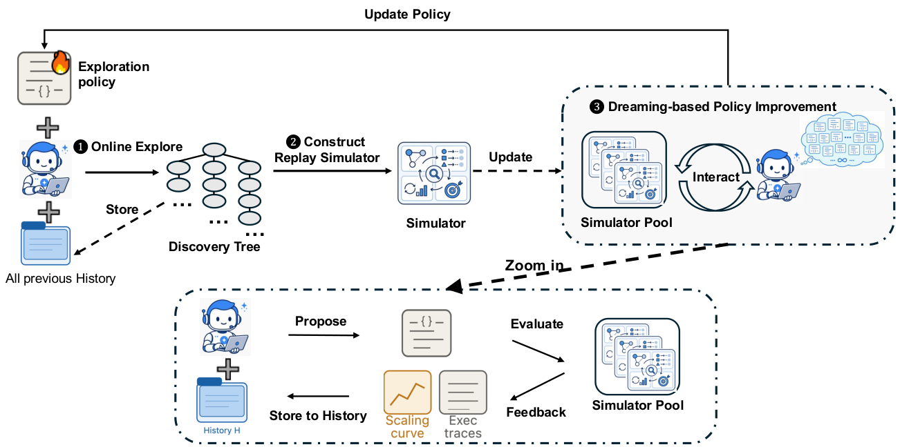
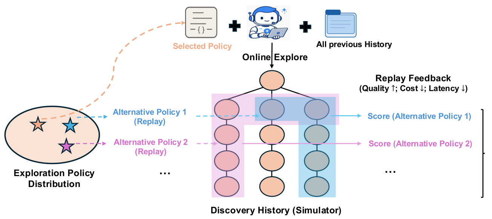

## 痛点

1. 评价一个候选程序，通常只需要运行它并检查结果。评价一个探索策略，则需要让它连续安排很多次尝试，观察最终发现了多好的方案、消耗了多少资源。一个眼前分数低的方向，可能几次修复后才出现突破；一个早期领先的方向，也可能很快停滞。
2. 策略质量的反馈比单个程序的反馈更延迟。每修改一次控制器都重新跑完整在线发现，会反复支付模型调用、代码执行和评价的成本。与此同时，探索策略的空间很大：分支选择、停止规则、并行批次和失败处理都可以组合变化。这是引言提出的两个瓶颈：**反馈昂贵而延迟，候选元策略又很多**
3. 固定探索策略的优点是简单、稳定；局限是它不能根据积累的发现经验改变跨轮的搜索习惯。Dream-RSI 的切入点，是降低比较探索策略的代价，而不是直接为某个领域设计一个更强的固定启发式。

## Dream-RSI 过程

### 0. Dream-RSI

分为在线工作和离线规划这两个过程，Dream-RSI 交替进行：

> 在线探索 → 保存发现树 → 离线评价和修改策略 → 选择策略上线 → 新一轮在线探索。

### 1. 在线探索

首先设置一个初始的工作环境，这个工作环境称为根节点 $r$，每个非根节点均记录 "父节点及之前的上下文、工作空间快照、评价诊断和评分"。设 $t$ 是在线—离线的外层循环编号，$\pi_t$ 是第 $t$ 轮在线使用的可执行调度策略代码。通过调度程序 $\pi_t$  选择当前探索树的叶节点或者是根节点，即延续所选节点的工作或者是开启新方法，由 coding agent 或专门负责解决这个任务的 agent 来完成节点的延续，完成后的节点保存上下文和评分，成为新的叶节点。停止条件：

1. 达到最大的在线调度轮数（一个并行批次计一轮，不等于一次尝试）；
2. 调度策略选择不继续进行；

### 2. 离线规划

由 1 的工作，我们得到这一轮的探索树 $\mathcal T_t$（下文简称 $\mathcal T$），明显地，$\mathcal T$ 是由若干条链组成的，因为上个阶段只允许在叶节点延续工作，不会从普通节点产生新分支（根节点除外）。离线先评价当前的策略 $\pi_t$，再评价其修改版本。模拟器持有完整树，但每次回放从根节点开始，只向策略逐步揭示已访问的节点，策略根据已揭示的信息来选择下一步的工作空间。设策略版本 $m$ 在第 $i$ 棵树上回放 $k$ 轮后为 $\mathcal T_i^{m,k}$，则有 $\mathcal T_i^{m,k}\subseteq\mathcal T_i$；一次回放期间策略代码不变。假设 A1 是最早创建的根节点子节点，可以这样回放：

| 轮次    | 策略选择的起点 | 模拟器返回      |
| ----- | ------- | ---------- |
| 第 1 轮 | 根节点 $r$ | 已保存的 A1    |
| 第 2 轮 | 根节点 $r$ | 已保存的 B1    |
| 第 3 轮 | A1、B1   | 已保存的 A2、B2 |
| 接下来   | 返回空批次   | 停止，不揭示 A3  |

这条策略没有创造新实验，只是形成了一条新的调度轨迹:

- **选当前已揭示树中的非根叶节点**：返回它已有的下一节点；
- **选根节点**：按创建先后，打开下一条尚未揭示的分支；
- **没有已记录后继**：不返回新节点

回放在策略返回空批次、达到最大回放调度轮数，或整棵历史树全部揭示时结束。一次回放结束后，通过公式计算得分：

$$
V=\underbrace{\max_{v\in\mathcal T_{\mathrm{revealed}}}s_v}_{\text{最佳发现质量}}
-\underbrace{\beta_1N}_{\text{总尝试量惩罚}}
+\underbrace{\beta_2\frac{N}{\max\{1,k^\star\}}}_{\text{平均批量奖励}}.
$$

这里 $\mathcal T_{\mathrm{revealed}}$ 是本次回放结束时已揭示的子树，$s_v$ 是节点 $v$ 的任务评分（越大越好），$V$ 是本次回放得分。$N=|\mathcal T_{\mathrm{revealed}}|-1$ 是已揭示的非根节点数，$k^\star$ 是本次回放完成的调度轮数；$\beta_1,\beta_2\geq0$ 分别是固定的成本惩罚和并行奖励系数。$N$ 代表这条轨迹所对应的生成—评价请求数；回放本身并没有重新执行这些请求。第一项看本次已揭示节点中的最高质量，不对所有分数求平均，也不计入未揭示节点。第二项鼓励节约尝试。第三项偏好把工作放进较少的决策轮，也就是奖励并行度的一个代理指标；分母取 $\max\{1,k^\star\}$ 是为了避免除以零。

为减少对单次探索经验的依赖，增加多样性，我们在第 $t$ 轮 RSI 中，让每个策略版本分别回放已积累的 $t$ 棵历史树，取

$$
V^m=\frac{1}{t}\sum_{i=1}^{t}V_i^m.
$$

其中 $m$ 是策略版本编号，$i$ 是历史树编号，$V_i^m$ 是同一个版本 $m$ 在第 $i$ 棵树上的回放得分，$V^m$ 是其平均分，不是各轮旧策略当年的分数平均。多树评价不保证消除历史过拟合。

### 3. 选择策略上线

每个版本在全部历史树上完成离线测评后，交给策略开发 Agent 根据回放轨迹、得分和此前反馈修改调度策略代码，得到下一版本，而不是直接修改轨迹。达到规定的版本数后，从全部已测版本（含原策略）中选平均分最高者，作为下一轮在线策略；只保证固定历史上的平均回放分不低于原策略，不保证在线表现一定提升。

### 4. 离线评价的作用

离线阶段的价值不是在旧记录里创造新发现，而是**低成本比较不同调度程序**。

不同策略可能在同一历史树上：

- 用更少尝试找到相同质量的结果；
- 避免过早停止，从而访问到更好的结果；
- 把有价值的尝试组织成并行批次；

没有回放时，比较每个策略版本通常需要重新进行真实探索；有回放后，可以先利用已有结果筛选策略，再把有希望的版本部署到在线环境。

## RSI 的不足

1. 具有局限性：不同的任务所需的评价方法不同，需要针对数据集或者任务场景针对性设计。它并没有因此获得任意增加能力、修改评价标准、改变任务接口的自由。更重要的是，它的调度程序在运行过程中是固定的，也就意味着它不适合通用的场景，缺少统一策略的跨场景泛化。
2. 只能选择叶节点或根节点，整个树是若干条链组成的，**可以在某个父节点后开辟新的子节点，但具体有待商讨**（这里指从已有后继的中间节点重新分叉，是扩展设想，不是文中已支持的操作）。
3. 需要适合保存、分支和重复尝试的状态，代码工作空间比较容易保存和恢复。但发送邮件、修改共享系统、与他人交互等行为，可能影响真实外部环境，不能像代码快照一样随意恢复。把这类任务组织成独立、可回放的探索分支，需要额外设计。
4. 历史回放的有效性有限。回放只提供已经发生过的结果。如果换了任务、用户目标或环境，旧结果可能不再具有同样的意义。所以，它更适合“能够反复试验和比较候选解”的发现问题，而不是已经覆盖了所有通用智能体任务。
5. 文中未单独定义"若当前任务已经完成之后，该分支就停止"的分支终止规则；若后续调度程序仍然在已完成的叶节点上继续，且没有提高最佳分数，会增加尝试成本，降低 $V$。
6. 在全部历史树上取平均，可以减少对单棵树的依赖，但这些历史同时参与策略开发，因此仍可能过拟合。

## 总结

Dream-RSI 具有可跨领域复用的元探索框架，但现有验证主要集中于可重复生成候选、可自动评价、可保存探索状态的发现任务。其应用依赖任务特定的评分与执行接口，尚未充分证明单一调度策略对异质任务和变化用户需求的泛化能力。它能自动改进预设接口内的调度规则，但不能自动解决目标定义、状态可回放性和跨场景适配问题。

论文：[Dream-RSI: Recursive Self-Improvement through Evolving Worlds](https://arxiv.org/abs/2609.14858v1)。
